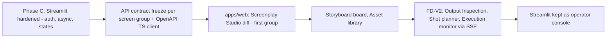

# ADR-002 — Frontend Strategy: Streamlit Alpha Surface vs React/Next.js Production Workspace

**Doc ID:** ADR-002 · **Version:** 1.0-draft · **Date:** 2026-11-05 · **Status:** Phase B design — pending approval
**Inputs:** Master Prompt §18 (frontend decision), §25 (workspace groups) · `docs/audit/04` · `docs/audit/10` CON-01, CON-04, DEC-009 · ADR-001 · `apps/ui/*`

**Product:** Tattva AI Film Director
**Decision ID:** ADR-002
**Version:** 1.0-draft
**Status:** **ACCEPTED (2026-11-06), with an amended outcome. See "Decision (approved)" below.**
**Date:** 5 November 2026
**Supersedes:** nothing. **Amends:** the ADR-001 "UI: Streamlit" row, if approved.

## Decision (approved 2026-11-06 by the product owner)

The product owner overrode the "Streamlit for V1" recommendation:

- **React replaces Streamlit for FD-V1 and onward.** The product is built as a final-grade production workspace, not a prototype.
- **Stack:**
  - Vite + React 18 + TypeScript (strict), React Router and TanStack Query.
  - A typed API client generated from FastAPI OpenAPI.
  - Design tokens from Guided Workspace Wireframe v1.1 as CSS custom properties.
  - Vitest + Testing Library for component tests; Playwright for E2E.
- **Next.js is not used.** The FastAPI backend is the only server, SEO and SSR are irrelevant for an authenticated workspace, and a static SPA is the simplest to deploy behind the same L7 load balancer and CDN.
- **Location:** `apps/web/`.
- **Retiring Streamlit:**
  1. `apps/ui` (Streamlit) is frozen from today.
  2. It is deleted, with `tests/unit/test_ui_smoke.py` and the `streamlit` dependency, once `apps/web` reaches parity for the existing flows (assets, G-01…G-04 runs, approval review, film bible, audit). Parity is verified by Playwright E2E.
  3. Deletion happens in the same milestone, not later.

---

## Context

ADR-001 selected Streamlit for the UI, which overrode PRD v0.9's Next.js recommendation (CON-01). The Master Prompt (§18) requires that the choice be re-assessed against the full product and **not** replaced automatically.

**Current UI** (`apps/ui`, audit `04`):
- 8 Streamlit views behind a sidebar radio.
- All API access goes through `TattvaApiClient` (`apps/ui/api_client.py`). The UI has **no direct DB access**, which makes the API the only contract and makes any frontend swap feasible.
- The UI never sends an actor, so it relies on the dev fallback identity (SEC-02). It cannot run against staging.
- Every workflow trigger is `sync_execution=True`, so the UI blocks for the whole run.
- Test coverage is `tests/unit/test_ui_smoke.py` (render against a fake API) only.

**Target scope:** the IA defines 44 screens and the Master Prompt §25 lists 22+ workspace groups. Several of them need interaction patterns Streamlit handles badly.

## Requirements assessment (Master Prompt §18)

| Requirement | Needed by | Streamlit | React/Next.js | Weight |
|---|---|---|---|---|
| Script editor with redline/diff between screenplay versions | Screenplay Studio (TFD-SCR-006/007, TFD-SCR-012) | Poor: needs a custom component | Good (Monaco/CodeMirror diff, ProseMirror) | High (FD-V1) |
| Storyboard board, drag-and-drop panel ↔ scene mapping | Storyboard Studio (TFD-SB-001, TFD-SB-003) | Poor: custom component | Good (dnd-kit) | High (FD-V1) |
| Visual asset library, grid with filters and lazy thumbnails | Asset Library (TFD-AST-001, TFD-LIB-001) | Moderate: `st.image` grids reload on every rerun | Good: virtualised grid | Medium |
| Character / Environment / Cinematography studios (structured forms with provenance badges) | TFD-CHR/ENV/CIN | Good for forms; weak for side-by-side reference compare | Good | Medium |
| Shot planner and timeline | TFD-SEQ/SHT | Poor | Good (custom canvas or a timeline library) | High (FD-V2) |
| Media preview: video scrub, A/B compare, frame overlay against the performance reference | Output Inspection (TFD-OUT-002, TFD-OUT-003) | Weak: `st.video` is basic | Good (HTML5 video + canvas, frame-accurate seeking via proxies) | High (FD-V2) |
| Multi-user collaboration and realtime job status | Execution Monitor, approval tray | Poor: rerun model, no push channel | Good: SSE (capacity plan §1) | High |
| Complex navigation and deep links (link to a shot, a finding, an approval) | All | Weak | Good (file-based routing) | Medium |
| Responsive behaviour | Review on a laptop or tablet on set | Moderate | Good | Medium |
| Accessibility (WCAG 2.2 AA, NFR-A11Y-01) | All | Limited control over semantics | Achievable with discipline and axe-core tests | Medium |
| Forms, tables, review trays, admin dashboards | Alpha intelligence workflows | **Good** (today's strength) | Good | — |

## Options

| Option | Description |
|---|---|
| A | Streamlit for everything, extended with custom components |
| B | **Streamlit as the FD-V1 internal alpha / control surface; React/Next.js (TypeScript) production workspace built against the same API, starting before the FD-V2 UX freeze** |
| C | Immediate full migration to React/Next.js |

## Trade-offs

| Dimension | A: Streamlit + components | B: Hybrid, staged | C: Migrate now |
|---|---|---|---|
| Product fit | Each high-weight requirement needs a bespoke React component wrapped in Streamlit. That means two stacks anyway, without the routing or state benefits | Alpha needs (forms, review) fit Streamlit; the production workspace gets a fit-for-purpose stack | Best long-term fit |
| Development cost | Low at first; rises steeply with each custom component (bidirectional component bridge, rerun-state bugs) | Moderate: keeps the 8 working views; web app built incrementally, screen group by screen group | High upfront; pauses FD-V1 intelligence delivery |
| Migration risk | Low now, high later (ends up rewritten) | Low: the API is already the only contract; both UIs can run side by side | Medium-high: rewrites working screens while auth and async (P0) are also changing |
| Performance | Full-script rerun on every interaction; media-heavy screens re-render | Web app: client-side state, virtualised lists, SSE | Same as B for the web app |
| Future capabilities (collaboration, realtime, timeline) | Capped | Unblocked | Unblocked |
| API reuse | 100 % | 100 %: both consume `/api/v1`; a generated TS client from OpenAPI | 100 % |
| Team skills | Python only | Adds TypeScript to the team; the Python team stays on API/workflows | Same as B |
| Ops | 1 UI image | 2 UI images during overlap | 1 UI image |

## Decision (proposed)

**Option B.**

1. **Streamlit remains the FD-V1 internal alpha and operator control surface** (`apps/ui`). It is fixed for the defects that apply regardless of framework (audit `04` §4):
   - send an auth token (ADR-003)
   - async runs with a status tray polling `GET /workflow-runs/{id}`
   - structured rendering of WF-01 results instead of raw JSON
   - explicit loading / empty / error / recovery states
   - generator-mode labels
2. **A React/Next.js + TypeScript production workspace** (`apps/web`) is started when FD-V1 API contracts for the screenplay lock and storyboard mapping stabilise, and is **required before the FD-V2 UX freeze**. It is built screen group by screen group, prioritised by the "Poor" rows above: Screenplay Studio diff → Storyboard board → Output Inspection compare → Shot planner/timeline.
3. **No backend logic in either UI.** All business rules, authZ, approvals and consent live in services behind `/api/v1` (ADR-001 invariants 2 and 5).
4. Streamlit is **not** removed when the web app reaches parity. It stays as an internal admin/operator console unless a later ADR retires it.

## Migration strategy

- **Strangler pattern by screen group.** Navigation in each UI links to the other for screens not yet migrated, using deep links with `project_id`.
- **Contract-first.** Each migrated group requires: OpenAPI schemas complete for its routes; cursor pagination; SSE events defined; Playwright journeys (Testing §11) re-pointed to the web app.
- **Auth.** OIDC authorization code + PKCE in the web app. Streamlit uses the same IdP. Both send bearer tokens (ADR-003).
- **Exit criteria per group:** feature parity checklist, Playwright journeys green, axe-core 0 serious violations, p95 interaction latency measured.

## Consequences

- Positive: FD-V1 delivery isn't paused; the high-weight FD-V2 interactions get a suitable stack; the API becomes the hardened contract, which also serves future integrations.
- Negative: two UI codebases during the overlap; adds a TypeScript build, lint and test pipeline to CI; the team needs frontend capacity (**cost:** at least one frontend engineer from the start of step 2).
- ADR-001's "UI = Streamlit" row becomes "Streamlit = alpha/operator surface; production workspace per ADR-002" once approved. PRD v1.0 and IA reflect this.
- **Not approved yet:** no `apps/web` code is written before gate #2.

## Links
DEC-009 · CON-01 · CON-04 · ADR-003 (auth) · NFR-A11Y-01/02 · `SCALABILITY_PERFORMANCE_CAPACITY_PLAN.md` §1 (SSE)
