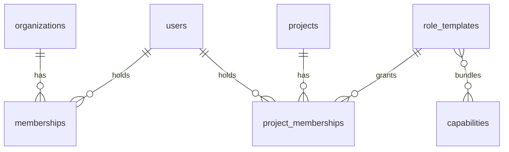

# ADR-003 — Authentication and Authorization

**Doc ID:** ADR-003 · **Version:** 1.0-draft · **Date:** 2026-11-05 · **Status:** Phase B design — pending approval
**Inputs:** Master Prompt §5 (management authority), §6.5, §21 · `docs/audit/03` §3–§5, `08` SEC-01/02/03/04/08 · `apps/api/dependencies.py::get_actor` · `packages/services/identity.py::IdentityService.resolve` · `packages/persistence/repositories.py::UserRepository.get_or_create_default_actor` · DEC-002

**Product:** Tattva AI Film Director
**Decision ID:** ADR-003
**Version:** 1.0-draft
**Status:** Proposed (approval gate #1, DEC-002)
**Date:** 5 November 2026

## Context

- **Identity today:** the `X-Actor-ID` header names a user UUID. Possession of the UUID is full impersonation (SEC-01). When the header is missing and `environment ∈ {development, test}`, which is the default, `get_or_create_default_actor()` binds to `default-studio` **or the first organization** (SEC-02).
- **Positive properties to keep:**
  - `org_id` is derived from the DB user, never from the request.
  - Scoped repositories return 404 to avoid an existence oracle.
- **Authorization:** none. `users.role` is stored and never read (SEC-03). Any org member can approve anything, and any member sees every project.
- The Master Prompt requires:
  - management authority over the locked screenplay (§5)
  - consent-gated access to likeness data (§6.5)
  - server-side authorization on every external execution (§21)

## Decision (proposed)

### 1. Authentication
- An **OIDC identity provider** behind an `AuthProvider` port (`packages/services/auth.py`). The vendor is DEC-002; the code is vendor-neutral.
- The API verifies a **JWT access token** on every request: signature via cached JWKS (refreshed on `kid` miss), `iss`, `aud`, `exp`/`nbf` (60 s leeway), and required claims `sub` and `email_verified`.
- `get_actor` maps `(iss, sub)` to `users` through new columns `users.idp_issuer` and `users.idp_subject` (unique pair; expand migration). Existing users are linked at first login by verified email, under an admin-approved invite.
- **Organization selection:** the header `X-Org-ID` is accepted only as a *selector*, verified against `memberships`. With no header, the user's single org is used; if the user has several orgs, the request fails with 400. This keeps the DB-derived org principle (CODE-02).
- **Header identity** (`X-Actor-ID`) is accepted **only** when `environment == "test"`. The dev fallback requires `environment == "development"` **and** `ALLOW_DEV_IDENTITY_FALLBACK=true`, and binds only to `slug='default-studio'`. The `.first()` branch is removed (DevOps §8).
- UI: Streamlit and the future web app use authorization code + PKCE, and send `Authorization: Bearer`.
- Service-to-service: workers act **as the run's actor** for authorization re-checks (`workflow_runs.actor_id`) plus a `system` principal for maintenance tasks. No worker endpoint is exposed.

### 2. Authorization model

- `memberships(user_id, organization_id, org_role ∈ {owner, admin, member}, status)`.
- `project_memberships(user_id, project_id, role_template_id)`.
- `role_templates` (seeded per org, editable by owner/admin) → `capabilities`.
- Initial templates: `management`, `director`, `producer`, `crew_editor`, `reviewer`, `viewer`, plus the org `owner` with every capability.
- **Capabilities (initial list):** `project.create`, `project.read`, `project.admin`, `asset.upload`, `workflow.run`, `canon.propose`, `approval.creative`, `screenplay.approve_lock`, `cost.approve`, `consent.manage`, `likeness.view`, `voice.view`, `audit.read`, `provider.connect`, `provider.submit`, `package.export`, `budget.manage`.
- Enforcement is in **services**, not routers: `authz.require(actor, capability, project_id)` is called at the start of every command and every C4 read. Routers stay thin (the current layering, audit `03` §1).
- **Approval levels:** `approval_requests` is generalized with `approval_level ∈ {creative, management, cost, consent}` and `required_capability`. `decide()` checks the decider's capability **and** that the decider is not the requester for `management` and `cost` (four-eyes).
- **Management authority:** only `screenplay.approve_lock` can move a `screenplay_versions` row to `approved_locked` (ADR-004).
- **Consent:** `consent.manage` records consent. `likeness.view` / `voice.view` gate C4 reads (ADR-006).
- **Tenant scoping:** every repository getter for tenant data takes `(id, project_id, org_id)` (SEC-04). Foreign IDs in bodies are validated against the path project.
- **Unknown approval scope → 422** with an explicit dispatch table (SEC-08).

The negative authZ matrix in `TESTING_AND_QA_STRATEGY.md` §5 is generated from the same capability table (`packages/domain/capabilities.py`).

### 3. Compatibility and migration
1. **Expand:** add `memberships`, `project_memberships`, `role_templates`, `capabilities`; add `users.idp_issuer` / `users.idp_subject`.
2. **Backfill:** each existing `users` row → a `memberships` row (`org_role`: map the existing `users.role`, where `creator` → `member`). Each existing (org member × project) → a `project_memberships` row with the `director` template. This preserves today's "every member sees every project" behaviour, so no user loses access on upgrade.
3. **Switch:** turn on `authz.require` checks behind `FF_RBAC_ENFORCE`; shadow mode first (log denials without blocking) for one release.
4. **Contract:** `users.role` stays (unused) until a later release; it is not dropped in this ADR.

## Consequences

- Closes SEC-01/02/03/04/08 once complete. Unblocks staging (the UI can run against a real API).
- Adds a dependency on an external IdP (availability, cost). Mitigation: JWKS caching tolerates short IdP outages for already-issued tokens.
- Every test needs a token. The test JWKS fixture (Testing §6) handles this; the existing `X-Actor-ID` tests keep working in `environment=test`.
- **OPEN — DEC-002:** IdP vendor. **OPEN:** whether SSO/SAML is a pilot requirement (product).

## Links
DEC-002 · SEC-01, SEC-02, SEC-03, SEC-04, SEC-08 · ADR-004 · ADR-006 · NFR-SEC-01..03
