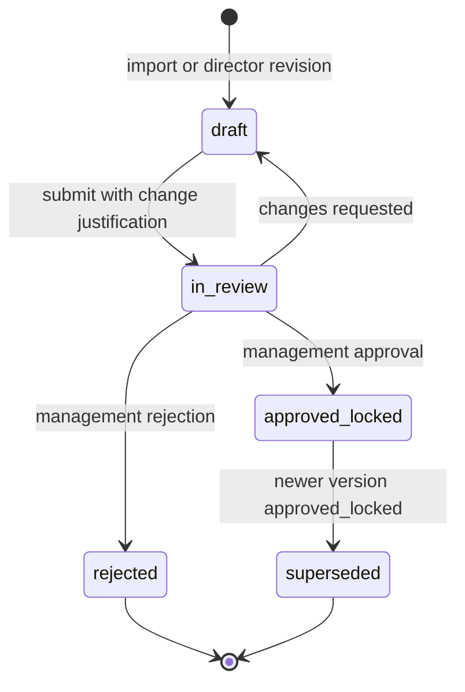

# ADR-004 — Artifact Versioning and Screenplay Lock

**Doc ID:** ADR-004 · **Version:** 1.0-draft · **Date:** 2026-11-05 · **Status:** Phase B design — pending approval
**Inputs:** Master Prompt §5 (management-locked screenplay, three workflows), §11 (continuity status), §24 · `docs/audit/02` V1-05/V1-06/V1-29, `03` §7, `05` §2 · `packages/persistence/models.py` (`ProjectModel.current_version`, `ProjectVersionModel`, `AssetModel`) · `packages/domain/invariants.py::assert_expected_version` · `packages/services/script_review.py`

**Product:** Tattva AI Film Director
**Decision ID:** ADR-004
**Version:** 1.0-draft
**Status:** Proposed
**Date:** 5 November 2026

## Context

**Current state:**
- A screenplay is just an `assets` row (`asset_type="script"`). There is no lock, no screenplay version entity, and no record of which version is approved for production (V1-05 NOT_IMPL).
- Project versioning is a single integer `projects.current_version` plus `project_versions` rows with an opaque `snapshot_data` JSON.
- G-01..G-04 capture `expected_project_version` at start and check it at commit (`assert_expected_version`). That part is good.
- Only `script_review.py` locks the project row when bumping the version. Research, storyboard and film-bible reviews bump without a lock, and there is no unique `(project_id, version_number)` (PERF-06).
- `branch_name` exists but is always `main`; the UI hardcodes "Branch: main".

**Requirements (Master Prompt §5, product decisions, not open questions):**
- The approved screenplay is locked, and management holds authority over it.
- Three workflows:
  1. Original production (locked)
  2. AI suggestions in a **separate Suggestions Workspace** that never alters the approved screenplay
  3. Director-led revisions: revision → comparison → justification → management review → approve/reject → new locked version
- The system always knows which screenplay version is approved for production.
- Every shot and sequence records its source screenplay version.
- An approved revision triggers impact analysis. There is **no automatic propagation** into approved production assets.

## Decision (proposed)

### 1. Two levels of versioning
1. **Project version (kept).** `projects.current_version` + `project_versions` remain the project-wide commit log. Every canonical commit, from any workflow, bumps it under a **project row lock**. A unique constraint on `(project_id, version_number)` is added after a dedupe check. `project_versions` gains typed references (`changed_artifacts` JSONB list of `{type, id, version}`) next to `snapshot_data`, which stays readable.
2. **Artifact versions (new, per governed artifact type).** Each governed artifact has its own immutable version rows: `screenplay_versions`, `character_versions`, `avatar_versions`, `prompt_versions` and others (named in the brief's canonical entity list; DB design owns columns). Common shape:
   - `version_number` (unique per parent)
   - `status`
   - `parent_version_id`
   - `created_by`, `approved_by`, `approved_at`
   - `content_ref` (asset or JSONB)
   - `project_version_at_approval`

   Approved versions are **immutable**: an edit creates a new version.

### 2. Screenplay version state machine

- Statuses: `draft | in_review | approved_locked | superseded | rejected`.
- **Exactly one** version per project has `is_production_canonical = true`. This is enforced by a partial unique index `(project_id) WHERE is_production_canonical`. The flag and status change, and the old version's move to `superseded`, happen in one transaction under the project row lock.
- `approved_locked` requires an `approval_requests` row with `approval_level=management`, decided by an `screenplay.approve_lock` holder who is not the submitter (ADR-003).
- An `approved_locked` version's content can never change. The DB enforces this with a trigger rejecting UPDATE of content columns, and the services do not expose such an operation.
- `screenplay_changes` stores the computed diff (scene, dialogue and action granularity) between the parent and the new version, plus the director's justification.
- `screenplay_suggestions` (Suggestions Workspace) reference a base version and **never** write to `screenplay_versions`. Accepting a suggestion means a director copies it into a new `draft` revision (workflow 3).

### 3. Lineage to downstream artifacts
- `scenes` gains `screenplay_version_id` (expand; backfill: create one `screenplay_versions` row per existing script asset that has committed scenes, status `approved_locked`, marked `migrated_legacy` in `provenance`, and point its scenes at it). New `sequences` and `shots` carry `screenplay_version_id` from creation (required).
- **Impact analysis** (`impact_analyses`) runs as an outbox task when a new version is locked. Using `screenplay_changes`, it marks affected scenes, characters, sequences, shots, packages and assets as `review_required` (the continuity status vocabulary). It never edits them. Each affected item needs a human disposition: `keep`, `revise` or `intentional_variation`.

### 4. Locking and concurrency rules (all artifacts)
1. Version bump = `SELECT … FROM projects WHERE id=:pid FOR UPDATE` → increment → insert version row → commit. Fix the three unlocked call sites (`research_review.py:170`, `storyboard_review.py:151`, `film_bible_review.py:158`).
2. Mutations of governed artifacts carry `expected_version` (an HTTP `If-Match` header or a body field); a mismatch returns 409 (already the pattern via `assert_expected_version`).
3. Graph commits re-check `expected_project_version` **and**, for screenplay-derived work, that the run's `screenplay_version_id` is still canonical. If it is not, the candidates are kept but committed as `stale` for review instead of canonical.

### 5. Branches
`branch_name` stays `main` in FD-V1. Branching is not implemented. The UI stops hardcoding the label and displays the field instead.

## Consequences

- Delivers TFD-SCR-001..010 and TFD-VER-001..005 foundations and fixes PERF-06.
- Additive only: current scripts, scenes and versions remain valid through the legacy backfill.
- WF-01 changes from "parse an asset" to "parse a `screenplay_versions` row". Its route keeps accepting `asset_id`; when the asset has no version, a `draft` version is created implicitly (compatible contract).
- Impact analysis quality depends on diff granularity; the first version is scene-level and deterministic.

## Links
Master Prompt §5 (requirement, no DEC) · PERF-06 · CODE-07 / SEC-06 · ADR-003 (management authority) · DEC-010 (G-04 fix uses the locked bump)
