# ADR-005 — Provider Registry and Manual-First Execution

**Doc ID:** ADR-005 · **Version:** 1.0-draft · **Date:** 2026-11-05 · **Status:** Phase B design — pending approval
**Inputs:** Master Prompt §12.1–§12.4, §14, §21 · `docs/audit/07` · Gap Report FD-FR-033/035–039/051–059 · `packages/core/config.py` (`higgsfield_integration_mode: Literal["manual_export"]`, `model_gateway_provider: Literal["mock"]`) · DEC-004, DEC-006, DEC-013

**Product:** Tattva AI Film Director
**Decision ID:** ADR-005
**Version:** 1.0-draft
**Status:** Proposed
**Date:** 5 November 2026

## Context

- No code path calls any external service (audit `07` §1). Higgsfield exists only as configuration intent. All 14 candidate providers are **UNVERIFIED**.
- Product decisions (Master Prompt §12):
  - Tattva **never generates media itself**.
  - **Manual execution is a permanent capability**, not a fallback to be removed later.
  - Connected execution is only for providers that officially support it.
  - Internal Shot and Character Specifications must not be tied to any provider's payload.
  - Paid or irreversible execution always requires explicit authorization.
- Positions carried from the Gap Report:
  - Midjourney: manual only (its terms prohibit automation).
  - Higgsfield: API and MCP are separate contracts.

## Decision (proposed)

### 1. Registry
- `providers`: identity, category, official URL.
- `provider_capability_snapshots`: **immutable, versioned** records with every Master Prompt §12.3 field (model ID/version, task category, modalities, reference/consistency/motion/performance/camera-parameter support, resolution and duration limits, audio, cost model, execution modes, auth method, provider schema version), plus `verification_status ∈ {unverified, verified, drifted, withdrawn}`, `verified_at`, `verified_by`, `source_urls`, `terms_summary` (commercial use, data retention, training use, region, deletion process).
- Only **verified** snapshots can be selected for connected execution. Unverified snapshots support manual mode only.
- Snapshots are curated by people (an admin UI and a reviewed seed file). Tattva does **not** scrape provider sites, and does not invent fields: unknown means null plus `unverified`.

### 2. Execution modes
`execution_mode ∈ {manual, connected_api, connected_mcp}` per `generation_jobs` row (FD-FR-051). `manual` is available for **every** capability regardless of connection status. The UI never hides it.

### 3. Adapter port

```python
class ProviderAdapter(Protocol):            # packages/integrations/base.py (target)
    provider_id: str; execution_mode: ExecutionMode
    def validate(self, spec: ShotSpec, snapshot: CapabilitySnapshot) -> ValidationReport: ...
    def compile(self, spec: ShotSpec, ctx: ContextPackageRef, snapshot) -> ProviderPayload: ...
    def estimate(self, payload, snapshot) -> CostEstimate: ...          # amount may be None
    def submit(self, payload, idempotency_key: str) -> SubmitResult: ... # connected only
    def poll(self, external_job_id: str) -> JobStatus: ...
    def fetch_result(self, ref) -> ImportedArtifactStream: ...         # via SafeFetcher
    def normalize(self, raw) -> NormalizedResult: ...
```

- `ManualAdapter` implements `validate`, `compile` and `estimate` (estimate is null); the rest of its lifecycle is a human export → import.
- `MockProviderAdapter` exists for tests and demos only, is labelled `generator_mode="mock"`, and is blocked in production unless `ALLOW_MOCK_PROVIDERS` is set.
- API and MCP for the same provider are **separate adapters** with separately verified snapshots.
- No adapter is written until its snapshot is verified (DEC-013 for the first one).

### 4. Pipeline (connected and manual share the front half)

```mermaid
flowchart LR
  SS["Shot Spec - provider neutral"] --> CR["Context Resolver - hashed package"]
  CR --> CG["Consent gate - ADR-006"]
  CG --> PC["Prompt compiler - per snapshot"]
  PC --> PKG["production_packages - immutable, checksummed manifest"]
  PKG --> MODE{"execution_mode"}
  MODE -- manual --> EXP["Export: copy prompt, download refs, manifest"]
  EXP --> USR["User runs external tool"]
  USR --> IMP["import_jobs: upload result, validate, map to shot"]
  MODE -- connected --> APR["Cost approval + budget gate"]
  APR --> SUB["Provider worker: re-check authZ and consent, submit with idempotency key"]
  SUB --> TRK["generation_attempts: poll or verified webhook"]
  TRK --> IMP
  IMP --> OR["output_reviews: inspect, approve, revise"]
```



### 5. Safety rules
1. **Authorization is re-checked at submit time** in the worker (actor still has `provider.submit`, project not archived, consent still active), not only when the job is queued (Master Prompt §21).
2. **Idempotency.** Each attempt has `idempotency_key = hash(package_id, attempt_no)`. On timeout the attempt goes to `outcome_unknown` and **must be reconciled** (poll by key or client reference, where the provider supports it) **before** any retry (FD-FR-056). If reconciliation is impossible, a human decides whether to retry.
3. **Outputs are new immutable assets** linked to package, attempt and shot (`asset_lineage`). They never overwrite (FD-FR-057).
4. **Webhooks** only for providers with a documented signature scheme; verify-by-pull (Threat model §3.4).
5. **Downloads** of results only through `SafeFetcher` with the snapshot's host allowlist (Threat model §3.3).
6. **Provider outage:** the connected adapter is marked `degraded`; new jobs default to manual mode; in-flight attempts keep reconciling (runbook).

## Consequences

- The manual loop (TFD-PKG-001/002, TFD-INT-001, TFD-INT-004, TFD-OUT-001) is FD-V1 and exercises the whole provenance chain without any provider.
- Connected execution (TFD-INT-002, TFD-GEN-*) in FD-V2 reuses the same packages and imports.
- Verification is ongoing operational work: snapshots drift, and the nightly live contract run flags `drifted` (Testing §9).
- **OPEN — DEC-006** (Higgsfield mode) · **OPEN — DEC-013** (first connected pilot) · **OPEN — DEC-004** (LLM provider behind ModelGateway, which is a separate port from this one).

## Links
DEC-004 · DEC-006 · DEC-013 · ADR-006 · ADR-007 (provider pool) · `COST_AND_CAPACITY_MODEL.md` §4
