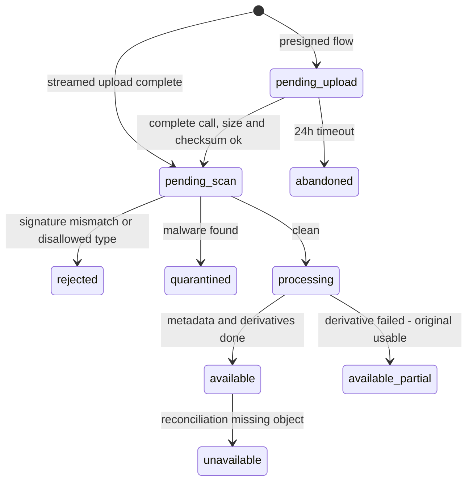

# ADR-008 — Object Storage and Media Pipeline

**Doc ID:** ADR-008 · **Version:** 1.0-draft · **Date:** 2026-11-05 · **Status:** Phase B design — pending approval
**Inputs:** Master Prompt §20.5, §21 · `docs/audit/03` §6, `08` SEC-05/PERF-03 · `packages/storage/service.py` (`StorageService`, `LocalFileSystemStorageService`), `packages/storage/factory.py` · `apps/api/routers/assets.py` · `packages/persistence/models.py::AssetModel` · DEC-003, DEC-018, DEC-022

**Product:** Tattva AI Film Director
**Decision ID:** ADR-008
**Version:** 1.0-draft
**Status:** Proposed (approval gate #5 for the vendor, DEC-003)
**Date:** 5 November 2026

## Context

**Keep:**
- The `StorageService` abstraction.
- Content-addressed keys `{org}/{project}/{sha256}_{safe_name}`.
- Write-once semantics.
- The path-traversal guard.

**Defects:**
- Whole-file reads in `routers/assets.py:27` and `store_stream`.
- Client-trusted MIME types; no scan or quarantine.
- PDF/DOCX decoded as UTF-8.
- `factory.get_storage` supports only `local`, which cannot be shared across replicas.
- `assets.size_bytes` is a 32-bit `Integer`.
- `assets` has no processing state and no sensitivity class.

## Decision (proposed)

### 1. Storage adapter
- Add `S3CompatibleStorageService` (S3 / R2 / MinIO; DEC-003) implementing the existing ABC.
- Extend the ABC with `put_stream(stream, key, expected_sha256=None)` (hash while streaming), `presign_put_multipart(key, parts)`, `presign_get(key, ttl)`, `head(key)` and `copy(src, dst)`.
- `LocalFileSystemStorageService` remains for development and test.
- Key layout: `orig/{org}/{project}/{sha256}_{safe_name}`, `c4/...`, `deriv/{asset_id}/{kind}/{sha256}.{ext}`, `quarantine/...`.
- Existing local keys are copied under `orig/` with checksum verification (Backup doc §3).

### 2. Asset processing states (additive `processing_state` column; existing rows backfilled as `available`)

### 3. Pipeline (media worker pool)
1. **Signature check:** libmagic on the first 8 KB against the declared type and the per-`asset_type` allowlist.
2. **Malware scan:** engine per **DEC-022**.
3. **Parsing** of documents with real PDF/DOCX parsers, with no network, page/size/decompression limits and a 60 s timeout. Replaces UTF-8 decoding in `script_review.py`.
4. **Metadata:** `ffprobe` JSON (pinned LGPL build, **DEC-018**).
5. **Derivatives:** thumbnail, 720p H.264 review proxy, waveform, contact sheet → `asset_derivatives` (content-addressed).
6. Never final rendering or mastering (V3 deferred).

### 4. Upload and download paths
- **≤ 100 MB:** streamed through the API with a 16 MB spool.
- **> 100 MB (FD-V2):** presigned multipart directly to the bucket; `complete` verifies.
- **Downloads:** 15 min presigned GET after authZ; C4 data streamed through the API with `Cache-Control: no-store`.

### 5. Schema additions (expand only)
- `processing_state`, `sensitivity_class`, `storage_provider`, `size_bytes_big BIGINT` (backfill, then switch reads; drop the old column only in a later contract release), `kind`, `retention_class`.
- New tables `asset_derivatives` and `asset_lineage`.

### 6. Lifecycle
Object lock on originals, versioning, expiry of derivatives and quarantine (capacity plan §5; Privacy doc §2).

## Consequences

- Fixes SEC-05, PERF-03 and NFR-UP-02/03. Implements TFD-AST-001/002/005/007/010 and enables FD-V2 footage ingestion (TFD-HYB-003/004) and output import (TFD-OUT-001).
- Adds the media pool image (ffmpeg, libmagic, scanner sidecar).
- The current upload route contract (`POST /projects/{pid}/assets/upload`, multipart) is unchanged. Presigned upload routes (`POST /projects/{pid}/uploads`, `POST /uploads/{id}/complete`, per `API_AND_EVENT_CONTRACTS.md`) are new and additive.

## Links
DEC-003 (gate #5) · DEC-018 · DEC-022 · SEC-05 · PERF-03 · `BACKUP_AND_DISASTER_RECOVERY.md` §3–§4 · `DATA_PRIVACY_AND_RETENTION.md`
