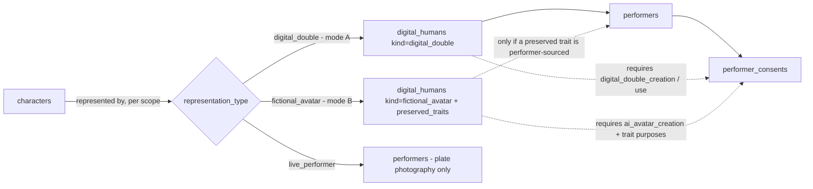
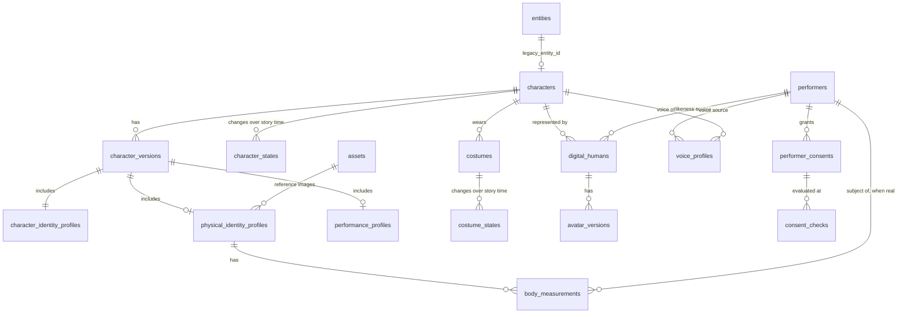
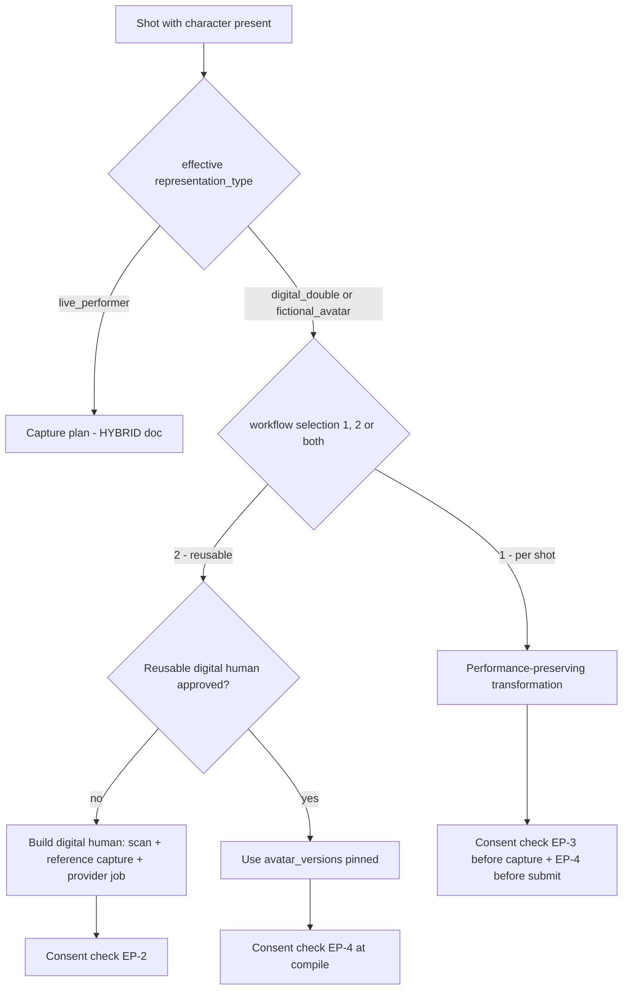
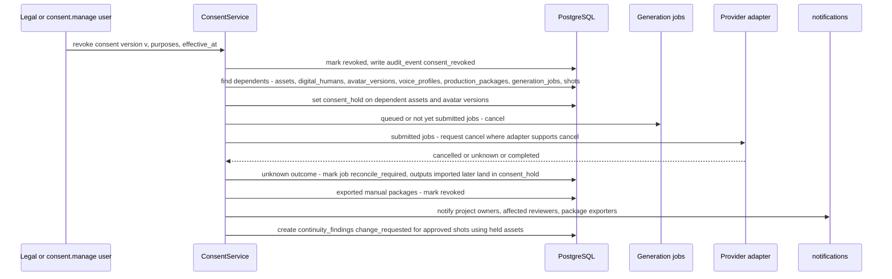

# Character and Digital Human Architecture

**Doc ID:** TFD-ARCH-CHR-001 · **Version:** 1.0-draft · **Date:** 2026-11-05 · **Status:** Phase B design — pending approval

**Inputs:** Phase A audit `docs/audit/02` (V1-10, V1-11, V1-12, V2-03, V2-07, V2-08, §3 "new capability families"), `docs/audit/10` (DEC-007, DEC-012); PHASE_B shared brief (canonical entity names); Gap Report v1.0 §9 (rights/consent as explicit metadata); code `packages/persistence/models.py::EntityModel`, `SceneModel.characters_present`, `packages/services/script_review.py`, `packages/domain/enums.py`.

> **Source note.** Field lists reconciled against the Master Prompt field digest (2026-11-05). This document covers:
> - §6.1 (all five profile groups)
> - §6.2 avatar modes A/B/C
> - §6.3 performance workflows 1/2
> - §6.4 measurements
> - §6.5 consent triggers
> - §9 voice consent
> - §11 character, physical-state and costume continuity dimensions
>
> Where this document is stricter than the source, the stricter rule stands until Legal (DEC-012) says otherwise.

---

## 1. Current state (as-built)

| Element | CURRENT evidence | Gap |
|---|---|---|
| Character | `entities` row with `category="character"`, created by WF-01 promotion (`ScriptReviewService.promote_approved`). Fields: `name`, `description`, `source_locator`, `project_version` | No identity, versions, relationships, states, appearance, performer link |
| Character presence | `scenes.characters_present` (JSON list of names, not IDs) | Name-based, so renames break links |
| Physical identity, measurements, performance | none | NOT_IMPL (V1-11) |
| Costumes / costume states | none (only mentioned in `investigator.py` fixture text) | NOT_IMPL (V1-12) |
| Performers, consent, digital humans, voice | none | NOT_IMPL; **blocking**: DEC-007 and DEC-012 must close before any likeness or voice data is stored |
| Access control | `X-Actor-ID` only; no RBAC (audit 08) | Sensitive identity references need capability-gated access, so this depends on DEC-002 |

**Hard sequencing rule:** no table in §3 that stores performer likeness, body data or voice may be migrated into a shared environment before DEC-002 (auth), DEC-007 (retention) and DEC-012 (consent template) are approved. Character tables that hold fictional and narrative data only (`characters`, `character_versions`, `character_identity_profiles`, `character_states`, `costumes`, `costume_states`) are **not** blocked.

---

## 2. Concepts

| Concept | Definition |
|---|---|
| **Character** | A story role, e.g. "ASHOKA". Fictional and narrative. Owned by the project. |
| **Performer** | A real person: actor, stand-in, stunt double, voice artist. Has legal rights over likeness, body data and voice. |
| **Representation** | How a character appears on screen in a given scope. See the types below. |
| **Mode A: identity-preserving digital double** (§6.2) | A digital representation **of a specific real performer**. It preserves the face, facial characteristics, body proportions, appearance, approved physical identity and performance characteristics. AI may transform only the environment and the *approved* costume appearance. Always requires performer consent. |
| **Mode B: fictional AI avatar** (§6.2) | Face and appearance may be redesigned within the approved spec. The director chooses which source traits to **preserve**: `body_dimensions`, `movement`, `gesture`, `performance`, `facial_expressions`, `voice_characteristics` (stored as `digital_humans.preserved_traits[]`). If any preserved trait comes from a real performer, consent for that trait's purpose is required (EP-2). Creating the avatar itself requires `ai_avatar_creation` consent when a performer is the source. |
| **Mode C: hybrid** (§6.2) | Modes A and B combined in the **same project**. The director selects per character × scope (e.g. a digital double of the anchor, fictional avatars for historical figures driven by real performers). This is a project-level combination, not a third avatar type: each `digital_humans` row is `kind=digital_double` or `kind=fictional_avatar`. |
| **Workflow 1: performance-preserving video transformation** (§6.3) | A per-shot operation (V2-07). Footage of a performer is transformed while **preserving movement, timing, gestures, facial expressions, performance intensity, screen direction and spatial positioning**. Tattva inspects the output against the original performance reference (WF-11, hybrid doc §8). The output is shot-scoped and not reusable as an identity asset. |
| **Workflow 2: reusable digital human / 3D avatar** (§6.3) | A persistent, versioned `digital_humans` asset (V2-08) reusable across scenes and episodes. Components (`avatar_versions.components`): character model, facial identity, body proportions, skeleton and rig, blendshapes (where available), motion references, approved appearance, costume variants, character-specific animation and motion assets. It has a higher consent bar: reuse scope is explicit. |
| **Workflow selection** (§6.3) | Per character × scope: workflow 1, 2, or a combination. Tattva **recommends** (WF-05, with explanation), and the director decides. No irreversible or paid step runs without explicit authorization (approval at `creative`, `consent` and `cost` levels as applicable). |



`representation_type` (`live_performer | digital_double | fictional_avatar`) is set per **character × scope**, using the same inheritance as production mode: project → sequence → scene → character → shot, where null means inherit. Mode C (hybrid) is simply a project in which different characters or scopes use different values. One character can be a live performer in scene 4, a digital double in the battle sequence, and a fictional avatar (preserving the performer's movement and expressions) for the aged epilogue.

---

## 3. Data model

Table and column ownership sits with `DATABASE_DESIGN_AND_ERD.md`. This is the domain shape it must satisfy.



`consent_checks` is the audit trail of enforcement-point evaluations (§6.3). It may be implemented as typed `audit_events` rather than a table, and the DB doc decides.

### 3.1 `characters` and `character_versions`

- `characters`: `id`, `organization_id`, `project_id`, `legacy_entity_id` (FK `entities.id`, unique, nullable), `slug`, `display_name`, `current_version_id`, `status` (continuity status enum: `candidate|review_required|approved_canon|…|superseded`).
- **Backfill (expand→backfill→switch).** For every `entities` row with `category='character'`, create a `characters` row plus `character_versions` v1 (`description` copied, `source_locator` kept as provenance). `scenes.characters_present` stays readable. A new `scene_characters(scene_id, character_id)` link is backfilled by exact-name match, with unmatched names reported as `review_required`, never guessed. WF-01 keeps writing `entities`, and the promotion service also upserts `characters`. Retiring `characters_present` is a later contract step behind a compatibility view.
- `character_versions` are **immutable**. Each has `version_number`, `parent_version_id`, `created_from` (`wf05_run_id` | `manual_edit` | `import`), `approval_request_id`, and `approved_at/by`. Edits create a new version through a proposal and approval. Shots, packages and continuity findings reference a **character version**, never just a character.

### 3.2 Character Identity Profile (`character_identity_profiles`)

Narrative and creative identity, not biometric. §6.1 "Identity" fields (verbatim) and their storage:

| §6.1 field | Storage |
|---|---|
| character ID | `characters.id` (+ `slug`) |
| name | `display_name`, aliases |
| role | `role` (protagonist, antagonist, supporting, extra, narrator, anchor) |
| biography | `biography` |
| story context | `story_context` (arc summary, screenplay locators) |
| relationships | `relationships[]` to other `characters`, typed, with evidence |
| approved identity description | `approved_identity_description` (the canonical text used by the Context Resolver) |
| age and timeline | `age_by_period[]` linked to `timeline_events` (story timeline) |
| historical context | `historical_context` with `evidence_refs` to approved research claims |

Additional fields:
- gender expression as written
- social status
- ethnicity/region **only as written in the screenplay or approved research**, with evidence ref
- personality and voice notes
- prohibited depictions (director or historical constraints)
- `evidence_refs` to screenplay locators and research claims

Every characteristic carries the provenance envelope:

```json
{"value": "late 30s", "provenance": {"source": "screenplay|research_claim|director|ai_candidate|performer_measurement|scan",
  "status": "estimated|verified|approved|disputed", "confidence": 0.7, "approved_by": "user-id|null",
  "version": 3, "evidence_refs": [{"kind": "scene", "id": "…", "locator": "p12 l4"}]}}
```

### 3.3 Physical Identity Profile and facial identity

`physical_identity_profiles` describes how the character **looks**, independent of which performer or avatar delivers it. §6.1 "Physical" fields (verbatim):
- height
- shoulder width, chest, waist, hip: values are `body_measurements` rows (§3.4), and the profile shows the current value with its status
- arm proportions, leg proportions: measurement keys plus a proportion note
- body type
- posture
- physical condition
- distinguishing body characteristics: body-location-tagged list (scars, tattoos)

Plus handedness and `reference_sets`.

**Facial identity** (§6.1 "Facial", verbatim) lives in `physical_identity_profiles.facial`. Each item is either a provenanced value or a set of approved **reference image assets** (`assets` rows with `sensitivity`, see §7):

| §6.1 facial field | Storage |
|---|---|
| face reference images | reference set role `identity_face` |
| front, side, three-quarter views | reference set roles `identity_front`, `identity_profile` (side), `identity_three_quarter` |
| facial geometry references | reference assets of role `facial_geometry` (e.g. scan meshes or photogrammetry output imported from an external tool). Stored as files. **Tattva does not compute biometric templates from them** (DEC-017) |
| skin tone | colour-chip reference asset plus a provenanced descriptive value |
| hair | colour, length, texture, style; varies by state (§3.6) |
| eyes | colour, shape note |
| facial hair | style; varies by state |
| facial marks and distinguishing features | location-tagged list |
| expression references | reference set role `expression_range` |
| approved facial identity version | `facial_identity_version` (integer) plus `approval_request_id`. Shots pin it via `character_version_id` |

Other roles: `lighting_neutral`, `age_variant:<label>`. Each reference set records which representation it belongs to (performer-derived vs fictional) and its consent basis.

**OPEN — DEC-017** (new): whether Tattva ever computes or stores **facial embeddings or biometric templates** (e.g. for automated identity-drift detection in WF-11). Recommendation: **no** in FD-V1/FD-V2. Store reference images only. Identity drift is a human review task with side-by-side comparison. If identity checks are ever automated, use a provider or on-prem model under a separate, explicit `biometric_processing` consent purpose and a DEC-007 retention rule. Biometric data carries heightened legal duties in many jurisdictions, so Legal must decide.

### 3.4 Body measurements with full provenance (`body_measurements`)

One row per measurement **observation**, never an overwritten value. This is required so that "estimated" and "verified" coexist and the history of who changed what survives.

| Field | Notes |
|---|---|
| `id`, `organization_id`, `project_id` | tenant scope |
| `subject_type`, `subject_id` | `performer` (real person) or `character_version` (design target for a fictional avatar) |
| `measurement_key` | controlled vocabulary covering at least the §6.1 physical list: `height`, `shoulder_width`, `chest_circumference`, `waist_circumference`, `hip_circumference`, `upper_arm_length`, `forearm_length`, `arm_span`, `inseam`, `outseam`, `thigh_circumference`, plus `head_circumference`, `hand_span`. Extensible via the registry; unknown keys are rejected |
| `value`, `unit` | numeric value plus SI unit; display conversion happens in the UI only |
| `status` (§6.4 "verification status") | `estimated` \| `measured` \| `verified` \| `approved` \| `superseded` \| `disputed` |
| `confidence` (§6.4 "estimation confidence") | 0–1, required for `estimated` |
| `capture_method` (§6.4 sources) | `manual_entry` (incl. tape) \| `ai_estimate_from_permitted_media` (images/video with consent) \| `external_body_scan_import` (e.g. Size Stream or calibrated scanners) \| `manual_correction` (corrects a prior row, `supersedes_id` required) \| `costume_department_record` \| `performer_self_reported` |
| `approved_by`, `approved_at` | §6.4 "approver": approval of the measurement for production use, a step separate from verification |
| `version` | monotonically increasing per `(subject, measurement_key)` |
| `capture_device_or_tool` | free text plus optional `provider_id` (e.g. a body-scan provider from the registry) |
| `source_asset_id` | scan file, measurement sheet or photo |
| `captured_at`, `captured_by` | |
| `verified_by`, `verified_at` | must be a user holding `identity.verify_measurement`; **a verifier must differ from the capturer** for `status=verified` |
| `consent_id` | FK `performer_consents`; **required** when `subject_type=performer` |
| `supersedes_id` | chain |
| `notes` | |

Rules:
- The §6.4 lifecycle is: manual entry, AI-assisted estimation or external scan import → manual correction → human verification → approval.
- AI may only create `estimated` rows with `capture_method=ai_estimate_from_permitted_media`, only from media whose consent covers `body_measurement`, and only as candidates. They are always labelled "estimated, not verified". Promotion to `verified` and `approved` is human-only.
- **A single arbitrary photo is not anthropometric ground truth** (§6.4). An estimate from one image is capped at `confidence ≤ 0.5` and can never be `verified` without a `measured` or `external_body_scan_import` observation.
- The "current value" is a view: the latest `verified`, else the latest `measured`, else the latest `estimated`, labelled with its status everywhere it is shown, including in compiled packages.
- Measurements derived from a performer are personal data. Retention follows DEC-007, and revocation behaviour follows §6.4.

### 3.5 Performance profile (`performance_profiles`)

§6.1 "Performance" fields (verbatim), each provenanced:
- walking style
- running style
- gestures
- body language
- facial expressions
- acting references
- movement characteristics
- performance reference videos (assets with role `performance_reference`)

Also covers:
- fight/dance choreography references
- vocal delivery notes (linking to `voice_profiles`)
- eyeline habits
- stunt restrictions

References are motion-capture takes, rehearsal clips and annotated video assets. For digital doubles, and for fictional avatars that preserve a performer's traits, the profile records the **source performer** and the consent purpose under which the capture was made.

### 3.6 Character states and costume states over time

§6.1 "Appearance & costume" fields (verbatim) and where they live:

| §6.1 field | Storage |
|---|---|
| costume and armour | `costumes` (kind `garment|armour`) + `costume_states` |
| accessories | `costumes` items of kind `accessory` |
| weapons | `props` with `kind=weapon` + `prop_states`; ownership links to the character |
| footwear | `costumes` items of kind `footwear` |
| jewellery | `costumes` items of kind `jewellery` |
| hair and makeup | `character_states.deltas.hair`, `.makeup` (base in the physical profile) |
| dirt, wounds, physical condition | `character_states.deltas.condition` (dirt, blood, wetness, injuries, fatigue, ageing: the §11 physical-state dimensions) |
| scene-specific changes | `character_states` / `costume_states` anchored to scenes or shots (below) |

`character_states` and `costume_states` model change across **story time**, which is separate from production order:

| Field | Purpose |
|---|---|
| `character_id` / `costume_id` | |
| `state_label` | e.g. "post-battle wounded", "monk robes" |
| `applies_from` / `applies_until` | anchors: `scene_id` and optional `shot_id`; open-ended allowed |
| `story_time` | optional link to `timeline_events` (story timeline) |
| `deltas` | structured changes vs base profile, e.g. `{"injury": {"location": "left forearm", "severity": "bandaged"}, "hair": "shaved"}` |
| `costume_id` | for character states, which costume (and `costume_state_id`) is worn |
| `status` | continuity status enum (`approved_canon`, `intentional_variation`, …) |
| `evidence_refs` | screenplay locators |

Resolution rule: the Context Resolver computes **the effective state at a shot** by ordering states by scene number, then shot order, and taking the latest applicable state. Overlaps are a continuity finding (`conflict_detected`), never silently resolved. WF-07 checks consecutive shots for state transitions not justified by an approved state change.

---

## 4. Representation workflows



A fictional avatar with no performer-sourced traits needs no performer consent. It goes through reference generation via a package (V2-03).

- **Performance-preserving transformation (shot-scoped):**
  - Inputs are a plate (`production_footage`), a target appearance (avatar or reference set) and the `performance_profiles` link.
  - The output is a shot asset with lineage to both inputs (`asset_lineage`).
  - It does **not** create a `digital_humans` row.
- **Reusable digital human:**
  - Creating one is a governed workflow (WF-05 extension) with its own approval at `approval_level=consent` and `creative`.
  - `avatar_versions` are immutable and pinned by shots. A new version does not alter shots already approved on an older version. Those shots get a continuity finding (`change_requested`) for the director to decide.
- **Cross-project reuse** of a digital human requires a consent purpose `reuse_across_projects` naming the target project, or a wildcard explicitly granted by the performer. Default: project-locked.

---

## 5. Voice

§9 requires that **permission to use recorded audio is not permission to clone**. `voice_recording_use` and `voice_clone_creation` are separate consent purposes, and holding the first never satisfies the second.

Original production audio is preserved as the master and linked to scene, character and `dialogue_segments`, with takes and versions, recording metadata and audio quality/sync status. AI voice options are:
- authorized voice cloning
- fictional AI voices
- voice profile creation and selection
- emotion and delivery
- language and accent

Each is versioned and approved. Localized and dubbed dialogue are separate approved dialogue assets linked to the source `screenplay_versions`, and they never replace locked dialogue.

`voice_profiles`:
- `subject` (performer or synthetic)
- `kind`: `original_recording` | `synthetic_voice` | `voice_clone_of_performer` | `dubbing_voice`
- `language`
- provider link (registry)
- sample assets
- `consent_id`, required for any clone or derivative of a real voice

Original production dialogue stays the master. AI dubbing and lip-sync (V2-14/15/16) are packages compiled like any other and gated by the same enforcement points. Detailed voice design belongs to the voice/localisation document. This document fixes only the consent coupling.

---

## 6. Performer consent and likeness/voice authorization

### 6.1 Principles (requirements)

Consent is:
- **explicit:** recorded with a signed document asset and the template version
- **purpose-specific:** one row per purpose, with no blanket "all uses"
- **versioned:** amendments create new versions; prior versions stay for audit
- **revocable:** the effects of revocation are defined (§6.4)
- **checked by the system at defined enforcement points:** not by UI convention

Consent is **not** inferred from contracts uploaded as free text. A consent record is created by a user holding `consent.manage`, with `approval_level=consent` on the generalized `approval_requests`.

### 6.2 `performer_consents`

| Field | Notes |
|---|---|
| `id`, `organization_id`, `performer_id` | |
| `version`, `supersedes_id` | immutable rows |
| `purpose` | controlled list (Legal-owned, DEC-012): `likeness_capture_photo`, `likeness_capture_video`, `body_scan`, `body_measurement`, `motion_capture`, `performance_transformation`, `digital_double_creation`, `digital_double_use`, `ai_avatar_creation`, `appearance_model_training`, `new_performance_generation`, `voice_recording_use`, `voice_clone_creation`, `voice_synthesis_use`, `lip_sync_alteration`, `ai_dubbing`, `third_party_provider_submission`, `reuse_across_projects`, `biometric_processing` (DEC-017) |
| `project_scope` | list of project IDs, or `org_wide` (explicit) |
| `provider_scope` | allowed provider IDs for `third_party_provider_submission`. Empty means none, so connected submission is blocked and manual handling requires an explicit acknowledgement |
| `territory`, `media`, `valid_from`, `valid_until` | as captured from the agreement |
| `restrictions` | structured: e.g. `no_nudity`, `no_political_content`, `no_alteration_of_age`, `approval_of_final_use_required` |
| `document_asset_id` | signed agreement (restricted sensitivity) |
| `template_id`, `template_version` | DEC-012 |
| `status` | `draft` \| `active` \| `suspended` \| `revoked` \| `expired` |
| `granted_at`, `recorded_by`, `approved_by` | |
| `revoked_at`, `revoked_by`, `revocation_reason`, `revocation_effective_at` | |

A **consent decision** answers: *may actor A use performer P's data D for purpose X, in project Y, with provider Z, now?* It is computed by `ConsentService.evaluate(...)`, a pure function over active rows plus `restrictions`. It returns `allow | deny(reason) | allow_with_acknowledgement(reason)`, and every evaluation at an enforcement point is audited.

**§6.5 consent triggers → purposes → enforcement points.** Every §6.5 trigger maps to at least one purpose and a blocking enforcement point:

| §6.5 "consent required before" | Purpose(s) | Enforced at |
|---|---|---|
| creating digital doubles | `digital_double_creation` | EP-2 |
| creating AI avatars | `ai_avatar_creation` (when a performer is a source of any preserved trait) | EP-2 |
| training/deriving an appearance model | `appearance_model_training` | EP-4, EP-5 (packages whose target operation trains or derives an identity model, e.g. a provider "character training" tool) |
| using performance footage for transformation | `performance_transformation` | EP-3, EP-4, EP-5 |
| cloning voices | `voice_clone_creation` | EP-2, EP-5 |
| generating new performances from identity | `new_performance_generation` | EP-4, EP-5 (packages that animate a digital double beyond captured performance) |
| reusing likeness in future projects | `reuse_across_projects` | EP-2 (cross-project link), EP-4 |

Consent is linked to performer **and** project permissions: `project_scope` plus the `consent.view` / `consent.manage` capabilities. Sensitive identity references are never accessible without authorization (EP-8).

### 6.3 Enforcement points

| EP | Where (TARGET code location) | Check | On deny |
|---|---|---|---|
| EP-1 | Upload of an asset tagged as performer likeness, body scan or voice (`AssetService.upload` + classification step) | Active consent for the matching capture purpose | Upload is quarantined (`processing_state=consent_hold`), not deleted. Not usable or viewable beyond the uploader and `consent.manage` holders |
| EP-2 | Creating or approving `digital_humans` / `avatar_versions`, `voice_profiles` of kind clone | `digital_double_creation` / `voice_clone_creation` | Approval request cannot be decided `approved` |
| EP-3 | Capture planning for a shot needing performance capture, scan or transformation (`CapturePlanningService`) | Purposes for that capture | Plan generated with a blocking requirement "consent missing", and the shot cannot reach `ready_for_capture` |
| EP-4 | Context Resolver and prompt compiler (WF-09), when a package references performer-derived assets | `digital_double_use` / `performance_transformation` / `voice_synthesis_use` / `lip_sync_alteration` | Item excluded with reason. If the reference is mandatory, compile blocks |
| EP-5 | External submission (WF-10 connected) | `third_party_provider_submission` with this provider ID in `provider_scope` | Submission is blocked; the manual path is offered only if a policy allows manual handling, with acknowledgement |
| EP-6 | Manual export of a package containing performer-derived references | Same as EP-5, plus the user acknowledges they will use only permitted tools | Export blocked or requires acknowledgement per `restrictions` |
| EP-7 | Output import mapped to a shot with a performer-derived representation (WF-11) | Consent still active at import time | Output imported in `consent_hold` |
| EP-8 | Viewing or downloading restricted identity assets | Capability `identity.view_sensitive` **and** an active consent of any purpose (or a legal hold) | 403; audited |

Consent is re-evaluated **at execution time**, not only at planning. A package compiled yesterday is re-checked at EP-5 today.

### 6.4 Revocation



Effects:
- **Existing assets** are **not auto-deleted**: deletion is a Legal decision under DEC-007, and evidence of what existed may need to be retained. They move to `consent_hold`:
  - excluded from all context packages, exports and submissions
  - previews are hidden except to `consent.manage`
  - a Legal-approved purge action (crypto-shred or physical delete of the storage object, with a tombstone row) is available
- **Approved shots** using held assets keep their history but get a `change_requested` continuity finding. They cannot be included in new handoff packages.
- **In-flight jobs:**
  - queued jobs are cancelled
  - submitted jobs get a cancel request where the provider adapter declares `cancel` in its capability snapshot; otherwise the job is marked `reconcile_required`
  - any output that later arrives is imported in `consent_hold`
  - Tattva cannot recall data already held by a third-party provider. The UI says so and records which providers received what (from `generation_attempts`), so Legal can follow up under the provider's terms.
- **Manual packages already exported** cannot be recalled technically. They are marked revoked, and their exporters are notified with an instruction to stop use.
- **Expiry** (`valid_until`) triggers the same flow automatically via a scheduled check.

---

## 7. Access control for sensitive identity references

Depends on DEC-002 (auth) and the IAM model (`memberships`, `project_memberships`, `capabilities`).

- **Sensitivity classes** on `assets` (new column): `standard` | `confidential` (unreleased creative) | `restricted_identity` (performer likeness, scans, voice samples, consent documents).
- **Capabilities:**
  - `identity.view_sensitive`
  - `identity.download_sensitive`
  - `identity.verify_measurement`
  - `consent.manage`
  - `consent.view`

  They are granted via `role_templates`, with none granted by default to `viewer`/`external_reviewer` roles.
- **Storage:** `restricted_identity` objects go under a separate storage prefix with server-side encryption. With DEC-003 they are reached only via short-lived presigned URLs issued after the EP-8 check. They never have public URLs, never appear in exports, and are never sent to providers unless EP-5/EP-6 allow it.
- **Audit:** every view, download, export and submission of a `restricted_identity` asset writes an `audit_events` row (append-only).
- **Thumbnails** of restricted assets are themselves restricted derivatives (`asset_derivatives` inherit sensitivity).
- **Tenant isolation:** all identity tables carry `organization_id` and are accessed via scoped repositories. This also covers the audit's unscoped-getter finding pattern (research/film-bible getters) for new code.

---

## 8. Versioning and character continuity

- **Director continuity controls (§11):**
  - lock a characteristic (`provenance.locked=true`, so AI and automatic updates may not change it)
  - permit controlled variations (an allowed range or list per characteristic)
  - approve intentional changes (`intentional_variation`)
  - request corrections (`change_requested`)
  - define scene-specific states and timeline-specific appearance (`character_states` anchored to scenes or `timeline_events`)
  - compare outputs against approved references (WF-11)

  States use the §11 enum: not configured, candidate, review required, approved canon, intentional variation, conflict detected, change requested, rejected, superseded.
- **§11 dimensions owned by this domain:**
  - Character identity: face, facial features, age appearance, body proportions, hair, skin, recognizable marks, identity references.
  - Physical state: injuries, fatigue, physical condition, dirt, blood, wetness, damage, ageing, timeline state.
  - Costume: garments, armour, colours, textures, accessories, condition, scene-specific variations.
  - Audio voice identity (with `voice_profiles`).

  Each is a key in `physical_identity_profiles`, `character_states.deltas` or `costume_states`, so WF-07 can compare it.
- Shots pin `character_version_id`, `avatar_version_id` (if any), `costume_state_id` and the effective `character_state_id` (resolved and stored at shot approval).
- When a new character version, avatar version or measurement verification changes a pinned dependency, an impact analysis (`impact_analyses`) lists affected shots. Each affected shot gets a continuity finding. Nothing re-renders automatically.
- WF-07 deterministic checks (FD-V1):
  - costume state across consecutive shots
  - injury/state persistence
  - representation type switch inside a scene without an approved `intentional_variation`
  - measurement status `estimated` used in a shot marked `final`
- AI-assisted visual identity comparison of outputs (WF-11) is FD-V2 and human-confirmed (see DEC-017).

---

## 9. Requirements introduced

| ID | Requirement | Release |
|---|---|---|
| TFD-CHR-001 | `characters` + immutable `character_versions`, backfilled from `entities` with a legacy link | FD-V1 |
| TFD-CHR-002 | `character_states` and `costume_states` with story-time anchors; effective-state resolution | FD-V1 |
| TFD-PHY-001 | `body_measurements` as append-only observations with status, confidence, capture method, verifier ≠ capturer | FD-V1 |
| TFD-CST-001 | Costume Bible with states over time | FD-V1 |
| TFD-DH-001 | Digital double creation workflow (mode A) and representation type per character × scope with inheritance; fictional avatar (mode B) with `preserved_traits`; hybrid (mode C) per project | FD-V1 (model), FD-V2 (workflows) |
| TFD-DH-002 | Reusable digital humans with immutable `avatar_versions`, project-locked by default | FD-V2 |
| TFD-CNS-001 | Purpose-specific, versioned, revocable `performer_consents`; `ConsentService.evaluate` | FD-V1 (before any likeness or voice data) |
| TFD-CNS-002 | Enforcement points EP-1…EP-8 with audited decisions | FD-V1 (EP-1, 3, 4, 6, 8), FD-V2 (EP-2, 5, 7) |
| TFD-CNS-003 | Revocation flow: consent_hold, job cancel or reconcile, notifications, findings | FD-V1 |
| TFD-IAM-0xx | Sensitivity classes and identity capabilities (number assigned by IAM doc) | FD-V1 |

## 10. Open decisions

| ID | Decision | Recommendation |
|---|---|---|
| **OPEN — DEC-012** | Consent template and purpose vocabulary owner | Legal owns the purpose list and template; product implements §6.2 fields; no likeness/voice storage before approval |
| **OPEN — DEC-007** | Retention and purge of performer data after revocation or project end | Hold by default, Legal-approved purge with tombstone; define per-purpose retention |
| **OPEN — DEC-002** | Auth provider | Required before §7 can be enforced; header identity must never protect `restricted_identity` assets |
| **OPEN — DEC-017** (new) | Facial embeddings / biometric templates | Do not compute or store in FD-V1/V2; human side-by-side review only |
