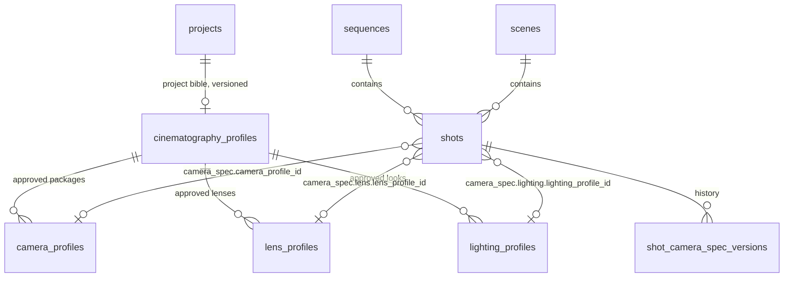
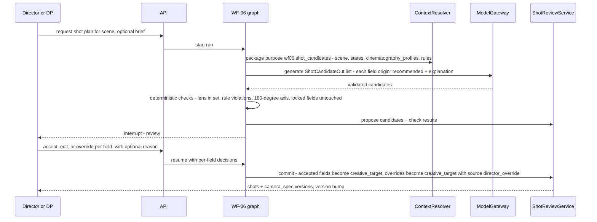

# Cinematography and Virtual Camera Architecture

**Doc ID:** TFD-ARCH-CIN-001 · **Version:** 1.0-draft · **Date:** 2026-11-05 · **Status:** Phase B design — pending approval

**Inputs:** Phase A audit `docs/audit/02` (V1-16, V1-17, V1-19, V1-23); PHASE_B shared brief (entity names `camera_profiles`, `lens_profiles`, `lighting_profiles`, `cinematography_profiles`, `shots.camera_spec`); Gap Report v1.0 §7.5 (manual package contract fields: "camera/lens/movement, duration, aspect ratio, resolution, frame rate, seed and provider-specific parameters only where the provider supports them"); code `packages/workflows/storyboard_intelligence/aligner.py`, `packages/domain/enums.py::{ShotType, VisualRuleCategory}`, `packages/persistence/models.py::StoryboardPanelModel`.

> **Source note.** Field lists reconciled against the Master Prompt field digest (2026-11-05). The §4.1 coverage table maps every §7.1 physical-camera field, every §7.2 virtual-cinematography item and every §7.3 recommendation output to a `camera_spec` path. §5 covers all seven §7.4 reusable profiles. §7.1 requires an extensible schema with "no fixed shortlist", which `extensions` provides.

---

## 1. Current state

| Element | CURRENT evidence |
|---|---|
| Shot type | `ShotType` enum; `storyboard_panels.shot_type` (string) |
| Lens / camera info | Hardcoded prose in `StoryboardAligner.generate_panels`, e.g. `"Eye-level camera; 50mm lens; standard coverage."` and `"Shallow depth of field; 85mm prime lens"`, stored in `visual_notes` text |
| Camera language rules | `VisualRuleCategory.CAMERA_LANGUAGE` exists for Film Bible rules (WF-04 WIP) |
| Shots, camera spec, lens/lighting profiles, cinematography bible | None (V1-16, V1-17, V1-19 NOT_IMPL/PARTIAL) |

Lens and camera data today is unstructured text with no provenance. The target turns it into structured, provenance-tagged data. Existing `visual_notes` stay as human-readable notes and are never parsed into canon automatically.

---

## 2. Design goals

1. **One spec model** for physical (live-action, chroma plate) and virtual (AI-generated, CG) cameras, so a mixed-mode scene can be planned, compared and continuity-checked in one vocabulary.
2. **Provenance per field:** `actual` (recorded on set or extracted from file metadata), `creative_target` (director/DP intent), `recommended` (AI or rule suggestion, not yet accepted).
3. **Provider-neutral.** The spec never contains a provider parameter name. Mapping happens only in the prompt compiler (WF-09) against a capability snapshot.
4. **Extensible without migration.** JSONB with a versioned JSON Schema and namespaced `extensions`.

---

## 3. Model overview



- `shots.camera_spec` (JSONB) is the **current** spec. Every change writes an immutable `shot_camera_spec_versions` row (or uses the shot versioning mechanism chosen by the DB doc) with `changed_by`, `reason` and `source` (`director_override` | `ai_recommendation_accepted` | `capture_actuals_import` | `manual_edit`).
- Profiles are **libraries**: a shot references a profile by ID and may override individual fields. The effective value is the profile value overlaid with the shot override, and the override is visible in the UI.
- `spec_kind`: `physical` | `virtual`. Shots with `production_method = combined` (e.g. chroma plate plus virtual environment) carry **two** specs, `camera_spec` (plate) and `camera_spec_virtual` (CG/AI layer). Plate actuals drive the virtual camera match.

---

## 4. `camera_spec` JSON Schema (v1)

Each leaf parameter is a **provenanced value**: `{"value": …, "origin": "actual|creative_target|recommended", "confidence"?, "source_ref"?}`. This makes "the DP intended 35mm, the AI recommended 40mm, set data says 32mm" representable without a separate table. The top-level `metadata_origin` is the **dominant** origin for display and filtering. Per-field origin is authoritative.

```json
{
  "$schema": "https://json-schema.org/draft/2020-12/schema",
  "$id": "https://tattva.local/schemas/camera_spec/1.json",
  "title": "Tattva camera_spec v1",
  "type": "object",
  "required": ["schema_version", "spec_kind", "metadata_origin"],
  "additionalProperties": false,
  "$defs": {
    "origin": {"enum": ["actual", "creative_target", "recommended"]},
    "pv_number": {
      "type": "object", "required": ["value", "origin"], "additionalProperties": false,
      "properties": {
        "value": {"type": "number"},
        "unit": {"type": "string"},
        "origin": {"$ref": "#/$defs/origin"},
        "confidence": {"type": "number", "minimum": 0, "maximum": 1},
        "source_ref": {"type": "string", "description": "asset id / capture_manifest id / ai_run id / user id"},
        "locked": {"type": "boolean", "description": "director lock: AI may not recommend changes"}
      }
    },
    "pv_string": {
      "type": "object", "required": ["value", "origin"], "additionalProperties": false,
      "properties": {
        "value": {"type": "string"},
        "origin": {"$ref": "#/$defs/origin"},
        "confidence": {"type": "number", "minimum": 0, "maximum": 1},
        "source_ref": {"type": "string"},
        "locked": {"type": "boolean"}
      }
    },
    "pv_enum_shot_size": {
      "allOf": [{"$ref": "#/$defs/pv_string"}],
      "properties": {"value": {"enum": ["extreme_wide", "wide", "full", "medium_wide", "medium", "medium_close_up", "close_up", "extreme_close_up", "insert", "establishing", "over_the_shoulder", "pov", "two_shot"]}}
    },
    "vec3": {"type": "array", "items": {"type": "number"}, "minItems": 3, "maxItems": 3},
    "keyframe": {
      "type": "object", "required": ["t"],
      "properties": {
        "t": {"type": "number", "description": "seconds from shot start"},
        "position_m": {"$ref": "#/$defs/vec3"},
        "rotation_deg": {"$ref": "#/$defs/vec3", "description": "pan, tilt, roll"},
        "focal_length_mm": {"type": "number"},
        "focus_distance_m": {"type": "number"},
        "easing": {"enum": ["linear", "ease_in", "ease_out", "ease_in_out", "hold"]}
      }
    }
  },
  "properties": {
    "schema_version": {"const": "1"},
    "spec_kind": {"enum": ["physical", "virtual"]},
    "metadata_origin": {"$ref": "#/$defs/origin"},
    "camera_profile_id": {"type": ["string", "null"]},

    "framing": {
      "type": "object", "additionalProperties": false,
      "properties": {
        "shot_size": {"$ref": "#/$defs/pv_enum_shot_size"},
        "composition": {"$ref": "#/$defs/pv_string", "description": "e.g. rule_of_thirds_left, centered, dutch"},
        "subject_ids": {"type": "array", "items": {"type": "string"}, "description": "character/prop ids in frame"},
        "camera_angle": {"$ref": "#/$defs/pv_string", "description": "eye_level, low, high, overhead, worms_eye, dutch"},
        "camera_height_m": {"$ref": "#/$defs/pv_number"},
        "camera_distance_m": {"$ref": "#/$defs/pv_number", "description": "camera to primary subject"},
        "camera_position": {
          "type": "object", "description": "camera position relative to set/subject; descriptive and/or metric",
          "properties": {
            "description": {"$ref": "#/$defs/pv_string", "description": "e.g. 'low, camera left of Ashoka, behind the chariot wheel'"},
            "position_m": {"$ref": "#/$defs/vec3"},
            "origin": {"$ref": "#/$defs/origin"}
          }
        },
        "subject_placement": {"$ref": "#/$defs/pv_string", "description": "where subjects sit in frame, e.g. 'Ashoka left third, army right background'"},
        "background_environment": {
          "type": "object",
          "properties": {
            "environment_profile_id": {"type": ["string", "null"]},
            "environment_state_id": {"type": ["string", "null"]},
            "description": {"$ref": "#/$defs/pv_string"}
          }
        },
        "eyeline": {"$ref": "#/$defs/pv_string", "description": "camera_left/right, to_lens, target subject id"},
        "screen_direction": {"$ref": "#/$defs/pv_string", "description": "left_to_right, right_to_left, neutral"},
        "axis_side": {"$ref": "#/$defs/pv_string", "description": "180-degree line side reference for continuity"}
      }
    },

    "format": {
      "type": "object", "additionalProperties": false,
      "properties": {
        "aspect_ratio": {"$ref": "#/$defs/pv_string", "description": "2.39:1, 1.85:1, 16:9, 9:16 ..."},
        "resolution": {"$ref": "#/$defs/pv_string", "description": "e.g. 4096x2160"},
        "frame_rate_fps": {"$ref": "#/$defs/pv_number"},
        "duration_s": {"$ref": "#/$defs/pv_number", "description": "shot duration"},
        "shutter_angle_deg": {"$ref": "#/$defs/pv_number"},
        "shutter_speed_s": {"$ref": "#/$defs/pv_number"},
        "high_speed": {"type": "boolean"},
        "output_requirements": {"$ref": "#/$defs/pv_string", "description": "delivery/output requirements for this shot, e.g. deliverable codec, bit depth, plate format for VFX; defaults from the project delivery profile"}
      }
    },

    "physical_camera": {
      "description": "Present when spec_kind=physical (or for plate of a combined shot)",
      "type": "object", "additionalProperties": false,
      "properties": {
        "camera_manufacturer": {"$ref": "#/$defs/pv_string"},
        "camera_body": {"$ref": "#/$defs/pv_string"},
        "sensor_format": {"$ref": "#/$defs/pv_string", "description": "e.g. full_frame, super35, large_format"},
        "sensor_width_mm": {"$ref": "#/$defs/pv_number"},
        "sensor_height_mm": {"$ref": "#/$defs/pv_number"},
        "recording_mode": {"$ref": "#/$defs/pv_string", "description": "open gate, 4K 17:9 etc."},
        "recording_codec": {"$ref": "#/$defs/pv_string"},
        "color_space_gamma": {"$ref": "#/$defs/pv_string", "description": "log curve / gamut as recorded"},
        "iso_exposure_index": {"$ref": "#/$defs/pv_number", "description": "ISO / exposure index"},
        "white_balance_k": {"$ref": "#/$defs/pv_number"},
        "nd_stops": {"$ref": "#/$defs/pv_number"},
        "rolling_shutter_readout_ms": {"$ref": "#/$defs/pv_number"},
        "support": {"$ref": "#/$defs/pv_string", "description": "tripod, dolly, slider, crane, steadicam, gimbal, handheld, drone, motion_control, vehicle_mount"},
        "timecode_start": {"$ref": "#/$defs/pv_string"},
        "camera_id_on_set": {"$ref": "#/$defs/pv_string", "description": "A-cam, B-cam"}
      }
    },

    "virtual_camera": {
      "description": "Present when spec_kind=virtual",
      "type": "object", "additionalProperties": false,
      "properties": {
        "virtual_sensor_equivalent": {"$ref": "#/$defs/pv_string", "description": "sensor the virtual camera emulates, for FOV/DOF math"},
        "field_of_view_deg": {"$ref": "#/$defs/pv_number"},
        "simulated_depth_of_field": {"type": "boolean"},
        "camera_path": {"type": "array", "items": {"$ref": "#/$defs/keyframe"}, "description": "explicit keyframed path; empty = described movement only"},
        "path_origin": {"$ref": "#/$defs/origin"},
        "match_to_plate_shot_id": {"type": ["string", "null"], "description": "virtual layer must match this physical plate's tracked camera"},
        "tracking_solve_asset_id": {"type": ["string", "null"]},
        "world_scale_m_per_unit": {"type": "number"},
        "motion_blur": {"$ref": "#/$defs/pv_string"},
        "seed": {"type": ["integer", "null"], "description": "provider-neutral seed intent; mapped only if provider supports"},
        "lens_look": {"$ref": "#/$defs/pv_string", "description": "§7.2 lens look as a creative target, e.g. 'vintage anamorphic, oval bokeh, blue streak flares'"},
        "simulated_imperfections": {"$ref": "#/$defs/pv_string", "description": "handheld shake, lens breathing, film grain intent"}
      }
    },

    "lens": {
      "type": "object", "additionalProperties": false,
      "properties": {
        "lens_profile_id": {"type": ["string", "null"]},
        "lens_manufacturer": {"$ref": "#/$defs/pv_string"},
        "lens_series": {"$ref": "#/$defs/pv_string"},
        "lens_type": {"$ref": "#/$defs/pv_string", "description": "spherical_prime, spherical_zoom, anamorphic_prime, macro, tilt_shift, fisheye"},
        "focal_length_mm": {"$ref": "#/$defs/pv_number"},
        "anamorphic_squeeze": {"$ref": "#/$defs/pv_number"},
        "aperture": {"$ref": "#/$defs/pv_number", "description": "unit 'T' or 'f' in pv.unit"},
        "focus_distance_m": {"$ref": "#/$defs/pv_number"},
        "depth_of_field": {"$ref": "#/$defs/pv_string", "description": "deep, moderate, shallow"},
        "focus_behaviour": {"$ref": "#/$defs/pv_string", "description": "locked, rack_to:<subject>, follow:<subject>"},
        "filtration": {"$ref": "#/$defs/pv_string", "description": "diffusion, polariser, ND grad ..."},
        "lens_characteristics": {"$ref": "#/$defs/pv_string", "description": "flare, distortion, vignetting, breathing, bokeh"}
      }
    },

    "movement": {
      "type": "object", "additionalProperties": false,
      "properties": {
        "move_type": {
          "allOf": [{"$ref": "#/$defs/pv_string"}],
          "properties": {"value": {"enum": ["locked", "pan", "tilt", "pan_tilt", "tracking", "dolly_in", "dolly_out", "truck", "pedestal", "crane_up", "crane_down", "orbit", "zoom", "dolly_zoom", "handheld_style", "steadicam_follow", "drone_flyover", "whip_pan"]}}
        },
        "direction": {"$ref": "#/$defs/pv_string"},
        "speed": {"$ref": "#/$defs/pv_string", "description": "movement speed: slow, moderate, fast or m/s in extensions"},
        "motion_intensity": {"$ref": "#/$defs/pv_string", "description": "§7.2 motion intensity of camera + subject action: subtle, moderate, energetic, violent"},
        "start_framing": {"$ref": "#/$defs/pv_enum_shot_size"},
        "end_framing": {"$ref": "#/$defs/pv_enum_shot_size"},
        "motivated_by": {"$ref": "#/$defs/pv_string", "description": "subject action / reveal / emotion"},
        "repeatable": {"type": "boolean", "description": "needs motion control or recorded path for multi-pass / plate match"}
      }
    },

    "lighting": {
      "type": "object", "additionalProperties": false,
      "properties": {
        "lighting_profile_id": {"type": ["string", "null"]},
        "time_of_day": {"$ref": "#/$defs/pv_string"},
        "key_direction": {"$ref": "#/$defs/pv_string", "description": "camera_left_45, top, back ..."},
        "key_quality": {"$ref": "#/$defs/pv_string", "description": "hard, soft"},
        "contrast_ratio": {"$ref": "#/$defs/pv_string", "description": "e.g. 4:1"},
        "color_temperature_k": {"$ref": "#/$defs/pv_number"},
        "practicals": {"$ref": "#/$defs/pv_string"},
        "motivation": {"$ref": "#/$defs/pv_string", "description": "sun, fire, torch, window"},
        "atmosphere": {"$ref": "#/$defs/pv_string", "description": "haze, smoke, dust, rain"},
        "hdri_asset_id": {"type": ["string", "null"], "description": "captured HDRI for CG lighting match"}
      }
    },

    "look": {
      "type": "object", "additionalProperties": false,
      "properties": {
        "look_reference_asset_ids": {"type": "array", "items": {"type": "string"}},
        "lut_or_show_look": {"$ref": "#/$defs/pv_string"},
        "color_and_film_response": {"$ref": "#/$defs/pv_string", "description": "§7.2 colour and film response: stock emulation, contrast curve, saturation, highlight roll-off"},
        "texture": {"$ref": "#/$defs/pv_string", "description": "grain, halation intent"}
      }
    },

    "explanation": {
      "type": "object",
      "description": "Required when any field has origin=recommended",
      "properties": {
        "ai_run_id": {"type": "string"},
        "rationale": {"type": "string"},
        "evidence_refs": {"type": "array", "items": {"type": "object"}},
        "rules_applied": {"type": "array", "items": {"type": "string"}, "description": "film_bible_rule ids / cinematography_profile rule ids"}
      }
    },

    "extensions": {
      "type": "object",
      "description": "Namespaced additions, e.g. {'tattva.stereo': {...}, 'org.acme.rig': {...}}. Keys must match ^[a-z0-9]+(\\.[a-z0-9_]+)+$. Each namespace registers a JSON Schema in the schema registry; unknown namespaces are rejected at write.",
      "propertyNames": {"pattern": "^[a-z0-9]+(\\.[a-z0-9_]+)+$"}
    }
  }
}
```

**Schema governance.**
- The schema is versioned (`schema_version`). Fields are added in a minor version and are optional. Renames and removals need a new major version plus a migration function (`upgrade_camera_spec_v1_to_v2`) run as an expand→backfill job.
- Validation runs at write (API) and at compile (WF-09). Extension schemas are stored in a registry table so organizations can add fields, e.g. a stereo rig, without a code release.

### 4.1 Master Prompt coverage

**§7.1 physical camera fields → path**

| §7.1 field | `camera_spec` path |
|---|---|
| camera manufacturer | `physical_camera.camera_manufacturer` |
| camera body | `physical_camera.camera_body` |
| sensor format | `physical_camera.sensor_format` (+ `sensor_width_mm`, `sensor_height_mm`) |
| recording resolution | `format.resolution` (+ `physical_camera.recording_mode`) |
| frame rate | `format.frame_rate_fps` |
| shutter angle or shutter speed | `format.shutter_angle_deg` / `format.shutter_speed_s` |
| ISO / exposure index | `physical_camera.iso_exposure_index` |
| aperture | `lens.aperture` |
| white balance | `physical_camera.white_balance_k` |
| lens manufacturer | `lens.lens_manufacturer` |
| lens series | `lens.lens_series` |
| focal length | `lens.focal_length_mm` |
| lens characteristics | `lens.lens_characteristics` (+ `lens_type`, `anamorphic_squeeze`, `filtration`) |
| camera distance | `framing.camera_distance_m` |
| camera height | `framing.camera_height_m` |
| camera angle | `framing.camera_angle` |
| framing | `framing.shot_size`, `framing.composition` |
| focus distance | `lens.focus_distance_m` |
| depth of field | `lens.depth_of_field` |
| camera movement | `movement.*` |
| rig or stabilization | `physical_camera.support` |
| aspect ratio | `format.aspect_ratio` |
| recording codec and output requirements | `physical_camera.recording_codec`, `format.output_requirements` |
| *extensible, no fixed shortlist* | `extensions` (namespaced, schema-registered) |

**§7.2 virtual cinematography → path** (all may be `creative_target`; actual metadata stays distinct, §8)

| §7.2 item | `camera_spec` path |
|---|---|
| wide, medium, close-up, extreme close-up, establishing, over-the-shoulder, POV | `framing.shot_size` enum (`wide`, `medium`, `close_up`, `extreme_close_up`, `establishing`, `over_the_shoulder`, `pov`) |
| tracking, dolly, crane, orbit, pan and tilt, handheld style, locked camera | `movement.move_type` enum (`tracking`, `dolly_in`/`dolly_out`, `crane_up`/`crane_down`, `orbit`, `pan`/`tilt`/`pan_tilt`, `handheld_style`, `locked`) |
| lens look | `virtual_camera.lens_look` (+ `lens.*`) |
| depth of field | `lens.depth_of_field`, `virtual_camera.simulated_depth_of_field` |
| composition | `framing.composition` |
| lighting | `lighting.*` |
| colour and film response | `look.color_and_film_response` |
| movement speed | `movement.speed` |
| shot duration | `format.duration_s` |
| motion intensity | `movement.motion_intensity` |

**§7.3 AI recommendation outputs → path** (WF-06 emits each as `origin=recommended` with explanation)

| §7.3 output | path |
|---|---|
| shot type | `framing.shot_size` |
| camera position | `framing.camera_position` (+ `camera_height_m`, `camera_distance_m`, `camera_angle`) |
| lens & focal length | `lens.lens_profile_id`, `lens.focal_length_mm` |
| camera movement | `movement.*` |
| framing | `framing.composition` |
| lighting | `lighting.*` |
| background & environment | `framing.background_environment` |
| subject placement | `framing.subject_placement` |
| duration | `format.duration_s` |
| visual references | `look.look_reference_asset_ids` |
| technical settings supported by selected provider | computed at WF-09: only fields whose disposition is `native` for the selected target's snapshot are recommended as technical settings (§7) |

---

## 5. Profiles and the Cinematography Bible

| Entity | Content | Notes |
|---|---|---|
| `camera_profiles` (§7.4 Camera Package) | Named camera package: manufacturer, body, sensor, recording mode, codec, colour pipeline, default frame rate/shutter; or a virtual camera profile (sensor-equivalent, default FOV behaviour) | `kind: physical|virtual`. Physical profiles may be created from imported camera metadata |
| `lens_profiles` (§7.4 Lens Library) | Lens set: manufacturer, series, type, focal lengths available, T-stop range, close focus, squeeze, character notes, optional distortion grid asset | A shot's `focal_length_mm` is validated against the set: a warning, not a block, if not in the set |
| `lighting_profiles` (§7.4 Lighting Library) | Named look: key/fill ratios, colour temperatures, motivation, atmosphere, reference frames | Linked to environment profiles and time of day |
| §7.4 Shot Composition Rules | Rule set inside `cinematography_profiles.rules` with category `composition`, e.g. headroom, lead room, symmetry for royal court scenes, OTS coverage conventions. Same rule shape, `strictness` and approval as camera-language rules | WF-06 deterministic pre-checks evaluate `mandatory` composition rules |
| §7.4 Virtual Camera Profile | `camera_profiles` with `kind=virtual`: sensor-equivalent, default FOV/DOF behaviour, default lens look, motion-intensity defaults, imperfection simulation | Used by every `spec_kind=virtual` shot unless overridden |
| §7.4 Visual Language Profile | Section of `cinematography_profiles` (`visual_language`) linking the WF-04 Film Bible visual rules (`VisualRuleCategory`) to camera terms: colour palette, texture, lighting style, realism level and film look (the §11 visual-style dimensions) | Read by the Context Resolver for WF-06/WF-09; WF-07 uses it for visual-style continuity |
| `cinematography_profiles` (§7.4 Project Cinematography Bible) | **Project Cinematography Bible:** approved camera/lens/lighting profiles, default aspect ratio and frame rate per delivery format, camera-language rules (e.g. "no handheld before the Kalinga battle", "wide lenses for Ashoka's isolation") | Versioned and approved via the generalized `approval_requests`. Camera-language rules reuse the Film Bible rule shape (`VisualRuleCategory.CAMERA_LANGUAGE`, `strictness`). The existing WF-04 `CAMERA_LANGUAGE` rules are imported as candidates on first creation, never auto-approved |

Mixed-mode consistency rule: when a scene contains both physical and virtual shots, the bible's lens and lighting profiles apply to both. The virtual camera uses `virtual_sensor_equivalent` to keep FOV and depth of field consistent with the physical package.

---

## 6. AI recommendation flow (WF-06 Shot Planning)



- **Explanation is mandatory.** Every recommended field set carries `explanation.rationale`, `rules_applied` and `evidence_refs`, e.g. "85mm close-up because bible rule CL-03 calls for compressed close-ups in confrontation scenes; scene 14 is a confrontation (scene summary)". The UI shows these next to each recommendation.
- **Director override always wins:**
  - An accepted recommendation becomes `origin=creative_target` with `source_ref` = the accepting user.
  - An override is `creative_target` with `source=director_override` and an optional reason. Overrides are kept as signal for evaluation (§11 of the AI doc).
  - `locked: true` fields are excluded from future recommendations. WF-06 must not propose changes to them, and a test enforces this.
- **Deterministic pre-checks** run without a model:
  - lens availability
  - frame rate vs delivery profile
  - aspect ratio vs format
  - screen direction / axis continuity vs the previous approved shot in the scene
  - Film Bible `mandatory` rule violations

  Their output is attached as findings, never as silent corrections.
- **CURRENT → TARGET for WF-03.** Storyboard panel `visual_notes` with lens text can be offered to WF-06 as untrusted hints in the context package. They are not migrated into `camera_spec`.

---

## 7. Provider parameter mapping

The neutral spec compiles to provider capabilities only in WF-09 (`AI_SYSTEM_ARCHITECTURE.md` §8). **This document defines the mechanism, not any provider's parameters.** No provider parameter names are asserted here.

### 7.1 Capability snapshot lookup

1. The package target selects a provider and model (or a manual target) from the registry.
2. The compiler loads the **pinned** `provider_capability_snapshots` row: the newest snapshot with `status=verified` for that provider, model and execution mode. The snapshot ID is recorded on the package.
3. The snapshot contains a `parameter_map`, authored during provider onboarding from the provider's official documentation (`INTEGRATION_ARCHITECTURE.md` §4) and each entry citing its source URL:

```json
{
  "neutral_path": "format.aspect_ratio",
  "disposition": "native | prompt_text | reference | unsupported",
  "provider_param": "<as documented — filled only from official docs at onboarding>",
  "allowed_values": ["<from docs>"],
  "transform": "enum_map | numeric_clamp | ratio_to_string | none",
  "transform_args": {},
  "prompt_template_id": "camera.focal_length.v1",
  "source_url": "<official doc url>",
  "verified_at": "YYYY-MM-DD"
}
```

### 7.2 Disposition rules

| Disposition | Behaviour |
|---|---|
| `native` | Value is transformed and validated against `allowed_values` / range. Out-of-range is never silently clamped for `creative_target` fields: the compiler reports a deviation the user must accept, or picks another target |
| `prompt_text` | Rendered through a versioned phrase template, e.g. focal length to "shot on an 85mm lens, shallow depth of field". Templates are `prompt_versions` rows and are evaluated (WF-09 golden set) |
| `reference` | Satisfied by a reference asset of a given role, e.g. a lighting reference frame or a camera-path preview video, if the snapshot declares reference input for that role |
| `unsupported` | Dropped with a recorded warning. If the field is `locked` or required by a `mandatory` bible rule, compile **blocks** and explains which providers in the registry support it (feeds the recommendation engine) |

The compiled package stores a **disposition table**: every non-null spec field mapped to its disposition and its rendered form. Reviewers see what each provider was told and what was lost. When no verified snapshot exists, only manual targets are available. Their package presents the full neutral spec in human-readable form, with "set if your tool supports it" guidance.

---

## 8. Metadata provenance: actual vs creative_target vs recommended

| Origin | Who or what writes it | Typical source | Mutable? |
|---|---|---|---|
| `recommended` | WF-06 / WF-08 via review service, as candidate only | `ai_runs` | Replaced by acceptance or override; history kept |
| `creative_target` | Human acceptance or override; profile defaults applied by a human | user | New spec version on change |
| `actual` | Capture manifest import (on-set logs), file metadata extraction (ffprobe/EXIF; see the hybrid doc §6), provider output metadata after import | `capture_manifests`, `production_footage`, `generation_attempts` | Append-only; corrections create a new value with a reason |

§7.2 requires that **actual camera metadata is always distinguished from creative simulation instructions**. For virtual shots, every value Tattva sends to a provider is a `creative_target`. It becomes `actual` only if the provider reports it back.

§11 cinematography continuity dimensions are compared through these fields between consecutive shots and between target and actual. The dimensions are camera, lens, framing, camera direction, screen direction, movement, lighting, colour profile and composition, mapped as follows:
- `physical_camera.*`
- `lens.*`
- `framing.*`
- `framing.screen_direction` / `axis_side`
- `movement.*`
- `lighting.*`
- `look.*`
- `framing.composition`

Rules:
- An `actual` value **never overwrites** the `creative_target` for the same field. Both are kept, using a `targets` and `actuals` pair per shot: `camera_spec` holds targets, and an `actual` overlay is stored with the footage or output and linked to the shot. The UI and WF-07 compare them. A deviation beyond a per-field tolerance (e.g. frame rate any difference; focal length > 10%) becomes a `continuity_findings` row with status `review_required`, which the director resolves as `intentional_variation` or `change_requested`.
- For virtual shots, `actual` means "what the provider reports it did", only when the provider returns such metadata. Otherwise actuals are absent and **must not** be inferred from the request.
- Packages compiled for external tools always use `creative_target` values, never `recommended` ones. A spec that still contains unaccepted `recommended` fields cannot be compiled.

---

## 9. Requirements introduced

| ID | Requirement | Release |
|---|---|---|
| TFD-CIN-001 | `camera_spec` JSONB v1 per §4 with per-field origin; validated at write and compile | FD-V1 |
| TFD-CIN-002 | Camera, lens and lighting profile libraries; project Cinematography Bible with versioned approval | FD-V1 |
| TFD-CIN-003 | AI camera recommendations carry explanation; director override per field; locked fields never re-recommended | FD-V1 (deterministic + mock), FD-V2 (live) |
| TFD-CIN-004 | Actual vs target comparison with tolerances generating continuity findings | FD-V1 (manual actuals), FD-V2 (imported) |
| TFD-SHT-0xx | `shots` entity with `camera_spec`, `camera_spec_virtual`, `production_method` (number assigned by shot doc) | FD-V1 |
| TFD-PKG-0xx | Compiler disposition table using pinned capability snapshot | FD-V1 (manual), FD-V2 (connected) |

## 10. Open decisions

None new. Depends on DEC-004 (live recommendation model) and DEC-013 (first connected provider, which supplies the first non-manual `parameter_map`). Tolerance defaults in §8 are a product proposal for approval with this document.
