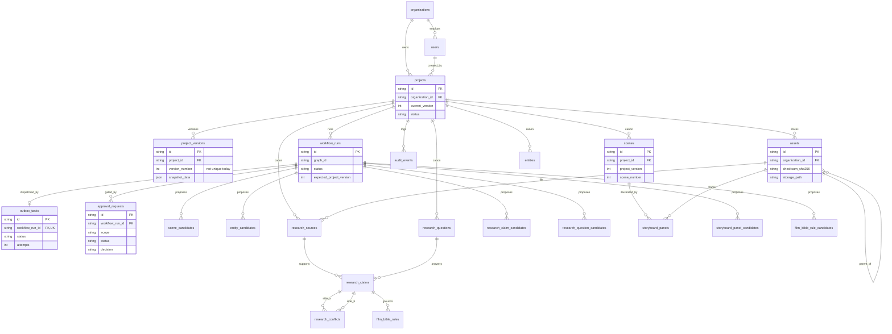
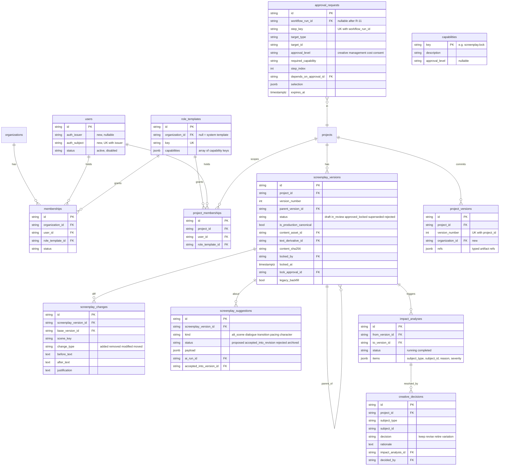
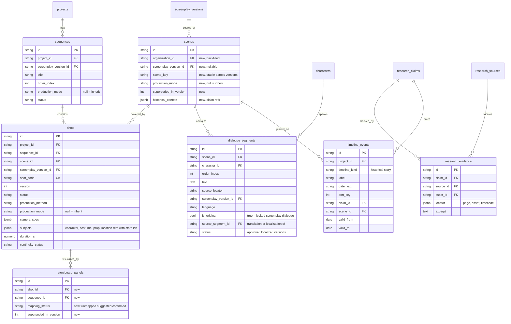
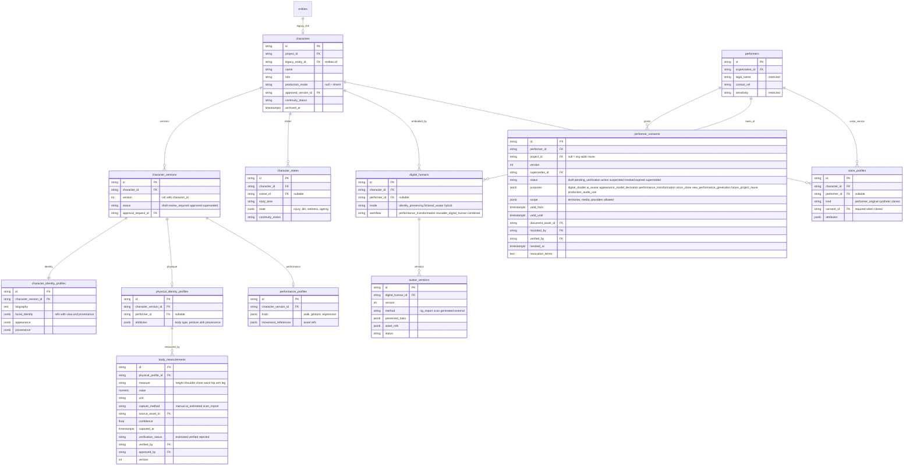
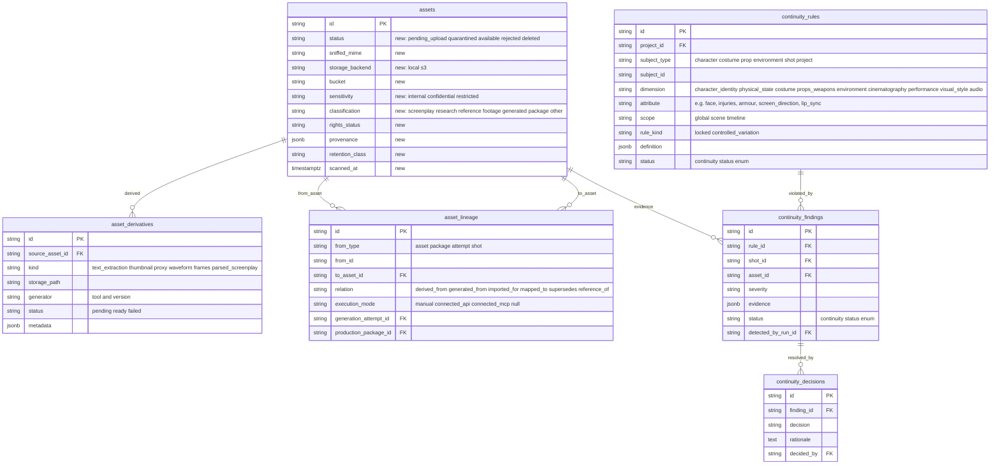
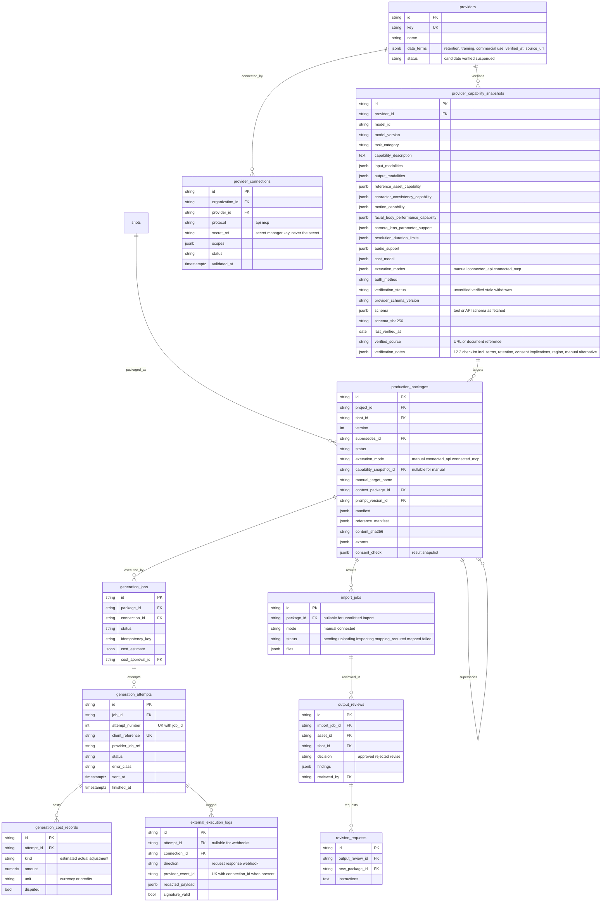

# Database Design and ERD — Tattva AI Film Director

**Doc ID:** TFD-ARC-004 · **Version:** 1.0-draft · **Date:** 2026-11-05 · **Status:** Phase B design — pending approval

**Inputs:**
- `packages/persistence/models.py` (read in full)
- `packages/persistence/migrations/versions/{e16ffe799e44,0d204c88a75f,066e52ac4889,00b7cd57e036}*.py`
- `packages/persistence/repositories.py`
- `docs/audit/05_DATABASE_AND_MIGRATION_AUDIT.md`
- Master Prompt §6, §11, §12.3, §19, §20.3
- Gap Report §10–§11

This document **owns the final column definitions** for the canonical entity names in the Phase B brief.

---

## 1. Current schema (as built, verified from `models.py`)

### 1.1 Facts
- **23 application tables** are declared in `models.py` (`grep -c __tablename__` = 23). Alembic additionally owns `alembic_version`. LangGraph's `PostgresSaver.setup()` creates its own checkpoint tables (`checkpoints`, `checkpoint_blobs`, `checkpoint_writes`, `checkpoint_migrations`). These are excluded from autogenerate by `migration_filters.include_object` and are not application tables.
  - Note: the Phase B brief says "25 tables". The code shows **23**. See the contradiction note in §9.
- Migration chain (linear): `e16ffe799e44` (13 core) → `0d204c88a75f` (6 research) → `066e52ac4889` (2 storyboard) → **`00b7cd57e036` (2 film bible)**.
- **`00b7cd57e036` is uncommitted WIP but already applied to the local dev DB** (`alembic current` = head = `00b7cd57e036`, `docs/audit/05` §1). It must never be edited or deleted. If the WIP were discarded, run `alembic downgrade 066e52ac4889` **before** removing the file. DEC-010 recommends fixing forward instead, which keeps the file as-is and commits it.
- **Conventions:**
  - Primary keys are `String(36)` UUID text with default `uuid4`.
  - `DateTime(timezone=True)`.
  - JSON columns use SQLAlchemy `JSON` (PostgreSQL `json`, **not** `jsonb`).
  - FKs have no `ondelete`.
  - There are no `relationship()` objects.
  - **Every status column is a plain `String(50)` with no CHECK.**
- **Uniqueness:** only `organizations.slug`, `users.email` and `outbox_tasks.workflow_run_id`. There is **no** unique `(project_id, version_number)` on `project_versions`.
- **Missing `organization_id`:** `project_versions`, `scenes`, `entities`, `scene_candidates`, `entity_candidates`.
- **Canonical accumulation:** `scenes`, `entities`, `storyboard_panels` and `film_bible_rules` gain new rows per approval with a higher `project_version`. Nothing marks older rows superseded, so `CanonicalRepository.scenes_for_project` returns every generation (see also G04-F).

### 1.2 Table inventory

| Group | Table | Key columns (beyond `id`, `created_at`) | FKs | Status / enum columns (plain strings) |
|---|---|---|---|---|
| Tenancy | `organizations` | name, slug (UK) | — | — |
| | `users` | organization_id, email (UK), full_name, role (default `creator`, unused) | organizations | role |
| Project | `projects` | organization_id, title, logline, genre, current_version, created_by, updated_at | organizations, users | status (`draft`…) |
| | `project_versions` | project_id, version_number, branch_name, commit_message, committed_by, snapshot_data (json) | projects, users | — |
| Assets | `assets` | project_id, organization_id, filename, mime_type, size_bytes, checksum_sha256, storage_path, is_original, parent_asset_id, uploaded_by, metadata (json) | projects, organizations, assets (self), users | asset_type |
| Workflow / ops | `workflow_runs` | graph_id, graph_version, project_id, organization_id, actor_id, expected_project_version, input_asset_ids (json), output_refs (json), error_message, updated_at | projects, organizations, users | status (indexed) |
| | `outbox_tasks` | workflow_run_id (**UK**), task_type, payload (json), attempts, claimed_by, claimed_at, updated_at | workflow_runs | status (indexed) |
| | `approval_requests` | workflow_run_id, project_id, organization_id, scope, candidate_summary (json), decision, decision_notes, decided_by, decided_at | workflow_runs, projects, organizations, users | status (indexed), decision, scope |
| | `audit_events` | project_id, organization_id, actor_id, action, target_type, target_id, details (json) | projects, organizations, users | action |
| Story (WF-01) | `scene_candidates` | workflow_run_id, project_id, scene_number, heading, setting, location_name, time_of_day, summary, source_locator, characters_present (json) | workflow_runs, projects | status |
| | `entity_candidates` | workflow_run_id, project_id, name, category, description, source_locator, confidence | workflow_runs, projects | status, category |
| | `scenes` | project_id, scene_number, heading, setting, location_name, time_of_day, summary, source_locator, characters_present (json), project_version | projects | — |
| | `entities` | project_id, name, category, description, source_locator, project_version | projects | category |
| Research (WF-02) | `research_questions` | project_id, organization_id, project_version, text, category, updated_at | projects, organizations | status |
| | `research_sources` | project_id, organization_id, project_version, title, tier, author, publication_year, locator, url, asset_id, reliability_notes | projects, organizations, assets | tier |
| | `research_claims` | project_id, organization_id, project_version, claim_class, statement, era_or_date, location, confidence, source_id, question_id | projects, organizations, research_sources, research_questions | status, claim_class |
| | `research_conflicts` | project_id, organization_id, project_version, claim_id_a, claim_id_b, description, resolution_notes | projects, organizations, research_claims ×2 | status |
| | `research_claim_candidates` | workflow_run_id, project_id, organization_id, claim_class, statement, era_or_date, location, confidence, source_title, source_tier, source_locator | workflow_runs, projects, organizations | status |
| | `research_question_candidates` | workflow_run_id, project_id, organization_id, text, category | workflow_runs, projects, organizations | status |
| Storyboard (WF-03) | `storyboard_panels` | project_id, organization_id, project_version, panel_number, scene_id (idx), shot_type, description, visual_notes, dialogue_snippet, frame_asset_id, aspect_ratio | projects, organizations, scenes, assets | shot_type |
| | `storyboard_panel_candidates` | workflow_run_id, project_id, organization_id, panel_number, suggested_scene_number, shot_type, description, visual_notes, dialogue_snippet, confidence | workflow_runs, projects, organizations | status |
| Film Bible (WF-04, WIP) | `film_bible_rules` | project_id, organization_id, project_version, category (idx), title, rule_text, negative_prompt_guidance, strictness, historical_claim_id (idx), rationale, updated_at | projects, organizations, research_claims | category, strictness |
| | `film_bible_rule_candidates` | workflow_run_id, project_id, organization_id, category (idx), title, rule_text, negative_prompt_guidance, strictness, suggested_claim_statement, confidence, conflict_warning | workflow_runs, projects, organizations | status |

### 1.3 Current ERD

---

## 2. Target data-modelling conventions

| Topic | Rule |
|---|---|
| IDs | Keep `String(36)` UUID text for all tables, old and new, so FK types stay uniform. Do not convert to native `uuid` (a whole-schema rewrite for no product gain). |
| JSON | **New** columns use `JSONB`. Existing `json` columns are converted to `jsonb` in a contract-phase revision (R-C4) only where they are queried. Each JSONB payload carries a `schema_version`. |
| Enums | `String(50)` + named CHECK constraint `ck_<table>_<column>`. Constraints are added `NOT VALID` and then `VALIDATE CONSTRAINT` in a separate step, so there is no long lock. No PG ENUM types (`docs/audit/05` §2). |
| Tenant columns | `organization_id NOT NULL` on **every** tenant table, plus `project_id` where project-scoped. Composite FK `(project_id, organization_id) → projects(id, organization_id)` guarantees that a row's org matches its project. This needs `UNIQUE (id, organization_id)` on `projects`. |
| Timestamps | `created_at`, plus `updated_at` on mutable rows. Bitemporal fields only where the domain needs them: `valid_from`/`valid_to` for consents and timeline events, and `story_time` on character states. |
| Soft delete | `archived_at` on user-managed aggregates (projects, characters, locations…). Hard delete is retention-driven only (§5). |
| Versioning patterns | (a) **Commit log:** `project_versions` (monotonic, unique). (b) **Identity + version rows:** `characters` → `character_versions`; `screenplay_versions`; `avatar_versions`; `performer_consents` (version, supersedes_id). (c) **Row-per-canon-version with supersede marker:** existing canonical tables gain `superseded_in_version INT NULL`, so "current canon" = `superseded_in_version IS NULL`. This fixes accumulation without rewriting history. |
| Provenance | `provenance JSONB` envelope `{source, status, confidence, approved_by, version, evidence_refs[]}` on characteristic-bearing rows (§6, Master Prompt §6.1 "every characteristic must carry its source, status, confidence, approval and version"). Asset-level lineage lives in `asset_lineage` (§6). |
| Indexing | Every FK is indexed. Hot lists use `(project_id, created_at DESC, id)` for cursor pagination. Status queues use partial indexes (`WHERE status IN (…)`). |

---

## 3. Target schema by domain group
Column lists show **key** columns. Every tenant table also has `id PK`, `organization_id FK NOT NULL`, `created_at` and, where mutable, `updated_at`. These are omitted below unless relevant.

### 3.1 IAM and governance

| Table | Constraints and indexes |
|---|---|
| `users` | `UNIQUE (auth_issuer, auth_subject)`. `users.organization_id` is kept as the **home org** for backward compatibility. Authority comes from `memberships`. |
| `memberships` | `UNIQUE (organization_id, user_id)`; CHECK status ∈ (`invited`,`active`,`suspended`,`removed`) |
| `project_memberships` | `UNIQUE (project_id, user_id)`. Org membership grants **no** project access unless the role template has `project.*:all` (org owner/admin). This is the behaviour change for SEC-03. |
| `screenplay_versions` | `UNIQUE (project_id, version_number)`; **partial unique** `(project_id) WHERE is_production_canonical`; CHECK `is_production_canonical → status='approved_locked'`; CHECK status set |
| `approval_requests` (extended) | `UNIQUE (workflow_run_id, step_key)` where `workflow_run_id IS NOT NULL`; index `(organization_id, status, approval_level)` for approval inboxes; CHECK status ∈ (`pending`,`decided`,`cancelled`,`expired`,`superseded`); CHECK decision ∈ (`approved`,`rejected`,`changes_requested`) or NULL; CHECK approval_level set |
| `project_versions` | `UNIQUE (project_id, version_number)` named `uq_project_versions_project_number` (LLD §4.2) |

### 3.2 Story, structure and research

**`shots.camera_spec`** (JSONB, validated by the `CameraSpec` Pydantic model) has four parts:

1. **Header:** `schema_version`, `spec_kind` (`physical` | `virtual`) and `metadata_origin` (`actual` | `creative_target` | `recommended`). These keep actual camera metadata separate from creative simulation instructions, as Master Prompt §7.2 requires.
2. **`physical`** (Master Prompt §7.1, every field optional):
   - camera: `camera_manufacturer`, `camera_body`, `sensor_format`, `recording_resolution`, `frame_rate`, `shutter_angle` | `shutter_speed`, `iso_ei`, `aperture`, `white_balance_k`
   - lens: `lens_manufacturer`, `lens_series`, `focal_length_mm`, `lens_characteristics`
   - position and focus: `camera_distance_m`, `camera_height_m`, `camera_angle`, `framing`, `focus_distance_m`, `depth_of_field`
   - movement and output: `camera_movement`, `rig_or_stabilization`, `aspect_ratio`, `recording_codec`, `output_requirements`
3. **`virtual`** (Master Prompt §7.2), all of which may be creative targets:
   - `shot_size` (wide|medium|close_up|extreme_close_up|establishing|over_the_shoulder|pov)
   - `movement` (tracking|dolly|crane|orbit|pan_tilt|handheld_style|locked)
   - `lens_look`, `depth_of_field`, `composition`, `lighting`, `colour_film_response`, `movement_speed`, `shot_duration_s`, `motion_intensity`
4. **References and extensions:**
   - `camera_profile_id`, `lens_profile_id`, `lighting_profile_id`
   - `recommendation` (the Master Prompt §7.3 outputs plus a `rationale`, set when origin = recommended)
   - `extensions` (free key-value pairs, because §7.1 requires an extensible schema rather than a fixed shortlist)

It is JSONB because the parameter set is extensible and provider-neutral (Master Prompt §7.1, §12.3). When a real query appears (for example, filter by lens or by movement), it gets an expression index.

**Shot constraints:**
- CHECK `production_method ∈ (fully_ai_generated, live_action_chroma, performance_transformation, digital_human, combined)`
- CHECK `production_mode IS NULL OR production_mode ∈ (fully_ai, hybrid_live_action, mixed)` (also on `scenes`, `sequences`, `characters`)
- `UNIQUE (project_id, shot_code, version)`

### 3.3 Character, digital human and consent

**Purpose vocabulary:**
- The first seven purposes map one to one onto the Master Prompt §6.5 "consent required before" list.
- `production_audio_use` exists because §9 states that "recorded-audio permission ≠ clone permission". Using original production audio and cloning a voice are therefore separate purposes.

**Body measurements:** a CHECK prevents `capture_method='ai_estimated'` rows from having `verification_status='verified'` unless `verified_by` is set. Per §6.4, AI estimates are labelled estimated and never treated as verified.

**Constraints:**
- `performer_consents`:
  - CHECK `status='active' → verified_by IS NOT NULL AND verified_by <> recorded_by` (two-person rule)
  - partial index `(performer_id, status) WHERE status='active'`
- `voice_profiles`: CHECK `kind <> 'cloned' OR consent_id IS NOT NULL`.

**Storage and policy:** all performer-linked rows have `sensitivity='restricted'`, and their referenced assets live in the restricted bucket (SYSTEM_ARCHITECTURE §8). **No row in this group may be populated with real performer data until DEC-007 and DEC-012 are approved.** The schema may land earlier, because tests use synthetic data.

### 3.4 World (costume, props, environment)

| Table | Key columns | Notes |
|---|---|---|
| `locations` | project_id, name, legacy_entity_id, geography jsonb, approved_version, continuity_status | Legacy link to `entities(category='location')` |
| `environment_profiles` | location_id, version, architecture jsonb, materials jsonb, period, provenance jsonb, status | `architecture_profiles` and `material_references` (§19) are JSONB substructures here |
| `environment_states` | environment_profile_id, scene_id, weather, time_of_day, changes jsonb, continuity_status | Scene/time-specific state |
| `costumes` | project_id, character_id (nullable), name, version, supersedes_id, garments jsonb, materials jsonb, status, continuity_status | `costume_versions` = row-per-version via `version` + `supersedes_id` |
| `costume_states` | costume_id, scene_id, condition jsonb (dirt, damage, wetness), continuity_status | |
| `props` | project_id, kind (`prop`,`weapon`), name, legacy_entity_id, design jsonb, material, scale, owner_character_id, version, status, continuity_status | `weapons` = `kind='weapon'` |
| `prop_states` | prop_id, scene_id, position, condition jsonb, continuity_status | |

### 3.5 Cinematography and on-set

| Table | Key columns | Notes |
|---|---|---|
| `camera_profiles` | organization_id, project_id (nullable = org library), kind (`body`,`virtual`), make, model, sensor jsonb, metadata_origin | `camera_bodies` (§19) = `kind='body'` |
| `lens_profiles` | project_id nullable, name, focal_range jsonb, aperture_range, characteristics jsonb | |
| `lighting_profiles` | project_id, name, setup jsonb, color_temperature_k | |
| `cinematography_profiles` | project_id (UK where `status='approved'`), version, visual_language jsonb, default_camera_profile_id, default_lens_set jsonb, status | The Cinematography Bible. `film_bible_rules` stays as rule rows that reference this profile (`cinematography_profile_id`, added). |
| `film_bible_rules` (existing, extended) | + `superseded_in_version`, `cinematography_profile_id`, CHECK category ∈ `VisualRuleCategory`, CHECK strictness ∈ `RuleStrictness` | Fixes G04-F accumulation |
| `capture_plans` | project_id, scene_id/sequence_id, shoot_date, status | Hybrid / live-action mode |
| `capture_requirements` | capture_plan_id, shot_id, requirement_type (`chroma`,`tracking_markers`,`clean_plate`,`reference_pass`,…), spec jsonb, status | |
| `capture_manifests` | capture_plan_id, scene_id, shot_id, performer_id (nullable), camera_profile_id, lens_profile_id, recording_settings jsonb, lighting_setup jsonb, capture_requirement_ids jsonb, required_footage jsonb, captured_footage jsonb (→ `production_footage` ids), validation jsonb (Master Prompt §8.2 findings: missing references, spill, tracking, motion blur, occlusion, frame-rate and exposure inconsistencies, audio, insufficient face/body refs), missing_information jsonb, approval_status, approval_request_id, exported_at, exported_by | Columns map one to one onto the Master Prompt §8.3 manifest fields. `performer_id` makes the consent gate apply when performance footage is captured for transformation. |
| `production_footage` | project_id, asset_id, shot_id, take, camera_metadata jsonb (`metadata_origin='actual'`), timecode_in/out, status | `camera_metadata` (§19) = JSONB here |

### 3.6 Assets, lineage and continuity

The **continuity status CHECK** is shared by `continuity_rules.status`, `continuity_findings.status` and every `continuity_status` column: `not_configured|candidate|review_required|approved_canon|intentional_variation|conflict_detected|change_requested|rejected|superseded`.

### 3.7 AI records

| Table | Key columns | Notes |
|---|---|---|
| `context_packages` | project_id, workflow_run_id, purpose, input_refs jsonb (entity → version/hash), excluded_refs jsonb, content_sha256, storage_path (large bodies in object storage) | Immutable. Input refs feed the DEC-020 fingerprint check. |
| `prompt_versions` | key, version, template_sha256, body, model_family, status | Global (not tenant) unless an org overrides it. `UNIQUE (key, version)`. |
| `ai_runs` | workflow_run_id, node, generator_mode (`deterministic`,`mock`,`live`), model_route, prompt_version_id, context_package_id, input_tokens, output_tokens, latency_ms, cost_estimate, status, error_class | One per model or tool call |
| `evaluation_records` | ai_run_id or dataset_case, rubric_key, score jsonb, evaluator (`human`,`auto`), notes | Golden-set and online evaluations (Master Prompt §22) |

### 3.8 External tools, packages and generation

### 3.9 Workflow and operations

| Table | Change | Key columns |
|---|---|---|
| `workflow_runs` (EXTEND) | add | `workflow_key` (`WF-01`…; backfilled from `graph_id`), `input_refs` jsonb, `generator_mode`, `error_class`, `cancel_requested_at`, `retry_of_run_id`, `context_package_id`, `started_at`, `finished_at`; CHECK status ∈ (`queued`,`running`,`awaiting_approval`,`resuming`,`completed`,`rejected`,`failed`,`cancelled`) |
| `outbox_tasks` (EXTEND) | add | `queue` (default `wf`), `priority` int, `organization_id`, `lease_expires_at`, `heartbeat_at`, `next_attempt_at` (default now), `max_attempts` (default 5), `dedupe_key`, `last_error_class`, `last_error`, `dead_lettered_at`; `workflow_run_id` becomes **nullable**. Partial unique `(dedupe_key) WHERE status IN ('pending','claimed')`. Claim index `(queue, priority DESC, next_attempt_at) WHERE status='pending'`. Lease index `(lease_expires_at) WHERE status='claimed'`. CHECK status ∈ (`pending`,`claimed`,`completed`,`dead_lettered`,`cancelled`,`failed`*) (*legacy, removed in contract) |
| `audit_events` (EXTEND) | add | `request_id`, `actor_kind` (`human`,`system`), `prev_hash` (optional hash chain); `project_id` becomes nullable for org-level events. App DB role: `INSERT, SELECT` only. |
| `job_events` (NEW) | — | `subject_type` (`workflow_run`,`generation_job`,`import_job`,`outbox_task`), `subject_id`, `from_status`, `to_status`, `details` jsonb. Append-only. Partition by month only when its volume justifies it. |
| `idempotency_keys` (NEW) | — | LLD §5 |
| `notifications` (NEW) | — | `user_id`, `kind`, `subject_type/id`, `payload`, `read_at` |
| `usage_records` (NEW) | — | `organization_id`, `project_id`, `metric` (`ai_tokens`,`generation_credits`,`storage_bytes`,`workflow_runs`), `quantity`, `period`, `source_id` |

---

## 4. Tenant isolation

### 4.1 Rule
Every tenant table has `organization_id NOT NULL`, indexed. Project-scoped tables also carry the composite FK `(project_id, organization_id) → projects(id, organization_id)`, which makes cross-tenant references impossible at the DB level. For example, a `research_sources.asset_id` from another org fails because `assets` gets the same composite FK pattern on `(asset_id, organization_id)` once `UNIQUE (id, organization_id)` exists on `assets`.

### 4.2 Backfill plan for tables missing `organization_id`

| Table | Backfill source | Steps (revision R-07) |
|---|---|---|
| `project_versions` | `projects.organization_id` via `project_id` | add nullable → `UPDATE … FROM projects` in batches of 5,000 → verify `count(*) WHERE organization_id IS NULL = 0` → `SET NOT NULL` → composite FK `NOT VALID` → `VALIDATE` |
| `scenes` | same | same |
| `entities` | same | same |
| `scene_candidates` | same (also cross-check `workflow_runs.organization_id`) | same, plus a verify query that `scene_candidates.organization_id = workflow_runs.organization_id` for all rows |
| `entity_candidates` | same | same |

Writers must set `organization_id` **before** the `SET NOT NULL` step: the code is deployed in the same release as the nullable add, and the constraint lands in the next release.

### 4.3 Row-level security — **OPEN — DEC-019**
Recommended for FD-V2 as defense-in-depth once §4.2 is complete. Policies use `USING (organization_id = current_setting('app.org_id'))`, set via `SET LOCAL` in the session factory. Not adopted in V1, because every worker and graph-node session (`session_scope()`) would need the GUC first, and a miss fails closed (empty results). That is a testing burden to schedule deliberately.

---

## 5. Retention

All durations below are **proposed defaults pending DEC-007** (retention and privacy policy, Legal). They are implemented as `retention_class` on assets and as sweeper jobs. Nothing is deleted before DEC-007 is approved.

| Data | Proposed retention | Mechanism |
|---|---|---|
| Canonical project data, versions, approvals, creative decisions | Life of project + archive; deleted on org/project deletion request after a grace period | Soft `archived_at` → hard-delete job |
| `audit_events` | Life of org + statutory period (Legal to set) | Append-only; exported before org deletion |
| Performer restricted assets and measurements | Bound to consent: deleted or quarantined on revocation per the agreement's terms | `consent.revoked` handler sets `retention_class='revoked_consent'`; deletion is a human-confirmed job |
| `performer_consents` rows | Kept after revocation (evidence of what was authorized and when) | Never hard-deleted while any derived asset exists |
| Derivatives | Rebuildable; may be purged after 90 days without access | Object lifecycle rule on the derivatives bucket |
| Package bundles | 30 days after `closed` (the manifest row is kept forever) | Lifecycle rule |
| `outbox_tasks` completed/cancelled | 30 days | Sweeper |
| `idempotency_keys` | `expires_at` (24 h) + 24 h | Sweeper |
| `job_events` | 180 days | Sweeper or partition drop |
| `external_execution_logs` | 1 year, redacted at write | Sweeper |
| LangGraph checkpoints | Threads of terminal runs: 30 days | Sweeper deleting by `thread_id` for runs in a terminal status |

---

## 6. Provenance and lineage
- **Asset level:** `asset_lineage` is a typed edge list. `generated_from` package/attempt, `imported_for` shot, `derived_from` original, `supersedes` previous approved output, `reference_of` (asset used as a reference in a package). Together with `assets.provenance`, this answers: "where did this file come from, under which consent, from which package and context, and who approved it?"
- **Characteristic level:** the `provenance` envelope on profile rows (§2).
- **Canon level:** canonical rows record `project_version` (existing) + `superseded_in_version` (new). Candidates record `promoted_to_id` (new).
- **Existing columns kept:** `assets.parent_asset_id` and `is_original` (backfilled into `asset_lineage` as `derived_from`).

---

## 7. Master Prompt §19 table classification

**Legend:**
- **NEW** = new table
- **EXTEND** = existing table gains columns or constraints
- **JSONB** = substructure inside another table
- **MERGED** = represented by another listed table
- **DEFER** = not created until a trigger condition

| §19 group | §19 name | Decision | Target | Justification |
|---|---|---|---|---|
| Project & governance | organizations | EXTEND | `organizations` (+ settings jsonb, status) | Exists; tenancy root |
| | users | EXTEND | `users` (+ auth_issuer, auth_subject, status) | Exists; keep IDs |
| | memberships | NEW | `memberships` | Multi-org users; role per org |
| | roles | NEW | `role_templates` | Org-customisable role templates |
| | permissions | NEW | `capabilities` (+ `role_templates.capabilities` jsonb) | Capabilities are a static, code-known vocabulary. A join table adds nothing over a validated array. |
| | projects | EXTEND | `projects` (+ production_format, production_mode, visual_quality_profile, project_scale, delivery_profile jsonb, template_key, archived_at) | Exists; the new columns are the Master Prompt §13 stage-1 fields. `delivery_profile` holds the §10 template fields: resolution, aspect ratio, frame rate, duration, audio, subtitles, delivery format, platform requirements. |
| | project_versions | EXTEND | `project_versions` (+ organization_id, refs jsonb, UNIQUE) | Exists; race fix |
| | screenplay_versions | NEW | `screenplay_versions` | §5 governance |
| | screenplay_changes | NEW | `screenplay_changes` | Change comparison and justification per change |
| | management_approvals | MERGED | `approval_requests` with `approval_level='management'` | One approval engine. A separate table would duplicate the decision, lock and audit logic. |
| | creative_decisions | NEW | `creative_decisions` | Human decisions after impact analysis |
| | audit_events | EXTEND | `audit_events` | Exists; append-only grants |
| Story & filmmaking | scenes | EXTEND | `scenes` | Exists (WF-01 canon) |
| | sequences | NEW | `sequences` | Production structure |
| | shots | NEW | `shots` | Shot Specification home |
| | dialogue_segments | NEW | `dialogue_segments` | Dialogue preservation (§22); voice/lip-sync linkage |
| | storyboards | DEFER | — | Panels grouped by scene/shot + version cover V1. Create when alternative boards per scene are required. |
| | storyboard_panels | EXTEND | `storyboard_panels` (+ shot_id, sequence_id, mapping_status, superseded_in_version) | Exists |
| | screenplay_scene_mappings | EXTEND | `scenes.screenplay_version_id` + `scenes.scene_key` | 1:1 with a scene per version; `scene_key` gives cross-version identity for diffs |
| | historical_contexts | JSONB | `scenes.historical_context` (claim refs, era, notes) | Read only with the scene; no independent lifecycle |
| | research_evidence | NEW | `research_evidence` | Many locators per claim; evidence traceability |
| | historical_sources | EXTEND | `research_sources` | Exists |
| | claims | EXTEND | `research_claims` (+ superseded_in_version) | Exists |
| | timeline_events | NEW | `timeline_events` (`timeline_kind` historical/story) | V1-08 dual timelines |
| Character & digital human | characters | NEW | `characters` (+ `legacy_entity_id`) | Rich identity; `entities` kept as the legacy adapter |
| | character_versions | NEW | `character_versions` | Approval and versioning of identity |
| | character_identity_profiles | NEW | `character_identity_profiles` | §6.1 |
| | facial_reference_assets | JSONB | `character_identity_profiles.facial_identity` (asset refs + view + provenance) + `asset_lineage reference_of` | Always read with the profile. Asset integrity is enforced by lineage edges and a service check. |
| | physical_identity_profiles | NEW | `physical_identity_profiles` | §6.1 |
| | body_measurements | NEW | `body_measurements` | §6.4 requires a per-measurement value, unit, method, confidence, verification and version |
| | performance_profiles | NEW | `performance_profiles` | §6.1 |
| | digital_humans | NEW | `digital_humans` | §6.2–§6.3 |
| | avatar_versions | NEW | `avatar_versions` | Reusable versions |
| | avatar_methods | JSONB/column | `avatar_versions.method` + `digital_humans.workflow` | Small closed vocabulary |
| | movement_references | JSONB | `performance_profiles.movement_references` | Asset refs with notes |
| | character_states | NEW | `character_states` | Scene/time-dependent state (§11) |
| | voice_profiles | NEW | `voice_profiles` | §9 |
| | performer_consents | NEW | `performer_consents` | §6.5 |
| | likeness_authorizations | MERGED | `performer_consents.purposes` | A purpose-specific consent *is* the authorization. Two tables would allow them to disagree. |
| Costume, prop & environment | costumes | NEW | `costumes` | |
| | costume_versions | EXTEND (pattern) | `costumes.version` + `supersedes_id` | Lightweight row-per-version; no separate identity needed |
| | props | NEW | `props` | |
| | weapons | MERGED | `props.kind='weapon'` | Same lifecycle and continuity dimensions |
| | environment_profiles | NEW | `environment_profiles` | |
| | locations | NEW | `locations` | |
| | architecture_profiles | JSONB | `environment_profiles.architecture` | No independent lifecycle |
| | material_references | JSONB | `environment_profiles.materials`, `costumes.materials` | |
| | environmental_states | NEW | `environment_states` | Scene-specific state |
| Cinematography & on-set | camera_profiles | NEW | `camera_profiles` | |
| | camera_bodies | MERGED | `camera_profiles.kind='body'` | Same attributes |
| | lens_profiles | NEW | `lens_profiles` | |
| | lighting_profiles | NEW | `lighting_profiles` | |
| | cinematography_profiles | NEW | `cinematography_profiles` | Cinematography Bible |
| | capture_plans | NEW | `capture_plans` | Hybrid mode (§8) |
| | capture_requirements | NEW | `capture_requirements` | |
| | capture_manifests | NEW | `capture_manifests` | |
| | production_footage | NEW | `production_footage` | |
| | camera_metadata | JSONB | `production_footage.camera_metadata` | Vendor-variable fields |
| Asset & continuity | assets | EXTEND | `assets` | Exists |
| | asset_derivatives | NEW | `asset_derivatives` | |
| | asset_relationships | MERGED | `asset_lineage` | One typed edge table |
| | asset_provenance | JSONB + MERGED | `assets.provenance` + `asset_lineage` | |
| | continuity_rules | NEW | `continuity_rules` | |
| | continuity_checks | MERGED | `workflow_runs` (WF-07) + `ai_runs` | A check is a run, and findings reference it |
| | continuity_findings | NEW | `continuity_findings` | |
| | continuity_decisions | NEW | `continuity_decisions` | |
| | reference_manifests | JSONB | `production_packages.reference_manifest` | Frozen with the package hash |
| External tool system | providers | NEW | `providers` | |
| | provider_capabilities | MERGED | `provider_capability_snapshots.capabilities` | Capabilities are only meaningful per verified snapshot |
| | provider_schema_snapshots | MERGED | `provider_capability_snapshots.schema` + `schema_sha256` | Same lifecycle as the capability record |
| | provider_connections | NEW | `provider_connections` | |
| | provider_execution_modes | JSONB | `provider_capability_snapshots.execution_modes` | |
| | production_packages | NEW | `production_packages` | |
| | generation_jobs | NEW | `generation_jobs` | |
| | generation_attempts | NEW | `generation_attempts` | Unknown-outcome tracking |
| | generation_cost_records | NEW | `generation_cost_records` | |
| | generated_assets | MERGED | `assets` (classification `generated`) + `asset_lineage` | Every output is an asset (Gap §10.4) |
| | output_reviews | NEW | `output_reviews` | |
| | revision_requests | NEW | `revision_requests` | |
| | import_jobs | NEW | `import_jobs` | |
| | external_execution_logs | NEW | `external_execution_logs` | Also holds webhook deliveries |
| Workflow & operations | workflow_runs | EXTEND | `workflow_runs` | Exists |
| | approval_requests | EXTEND | `approval_requests` | Exists; generalized |
| | outbox_tasks | EXTEND | `outbox_tasks` | Exists; lease/retry/DLQ |
| | job_events | NEW | `job_events` | System lifecycle log, separate from human audit |
| | notifications | NEW | `notifications` | |
| | usage_records | NEW | `usage_records` | |
| (not in §19) | screenplay_suggestions, impact_analyses, context_packages, ai_runs, prompt_versions, evaluation_records, idempotency_keys, performers, project_memberships | NEW | — | Required by §5 (suggestions workspace, impact), §22 (AI quality), LLD §5 (idempotency), §6.5 (performers are real people distinct from users), §21 (project-level access) |

---

## 8. Ordered additive migration map

**Rules** (from `docs/audit/05` §4 and Gap §11):
- expand → backfill → verify → switch → contract
- never drop or rename in the same release as the new writer
- never edit an applied revision
- every revision ships with an upgrade/downgrade test and a row-count reconciliation for backfills
- run `pg_dump` before applying to any shared environment

Revision IDs below are logical (`R-nn`). Alembic generates the hash IDs. Each revision's `down_revision` is the previous one, and the chain stays linear.

| # | Revision | Phase | Contents | Verify | Rollback |
|---|---|---|---|---|---|
| R-04 | `00b7cd57e036` (existing WIP) | — | Commit the file unchanged as part of the DEC-010 fix-forward | `alembic current` = head; `tests/integration/test_migrations.py` passes | `alembic downgrade 066e52ac4889` (drops 2 film-bible tables; data loss limited to WIP rows) |
| R-05 | `ops_outbox_lease` | expand + backfill | Outbox columns (§3.9); `workflow_run_id` nullable; backfill `queue='wf'`, `next_attempt_at=created_at`, `max_attempts=5`, `dedupe_key='run:'||workflow_run_id||':start'`; legacy `failed` → `dead_lettered`, `dead_lettered_at=updated_at`; partial unique on `dedupe_key`; claim/lease indexes | Every row has a non-null `dedupe_key`; status counts preserved (`failed` count = new `dead_lettered` count) | Drop added columns and indexes; `UPDATE … SET status='failed' WHERE status='dead_lettered'`; restore `workflow_run_id NOT NULL` (safe, because there are no null rows before R-11-era writers) |
| R-06 | `project_versions_unique` | expand + verify | Pre-check `SELECT project_id, version_number, count(*) … HAVING count(*)>1`. **If any rows are found, abort with a report.** Remediation is a reviewed SQL script that re-sequences later duplicates to `max+1` and writes an `audit_events` row per change. Then create `UNIQUE (project_id, version_number)` **concurrently** as an index, then attach the constraint. Add `organization_id` nullable. | Constraint exists; zero duplicates | Drop the constraint and the column |
| R-07 | `tenant_org_backfill` | expand + backfill | `organization_id` on `project_versions`, `scenes`, `entities`, `scene_candidates`, `entity_candidates` (nullable) + batched backfill (§4.2); `UNIQUE (id, organization_id)` on `projects` and `assets` | Null count = 0; cross-check against `workflow_runs` | Drop the columns and the unique constraints |
| R-08 | `tenant_org_enforce` | switch (next release) | `SET NOT NULL`; composite FKs `NOT VALID` then `VALIDATE` | Validation succeeds | Drop the FKs; `DROP NOT NULL` |
| R-09 | `status_checks` | verify | CHECK constraints `NOT VALID` on every existing status/enum column (`projects.status`, `workflow_runs.status`, `outbox_tasks.status`, `approval_requests.status/decision`, all `*_candidates.status`, `research_*` classes/tiers/status, `film_bible_*.category/strictness`) using the values in `packages/domain/enums.py` **plus** the target values from LLD §2. Then `VALIDATE`. | `VALIDATE` passes. If it fails, a pre-query lists offending rows for data fix-up. | Drop the constraints |
| R-10 | `iam_core` | expand + backfill | `memberships`, `project_memberships`, `role_templates` (seed system templates), `capabilities` (seed), `users.auth_issuer/auth_subject/status`; backfill one `memberships` row per user from `users.organization_id`, mapping `users.role` → template (`director`→`director`, `creator`→`director` for compatibility, others → `viewer`); backfill `project_memberships` for every (project, member of its org) so access is **unchanged** at switch time | Membership count = user count; each project has ≥ 1 member | Drop the new tables and columns |
| R-11 | `approvals_generalize` | expand + backfill | `approval_requests` + target_type/target_id/approval_level/required_capability/step_key/step_index/depends_on_approval_id/selection/expires_at; backfill `target_type='workflow_run'`, `target_id=workflow_run_id`, `approval_level='creative'`, `step_key='review'`, `required_capability='approval.decide.creative'`; `UNIQUE (workflow_run_id, step_key)`; `workflow_run_id` nullable | No nulls in the new NOT NULL columns; unique OK | Drop the columns; restore NOT NULL |
| R-12 | `ops_support` | expand | `idempotency_keys`, `job_events`, `notifications`, `usage_records`; `workflow_runs` extension (§3.9) with backfill `workflow_key` from `graph_id` (`script_intelligence`→`WF-01`, `historical_research`→`WF-02`, `storyboard_intelligence`→`WF-03`, `film_bible_synthesis`→`WF-04`), `input_refs` from `input_asset_ids` and from `output_refs.brief` (storyboard), `generator_mode` = `deterministic` (WF-01, WF-03) or `mock` (WF-02, WF-04) | Every run has a `workflow_key` | Drop tables and columns |
| R-13 | `audit_append_only` | switch | `REVOKE UPDATE, DELETE ON audit_events FROM tattva_app`; add `request_id`, `actor_kind` | An UPDATE as the app role fails (test) | `GRANT` back |
| R-14 | `screenplay_governance` | expand + backfill | `screenplay_versions`, `screenplay_changes`, `screenplay_suggestions`, `creative_decisions`, `impact_analyses`. Backfill: for each distinct script asset used by a completed WF-01 run, create `screenplay_versions` (`status='draft'`, `legacy_backfill=true`, `is_production_canonical=false`). **The backfill never claims a management lock that did not happen.** | One version per distinct script asset | Drop the tables |
| R-15 | `story_structure` | expand + backfill | `scenes` + screenplay_version_id, scene_key, production_mode, superseded_in_version, historical_context; `sequences`, `shots`, `dialogue_segments`, `timeline_events`, `research_evidence`; `storyboard_panels` extension; `superseded_in_version` on `entities`, `research_claims`, `storyboard_panels`, `film_bible_rules`. Backfill: `scenes.screenplay_version_id` via run → asset → R-14 version; `scene_key = md5(lower(heading))||'-'||scene_number`; `superseded_in_version` = next version that re-committed the same `scene_number` (scenes) / `name+category` (entities) / `panel_number` (panels) / `category+title` (rules) | Count of current canon (`superseded_in_version IS NULL`) per project equals the latest run's promoted count | Drop the columns and tables |
| R-16 | `projects_production` | expand | `projects` + production_format, visual_quality_profile, project_scale, production_mode (default `fully_ai` for existing rows, **OPEN — DEC-021**), delivery_profile, template_key, archived_at | — | Drop the columns |
| R-17 | `assets_extend` | expand + backfill | `assets` extension (§3.6); `asset_derivatives`; `asset_lineage`. Backfill `status='available'`, `storage_backend='local'`, `sensitivity='confidential'`, `classification` from `asset_type`, `asset_lineage derived_from` from `parent_asset_id` | Lineage rows = non-null `parent_asset_id` count | Drop the columns and tables |
| R-18 | `characters_world` | expand + backfill | Characters group (§3.3, except performer/consent tables), world group (§3.4). Backfill `characters` from current `entities(category='character')` with `legacy_entity_id`; `locations` from `entities(category='location')`; `props` from `entities(category='prop')` | Counts match the distinct current entities per category | Drop the tables |
| R-19 | `consent_dh` | expand | `performers`, `performer_consents`, `digital_humans`, `avatar_versions`, `voice_profiles` + two-person CHECK. **No backfill.** Gated by DEC-007/DEC-012 for real data. | — | Drop the tables |
| R-20 | `cinematography_onset` | expand | §3.5 tables; `film_bible_rules.cinematography_profile_id` | — | Drop |
| R-21 | `continuity` | expand | §3.6 continuity tables; `continuity_status` columns | — | Drop |
| R-22 | `ai_records` | expand | §3.7 tables | — | Drop |
| R-23 | `packages_manual` | expand | `providers`, `provider_capability_snapshots`, `production_packages`, `import_jobs`, `output_reviews`, `revision_requests` (the V1 manual loop) | — | Drop |
| R-24 | `generation_connected` | expand (FD-V2) | `provider_connections`, `generation_jobs`, `generation_attempts`, `generation_cost_records`, `external_execution_logs` | — | Drop |
| **Contract revisions** (only after two stable releases with parity, plus sign-off; Gap §11 M9) | | | | | |
| R-C1 | `outbox_contract` | contract | Drop `UNIQUE (workflow_run_id)` on `outbox_tasks` (resume tasks need a second row per run; `dedupe_key` replaces it); remove `failed` from the CHECK | No writer uses `failed` (grep + 30-day zero count) | Re-add the unique constraint only if there are no duplicate run IDs; otherwise rollback is not possible, so treat this as a one-way door, approved explicitly |
| R-C2 | `approvals_contract` | contract | `required_capability`, `approval_level`, `target_type` NOT NULL; remove the API default scope | — | `DROP NOT NULL` |
| R-C3 | `entities_readonly` | contract | Revoke INSERT on `entities` from the app role once WF-01 writes `characters`/`locations`/`props`. **The table is kept** for history and legacy reads. | Legacy route returns data via the adapter | Grant back |
| R-C4 | `json_to_jsonb` | contract | `ALTER COLUMN … TYPE jsonb` for queried legacy columns (`candidate_summary`, `output_refs`, `snapshot_data`, `metadata`) | Row counts and value equality on a sample | `ALTER … TYPE json` |

**Ordering note:**
- R-05 (outbox) and R-06 (version uniqueness) come first because they fix live correctness defects (`docs/audit/03` §7–§8).
- R-10 (IAM) must land before the auth switch (DEC-002).
- R-19 (consent) must land before any character/digital-human feature writes performer links.

**Data-protection rules (all revisions):**
1. `pg_dump` plus an object-storage manifest snapshot before every shared-environment migration.
2. Backfills run in batches of 5,000 or fewer, inside their own transactions, and are resumable (`WHERE new_col IS NULL`).
3. Each backfill writes a reconciliation record (expected vs actual counts) to `job_events`.
4. Constraints go in as `NOT VALID` → `VALIDATE`. Indexes are built `CONCURRENTLY` (in a separate Alembic revision with `transaction_per_migration` / autocommit block).
5. No revision deletes rows except the explicitly approved R-C revisions.
6. Every revision has a downgrade test in CI (`upgrade head → downgrade -1 → upgrade head`) against a fixture DB holding the current tables' representative rows (DEC-015 per-session test DB).

---

## 9. Notes and contradictions
- **Table count:** the Phase B brief and some summaries say 25 tables. `models.py` declares **23**. The difference is plausibly `alembic_version` plus a miscount, or the LangGraph checkpoint tables counted as one group. This document uses 23 (verified).
- **Version uniqueness scope:** the brief specifies unique `(project_id, version_number)`. `branch_name` exists (always `main`). If branches are introduced later (Gap §10.2 `branches`), the constraint must widen to `(project_id, branch_name, version_number)`. That would be a new revision, not an edit.
- **OPEN — DEC-021:** the default `production_mode` for existing projects. Recommendation: `fully_ai`, because all current slices are AI-only planning, with a one-time banner prompting owners to confirm it.
