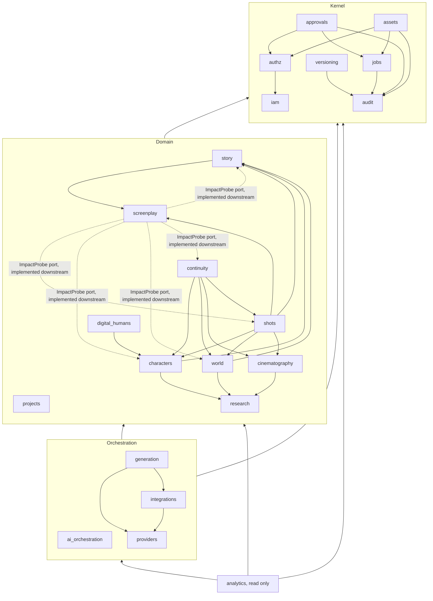
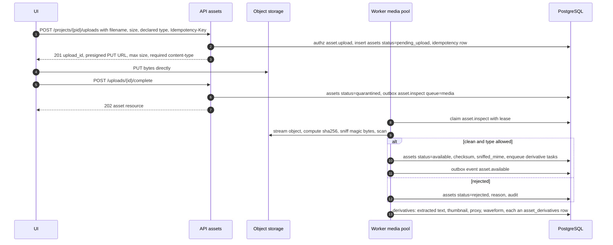
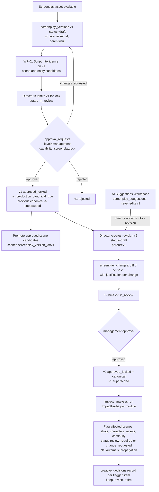
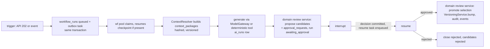
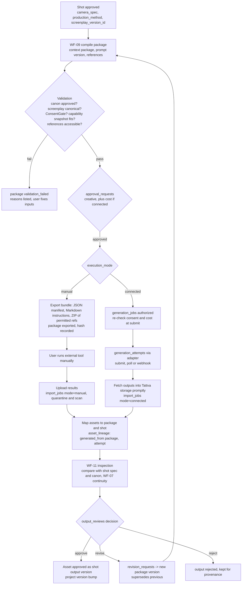

# High-Level Design — Tattva AI Film Director

**Doc ID:** TFD-ARC-002 · **Version:** 1.0-draft · **Date:** 2026-11-05 · **Status:** Phase B design — pending approval

**Inputs:** Master Execution Prompt §4–§6, §11–§13, §18 (backend responsibility list), §19; Gap Report v1.0 §7.5, §10–§11; `docs/audit/01`, `02`, `03`, `06`, `10`; code under `packages/services/*`, `packages/workflows/*`, `packages/persistence/*`, `apps/api/routers/*`.

**Related:** `SYSTEM_ARCHITECTURE.md` (containers, trust), `LOW_LEVEL_DESIGN.md` (state machines, transactions), `DATABASE_DESIGN_AND_ERD.md` (columns), `API_AND_EVENT_CONTRACTS.md` (routes, events).

---

## 1. Design rules for module boundaries

1. **One owner per table.** Only the owning module's repositories issue SQL against a table. Other modules call the owner's **facade** (`packages/<module>/api.py`) or react to its **domain events**. Today a single `packages/persistence/repositories.py` serves every module; it is split per module in Phase C, without changing SQL behaviour.
2. **Services own transactions; repositories never commit.** This rule already exists in `repositories.py` (module docstring) and is kept.
3. **Canonical writes only in domain review services, after an approval decision.** This continues the existing pattern: `ScriptReviewService.promote_approved`, `ResearchReviewService.commit_approved_candidates`, `StoryboardReviewService…`, `FilmBibleReviewService…`. LangGraph nodes call these services and never touch repositories directly.
4. **Dependencies point inward:** `analytics → orchestration → domain → kernel`. Domain modules never import `packages/workflows/*`; they start workflows by enqueuing a graph ID through `jobs`.
5. **Cross-domain reads use facades. Cross-domain reactions use events.** When an upstream module needs downstream information, as screenplay impact analysis does, the downstream module registers an **ImpactProbe** port. This inverts the dependency instead of creating a cycle (§4.2).
6. **Enforcement:** `import-linter` contracts in CI (layers + forbidden imports). This is a new dev dependency, justified because a modular monolith without a mechanical boundary check erodes. **Recommended.**

---

## 2. Module catalogue (Master Prompt §18 backend list)

**Layer key:**
- **K** = platform kernel
- **D** = domain
- **O** = orchestration
- **A** = analytics

"Ports" are the interfaces a module exposes (facade, ↑) or depends on (adapter, ↓).

| # | Module (target package) | Layer | Responsibilities | Owned tables (target; *italic* = exists today) | Ports | Allowed dependencies |
|---|---|---|---|---|---|---|
| 1 | Authentication & identity (`iam`) | K | Verify JWT, map IdP subject to user, resolve `ActorContext`, provision users at first login | *`organizations`*, *`users`* (+ `auth_issuer`, `auth_subject`) | ↓ `AuthProvider` (OIDC/JWKS; test header adapter). ↑ `resolve(token) -> ActorContext` | none (base) |
| 2 | Authorization (`authz`) | K | Org and project membership; role templates; capability checks; approval authority | `memberships`, `project_memberships`, `role_templates`, `capabilities` | ↑ `Authorizer.require(actor, capability, resource)`, `can(...)`, `approvers_for(capability, project)` | iam |
| 3 | Project management (`projects`) | D | Project CRUD; production format and mode; delivery profile; templates; archive | *`projects`* | ↑ `ProjectFacade.get_scoped`, `production_mode_for(...)` | iam, authz, audit, versioning |
| 4 | Screenplay governance (`screenplay`) | D | Screenplay versions, the lock, the director-revision workflow, the AI Suggestions Workspace, change diff, impact analysis, creative decisions | `screenplay_versions`, `screenplay_changes`, `screenplay_suggestions`, `creative_decisions`, `impact_analyses` | ↑ `ScreenplayFacade.production_canonical(project)`, `assert_locked(version_id)`. ↓ `ImpactProbe` (implemented by story, shots, characters, assets, continuity) | projects, assets, approvals, versioning, audit, jobs |
| 5 | Story intelligence (`story`) | D | Scenes and dialogue derived from a screenplay version; the legacy entity extraction (WF-01) | *`scenes`*, *`scene_candidates`*, *`entities`*, *`entity_candidates`*, `dialogue_segments` | ↑ `StoryFacade.scenes_for(version)`, `ImpactProbe` | projects, screenplay (read the locked version), assets, approvals, versioning, audit |
| 6 | Research intelligence (`research`) | D | Questions, sources, claims, evidence, conflicts; historical and story timelines (WF-02) | *`research_questions`*, *`research_sources`*, *`research_claims`*, *`research_conflicts`*, *`research_claim_candidates`*, *`research_question_candidates`*, `research_evidence`, `timeline_events` | ↑ `ResearchFacade.claims(project, ids)` | projects, assets, approvals, versioning, audit |
| 7 | Character intelligence (`characters`) | D | Character identity profile, versions, physical identity and measurements, performance profile, character states; provenance per characteristic (WF-05) | `characters`, `character_versions`, `character_identity_profiles`, `physical_identity_profiles`, `body_measurements`, `performance_profiles`, `character_states` | ↑ `CharacterFacade.approved_version(...)`, `ImpactProbe` | projects, story (read), research (read), assets, approvals, versioning, audit |
| 8 | Digital human management (`digital_humans`) | D | Performers (real people), **consent**, digital humans, avatar versions, voice profiles; the **ConsentGate** | `performers`, `performer_consents`, `digital_humans`, `avatar_versions`, `voice_profiles` | ↑ `ConsentGate.check(performer_ids, purposes, project, at)` and `ConsentGate.require(...)` | characters (read), assets, approvals, authz, audit |
| 9 | Cinematography (`cinematography`) | D | Camera, lens and lighting libraries; the project cinematography profile (Cinematography Bible); the **Film Bible / visual-language rules** (WF-04); on-set capture plans, requirements, manifests and footage | `camera_profiles`, `lens_profiles`, `lighting_profiles`, `cinematography_profiles`, *`film_bible_rules`*, *`film_bible_rule_candidates`* (WIP), `capture_plans`, `capture_requirements`, `capture_manifests`, `production_footage` | ↑ `CinematographyFacade.profile(project)`, `validate_camera_spec(spec)` | projects, research (read), assets, approvals, versioning, audit |
| 10 | Environment management (`world`) | D | Locations, environment profiles and states; costumes and costume states; props and weapons and their states | `locations`, `environment_profiles`, `environment_states`, `costumes`, `costume_states`, `props`, `prop_states` | ↑ `WorldFacade.state_at(entity, scene)`, `ImpactProbe` | projects, story (read), research (read), assets, approvals, versioning, audit |
| 11 | Storyboard & shot planning (`shots`) | D | Storyboard panels (WF-03), sequences, shots, the provider-neutral **Shot Specification** (`camera_spec`, production method), per-level production-mode inheritance (WF-06) | *`storyboard_panels`*, *`storyboard_panel_candidates`*, `sequences`, `shots` | ↑ `ShotFacade.spec(shot_id, version)`, `effective_production_mode(...)`, `ImpactProbe` | projects, screenplay (read), story, characters, world, cinematography (read), assets, approvals, versioning, audit |
| 12 | Continuity (`continuity`) | D | Continuity rules, findings, decisions; the continuity status model; comparison of outputs against canon (WF-07) | `continuity_rules`, `continuity_findings`, `continuity_decisions` | ↑ `ContinuityFacade.status(subject)`, `ImpactProbe` | characters, world, cinematography, shots (read), assets, approvals, audit |
| 13 | Asset management (`assets`) | K | Upload (presigned), quarantine and scan, immutable originals, derivatives, lineage, provenance, signed access | *`assets`*, `asset_derivatives`, `asset_lineage` | ↓ `StorageService` (exists: `packages/storage/service.py`), `ScanPort`, `MediaProbePort`. ↑ `AssetFacade.register_import(...)`, `signed_url(...)` | iam, authz, audit, jobs |
| 14 | AI orchestration (`ai_orchestration`) | O | LangGraph graphs WF-01…WF-11; graph runner; the shared approval gate; ContextResolver; ModelGateway; prompt versions; AI run records and evaluation | *`workflow_runs`*, `context_packages`, `ai_runs`, `prompt_versions`, `evaluation_records`; LangGraph checkpoint tables (separate schema) | ↓ `ModelGateway` (mock adapter first, DEC-004). ↑ `start_run(workflow, inputs)`, `resume(approval)` | every D module facade, kernel |
| 15 | Provider registry (`providers`) | O | Provider catalogue, versioned capability snapshots, org connections, execution modes, the recommendation engine input | `providers`, `provider_capability_snapshots`, `provider_connections` | ↑ `ProviderRegistry.snapshot(id)`, `modes_for(task)` | authz, audit |
| 16 | Integration adapters (`integrations`) | O | Protocol adapters: `ManualAdapter` (always present), `ApiAdapter`, `McpAdapter`, one per verified provider; webhook verification; the redacted execution log | `external_execution_logs` | ↑ `ProviderAdapter.submit/status/fetch/cancel`, `verify_webhook` | providers, assets (fetch into storage), audit |
| 17 | Generation jobs (`generation`) | O | Production packages (compile, validate, export), generation jobs and attempts, costs, manual and connected import, output review, revision requests (WF-09, WF-10, WF-11) | `production_packages`, `generation_jobs`, `generation_attempts`, `generation_cost_records`, `import_jobs`, `output_reviews`, `revision_requests` | ↑ `PackageService`, `GenerationService`, `ImportService` | shots, characters, world, cinematography, continuity (read); digital_humans.ConsentGate; providers; integrations; assets; approvals; versioning; audit; jobs |
| 18 | Approvals (`approvals`) | K | Generalized `approval_requests` (scope, target, level, required capability, steps); decision recording; dispatch to the owning module's decision handler | *`approval_requests`* | ↑ `ApprovalService.request(...)`, `decide(...)`. ↓ `DecisionHandler` registry keyed by `scope` (replaces the `if/elif` in `apps/api/routers/approvals.py`) | iam, authz, audit, jobs |
| 19 | Versioning (`versioning`) | K | Project version bump (locked + unique), version snapshot references | *`project_versions`* | ↑ `VersioningService.bump(project, expected, message, refs)` | audit |
| 20 | Audit (`audit`) | K | Append-only audit events; job event log | *`audit_events`*, `job_events` | ↑ `AuditRepository.record` (exists) | none |
| 21 | Analytics (`analytics`) | A | Usage records, product instrumentation, read models; read-replica eligible | `usage_records` | ↑ read-only queries | read-only on all modules |
| — | Platform jobs (`jobs`), a support module not named in §18 | K | Outbox (lease, retry, DLQ), domain-event publication, idempotency keys, notifications | *`outbox_tasks`*, `idempotency_keys`, `notifications` | ↑ `enqueue(task)`, `publish(event)`, `IdempotencyStore` | audit |

### 2.1 Dependency direction

**Forbidden imports:**
- any `D → O`
- `K → D` and `K → O`
- domain → another domain's repositories (facades only)
- `integrations → generation` (adapters are dumb protocol translators)
- `apps/ui → packages/*` (the UI may call only the API, as today)

### 2.2 Map of existing code onto target modules

| Existing path | Contents today | Target module and action |
|---|---|---|
| `packages/services/identity.py` | `IdentityService.resolve`, `ActorContext`, `AuthenticationError` | `iam`. Keep `ActorContext` and extend it with `memberships` and `capabilities`. Replace header resolution with an `AuthProvider`. The header becomes a test-only adapter. |
| `packages/services/projects.py` | `ProjectService` (create, list, get, versions, audit_log, canonical lists, candidates overview) | `projects`. The read aggregations (`candidates()`) move to the owning modules' facades. Keep the route-facing service as a thin composition. |
| `packages/services/assets.py` | `AssetService.upload`/`list`, `validate_upload` | `assets`. Add presigned flow, quarantine and scan, derivatives. `validate_upload` stays as a policy function. |
| `packages/services/script_intelligence.py` | `ScriptIntelligenceService` (start, execute, decide, `_invoke`) | `ai_orchestration`. Becomes a `GraphRunner` subclass configured for WF-01 (LLD §9). |
| `packages/services/script_review.py` | `ScriptReviewService` (propose, promote_approved, close_rejected), `record_decision`, `RunScope` | `story` (review service). `record_decision` moves to `approvals`. `RunScope` moves to `ai_orchestration` (it is defined four times today). |
| `packages/services/historical_research.py` | `HistoricalResearchService` run lifecycle | `ai_orchestration` (WF-02 runner) |
| `packages/services/research_review.py` | `ResearchReviewService` | `research` (review service). The version bump moves to `VersioningService` (race fix). |
| `packages/services/research.py` | `ResearchService` manual create/list | `research`. Manual creates route through candidate → approval, or a capability-gated direct path with version and audit (SEC-06). |
| `packages/services/storyboard.py` | `StoryboardIntelligenceService` (WF-03 runner), `StoryboardService` (list) | Runner → `ai_orchestration`; list → `shots` |
| `packages/services/storyboard_review.py` | `StoryboardReviewService` | `shots` (review service) |
| `packages/services/film_bible.py` (WIP) | `FilmBibleSynthesisService` (WF-04 runner), `FilmBibleService` (manual rules) | Runner → `ai_orchestration`; rules → `cinematography`. Fix forward first (DEC-010). |
| `packages/services/film_bible_review.py` (WIP) | `FilmBibleReviewService` | `cinematography` (review service) |
| `packages/workflows/{script_intelligence,historical_research,storyboard_intelligence,film_bible_synthesis}/` | Graphs, generators, state | `ai_orchestration/graphs/wf01…wf04`. The generators (`ScreenplayParser`, `HistoricalInvestigator`, `StoryboardAligner`, `FilmBibleSynthesizer`) sit behind `ModelGateway` or as deterministic tools, labelled with `generator_mode`. |
| `packages/workflows/checkpointer.py` | `get_checkpointer()` with `setup()` per call | `ai_orchestration`. Move `setup()` to the `migrate` entrypoint (PERF-02). |
| `packages/persistence/repositories.py` | 13 repository classes in one file | Split per owning module. `CandidateRepository` splits into each domain's candidate repository. |
| `packages/persistence/models.py` | 23 ORM models | Split per module. Keep a `models/__init__.py` re-export so Alembic `env.py` and existing imports keep working. |
| `packages/storage/*` | `StorageService` ABC, local implementation, factory | `assets` adapters. Add `S3StorageService` with `presign_put/presign_get` and streaming `store_stream`. |
| `packages/domain/{enums,errors,invariants}.py` | Shared vocabularies and errors | Keep as the shared kernel. Per-module enums move next to their modules over time, with re-exports. |
| `apps/worker/worker.py` | `TASK_HANDLERS` keyed by graph ID | `jobs` dispatcher. Handlers registered by modules; queue-aware; lease and retry (LLD §5). |
| `apps/api/routers/approvals.py` | Scope dispatch via `if/elif` with a script default (SEC-08) | A `DecisionHandler` registry. An unknown scope returns 422. |

---

## 3. Cross-cutting runtime conventions

| Concern | Convention |
|---|---|
| Actor and tenant | Every service method takes `ActorContext` first (existing convention). Tenant scope comes from the project row loaded via `get_scoped(project_id, org_id)`. Foreign IDs in request bodies are validated by the owning module's facade against the same project (fixes SEC-04). |
| Production mode | Effective mode = the first non-null of shot → scene → sequence → character (for character-centric work) → project. `projects.production_mode ∈ {fully_ai, hybrid_live_action, mixed}`. `shots.production_method ∈ {fully_ai_generated, live_action_chroma, performance_transformation, digital_human, combined}`. Resolution is done by `ShotFacade.effective_production_mode`. |
| Provenance | Each characteristic carries a `provenance` JSONB envelope `{source, status, confidence, approved_by, version}`. Assets carry lineage edges (`asset_lineage`). |
| Generator labelling | Every `workflow_runs`/`ai_runs` row records `generator_mode ∈ {deterministic, mock, live}` and the model route (`docs/audit/06` §5.7). |

---

## 4. Data flows

### 4.1 Universal intake (V1-03)

- Originals are never mutated. Content addressing (`{org}/{project}/{sha256}_{name}`) is kept, and the key is finalized after hashing.
- PDF and DOCX get real text-extraction derivatives in the sandboxed media pool. Script Intelligence reads the `text_extraction` derivative, never `bytes.decode("utf-8")` of a PDF (fixes `script_review.py::load_script_text` behaviour, `docs/audit/03` §6).
- Classification (screenplay, research document, reference image, footage, …) is a candidate the user confirms. A confirmed screenplay creates a `screenplay_versions` draft (§4.2).
- **Compatibility:** `POST /projects/{pid}/assets/upload` (multipart) stays for small text files. Internally it uses the same quarantine path, with the scan run inline for files ≤ 1 MB.

### 4.2 Screenplay lock and revision (§5)

**Rules enforced in services:**
- Exactly one `approved_locked` version per project has `is_production_canonical = true`, enforced by a partial unique index (DATABASE doc §4).
- A locked version's text and source asset are immutable. "Editing" always creates a child version.
- `shots`, `sequences` and `scenes` carry `screenplay_version_id`. Packages refuse shots whose screenplay version is not the production canonical one, unless a `creative_decisions` row explicitly keeps them (the "keep" decision).
- Impact analysis is computed by `ImpactProbe` implementations registered by `story`, `shots`, `characters`, `world` and `continuity`. Each returns `{subject_type, subject_id, reason, severity}` for the scene keys whose text changed in `screenplay_changes`. The screenplay module stores the union in `impact_analyses.items` and publishes `screenplay_version.impact_analyzed`.

### 4.3 Workflow graphs (WF-01…WF-11)
Every graph follows the existing pattern, now extracted into one shared helper (LLD §9):

| WF | Legacy | Module that owns the review service | Input | Candidate output → canon | Approval level |
|---|---|---|---|---|---|
| WF-01 Script Intelligence | G-01 | story | `screenplay_versions` (draft or locked) text derivative | scene/entity candidates → `scenes`, `entities` (→ `characters` adapter) | creative |
| WF-02 Historical Research | G-02 | research | topic, seed text, sources | claim/question candidates → `research_*`, `research_evidence` | creative |
| WF-03 Storyboard | G-03 | shots | brief, or panel images/PDF (PRD) | panel candidates → `storyboard_panels` | creative |
| WF-04 Film Bible | G-04 (WIP) | cinematography | approved claims, scenes, notes | rule candidates → `film_bible_rules` | creative |
| WF-05 Character / Asset | — | characters, world | scenes, references, research | character, costume, prop and location profile candidates | creative (+ consent for performer-linked) |
| WF-06 Shot Planning | — | shots | locked screenplay scenes, cinematography profile | sequence and shot candidates with `camera_spec` | creative |
| WF-07 Continuity | — | continuity | canon, shot specs, imported outputs | `continuity_findings` (candidate status) | creative (continuity supervisor) |
| WF-08 AI Director Review | — | ai_orchestration (advisory only) | shot or sequence plan | review notes; no canon writes | none (advisory) |
| WF-09 Prompt Compilation | — | generation | approved shot spec + context package + capability snapshot | `production_packages` draft | creative + cost when connected |
| WF-10 External Handoff | — | generation | approved package | manual export or a connected `generation_jobs` | cost / consent gates |
| WF-11 Output Inspection | — | generation + continuity | imported assets + package | `output_reviews` draft + continuity findings | creative |

### 4.4 Package → manual or connected execution → import → inspection loop (§12.1)

**Invariants:**
- The **same package envelope** serves both modes (Gap §7.5). Converting a connected job to manual is always possible before submission.
- A manual export never contains secrets. Reference bundles include only assets whose consent and rights allow the declared provider target. Restricted assets are delivered as short-lived signed links, never embedded in the Markdown.
- Imported outputs always become **new immutable assets** with `asset_lineage` edges to the package, the attempt (if connected) and the shot. Nothing overwrites an approved asset.

### 4.5 Consent gate checks (§6.5)

`ConsentGate.require(performer_ids, purposes, project_id, at=now)` passes only if, for every performer and purpose, a `performer_consents` row exists that is `active`, covers the purpose and the project (or `all_projects` reuse), and is within `valid_from`/`valid_until`.

| Checkpoint | Purposes checked | On failure |
|---|---|---|
| Linking a performer to a character or digital human (`digital_humans`, `avatar_versions`) | `digital_double` or `ai_avatar` | 409 `consent-required`; the link is not created |
| Reading restricted references (face, body, voice) | access requires capability `likeness.view`; purpose `appearance_model_derivation` when used for derivation | 403 / 409 |
| Package validation (WF-09) | derived from the shot's production method: `performance_transformation` → `performance_transformation`; `digital_human` → `digital_double` or `ai_avatar`; voice in package → `voice_clone` (synthetic or cloned voice) or `production_audio_use` (original recorded audio; Master Prompt §9 says recording permission ≠ clone permission); new performance from identity → `new_performance_generation`; other project → `future_project_reuse` | Package `validation_failed` with reason `consent_missing:{performer}:{purpose}` |
| Package approval | Re-check | Approval blocked |
| Generation job submit (connected) | Re-check inside the submit transaction | Job → `blocked_consent`; no provider call |
| Manual export | Re-check | Export refused |
| Import of transformed outputs | Re-check against the package's purposes | Import allowed but assets flagged `consent_review_required` |
| `consent.revoked` / `consent.expired` event | — | Unsubmitted packages → `invalidated`; queued jobs → `cancelled`; submitted attempts flagged; affected assets `consent_review_required`; notification sent to the legal officer and director |

Policy content (template, retention, revocation effects on already-delivered media) is **OPEN — DEC-007 / DEC-012** (approval gate #6). The gate's mechanics above do not depend on that outcome. No performer likeness or voice data may be stored in any environment until DEC-007 is approved.
