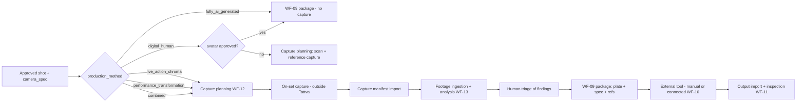
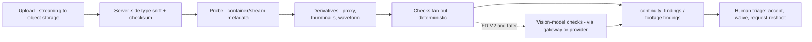

# Hybrid Production and Chroma Workflow

**Doc ID:** TFD-ARCH-HYB-001 · **Version:** 1.0-draft · **Date:** 2026-11-05 · **Status:** Phase B design — pending approval

**Inputs:** Phase A audit `docs/audit/02` §2 (V2-07, V2-08, V2-10, V2-11, V2-12, V2-21) and §3 ("On-set capture planning & capture manifest", "Independent footage ingestion & analysis": NOT_IMPL), `docs/audit/01` (uploads are text-only; no media pipeline); PHASE_B shared brief (production modes, `production_method`, `capture_plans`, `capture_requirements`, `capture_manifests`, `production_footage`); companion docs `CINEMATOGRAPHY_AND_VIRTUAL_CAMERA_ARCHITECTURE.md`, `CHARACTER_AND_DIGITAL_HUMAN_ARCHITECTURE.md`, `INTEGRATION_ARCHITECTURE.md`; code `packages/storage/service.py`, `apps/api/routers/assets.py`, `packages/core/config.py::storage_allowed_mime_types`.

> **Source note.** Field lists reconciled against the Master Prompt field digest (2026-11-05). This document covers:
> - every §8.1 guided-capture instruction (§3.3 coverage table)
> - every §8.2 analysis issue (§6.2)
> - every §8.3 capture-manifest field (§4)
> - the §13 stage-13 output-inspection dimensions (§8)
> - the §4 Mode B hybrid examples (§2.1)

Hybrid live-action + AI is an **equal production mode** (Master Prompt §4, resolved by precedence in CON-08), not an add-on. Tattva does not operate cameras, key footage, track, or render. It **plans, records, ingests, checks, packages and reviews**. Keying, tracking solves, compositing and transformation are done by external tools (manual or connected) or by downstream post (V3 boundary).

---

## 1. Current state

| Element | CURRENT |
|---|---|
| Media upload | Text-only allowlist (`storage_allowed_mime_types`: txt, pdf, docx, json); whole-file in memory; client-trusted MIME (audit 01/08) |
| Media probing / derivatives | None |
| Production mode / method | None |
| Capture plans, manifests, footage | None |

**Precondition for everything below:** the media ingestion pipeline (streaming upload to object storage per DEC-003, server-side type sniffing, per-asset processing states, derivatives) from the asset/storage design. Footage is large. It must never pass through the API process in memory, and analysis runs in the worker.

---

## 2. Production method per shot

`shots.production_method` ∈ `fully_ai_generated | live_action_chroma | performance_transformation | digital_human | combined`. Mode inheritance (`fully_ai | hybrid_live_action | mixed`, project → sequence → scene → character → shot; null means inherit) sets the **default**. The shot's method is always explicit once the shot is approved.

### 2.1 Master Prompt §4 Mode B examples → production method

| §4 hybrid example | `production_method` (+ representation) |
|---|---|
| real actors on green/chroma | `live_action_chroma` |
| real anchors → AI anchors | `performance_transformation` or `digital_human` (digital double, mode A) |
| real performers → AI historical characters | `performance_transformation` (fictional avatar preserving performance, mode B) |
| live-action actors in AI environments | `combined` (chroma plate + virtual environment) |
| real performance + digitally generated costumes/appearances | `performance_transformation` (mode A with approved costume transformation) |
| real movement transferred to AI characters | `performance_transformation` or `digital_human` driven by `motion_capture` |
| AI environments + physical performances | `combined` |
| real footage and fully AI shots in the same sequence | per-shot methods within a `mixed` sequence |

---

## 3. Capture planning (WF-12): an instruction generator

Capture planning is a **deterministic rule engine** (`CapturePlanningService`, a plain service, see the AI doc §7.1). It turns a shot's method, camera movement, actor movement and target-provider requirements into a list of `capture_requirements`. AI may suggest *additional* notes as `recommended` items. It never removes a rule-generated requirement.

### 3.1 Inputs

| Input | Source |
|---|---|
| `production_method` | shot |
| Camera movement | `camera_spec.movement.move_type`, `repeatable`, `physical_camera.support` |
| Actor movement | shot action description plus structured `actor_movement`: `static | in_place | crosses_frame | enters_exits | full_body_action | stunt` (new shot field) |
| Interaction with CG | `cg_interaction`: `none | eyeline_only | contact | occlusion | prop_handoff` |
| Environment | `environment_states`, time of day, `lighting` block |
| Target provider requirements | `provider_capability_snapshots.input_requirements` for the intended transformation or compositing tool (only fields documented by the provider; empty when unknown, so no requirement is generated from it and the plan says so) |
| Representation | character representation type and consent status (EP-3) |

### 3.2 Rule table (initial, versioned as `capture_rules v1`)

| # | Condition | Generated requirement(s) |
|---|---|---|
| R1 | method ∈ {live_action_chroma, combined} | Chroma backing colour choice (green/blue) chosen against costume and prop colours from `costume_states`. **Conflict check:** a costume dominant colour within the hue band of the backing gives a blocking warning |
| R2 | R1 and `move_type ≠ locked` | Tracking markers on backing (spacing guidance from the profile), no markers crossing subject silhouette paths, lens metadata recording, camera height/tilt logged per take |
| R3 | R1 and `repeatable = true` or multi-pass | Motion-control or recorded camera path; clean plate pass with identical move |
| R4 | R1 and `move_type = locked` | Locked-off clean plate (subject out) per setup |
| R5 | Any plate for CG integration | Reference capture: colour chart, grey card, grey/chrome ball (or HDRI where the bible requires CG lighting match), lens distortion grid per lens and focal length used, measured camera-to-subject distance |
| R6 | `cg_interaction = eyeline_only` | Eyeline marks with position relative to camera; height of the CG subject from `physical_identity_profiles` (labelled estimated/verified) |
| R7 | `cg_interaction = contact` or `prop_handoff` | Stand-in props with tracking markers; prop dimensions from `props` |
| R8 | `actor_movement ∈ {full_body_action, stunt}` and method ∈ {performance_transformation, digital_human} | Full-body visibility in frame (no head or feet crop) when the downstream tool needs it per snapshot; motion-capture take if the representation requires it; consent purposes `motion_capture` / `performance_transformation` (EP-3) |
| R9 | method = performance_transformation | Driving performance shot per provider-documented input constraints, e.g. clip duration limits and framing, **only** if present in the verified snapshot; otherwise "check provider documentation" placeholder flagged `unverified` |
| R10 | method = digital_human and no approved avatar | Scan or measurement session (`body_measurements` capture), identity reference photo set per the character doc §3.3, performance profile reference takes |
| R11 | frame rate / shutter | From `camera_spec.format`. If the target provider documents an accepted frame-rate set, a mismatch gives a warning with conversion implications |
| R12 | Lighting | Lighting to match `lighting_profiles` of the virtual environment; backing evenness target; keep spill-reducing distance from subject to backing |
| R13 | Audio | Sync sound or guide track, slate/timecode requirement if dialogue present (`dialogue_segments`) |
| R0 | Every captured shot | Camera and lens setup (camera manufacturer/body, lens series, focal length, aperture from `camera_spec`); sensor and recording format (sensor mode, resolution, codec); camera-movement restrictions derived from the target tool's documented limits (if known) and from tracking needs |
| R14 | method ∈ {performance_transformation, digital_human} or representation ∈ {digital_double, fictional_avatar with performer-sourced traits} | Identity and movement reference pack: full-body capture, facial close-ups, side and three-quarter views, movement reference, walking and turning reference (consent EP-3) |
| R15 | Any shot whose character wears a costume, or uses a prop that will be transformed or matched | Costume and prop reference: stills of each costume and prop item under neutral light, in the current `costume_states` / `prop_states` |
| R16 | method ∈ {live_action_chroma, combined} or a location plate is needed | Background capture: empty background plates or stills of the real location or set for environment matching |
| R17 | Every captured shot | Required metadata: per-take camera, lens, focal length, focus distance, height, tilt, frame rate, shutter, ISO/EI, white balance, timecode, slate. These feed the `actual` overlay |

Each requirement row stores:
- `rule_id` and `rule_version`
- `severity`: `blocking | required | recommended`
- `rationale` (rendered text)
- `inputs_snapshot` (the values it was derived from)
- `status`: `open | satisfied | waived(reason, by)`

### 3.3 §8.1 guided-capture coverage

Every §8.1 instruction is generated by at least one rule. The rules are driven by the §8.1 inputs: transformation method, environment, camera movement, actor movement and provider requirements (§3.1).

| §8.1 instruction | Rule(s) |
|---|---|
| camera & lens setup | R0 |
| sensor & recording format | R0 |
| frame rate | R11 |
| lighting arrangement | R12 |
| green-screen distance | R12 (subject-to-backing distance) |
| green-screen illumination | R1, R12 (evenness target) |
| subject separation | R12 (separation light and distance to limit spill) |
| camera & subject tracking | R2 (camera), R7/R8 (subject or prop markers, mocap) |
| camera movement restrictions / tracking requirements | R0, R2, R3 |
| tracking markers | R2, R7 |
| clean-plate capture | R3, R4 |
| reference stills | R5 |
| full-body capture | R8, R14 |
| facial close-ups | R14 |
| side & three-quarter views | R14 |
| movement reference | R14 |
| walking & turning reference | R14 |
| costume & prop reference | R15 |
| colour chart | R5 |
| grey card | R5 (grey card alongside chart and grey/chrome ball) |
| lighting reference | R5 (HDRI / ball), R12 |
| dialogue & audio recording | R13 |
| background capture | R16 |
| required metadata | R17 |

The plan (`capture_plans`) is versioned. A spec change regenerates it as a new version with a diff, so the AD/VFX supervisor sees exactly what changed. Plans export as a call-sheet-friendly PDF/CSV and JSON (DEC-014).

---

## 4. Capture manifest

`capture_manifests` is the record of **what was actually shot**, imported from on-set logging and keyed to shots and takes:

| §8.3 field | Storage / notes |
|---|---|
| project | `project_id` (+ `organization_id`) |
| scene | `scene_id` |
| shot | `shot_id` (+ `capture_plan_id`, plan version) |
| performer | `performers_present[]`: performer IDs, role (actor, stand-in, stunt), checked against consent (EP-3, EP-7) |
| camera | per take: camera ID on set + camera manufacturer/body (`actual` overlay, cinematography doc §8) |
| lens | per take: lens manufacturer/series, focal length, aperture, focus distance (`actual`) |
| recording settings | per take: resolution, frame rate, shutter, ISO/EI, white balance, codec, timecode (`actual`) |
| lighting setup | lighting diagram/notes asset + key values (`lighting` actuals) |
| capture requirements | the `capture_requirements` rows of the plan version captured against |
| required footage | derived list of clips/passes the plan requires (plate, clean plate, references, reference packs R14–R16) |
| captured footage | `takes[]`: take number, circled/selected, clip filename(s), timecode in/out, notes; `reference_captures[]` with roles |
| validation | per requirement: `satisfied | not_satisfied | waived`, with evidence; plus WF-13 analysis findings linked |
| missing information | computed list: required footage not captured, metadata fields absent, unmatched clips |
| approval status | `draft | submitted | review_required | approved | changes_requested`, via generalized `approval_requests` |
| (provenance) | `source` = `manual_entry | csv_import | json_import` (camera-report CSV formats added as import mappers; no vendor-specific format assumed); `submitted_by`, `submitted_at`, `version` |

Manifest-to-file reconciliation is deterministic: every manifest clip must match an ingested `production_footage` file by filename + size, or by checksum where supplied. Unmatched entries in either direction are listed as findings.

---

## 5. Chroma capture, tracking, clean plates, reference capture

These are **requirements and evidence**, not processing:
- **Chroma.** Backing colour, evenness target and spill guidance are generated (R1, R12). Evidence is the plate clips plus reference stills. Keying quality is assessed in §6 heuristics and finally by the external keying tool or post.
- **Tracking.** Marker requirements (R2). Evidence is the plate. Solve files (from an external tracker or a connected tool) are imported as assets with role `tracking_solve` and linked to `camera_spec_virtual.match_to_plate_shot_id`.
- **Clean plates.** R3/R4. Evidence is a clip with role `clean_plate` linked to the take. Missing gives a finding.
- **Reference capture.** R5. Assets with roles `color_chart`, `grey_ball`, `chrome_ball`, `hdri`, `lens_grid`, `set_measurement`. These become **reference inputs** in WF-09 packages where the target supports reference roles.

---

## 6. Independent footage ingestion and analysis (WF-13)

Footage may come from Tattva-planned shoots **or independently**, e.g. existing footage, a second unit, or stock. Ingestion never requires a plan. When there is no plan, findings are reported against the camera spec if a shot is mapped, else against project defaults.

### 6.1 Pipeline

`production_footage` rows hold: `asset_id`, probed metadata (JSONB), `shot_id`/`take` mapping (`mapped_by`: `manifest | filename_rule | user`), `analysis_status`, `findings_count`.

### 6.2 Issue types and detection honesty

Legend:
- **DET**: deterministic, implementable in FD-V1/V2 with probe tools (e.g. ffprobe/MediaInfo-class metadata readers) or simple pixel statistics on decoded frames.
- **HEUR**: deterministic heuristic on decoded frames. It gives an indicative score, needs per-project threshold calibration, and is never authoritative.
- **AI/FUTURE**: needs a vision or audio model. Not built until an evaluation set exists (AI doc §11). Until then the check is listed as "manual review" in the UI.

**§8.2 rule: recommend, do not reject unnecessarily.** Every finding is a recommendation with a severity (`info | advisory | blocking`) and a suggested remedy, e.g. "re-shoot clean plate", "use a tool that accepts 25 fps", "accept and note for post". Only consent violations and hard target incompatibilities are `blocking`. Footage is never auto-deleted or auto-rejected. The human triage decides.

**A. The eleven §8.2 issue types (verbatim) and how each is detected:**

| §8.2 issue | Detection | Method | Release |
|---|---|---|---|
| missing references | **DET** | Presence of required asset roles (`color_chart`, `grey_card`, `clean_plate`, `hdri`, R14–R16 packs) vs `capture_requirements` and manifest | FD-V1 |
| lighting problems | **DET** (metadata WB/ISO vs plan, where embedded) + **HEUR** (luma/colour-temperature drift across takes of one setup) + **AI/FUTURE** (lighting-direction mismatch vs `lighting_profiles`) | | FD-V1 / FD-V2 / Future |
| green-screen spill | **AI/FUTURE** | Needs subject segmentation. Interim HEUR risk score from backing-to-subject distance in the manifest (R12) | Future (HEUR risk FD-V2) |
| inadequate tracking info | **DET** (camera moved per spec/manifest but no markers requirement satisfied, no lens/height metadata, no solve imported) + **AI/FUTURE** (marker visibility count) | | FD-V1 / Future |
| motion blur | **HEUR** (metadata: shutter angle vs move speed) / **AI/FUTURE** (image-based blur estimate) | | FD-V2 / Future |
| occlusion | **AI/FUTURE** | Person/subject detection to find the subject blocked by foreground or crossing frame edge. Interim: reviewer checklist item | Future |
| inconsistent frame rates | **DET** | Probe frame rate per clip (incl. VFR flag) vs `camera_spec.format.frame_rate_fps`, vs other takes in the shot, and vs delivery profile | FD-V1 |
| exposure inconsistencies | **DET** (embedded ISO/shutter/aperture differences across takes, when present) + **HEUR** (luma histogram clipping and mean-level drift across takes) | | FD-V1 partial / FD-V2 |
| camera movement limitations | **DET** (`movement.move_type` / duration vs target tool limits recorded in the capability snapshot, when documented) + **HEUR** (rolling-shutter risk = readout time × move speed) | | FD-V1 / FD-V2 |
| audio issues | **DET** (missing audio stream, channel layout, sample rate, duration mismatch, timecode gap) + **HEUR** (clipping peaks, silence) + **AI/FUTURE** (intelligibility, noise classification) | | FD-V1 / FD-V2 / Future |
| insufficient face/body references | **DET** (R14 roles present: full-body, facial close-ups, side and three-quarter, walking/turning) + **AI/FUTURE** (quality: face size, sharpness, angle coverage) | | FD-V1 / Future |

**B. Additional deterministic and heuristic checks:**

| Issue type | Detection | Method | Release |
|---|---|---|---|
| Frame-rate mismatch vs target | **DET** | Probe stream frame rate (incl. variable-frame-rate flag) vs `camera_spec.format.frame_rate_fps` creative_target and delivery profile | FD-V1 (with media pipeline) |
| Resolution / aspect ratio mismatch | **DET** | Probe width/height/sample aspect vs spec | FD-V1 |
| Codec / bit depth / chroma subsampling unsuitable for keying | **DET** | Probe pixel format (e.g. 4:2:0 vs 4:2:2/4:4:4) and bit depth; flag against the bible's minimum for chroma shots | FD-V1 |
| Colour space / transfer tag mismatch | **DET** (tags only) | Probe colour primaries/transfer tags vs expected. Untagged files are flagged "unknown", not assumed | FD-V1 |
| Duration / timecode coverage vs manifest | **DET** | Probe duration and timecode track vs manifest in/out | FD-V1 |
| Missing clean plate / reference captures | **DET** | Manifest and asset-role presence vs `capture_requirements` | FD-V1 |
| Audio missing / channel layout / sample rate | **DET** | Probe audio streams | FD-V1 |
| Exposure metadata (ISO, shutter, WB) vs target | **DET only when embedded** | Camera metadata where the container or sidecar exposes it. Coverage varies by camera, so absence is reported, never inferred | FD-V1 partial |
| Exposure problems in image (clipping, crushed blacks) | **HEUR** | Luma histogram on sampled frames: % pixels at code-value extremes | FD-V2 |
| Chroma backing unevenness | **HEUR** | Hue/saturation variance within a user-drawn or default backing region on sampled frames | FD-V2 |
| Chroma spill on subject | **AI/FUTURE** | Needs subject segmentation | Future |
| Motion blur / shutter too slow for tracking or keying | **HEUR** (metadata) / **AI** (image) | Shutter angle from metadata vs move speed; image-based blur estimate is future | FD-V2 / Future |
| Focus issues / soft subject | **AI/FUTURE** | Sharpness on subject needs a subject region; global Laplacian variance is HEUR only and not decision-grade | Future |
| Tracking markers insufficient / occluded | **AI/FUTURE** | Marker detection | Future |
| Subject crossing frame edge (cropped limbs needed for transformation) | **AI/FUTURE** | Pose/person detection | Future |
| Rolling-shutter skew | **HEUR** (risk from metadata: readout time × move speed) / **AI** (detection) | | FD-V2 / Future |
| Dropped / duplicated frames | **DET** | Frame timestamp continuity from probe packet data | FD-V2 |
| Compression artefacts / heavy noise | **HEUR** | Bitrate per pixel + noise estimate; indicative only | FD-V2 |
| Eyeline / screen-direction mismatch vs spec | **AI/FUTURE** | | Future |
| Continuity: costume/prop/injury state vs canon | **AI/FUTURE** (visual) / manual | Until then, a reviewer checklist generated from effective `character_states`/`costume_states` at the shot | FD-V1 checklist, Future AI |
| Performer present without consent | **DET** (manifest) | `performers_present` vs `performer_consents` (EP-7). Face recognition is **not** used (DEC-017) | FD-V1 |

The probe toolchain (bundling a media probe binary in the worker image, version pinning, and licence review) is **OPEN — DEC-018** (new). Recommendation: an ffprobe/FFmpeg build with a licence compatible with commercial use (LGPL configuration), pinned in the worker Dockerfile (DEC-008), invoked with a timeout on files from object storage, never on user-supplied paths.

Every finding records `check_id`, `check_version`, `method` (DET/HEUR/AI), `measured_value`, `threshold` and `evidence` (frame numbers/timecodes, derivative asset ID). Heuristic findings are labelled as such in the UI.

---

## 7. Performance transformation and the digital-human path

**Performance-preserving transformation** (shot-scoped):
1. Plate approved in triage.
2. Consent EP-4/EP-5 for `performance_transformation` (and `third_party_provider_submission` with the chosen provider).
3. WF-09 compiles a package: plate (role `driving_performance`), target appearance references (avatar version or reference set), camera spec, and the constraints and dispositions from the target's snapshot.
4. WF-10 runs it manually or connected (integration doc).
5. Output import (§8).

The output lineage records plate, appearance source, avatar version, package hash and provider attempt.

Per §6.3, Tattva **inspects the transformed output against the original performance reference**. The review screen shows plate and output in sync, with a checklist for each preserved quality:
- movement
- timing (DET: duration and frame count equality)
- gestures
- facial expressions
- performance intensity
- screen direction
- spatial positioning

Automated comparison is AI/FUTURE.

**Digital-human path** (reusable):
1. Capture plan R10 produces a scan/measurement session, a reference photo set and performance takes.
2. Imports go to `body_measurements` (estimated/measured, then human-verified), identity reference sets and performance profile assets, all under consent EP-1.
3. A digital-human build package goes to an external tool (registry category `digital_human`/`avatar`).
4. The returned avatar is imported as `avatar_versions` candidate v1.
5. Approval at `creative` and `consent` levels (EP-2).
6. Shots then use the pinned avatar version, and production proceeds as `digital_human` method shots without per-shot capture (unless the method is combined).

---

## 8. Quality checks and output import

- **Import** (WF-11):
  - Returned files (manual upload or connected fetch) become **new immutable assets** with `asset_lineage` to the package, the attempt and every input asset.
  - They are mapped to shot and take: automatic when the package ID is known, otherwise by user mapping (Gap Report §7.2 step 5).
  - Nothing overwrites an earlier output.
- **§13 stage-13 inspection dimensions.** Each output review records a result per dimension: character identity, face consistency, body proportions, movement, costume, environment, lighting, composition, camera, lip-sync, artifact defects, continuity and quality. Each is `pass | issue | n/a` with notes and frame references, and feeds the §22 output-inspection metrics (AI doc §11.1a). Automated assists are limited to the DET/HEUR checks in §6. Everything else is human until evaluated.
- **Checks** on outputs reuse the §6 deterministic checks (frame rate, resolution, duration vs spec) plus:
  - **Spec deviation:** returned metadata vs `creative_target`, recorded as `actual` only if the provider returned it.
  - **Continuity checklist** from effective states (human).
  - **Identity review:** side-by-side with approved reference set (human; DEC-017).
  - **Consent recheck** (EP-7).
- **Review outcome:**
  - `approved`: the output becomes the shot's selected version.
  - `revision_requested`: `revision_requests` with structured reasons feeding the next package version.
  - `rejected`.

  Each decision is an approval with the reviewer and notes, audited.
- **Hand-off downstream** (V2-25): approved plates, solves, references and outputs plus manifests are exported as JSON/CSV (DEC-014). Tattva does not composite or conform (V3 boundary).

---

## 9. Requirements introduced

| ID | Requirement | Release |
|---|---|---|
| TFD-HYB-001 | `production_method` per shot with mode inheritance defaults | FD-V1 |
| TFD-HYB-002 | Rule-based capture planning (R1–R13, versioned) generating `capture_requirements` with severity and rationale | FD-V1 |
| TFD-HYB-003 | Capture manifest import (manual/CSV/JSON) with deterministic file reconciliation | FD-V1 |
| TFD-HYB-004 | Footage ingestion independent of planning; DET checks per §6.2 | FD-V1 (DET), FD-V2 (HEUR) |
| TFD-HYB-005 | Findings labelled DET/HEUR/AI; AI checks absent until evaluated | FD-V1 |
| TFD-HYB-006 | Performance transformation and digital-human paths gated by consent EP-3/4/5/7 | FD-V2 |
| TFD-OUT-0xx | Output import as immutable assets with lineage; review outcomes (number assigned by output doc) | FD-V1 (manual) |

## 10. Open decisions

| ID | Decision | Recommendation |
|---|---|---|
| **OPEN — DEC-003** | Object storage | Required before any footage ingestion (streaming, presigned upload) |
| **OPEN — DEC-014** | Interchange formats | JSON + CSV for plans and manifests first |
| **OPEN — DEC-017** (new) | No face recognition for performer presence | Manifest-declared presence only |
| **OPEN — DEC-018** (new) | Media probe toolchain in worker image | Pinned FFmpeg/ffprobe LGPL build; licence review |
