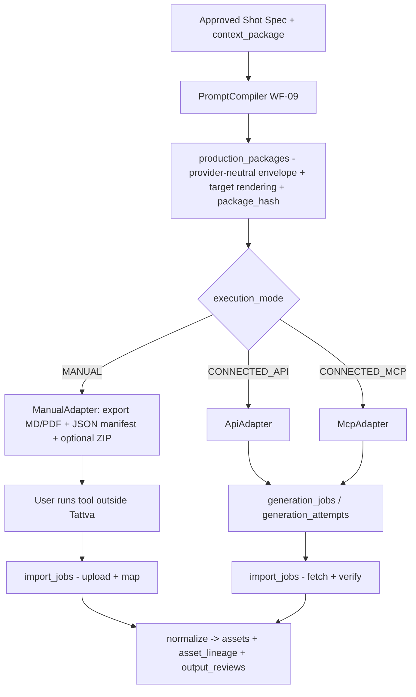
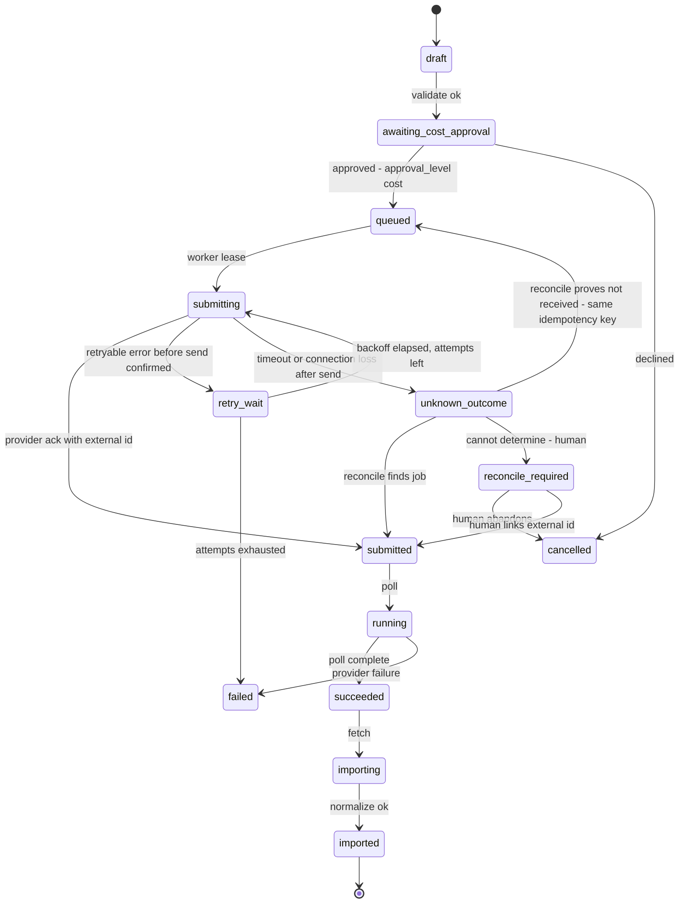

# Integration Architecture

**Doc ID:** TFD-ARCH-INT-001 · **Version:** 1.0-draft · **Date:** 2026-11-05 · **Status:** Phase B design — pending approval

**Inputs:**
- Phase A audit: `docs/audit/07` (no external calls; all 14 providers UNVERIFIED), `docs/audit/10` (DEC-006, DEC-013, DEC-014).
- Gap Report v1.0: §7.1 (CONNECTED_API / CONNECTED_MCP / MANUAL), §7.2 (Midjourney manual-only), §7.3 (Higgsfield separate API and MCP), §7.4 (onboarding gates), §7.5 (manual package contract).
- PHASE_B shared brief: external entity names.
- Code: `packages/core/config.py` (`higgsfield_integration_mode: Literal["manual_export"]`, `higgsfield_api_base_url`, `higgsfield_api_key`, "not yet consumed"), `packages/storage/service.py`.
- Official provider documentation found by web search on 2026-11-05 (register §11).

> **Source note.** Field lists reconciled against the Master Prompt field digest (2026-11-05). This document covers:
> - the §12.1 connected and manual flows (§2.1)
> - the §12.2 per-provider verification checklist (§11)
> - every §12.3 registry field (§3.4)
> - every §12.4 recommendation criterion (§10)

---

## 1. Current state

No code path calls any external service (audit 07). Higgsfield exists as three unused config fields. There are no providers, snapshots, packages, generation jobs, cost records, credential storage, MCP clients or import mapping. **Nothing in Tattva may be described as "connected" or "integrated" today.**

Product rules (requirements, not open questions):
- Tattva never generates media itself.
- Manual execution is permanent and first-class.
- Consent is checked before any likeness or voice use.
- Midjourney stays manual-only under its current terms.

---

## 2. Two first-class execution modes, one contract



- **Same package.** `production_packages` uses one envelope for every mode (Gap Report §7.5 fields): IDs and versions, execution mode, target, snapshot ID, compiler and schema version, prompt, negative guidance, camera/format fields, reference manifest (asset ID, version, checksum, role, rights and consent status), context package ID and hash, approvals, cost notice, user submission consent, `package_hash`.
- **Same import contract.** Every result, whether uploaded by a user or fetched by an adapter, goes through `import_jobs → normalize`. The output is new immutable assets, lineage to the package and attempt, and an `output_reviews` row.
- **MANUAL is never shown as a failed connection** (Gap Report §7.1). It is the default for every target, and connected mode is an upgrade per provider, per organization.
### 2.1 Master Prompt §12.1 flows → components

| §12.1 connected step | Component | §12.1 manual step | Component |
|---|---|---|---|
| prepare package | WF-09 `PromptCompiler` → `production_packages` | prepare package | same |
| validate inputs | `adapter.validate` + consent EP-5 | copy prompt/settings | `ManualAdapter.submit` export bundle (copy buttons, MD/PDF) |
| obtain user approval | `approval_requests` (`creative`) | download reference assets | ZIP / short-lived signed links (no secrets) |
| check permissions & cost | capability check + `adapter.estimate_cost` + `approval_level=cost` gate (§9) | open external app | registry `official_url` + manual instructions template |
| submit | `adapter.submit` (idempotency key) | user executes | outside Tattva; package marked `exported` |
| track job | `generation_jobs` / `generation_attempts`, `poll`, webhooks (§8) | user uploads result | `import_jobs` upload |
| receive result | `adapter.fetch` | validate file | `normalize`: checksum, type sniff, probe |
| import/link output | `normalize` → assets + `asset_lineage` | link to entity | import mapping UI → shot/character/environment/package |
| inspect | WF-11 | inspect | WF-11 |
| review → approve → version | `output_reviews` → approval → selected output version | review → approve → version | same |

- Config migration (expand→switch): `higgsfield_*` settings are superseded by registry rows plus `provider_connections`. The settings stay readable until the registry is live, then are removed in a contract step with a change note.

---

## 3. Universal Production Tool Registry

### 3.1 `providers` (one row per tool/vendor product)

| Field | Purpose |
|---|---|
| `id`, `slug`, `display_name`, `vendor` | |
| `categories[]` | `image_generation`, `video_generation`, `performance_transformation`, `digital_human`, `avatar_video`, `motion_capture`, `body_measurement`, `voice_tts`, `voice_clone`, `dubbing`, `lip_sync`, `cg_from_live_action` |
| `official_url`, `docs_url`, `terms_url` | from the verification register |
| `execution_modes_supported` | subset of `MANUAL`, `CONNECTED_API`, `CONNECTED_MCP`; **MANUAL is always present** |
| `automation_policy` | `permitted` \| `prohibited` \| `unreviewed`. Connected modes are disabled unless `permitted` |
| `terms_review` | `{status: unreviewed|in_review|approved|rejected, reviewed_by, reviewed_at, notes, terms_version_or_date}`. Legal sign-off (DEC-013) |
| `data_handling` | input licence, training/data-retention statement, output storage expiry, region: each a sourced value or `UNVERIFIED` |
| `consent_implications` | whether the tool processes likeness, voice or biometric data, which drives EP-5/EP-6 |
| `manual_instructions_template_id` | the user-facing manual runbook template |
| `status` | `candidate` \| `manual_only` \| `connected_pilot` \| `connected_ga` \| `suspended` \| `retired` |
| `verification` | `{verified_at, source_urls[], verified_by, unverified_fields[]}` |

### 3.2 `provider_capability_snapshots` (versioned and immutable)

A snapshot is the **only** source the compiler and adapters may use for what a provider accepts. One row per `(provider, model_or_tool, execution_mode, snapshot_version)`:
- `models_or_tools[]`, with names exactly as documented or as discovered over MCP
- `operations[]`: `generate`, `edit`, `transform`, `status`, `cancel`, `fetch_output`, `estimate_cost`
- `input_schema` (JSON Schema from the official OpenAPI/docs, or from MCP `tools/list`)
- `parameter_map` (cinematography doc §7)
- `input_requirements` (feeds capture rules R9 and R11)
- `reference_roles_supported`, `accepted_formats`, `limits` (only documented ones)
- `async_model`: `poll | webhook | both`
- `output_retention_note` (e.g. "output URLs expire", only if documented)
- `pricing_model` (a documented unit, or `UNVERIFIED`)
- `source_urls[]`, `captured_at`, `captured_by`
- `discovery_method`: `docs` | `mcp_tools_list` | `openapi`
- `status`: `draft | verified | deprecated`
- `contract_test_run_id`

Snapshots are **pinned** by packages. A provider change creates a new snapshot. Existing packages keep theirs, and re-compiling against the new snapshot is an explicit action.

### 3.3 `provider_connections` (per organization)

`organization_id`, `provider_id`, `execution_mode`, `credential_ref` (vault pointer, never the secret), `auth_kind` (`api_key | key_pair | oauth | jwt_from_key_pair`), `scopes`, `status` (`active | expired | revoked | error`), `last_verified_at`, `spend_limit`, `billing_owner_user_id`, `created_by`.

### 3.4 Master Prompt §12.3 registry field coverage

Every §12.3 field is stored. Model-level fields sit on the versioned snapshot, so that "versioned snapshots" (§12.3) applies to them.

| §12.3 field | Stored on | Column / key |
|---|---|---|
| provider ID | `providers` | `id` (+ `slug`) |
| provider name | `providers` | `display_name`, `vendor` |
| model ID | `provider_capability_snapshots` | `model_id` (exactly as documented/discovered) |
| model version | snapshot | `model_version` |
| task category | snapshot (+ provider `categories[]`) | `task_category` |
| capability description | snapshot | `capability_description` (sourced text) |
| input modalities | snapshot | `input_modalities[]` (`text`, `image`, `video`, `audio`, `mesh`, `mocap`, `measurement`) |
| output modalities | snapshot | `output_modalities[]` |
| reference asset capability | snapshot | `reference_roles_supported[]`, `max_references`, `accepted_formats` |
| character consistency capability | snapshot | `character_consistency` `{supported, mechanism (e.g. reference image, trained character), source_url}` or `UNVERIFIED` |
| motion capability | snapshot | `motion_capability` `{camera_motion, subject_motion, motion_reference_input}` |
| facial & body performance capability | snapshot | `performance_capability` `{facial, full_body, driving_video_input}` |
| camera/lens parameter support | snapshot | `parameter_map` dispositions for `camera_spec` paths (cinematography doc §7) |
| resolution & duration limits | snapshot | `limits.resolutions[]`, `limits.duration_s {min,max}`, `limits.frame_rates[]` |
| audio support | snapshot | `audio_support` `{generates_audio, accepts_audio, lip_sync}` |
| cost model | snapshot | `pricing_model` `{unit, source_url}` or `UNVERIFIED` |
| execution mode | snapshot | `execution_mode` (one per snapshot) |
| API/MCP/manual support | `providers` | `execution_modes_supported[]` |
| authentication method | `providers` (+ `provider_connections.auth_kind`) | `auth_method` |
| current verification status | snapshot (+ provider `verification`) | `status` (`draft | verified | deprecated`), `unverified_fields[]` |
| provider schema version | snapshot | `provider_schema_version` (API version header/date, OpenAPI version or MCP server version) |
| last verified date | snapshot (+ provider) | `verified_at` |

---

## 4. Provider onboarding gate

From Gap Report §7.4. Connected mode for a provider is enabled only when every gate is evidenced and recorded on the provider row and its snapshot:

| Gate | Evidence |
|---|---|
| Terms and rights | `terms_review.status=approved`; automation permitted; commercial use; input/output licence; training/retention; client-content constraints; likeness/voice rules |
| Auth and security | Auth method and scopes confirmed from docs; credential stored in vault; rotation and revocation tested |
| Capability contract | Snapshot `verified`; schema from official docs or live MCP discovery; contract tests pass against recorded fixtures |
| Execution lifecycle | Submit/status/cancel/timeouts/idempotency semantics documented, with unknown-outcome reconciliation tested |
| Output handling | Download, checksum, format and expiry behaviour verified; outputs copied to Tattva storage promptly |
| Commercial controls | Pricing unit known, or the cost gate falls back to "unknown cost — explicit acknowledgement" |
| Quality and ops | Golden requests run; latency and error rates recorded; manual fallback runbook exists |

---

## 5. Adapter interface

```python
# packages/integrations/adapter.py  (TARGET — illustrative)
class ProviderAdapter(Protocol):
    mode: Literal["MANUAL", "CONNECTED_API", "CONNECTED_MCP"]

    def compile(self, spec: ShotSpec, snapshot: CapabilitySnapshot, ctx: ContextPackageRef) -> ProviderPayload: ...
        # pure; delegates to PromptCompiler; returns rendered payload + disposition table
    def validate(self, payload: ProviderPayload, snapshot: CapabilitySnapshot) -> ValidationReport: ...
        # schema + limits + consent pre-check result (EP-5/EP-6 evaluated by caller, recorded here)
    def estimate_cost(self, payload: ProviderPayload, snapshot: CapabilitySnapshot) -> CostEstimate: ...
        # documented pricing only; else CostEstimate(kind="unknown", notice=...)
    def submit(self, payload: ProviderPayload, conn: ConnectionRef, idempotency_key: str) -> SubmitResult: ...
        # MANUAL: produces export bundle; connected: external call
    def poll(self, attempt: AttemptRef, conn: ConnectionRef) -> AttemptStatus: ...
        # MANUAL: returns awaiting_user_import
    def fetch(self, attempt: AttemptRef, conn: ConnectionRef) -> list[FetchedFile]: ...
        # MANUAL: no-op (files arrive via upload)
    def normalize(self, files: list[FetchedFile | UploadedFile], attempt: AttemptRef) -> NormalizedOutput: ...
        # shared implementation: checksum, sniff, probe, lineage, provider metadata -> 'actual' only if returned
```

- **Separate adapters per mode per provider.** `HiggsfieldApiAdapter` and `HiggsfieldMcpAdapter` are distinct classes with distinct snapshots (Gap Report §7.3). An OpenAPI contract is never taken as proof of MCP tools, or the reverse.
- **`ManualAdapter` is generic.** It is parameterised by the registry's manual instructions template and the target's snapshot (if any), and works for **every** provider, including those with no API.
- Adapters live in `packages/integrations/adapters/<provider>_<mode>.py`. Only adapters may import provider SDKs or HTTP clients, enforced by an architecture test.
- **Contract tests** use recorded fixtures (the AI doc's `RecordedAdapter` pattern) and run in CI. Live smoke tests are opt-in, nightly, and spend-capped.

---

## 6. MCP boundaries and schema discovery

- Tattva is an **MCP client** to provider MCP servers. Tattva does not expose its own canon as an MCP server in FD-V1/V2. If that is ever proposed it needs its own ADR.
- **Discovery.** On connection, and then on a schedule, the `McpAdapter` calls the server's tool listing and records the tools, their input schemas and descriptions into a **draft** snapshot (`discovery_method=mcp_tools_list`). A human (integration owner) reviews the diff against the last verified snapshot and promotes it. **New or changed tools are not callable until promoted.**
- **Allowlist.** Only tools mapped to Tattva operations (`generate`, `status`, `fetch_output`, …) in the verified snapshot are callable. Tools for billing, account, publishing or social posting (which provider MCP servers may expose; see the Higgsfield note in §11) are **never** called by Tattva.
- **Isolation.** MCP tool descriptions and results are untrusted input. They are never placed into Tattva's own LLM instructions, and the gateway's injection rules apply (AI doc §10). The MCP adapter never forwards Tattva credentials beyond the connection's own auth.
- **Session/auth.** For hosted MCP servers that use OAuth, the connection is per organization (or per user if the provider binds to a user account). Tokens live in the vault, with refresh and revocation handled by the connection lifecycle.

---

## 7. Auth and credential vault

- **Secrets.** API keys, key pairs, OAuth refresh tokens and webhook secrets are stored in a secrets manager (DEC-008 hosting dependent) or an envelope-encrypted table with a KMS-held key. `provider_connections.credential_ref` points to them.
- **Never** in `.env` for staging/prod, in logs, prompts, packages, exports or browser state (Gap Report §7.3). The current `higgsfield_api_key` / LLM key settings are dev-only and will be removed.
- Secrets are decrypted only inside the worker process at call time, for the duration of the call.
- Rotation via a UI action (`integration.manage` capability). On revocation, `status=revoked` and in-flight polls fail closed to `reconcile_required`.
- **Inbound webhooks:** a per-connection secret, signature verification as documented by the provider (e.g. Kling documents webhook signature verification, see §11), replay protection via `idempotency_keys`, and a minimal endpoint that only enqueues a poll. Webhooks are never trusted as the outcome itself: the adapter confirms by `poll`.

---

## 8. Jobs, retries, rate limits and unknown outcomes



- `generation_jobs` is the user intent: package, target, approvals. `generation_attempts` holds each provider interaction: external ID, idempotency key, request hash, status, error class, timestamps. `generation_cost_records` holds estimates and actuals.
- **Retries.** Only for classified retryable errors (network before send, documented rate-limit or 5xx responses), with exponential backoff and jitter, bounded by `max_attempts` (outbox extensions: `next_attempt_at`, `max_attempts`, `last_error_class`, `dead_lettered_at`).
- **Idempotency.** Where the provider documents an idempotency header (e.g. Sync Labs documents `Idempotency-Key`, §11), it is used. Otherwise Tattva deduplicates via its own `idempotency_keys` and **reconciles before any resubmit**.
- **Unknown outcome rule.** A billable submit whose result is unknown is **never blindly retried**. Reconciliation queries the provider using the external ID if one was received. With no external ID, it uses a provider-documented list/search operation if one exists. Failing both, it goes to `reconcile_required` for a human (Addendum §11.1).
- **Rate limits.** Per connection there is a token bucket, configured from documented limits, else conservative defaults, and adjusted when the provider returns rate-limit responses. Concurrency is limited per organization so one org cannot starve others.

---

## 9. Cost approval gate, output import and fallback to manual

- **Cost gate.**
  - Every connected submit requires an `approval_requests` row with `approval_level=cost`. It shows the estimate (documented pricing), the remaining org/project budget, and `kind=unknown` with an explicit acknowledgement when pricing is not documented.
  - Required approver role: per project policy (`required_role`). Auto-approval below a project threshold is allowed only for providers with documented pricing.
  - Actual cost is recorded from provider responses when available; mismatches over 10% raise a notification.
- **Output import.**
  - Outputs are downloaded promptly into Tattva storage (provider URLs may expire; BytePlus documents 24-hour output links for Seedance, §11), then checksummed, sniffed and probed.
  - They become immutable assets with lineage, and the provider URL is kept only as provenance.
  - Consent recheck at EP-7, then the `output_reviews` workflow (hybrid doc §8).
- **Fallback to manual.**
  - Any connected job can be converted to manual at any state before `submitted`.
  - After `submitted`/`unknown_outcome`, conversion requires a reconcile decision to avoid double spend.
  - A provider `suspended` in the registry flips its targets to manual automatically, and open packages remain exportable.

---

## 10. Tool recommendation engine (§12.4)

The engine is deterministic and explainable. It ranks registry targets for a given shot or package. There are no hidden model judgments in FD-V1. A learned component may only add a labelled `recommended` signal later, after evaluation.

**Hard filters** (exclusion, each with a stated reason):
1. category matches the shot's `production_method` need
2. provider `status` not `suspended`/`retired`
3. consent: EP-5 allows this provider for every performer-derived reference
4. any `mandatory`/`locked` spec field with disposition `unsupported` excludes the target
5. org policy (allowed providers, data residency)

**Scored criteria.** These are the fifteen §12.4 criteria, verbatim. A criterion is scored only when relevant to the task category, e.g. lip-sync only for dialogue shots. Weights are per project and visible, and default to equal weight across the applicable criteria, adjustable by the director. Each signal is in 0–1. A signal with no evidence scores a neutral 0.5 and is labelled "no evidence". It is never presented as measured.

| §12.4 criterion | Signal source |
|---|---|
| visual quality | evaluation records + reviewer `out.artifact_rate`/quality outcomes for provider × category in this org |
| character identity consistency | `out.character_consistency` history; snapshot `character_consistency` support |
| environment consistency | reviewer environment dimension outcomes (§13 stage-13 checklist); reference-role support for `environment` |
| motion realism | `out.motion_quality` history; snapshot `motion_capability` |
| facial performance | reviewer facial dimension outcomes; snapshot `performance_capability.facial` |
| full-body movement | reviewer movement outcomes; snapshot `performance_capability.full_body` |
| lip-sync | `out.lip_sync` history; snapshot `audio_support.lip_sync` |
| reference adherence | `pkg.reference_coverage` × reviewer adherence; share of required reference roles supported |
| camera control | share of non-null `camera_spec` fields with `native` / `reference` disposition |
| resolution | snapshot `limits.resolutions` meets the delivery profile (1 / partial / 0) |
| duration | snapshot `limits.duration_s` covers the shot duration (1), needs stitching (0.5), or cannot (0) |
| speed | observed median turnaround in this org; else neutral |
| cost | estimate vs remaining budget; unknown cost scores 0.5, labelled "unknown" |
| reliability | observed success rate and unknown-outcome rate of `generation_attempts`; else neutral |
| current provider compatibility | verified snapshot exists for the needed mode (connected verified = 1.0; manual only = 0.6, never excluded); snapshot not deprecated |

**Output.** A ranked list with the total score, per-criterion contributions, the exclusions with reasons, and "what would change the ranking" (e.g. "relax locked focal length to enable 2 more targets"). The user may override the ranking, and the user's choice and any override reason are recorded for evaluation. The engine never auto-submits. Paid or irreversible execution always requires explicit authorization (the cost gate, §9, and consent EP-5).

---

## 11. Provider verification register

**Verification date:** 2026-11-05. **Method:** web searches restricted to each provider's official domain(s). Facts below come from official-domain results. Pages were **not** fetched in full except where noted, and the Midjourney ToS direct fetch returned HTTP 403, so its text is taken from official-domain search excerpts and Gap Report source S1. **Every item must be re-verified by the integration owner at onboarding** (§4). Anything not confirmed from an official source is marked **UNVERIFIED**.

No endpoint paths, payload schemas or prices are asserted for implementation. Hosts and auth schemes are recorded only as documentation pointers.

| Provider | Official URL / docs | Public API? | MCP? | Auth (as stated in official docs) | Manual alternative | Automation / terms note | Source(s) |
|---|---|---|---|---|---|---|---|
| **FLUX.2** (Black Forest Labs) | https://docs.bfl.ai · https://docs.bfl.ml | **Yes.** FLUX.2 [pro]/[flex] generate/edit endpoints documented; async with a returned polling URL | **Official MCP integration page exists** (docs.bfl.ml/api_integration/mcp_integration); tool catalogue **UNVERIFIED** | `x-key` header (API key) | User-operated BFL interface: **UNVERIFIED**. Generic manual package export always available | Terms on automation, licence, retention: **UNVERIFIED** (not reviewed) | https://docs.bfl.ai/flux_2/flux2_text_to_image ; https://docs.bfl.ml/api-reference/models/generate-or-edit-an-image-with-flux2-%5Bpro%5D ; https://docs.bfl.ml/api_integration/mcp_integration |
| **Midjourney** | https://docs.midjourney.com | **No.** Community Guidelines (official): "Midjourney does not provide an API… automating interactions with Midjourney service is strictly prohibited", with "rare exceptions that are explicitly granted" | None | n/a | **Manual only.** User operates their own Midjourney session; Tattva exports prompt and manifest and imports results (Gap Report §7.2 flow) | **ToS prohibits automation:** "You may not use automated tools to access, interact with, or generate Assets through the Services" (ToS effective 27 May 2026 per official page). Also broad content licence and default public visibility: show the confidentiality warning before export (Gap Report §7.2). **Gap Report claim CONFIRMED** | https://docs.midjourney.com/docs/terms-of-service ; https://docs.midjourney.com/hc/en-us/articles/32083055291277-Terms-of-Service (403 on direct fetch) |
| **Higgsfield** | https://higgsfield.ai · https://docs.higgsfield.ai/docs | **Yes.** Documented REST API with async lifecycle | **Yes, official hosted MCP** at `https://mcp.higgsfield.ai/mcp`, OAuth sign-in to the user's Higgsfield account, generations draw plan credits (official help/blog pages). Separate contract from the API (Gap Report §7.3). The tool list must be discovered live, and per a third-party comparison it includes billing/workspace/social tools that Tattva must never call | API: `Authorization: Key <KEY_ID>:<KEY_SECRET>` (Bearer explicitly not used); server-side only | higgsfield.ai web app (user-operated) | Terms on automation: **UNVERIFIED** (not reviewed) | https://docs.higgsfield.ai/docs/authentication ; https://higgsfield.ai/creator-hub/help-center/integrations/what-is-higgsfield-mcp |
| **Seedance** (ByteDance) | https://seed.bytedance.com/en/seedance · BytePlus ModelArk https://docs.byteplus.com/en/docs/ModelArk | **Yes, via BytePlus ModelArk.** Async: create a video generation task, then query by task ID; optional callback URL; output links valid 24 h | **UNVERIFIED** (none found on official domains) | API key from BytePlus console. Exact header **UNVERIFIED** | User-operated interface: **UNVERIFIED** | Reported in official docs (search excerpt): Seedance 2.x does **not** accept direct upload of reference images/videos containing real human faces; portrait use requires an approved material library. **Material for digital doubles: re-verify.** Terms: **UNVERIFIED** | https://docs.byteplus.com/en/docs/ModelArk/1587798 ; https://www.byteplus.com/en/product/seedance |
| **Kling** (Kuaishou) | https://kling.ai/document-api · https://app.klingai.com/global/dev | **Yes.** Async task create/query; video, image, lip-sync and other APIs; callback protocol with webhook signature verification (update log 2026-08-07) | **UNVERIFIED** (a "Kling Skills" page exists; MCP not confirmed) | API key as Bearer, **or** AccessKey/SecretKey to generate a short-lived JWT; API domain `api-singapore.klingai.com` for servers outside China | Kling web app (user-operated) | Terms: **UNVERIFIED** | https://kling.ai/document-api/api/get-started/authentication ; https://kling.ai/document-api/quickStart/userManual |
| **Runway** (incl. Act-Two) | https://runwayml.com · https://docs.dev.runwayml.com · https://dev.runwayml.com | **Yes.** Developer API. Act-Two listed as `character_performance` endpoint with model `act_two` on the official dev site. Request schema **UNVERIFIED** (not fetched) | **UNVERIFIED** | `Authorization: Bearer <secret>` plus `X-Runway-Version` header | Runway web app incl. Act-Two (driving performance + character image/video; help centre states up to 30 s at 24 fps in the web app) | Terms: **UNVERIFIED**. Act-Two transforms a real performer's performance, so consent EP-3/4/5 applies | https://docs.dev.runwayml.com/guides/using-the-api/ ; https://dev.runwayml.com/endpoints/character_performance?modelId=act_two ; https://help.runwayml.com/hc/en-us/articles/42311337895827-Performance-Capture-with-Act-Two |
| **Wan** (Alibaba) | Alibaba Cloud Model Studio: https://www.alibabacloud.com/help/en/model-studio | **Yes.** Text-to-video, image-to-video, reference-to-video and a digital-human lip-sync (s2v) API reference are published; async task + poll; region-specific endpoints | **UNVERIFIED** | Model Studio API key; async header documented. Exact details: re-verify per region | **UNVERIFIED** | Terms: **UNVERIFIED** | https://www.alibabacloud.com/help/en/model-studio/image-to-video-general-api-reference ; https://www.alibabacloud.com/help/en/model-studio/wan-s2v-api |
| **Autodesk Flow Studio** (formerly Wonder Studio) | https://www.autodesk.com/solutions/wonder-dynamics · https://help.wonderdynamics.com | **UNVERIFIED.** No public API found on official domains | **UNVERIFIED** (none found) | Autodesk account sign-in (from 2026-05-04, per release notes). API auth n/a | **Manual:** cloud web app; exports (mocap, camera track, clean plates, USD) into Maya/Blender/Unreal/3ds Max; Maya add-on | Terms: **UNVERIFIED** | https://help.wonderdynamics.com/release-notes/ ; https://help.wonderdynamics.com/export-scenes/usd/ |
| **HeyGen** | https://www.heygen.com · https://developers.heygen.com | **Yes.** REST API | **Yes, official hosted MCP** at `https://mcp.heygen.com/mcp/v1/` with OAuth; tools for videos, avatars, voices, lip-sync and translation (changelog April 2026) | REST: `X-Api-Key` header. MCP: OAuth | HeyGen web app | Avatar and voice-clone tools process likeness and voice, so consent EP-2/5 applies. Terms: **UNVERIFIED** | https://developers.heygen.com/mcp/overview ; https://developers.heygen.com/docs/quick-start |
| **Rokoko** | https://www.rokoko.com | **UNVERIFIED.** No public REST API found. Official pages describe an **SDK licence** (raw data access) and real-time streaming from Rokoko Studio via plugins incl. custom plugins | None found | n/a | **Manual:** record in Rokoko Studio and export mocap files, then import to Tattva as `motion_capture` assets | Terms: **UNVERIFIED** | https://www.rokoko.com/products/studio ; https://www.rokoko.com/use-cases/robotics |
| **Move AI** | https://move.ai · https://developers.move.ai | **Yes.** GraphQL API (files, takes, jobs, cameras, webhooks); job states documented; webhooks preferred over polling | **UNVERIFIED** | API key in `Authorization` header | Move web/mobile apps: **UNVERIFIED** which | A **Move One API EULA** exists: review required. Terms: **UNVERIFIED** | https://developers.move.ai/docs/api-reference/ ; https://developers.move.ai/docs/usage/jobs/ ; https://move.ai/move-one-api-eula |
| **Size Stream** | https://www.sizestream.com | **Stated on official site** ("Body Measurement API and SDK"; iOS/Android SDK). Technical docs, endpoints and auth **UNVERIFIED** (not public in results) | None found | **UNVERIFIED** | **Manual:** portal, CSV export, SFTP (official site), imported as `body_measurements` with `capture_method=body_scan`, `status=measured` | Body data is personal/biometric-adjacent: consent `body_scan`/`body_measurement` (EP-1). Terms: **UNVERIFIED** | https://www.sizestream.com/technology/api-sdk/ ; https://www.sizestream.com/technology/body-measurement-data-management/ |
| **ElevenLabs** | https://elevenlabs.io · https://elevenlabs.io/docs | **Yes.** REST and WebSocket APIs | **Yes, official hosted MCP server** (OAuth). The local MCP server is **deprecated** per changelog 2026-08-22 | `xi-api-key` header; keys scopable by endpoint/quota/IP; single-use tokens for realtime WebSockets | ElevenLabs web app | Voice cloning processes a real voice, so consent `voice_clone_creation`/`voice_synthesis_use` applies (EP-2/5). Terms: **UNVERIFIED** | https://elevenlabs.io/docs/api-reference/authentication ; https://elevenlabs.io/docs/changelog/2026/8/22 |
| **Sync Labs** (sync.) | https://sync.so · https://sync.so/docs | **Yes.** API base `https://api.sync.so`, v2 endpoints; Python/TypeScript SDKs; optional `Idempotency-Key` header | **UNVERIFIED** | `x-api-key` header | sync.so web app: **UNVERIFIED** | Lip-sync alters a performer's mouth performance, so consent `lip_sync_alteration` applies (EP-4/5). Terms: **UNVERIFIED** | https://sync.so/docs/api-reference/guides/authentication ; https://sync.so/docs/api-reference/api-overview |

**§12.2 verification checklist.** The table above records the official website, API availability, MCP availability, auth method, manual alternative, terms and sources. The remaining §12.2 items are held per provider in `providers.verification.checklist`. As of 2026-11-05 they are **UNVERIFIED for every provider** unless a cell above says otherwise:
- supported features
- official API schemas
- input asset requirements
- output formats
- model/capability limits
- rate limits
- usage limits
- costs/credits
- commercial-use conditions
- data retention and privacy
- identity and consent implications (beyond the notes above)
- regional availability

They are filled from official sources during onboarding (§4).

**Out of register scope (§12.2):**
- **Finishing tools** (DaVinci Resolve, Premiere Pro) are external post-production targets reached only through the handoff package (DEC-014), with no adapter.
- **"Calibrated scanners"** for body measurement are handled generically: import via manual file upload into `body_measurements` (`capture_method=external_body_scan_import`), with the device recorded in `capture_device_or_tool`.

**Register consequences:**
- **Midjourney:** `automation_policy=prohibited`, `execution_modes_supported=[MANUAL]`, permanently until the provider publishes a permitted interface **and** updated terms. No Discord bots, browser automation or scraping.
- **Higgsfield:** two snapshots (API, MCP) and two adapters. The MCP allowlist excludes non-generation tools. It stays the first connected candidate per Gap Report, subject to DEC-006/DEC-013.
- **Autodesk Flow Studio, Rokoko, Size Stream:** manual (file-based) integration only until an official API contract is confirmed.
- **No provider** has `terms_review=approved` yet. Every provider other than Midjourney (already prohibited) is `automation_policy=unreviewed`, so **connected mode is disabled for all providers** until Legal review.

---

## 12. Requirements introduced

| ID | Requirement | Release |
|---|---|---|
| TFD-INT-001 | Three execution modes; MANUAL always available and first-class; shared package and import contracts | FD-V1 (manual), FD-V2 (connected) |
| TFD-INT-002 | Registry with `providers`, versioned `provider_capability_snapshots`, per-org `provider_connections` | FD-V1 (manual registry), FD-V2 |
| TFD-INT-003 | Adapter interface compile/validate/estimate_cost/submit/poll/fetch/normalize; separate API, MCP and manual adapters | FD-V2 |
| TFD-INT-004 | MCP tool discovery into draft snapshots; human promotion; allowlist | FD-V2 |
| TFD-INT-005 | Credentials only in vault; never in env (prod), logs, prompts or exports | FD-V2 (before first connection) |
| TFD-INT-006 | Unknown-outcome reconciliation; no blind retry of billable submits | FD-V2 |
| TFD-INT-007 | Cost approval gate (`approval_level=cost`) on every connected submit | FD-V2 |
| TFD-INT-008 | Explainable tool recommendation (filters + weighted criteria + reasons) | FD-V1 (manual targets), FD-V2 |
| TFD-INT-009 | Provider verification register maintained with sources and dates; UNVERIFIED fields block connected mode | FD-V1 |
| TFD-GEN-0xx / TFD-PKG-0xx | `generation_jobs`/`attempts`/`cost_records`; `production_packages` envelope (numbers assigned by package doc) | FD-V1 (packages), FD-V2 (jobs) |

## 13. Open decisions

| ID | Decision | Recommendation |
|---|---|---|
| **OPEN — DEC-006** | Higgsfield mode | Manual first; then separate API and MCP adapters after the §4 gates |
| **OPEN — DEC-013** | First connected provider pilot | One image or video provider with official API docs and approved terms; Midjourney excluded (ToS); decide after Legal terms review of the §11 candidates |
| **OPEN — DEC-008** | Hosting | Determines the secret manager for §7 |
| **OPEN — DEC-014** | Interchange formats | JSON + CSV manifests in manual packages |
