# Low-Level Design — Tattva AI Film Director

**Doc ID:** TFD-ARC-003 · **Version:** 1.0-draft · **Date:** 2026-11-05 · **Status:** Phase B design — pending approval

**Inputs:** code (`packages/persistence/repositories.py`, `packages/services/*`, `packages/workflows/*`, `apps/worker/worker.py`, `apps/api/errors.py`, `packages/domain/*`); `docs/audit/03` §7–§8, `06` §3, `08`; Master Prompt §5, §6.5, §11, §12, §20.4; Gap Report §7.4–§7.5.

**Related:** `HIGH_LEVEL_DESIGN.md` (module ownership), `DATABASE_DESIGN_AND_ERD.md` (columns and constraints), `API_AND_EVENT_CONTRACTS.md` (wire formats).

---

## 1. Code patterns (build on what exists)

| Pattern | Current implementation (keep) | Target extension |
|---|---|---|
| **Repository** | `_Repository._add` flushes but never commits; tenant lookups `get_scoped(id, org_id)` raise `NotFoundError` (no existence oracle) | One repository module per owning module. **Every** getter that takes an ID is scoped: `get_scoped(id, org_id)` or `get_for_project(id, project_id)`. The unscoped `ResearchRepository.get_question/get_source` and `FilmBibleRepository.get_rule` are removed (SEC-04). List methods take `Page(cursor, limit)` and return `(rows, next_cursor)`. |
| **Service** | One public method = one use case = one commit (`ScriptReviewService.promote_approved`). `ActorContext` is the first argument. | Each use case starts with `self.authz.require(actor, Capability.X, resource)`. Long work is enqueued in the same transaction. A service never calls a provider or LLM while holding row locks. |
| **Run scope** | `RunScope(run_id, project_id, org_id)`, duplicated in 4 `*_review.py` files | A single `ai_orchestration.RunScope`, also carrying `expected_inputs_fingerprint` (§4.3) |
| **Domain objects** | ORM models (`models.py`) used directly. Candidates passed as `dict`. | ORM stays the persistence shape. Structured payloads become **Pydantic value objects**, validated at the service boundary: `CameraSpec`, `ShotSpec`, `Provenance`, `PackageManifest`, `ConsentScope`, `CandidateSelection`. They are stored as JSONB, using `model_dump(mode="json")`, with a `schema_version` field. |
| **Domain errors** | `packages/domain/errors.py` hierarchy mapped once in `apps/api/errors.py` | New subclasses (§8). The mapping produces RFC 9457 bodies. |
| **Enums** | `packages/domain/enums.py` (`str, Enum`, persisted as strings) | Keep strings (no PG ENUM). Add DB CHECK constraints. Each lifecycle enum gets a transition table (§2). |

### 1.1 State-transition helper
```python
# packages/domain/state_machine.py (new)
@dataclass(frozen=True)
class Machine:
    name: str
    transitions: frozenset[tuple[str, str]]       # (from, to)
    terminal: frozenset[str]

    def assert_can(self, current: str, target: str) -> None:
        if (current, target) not in self.transitions:
            raise InvalidStateError(f"{self.name}: {current} -> {target} not allowed")

def transition(db, model, row_id, machine: Machine, expected: str, target: str, **fields) -> None:
    """Guarded UPDATE ... WHERE id=:id AND status=:expected; 0 rows -> InvalidStateError (lost race)."""
```
- `assert_can` validates intent.
- The guarded `UPDATE … WHERE status = :expected` makes concurrent transitions safe without holding long locks.
- Every transition writes a `job_events` row (system lifecycles) or an `audit_events` row (human-driven lifecycles).

---

## 2. State machines

### 2.1 `screenplay_versions`

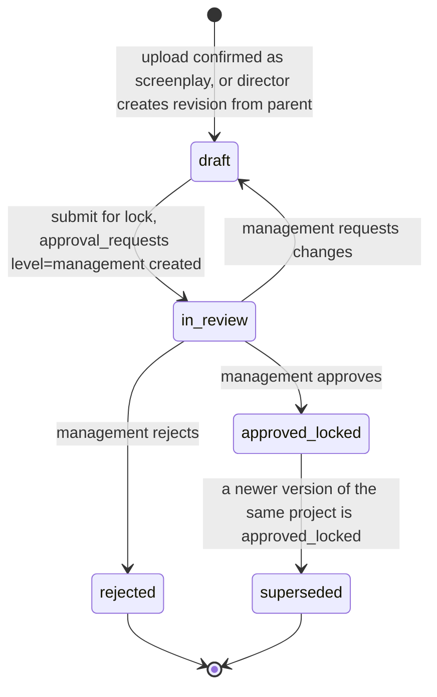

| Rule | Enforcement |
|---|---|
| Only `draft` content is editable | The service refuses writes unless `status='draft'`. `content_asset_id` is immutable after `in_review`. |
| One production-canonical version per project | Partial unique index on `(project_id) WHERE is_production_canonical`. The swap happens in one transaction: lock the project row, clear the old flag and set the old version to `superseded`, set the new one. |
| Lock requires management authority | The `approval_requests.required_capability = 'screenplay.lock'` decision is checked by `Authorizer` against the decider |
| Lock triggers impact analysis | Event `screenplay_version.locked` → `impact_analyses` task (HLD §4.2) |

### 2.2 `approval_requests` (generalized)
The current values are kept: `status ∈ {pending, decided}`, `decision ∈ {approved, rejected}`. Target values are added.

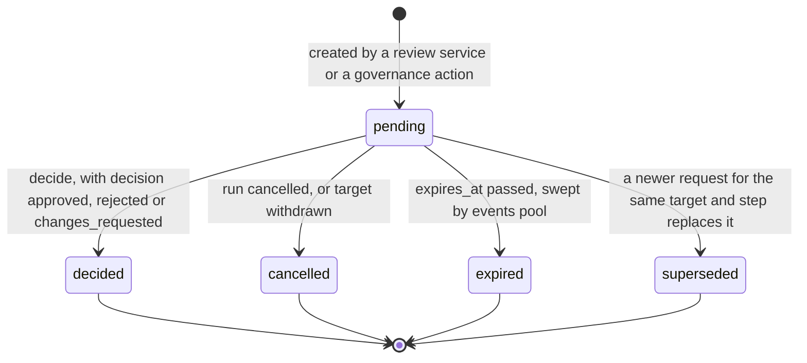

- **Partial approval** stays `decision='approved'` with `selection` JSONB, for example `{"scenes": ["id…"], "entities": null}`. `null` means all and `[]` means none, which is today's semantics in `ScriptReviewService.promote_approved`.
- **Multi-level approvals** (for example, creative then cost for a connected job) are separate rows that share `target_type`/`target_id` with increasing `step_index`. A row with `depends_on_approval_id` cannot be decided until its predecessor is `decided/approved`.
- **Authority:** `decide()` checks `Authorizer.require(actor, approval.required_capability, project)`. Requesters cannot approve their own `management` or `cost` level requests (separation of duties). This is configurable per org in `role_templates`.
- **Lock order** when a decision promotes canon: approval row (`for_update`) → project row (`for_update`) → candidate rows. Every path uses this order, which prevents deadlocks.

### 2.3 Candidate lifecycle (all `*_candidates` tables)

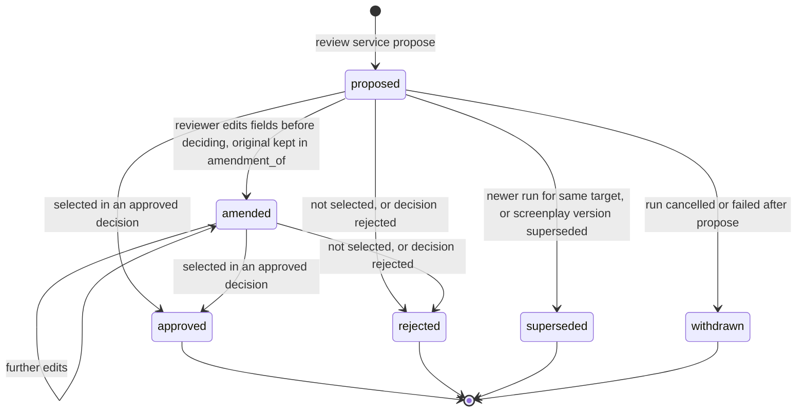

`approved` candidates keep a pointer to the canonical row they produced (`promoted_to_id`). This replaces today's implicit link, which is "same run, same version number".

### 2.4 `workflow_runs`
Current values: `queued, running, awaiting_approval, completed, rejected, failed`. Added: `resuming`, `cancelled`.

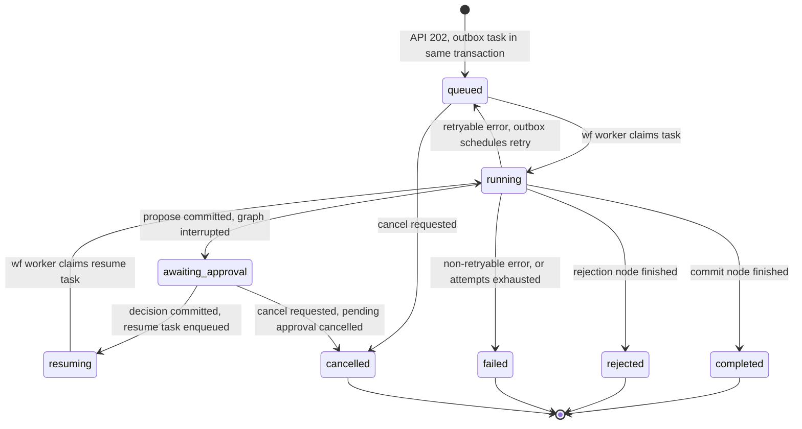

- `error_class` and `error_message` are set on `failed`. A `failed` run can be **re-triggered** as a new run (`retry_of_run_id`); a terminal run is never re-opened.
- A version conflict at commit (§4.3) yields `failed` with `error_class='version_conflict'`. The UI offers "re-run on current canon".

### 2.5 `outbox_tasks` (lease, retry, DLQ)
Current values: `pending, claimed, completed, failed`. Added: `dead_lettered`, `cancelled`. Legacy `failed` rows are backfilled to `dead_lettered` (DATABASE doc §6, R-05).

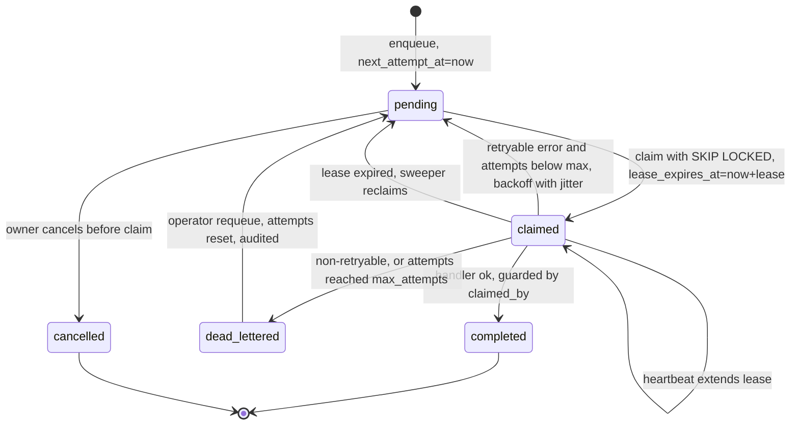

**Claim** (replaces `OutboxRepository.claim_next`):
```sql
UPDATE outbox_tasks t
SET status='claimed', claimed_by=:worker, claimed_at=now(), heartbeat_at=now(),
    lease_expires_at=now() + make_interval(secs => :lease_s), attempts=t.attempts+1
WHERE t.id = (
  SELECT id FROM outbox_tasks
  WHERE status='pending' AND queue = ANY(:queues) AND next_attempt_at <= now()
  ORDER BY priority DESC, next_attempt_at, created_at
  FOR UPDATE SKIP LOCKED LIMIT 1)
RETURNING t.*;
```

**Finish and retry**: always guarded by `WHERE id=:id AND status='claimed' AND claimed_by=:worker`. If no row matches, the lease was lost: log and drop the result. The next owner will redo the work idempotently.

| Parameter | Default (per queue; config) | Rationale |
|---|---|---|
| `lease_s` | wf 300 s, media 600 s, provider 120 s, events 60 s | Longer than a typical step; the heartbeat runs every `lease_s/3` |
| backoff | `delay = random.uniform(0.5, 1.0) * min(cap, base * 2**(attempts-1))`; base 5 s, cap 900 s | Exponential backoff with jitter (§20.4) |
| `max_attempts` | wf 5, media 3, events 10, provider **poll** 20; provider **submit = 1** | A submit is not assumed idempotent. Retrying it could double-charge, so failures go to `unknown_outcome` (§2.6). |
| Retryable classes | `transient_infra`, `provider_transient`, `provider_rate_limited` (uses provider `Retry-After` if present), `lease_expired` | Everything else is dead-lettered immediately |
| Dedupe | `dedupe_key` unique while not terminal (partial unique index) | For example `run:{run_id}:start`, `resume:{approval_id}`, `asset.inspect:{asset_id}` |
| Backpressure | A per-org fairness cap: claim skips orgs with ≥ N claimed tasks in this queue | Stops one tenant from starving others |
| Sweeper | events pool, every 30 s: reclaim expired leases; dead-letter tasks over max; expire approvals; purge old idempotency keys | Single-flight via `pg_try_advisory_lock` |

Workflow handlers **resume** instead of restarting:
```python
snapshot = graph.get_state(config)
if snapshot.next:          # interrupted or mid-run checkpoint exists
    graph.invoke(None, config)            # continue from the checkpoint
elif snapshot.values:      # already finished: only re-sync run status
    sync_run_status(run_id)
else:
    graph.invoke(initial_state, config)
```
Propose steps are idempotent through `UNIQUE (workflow_run_id, step_key)` on `approval_requests`. If the row exists, `propose` returns it and inserts no duplicate candidates. This fixes the duplication on re-delivery (`docs/audit/03` §8).

### 2.6 `generation_jobs` and `generation_attempts` (V2; manual path in V1)

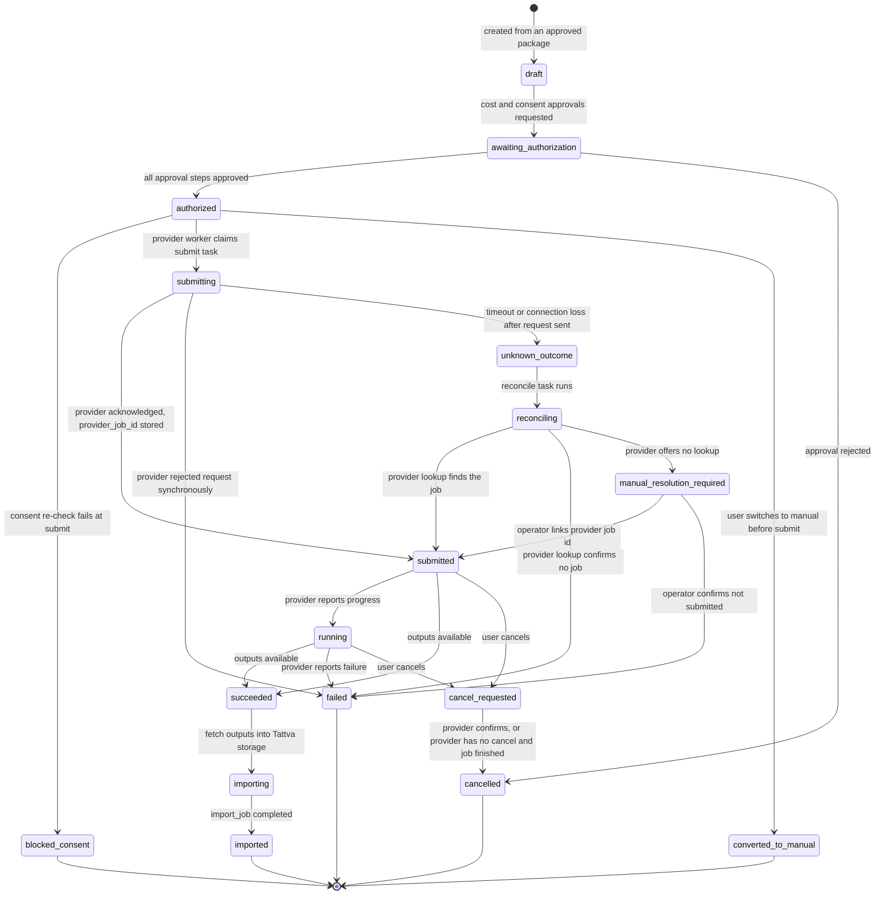

**Attempts** (one job can have several attempts, but only through an explicit user "retry", never automatically after an unknown outcome):

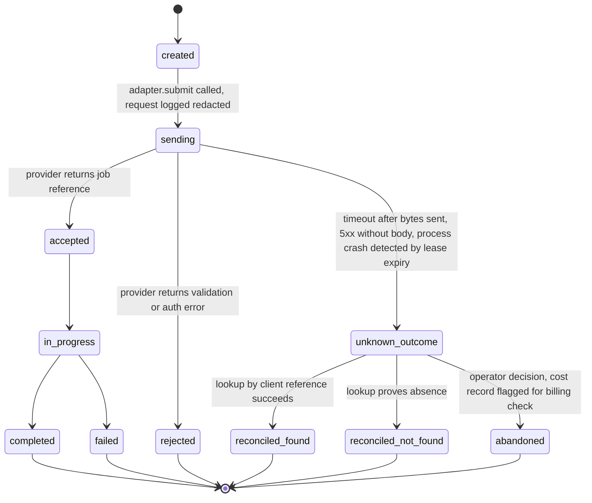

**Unknown-outcome rules:**
- An attempt row with a fresh `client_reference` (UUID) is **committed before** the adapter is called. A crash between the commit and the provider response therefore leaves evidence, which the lease-expiry sweep turns into `unknown_outcome`.
- Reconciliation uses only mechanisms that the verified capability snapshot declares, for example "lookup by client reference" or "list recent jobs". When none is declared, the job goes to `manual_resolution_required`. **No endpoint or capability is assumed** (Master Prompt §12.2).
- Paid providers: never auto-resubmit after `unknown_outcome`. Resubmitting needs a new explicit user action, and that action shows the possible duplicate-charge warning.
- `generation_cost_records` gets an `estimated` row at authorization, an `actual` row on provider confirmation, and a `disputed` flag for `abandoned` attempts.

### 2.7 Continuity status (`continuity_rules.status`, `continuity_findings.status`, and the per-subject continuity status on characters, costumes and similar)

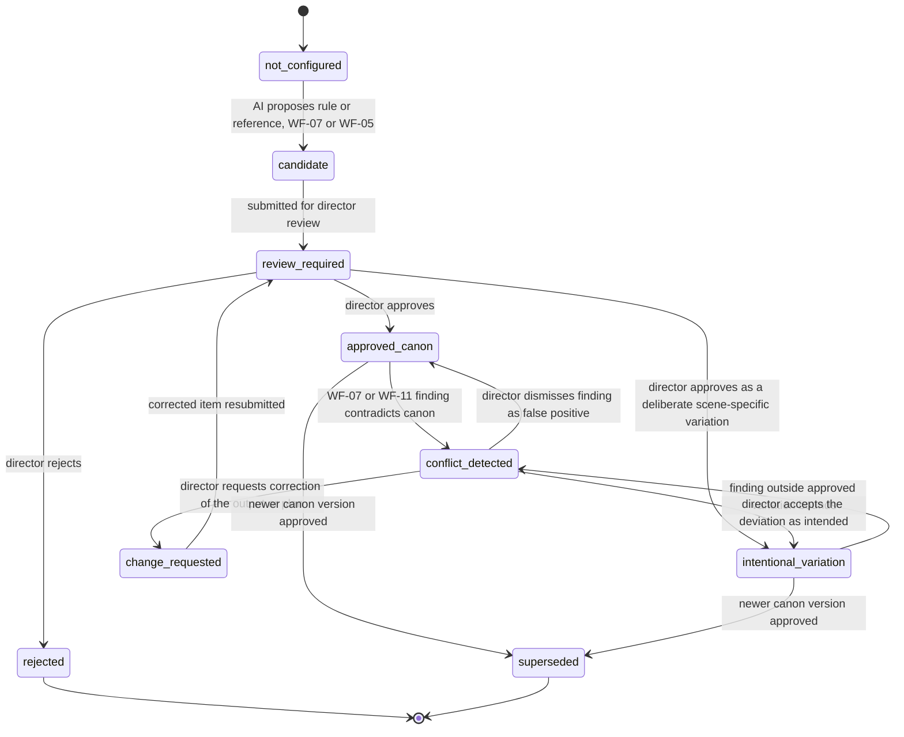

AI can move items only into `candidate` or `conflict_detected`. Every other transition requires a human with `continuity.decide` and writes a `continuity_decisions` row (Master Prompt §11: "AI can detect and recommend. The director owns final creative approval").

### 2.8 `performer_consents`

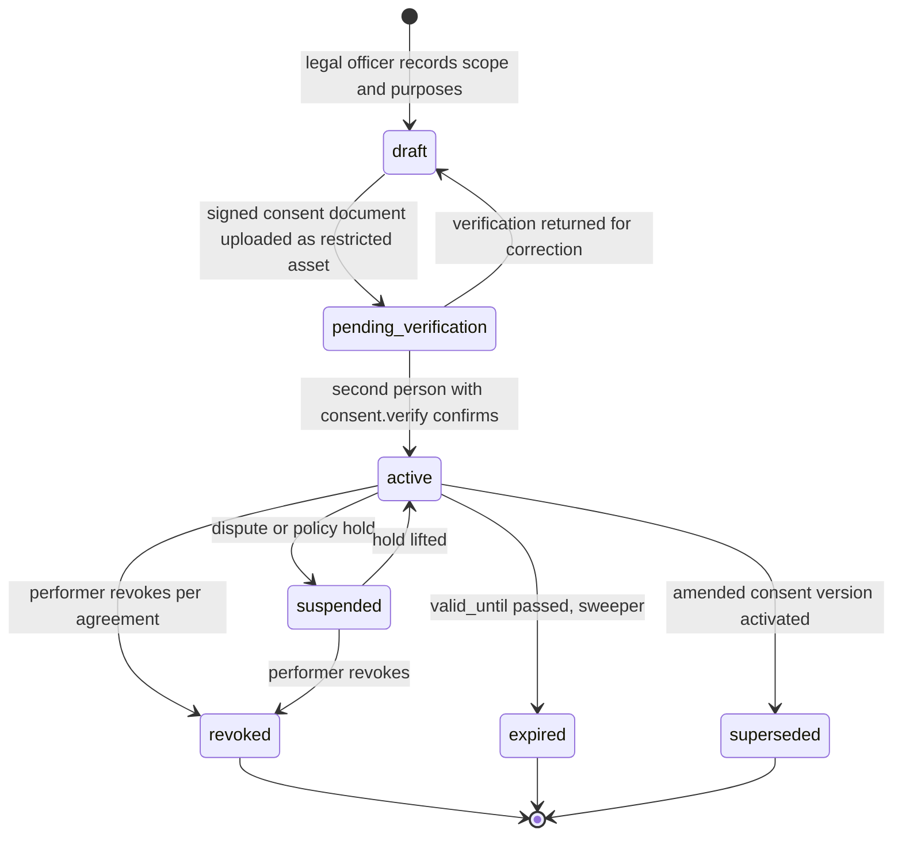

- A consent row is **immutable once `active`**. Amendments create a new version (`version + 1`, `supersedes_id`).
- `revoked`, `expired` and `superseded` (when the amendment narrows scope) emit events that drive HLD §4.5.
- The gate treats only `active` rows within `valid_from` ≤ t ≤ `valid_until` as passing.

### 2.9 `production_packages`

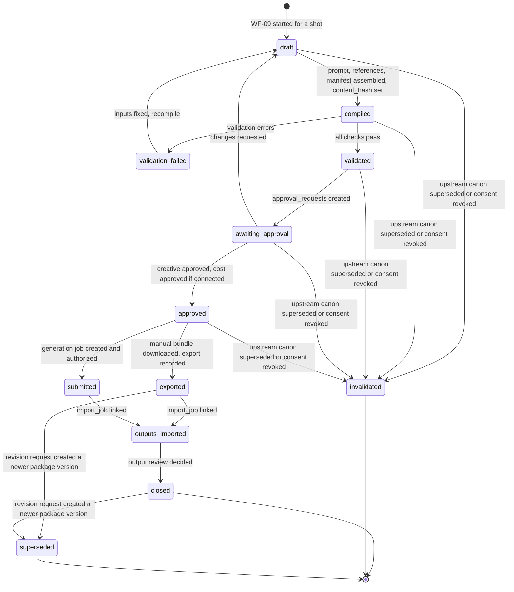

`content_hash` is a SHA-256 over the canonical JSON of the manifest (sorted keys, no export timestamps). It is frozen at `compiled`. Any input change produces a new package version, never an in-place edit. An `exported` package can be exported again; each export appends to `exports[]` with its actor and timestamp.

---

## 3. Domain invariants enforced in services

| Invariant | Where |
|---|---|
| A human decision is committed before the graph resumes (ADR-001 invariant 4) | `ApprovalService.decide`. This exists in all four `*Service.decide` methods today and is centralized. |
| Canon writes only via review services after an approved decision | Review services check `approval.status='decided' AND decision='approved'` for the run and step before promoting |
| A shot used in a package references the production-canonical screenplay version, or a `creative_decisions` "keep" | `PackageService.validate` |
| Restricted assets are only readable with a capability **and** an active consent purpose | `AssetFacade.signed_url` |
| Connected execution requires an approved cost step | `GenerationService.submit` |
| AI never transitions continuity beyond `candidate` or `conflict_detected` | `ContinuityService` checks `actor.kind == 'human'` (`ActorContext.kind ∈ {human, system}`) |

---

## 4. Transaction boundaries

### 4.1 Rules
1. **One use case = one transaction**, owned by the service (existing convention).
2. **Outbox in the same transaction** as the state change that requires the work. There is no dual write: the domain row and the outbox row commit together.
3. **No external I/O inside a transaction that holds row locks.** Provider, LLM and storage calls happen between transactions. The pattern is: commit intent (attempt row) → call → commit result.
4. **Graph nodes** open their own short session (`session_scope()`, as today) per node. A graph never holds a DB transaction across an LLM call.
5. **Lock order:** approval → project → target aggregate → candidates.

### 4.2 The version-bump race and its fix
**Defect (current):**
- `ScriptReviewService.promote_approved` locks the project row (`get_scoped(..., for_update=True)`).
- `ResearchReviewService.commit_approved_candidates` (`research_review.py:170`), `StoryboardReviewService` (`storyboard_review.py:151`) and `FilmBibleReviewService` (`film_bible_review.py:158`) read `project.current_version` **without** a lock and write `current_version + 1`.
- `project_versions` has no unique `(project_id, version_number)`.
- As a result, two concurrent approvals can both write version N+1.

**Fix:** use a single `VersioningService`, which every review service must call. Two layers enforce it: a pessimistic lock and a constraint as the backstop.

```python
# packages/versioning/service.py (new)
class VersioningService:
    def __init__(self, db: Session):
        self.db, self.projects, self.audit = db, ProjectRepository(db), AuditRepository(db)

    def bump(self, scope: RunScope, *, actor_id: str, message: str,
             refs: dict, expected_version: int | None = None) -> ProjectVersionModel:
        project = self.projects.get_scoped(scope.project_id, scope.org_id, for_update=True)  # layer 1
        if expected_version is not None:
            assert_expected_version(project.current_version, expected_version)
        nxt = project.current_version + 1
        version = ProjectVersionModel(project_id=project.id, organization_id=project.organization_id,
                                      version_number=nxt, branch_name="main", commit_message=message,
                                      committed_by=actor_id, snapshot_data=refs)
        self.db.add(version)
        project.current_version = nxt
        try:
            self.db.flush()                                        # layer 2: uq_project_versions_project_number
        except IntegrityError as exc:
            if "uq_project_versions_project_number" in str(exc.orig):
                raise VersionConflictError("Concurrent version commit; retry on current canon.") from exc
            raise
        return version
```

- The review services call `bump()` **first** in their promote transaction. That takes the project lock before any candidate rows are touched (lock order), and the returned `version_number` is used for the canonical rows.
- Migration R-06 adds the constraint after a duplicate pre-check (DATABASE doc §6).
- Test: two threads approve two different runs on the same project concurrently. Expect versions N+1 and N+2, or one `VersionConflictError`, never duplicates. Add to `tests/integration/`.

### 4.3 Expected-version semantics — **OPEN — DEC-020**
Today every run captures `expected_project_version` at start and fails at commit if *any* other commit happened in between (`assert_expected_version`). With 11 workflows committing on one project counter, unrelated work will conflict often. For example, a research approval would invalidate a pending storyboard review.

**Recommendation:**
- Keep `project_versions` as a monotonic commit log.
- Replace the global check with an **input-fingerprint check**: the run records the versions or hashes of the inputs it read (via `context_packages.input_refs`). The commit fails only if one of *those* inputs changed.
- Keep the current behaviour for WF-01 on a draft screenplay until DEC-020 is approved.

### 4.4 Transaction map for key use cases

| Use case | Tx 1 | External step | Tx 2 |
|---|---|---|---|
| Trigger workflow | authz; insert `workflow_runs` (queued) + `outbox_tasks` + `audit`; idempotency row | — | — |
| Decide approval | lock approval; record decision; audit; enqueue `workflow.resume` (`dedupe_key=resume:{approval_id}`); run → `resuming` | — | (worker) promote: `bump()` + canonical rows + candidate statuses + audit + events |
| Lock screenplay | lock approval; record; lock project; swap canonical flag; supersede old; audit; enqueue impact analysis | — | — |
| Export package | lock package; consent gate; state → exported; append export record; audit | build the ZIP in the worker (if large), upload to the packages bucket | mark bundle ready; event |
| Submit generation | lock job; consent gate + cost approval check; insert attempt (`sending`, `client_reference`) | adapter.submit | attempt → accepted, rejected or unknown; job state; logs |
| Manual import | insert `import_jobs` + presigned PUTs; idempotency | user uploads | per file: quarantine → available (media pool); mapping confirm tx: `asset_lineage` + package → `outputs_imported` |

---

## 5. Idempotency

**Scope:** every mutating route that creates resources or triggers work. That covers workflow triggers, approval decisions, uploads and imports, package compile, export and approval, generation job create and submit, consent record, revoke and verify, and screenplay submit and lock. The header is **required** on these in the target API (a missing key returns 428 after the deprecation window) and optional during migration.

**Table** `idempotency_keys`:
- key: `(organization_id, actor_id, key)` unique
- `route_key` (method + route template)
- `request_hash` (SHA-256 of canonical JSON body + path params)
- `status`
- `response_status`, `response_body`
- `resource_type`, `resource_id`
- `created_at`, `expires_at` (default 24 h)

**Algorithm (same transaction as the business write):**
```text
BEGIN
  INSERT INTO idempotency_keys(...) VALUES (..., status='in_progress')
    ON CONFLICT (organization_id, actor_id, key) DO NOTHING RETURNING id
  -- a concurrent duplicate blocks here on the unique index until the first tx ends
  IF no row returned:
     SELECT … FOR SHARE
     IF request_hash differs  -> 422 problem idempotency-key-reuse
     IF status='completed'    -> replay stored response_status/response_body (+ header Idempotent-Replayed: true)
  ELSE:
     perform use case
     UPDATE idempotency_keys SET status='completed', response_status, response_body, resource_*
COMMIT
```
- Because the key row commits atomically with the business write, a failed request leaves no key, and the client may retry. The `in_progress` value is visible only to a blocked concurrent duplicate, which then reads `completed`. A key reused before commit is not possible under this scheme.
- Worker-side idempotency uses `outbox_tasks.dedupe_key` and the natural unique keys: `(workflow_run_id, step_key)` and `(generation_job_id, attempt_number)`.
- Provider-side idempotency is used only if the capability snapshot declares it. Tattva then passes `generation_attempts.client_reference` in the provider's documented field.

---

## 6. Error taxonomy

| Domain error (`packages/domain/errors.py`) | Exists? | HTTP | Problem `type` (URN) | Worker `error_class` | Retryable |
|---|---|---|---|---|---|
| `AuthenticationError` (`services/identity.py`) | yes | 401 | `urn:tattva:problem:unauthenticated` | — | — |
| `AuthorizationError` (capability denied) | **new** | 403 | `urn:tattva:problem:forbidden` | `authorization` | no |
| `TenantAccessViolation` | yes | 403 (target: **404**, to avoid an oracle on cross-tenant IDs) | `urn:tattva:problem:not-found` | — | — |
| `NotFoundError` | yes | 404 | `urn:tattva:problem:not-found` | `not_found` | no |
| `VersionConflictError` | yes | 409 | `urn:tattva:problem:version-conflict` | `version_conflict` | no (re-run) |
| `InvalidStateError` | yes | 409 | `urn:tattva:problem:invalid-state` | `invalid_state` | no |
| `ScreenplayLockedError(InvalidStateError)` | **new** | 409 | `urn:tattva:problem:screenplay-locked` | — | no |
| `ConsentRequiredError(InvalidStateError)` | **new** | 409 | `urn:tattva:problem:consent-required` | `consent_revoked` | no |
| `ApprovalRequiredError(InvalidStateError)` | **new** | 409 | `urn:tattva:problem:approval-required` | — | no |
| `IdempotencyKeyReuseError(ValidationFailure)` | **new** | 422 | `urn:tattva:problem:idempotency-key-reuse` | — | — |
| `ValidationFailure` | yes | 422 | `urn:tattva:problem:validation` | `validation` | no |
| `PayloadTooLargeError` | yes | 413 | `urn:tattva:problem:payload-too-large` | — | — |
| `UnsupportedMediaTypeError` | yes | 415 | `urn:tattva:problem:unsupported-media-type` | `validation` | no |
| `RateLimitedError` | **new** | 429 + `Retry-After` | `urn:tattva:problem:rate-limited` | `provider_rate_limited` | yes |
| `DependencyUnavailableError` (storage, LLM, provider) | **new** | 503 + `Retry-After` | `urn:tattva:problem:dependency-unavailable` | `transient_infra` / `provider_transient` | yes |
| `ProviderRejectedError` | **new** | (job state, not HTTP) | — | `provider_rejected` | no |
| `UnknownOutcomeError` | **new** | (job state) | — | `unknown_outcome` | **never auto** |
| unhandled `Exception` | — | 500 | `urn:tattva:problem:internal` | `bug` | yes, up to max, then DLQ |

The `TenantAccessViolation` → 404 change keeps the "no existence oracle" property that the scoped repositories already provide. It is listed as a compatibility note in API §2.

---

## 7. Sequence: approval → resume (target, asynchronous)

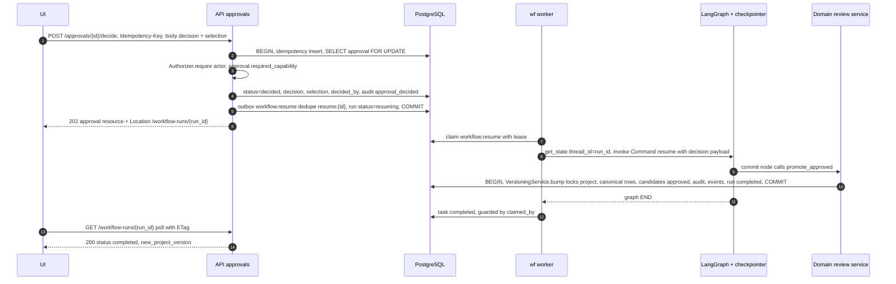

If the resume task's worker dies after the domain commit but before the task is completed, the lease expires and the task is re-run. `get_state` then shows no `next` node, so the handler only syncs status (§2.5). The promotion is not repeated.

## 8. Sequence: package export and manual import

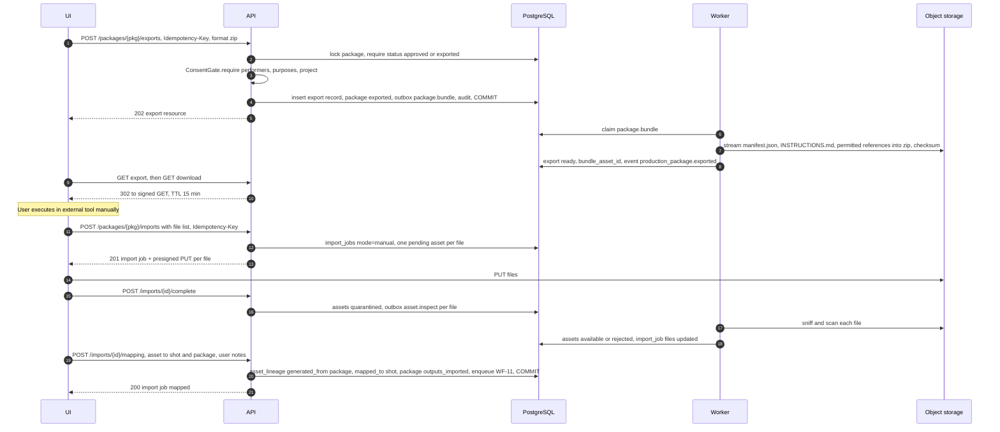

---

## 9. Shared approval-gate helper for WF graphs

**Problem.** Four copies of the gate exist today (`human_approval_interrupt_node` in G-01…G-03, `human_approval_gate` in G-04), plus four copies of `_invoke`/`_sync_run_status`/`_mark_failed` in the run services. They have already diverged:
- G-04 lacks the `approval_status != "pending"` guard (G04-G).
- G-04's `FilmBibleState` does not declare `approved_rule_ids`/`decision_notes`, so LangGraph drops them (G04-A).
- G-04's `commit_rules` writes the **new** project version into `expected_project_version`. That corrupts the optimistic-version input of any later step on the same thread.
- G-04's `human_approval_gate` **overwrites `actor_id`** (the run initiator) with the decider. The audit trail then loses who started the run.
- No `propose_*` method (G-01…G-04) is idempotent, so a redelivered task creates a **second** approval request and a second candidate set.

The helper fixes these structurally:
- `actor_id` and `expected_project_version` are **read-only after start**. The helper never returns them from a node, and `GraphRunner` asserts at commit that they are unchanged.
- The decider is recorded only in `decided_by`.
- The new version number is written to the separate `new_project_version` key.
- Propose goes through `ApprovalService.request(run_id, step_key, …)`. That call is idempotent on `UNIQUE (workflow_run_id, step_key)`: a redelivered propose returns the existing request and its candidates instead of inserting new ones.

**Design** (`packages/ai_orchestration/approval_gate.py`):

```python
class ApprovalGateState(TypedDict, total=False):
    workflow_run_id: str
    project_id: str
    organization_id: str
    actor_id: str
    approval_request_id: str | None
    approval_status: str                      # "pending" | "approved" | "rejected" | "changes_requested"
    decision_notes: str | None
    decided_by: str | None
    selection: dict[str, list[str] | None]    # ONE declared key for all selections -> no silently dropped keys

def approval_gate_node(*, message: str):
    """Factory: returns a node that interrupts once and normalizes the resume payload."""
    def node(state: ApprovalGateState) -> dict:
        if state.get("approval_status", "pending") != "pending":
            return {}                                         # idempotent on replay
        payload = interrupt({"message": message, "approval_request_id": state.get("approval_request_id")})
        if not isinstance(payload, dict):
            raise ValidationFailure("Resume payload must be a mapping.")   # no silent reject
        return {
            "approval_status": payload["decision"],
            "decision_notes": payload.get("notes"),
            "decided_by": payload["actor_id"],
            "selection": payload.get("selection") or {},
        }
    return node

def route_on_decision(approved: str, rejected: str, changes_requested: str | None = None):
    def route(state: ApprovalGateState) -> str:
        s = state.get("approval_status")
        if s == "approved": return approved
        if s == "changes_requested" and changes_requested: return changes_requested
        return rejected
    return route

def add_approval_gate(builder: StateGraph, *, after: str, approved: str, rejected: str, message: str) -> None:
    builder.add_node("approval_gate", approval_gate_node(message=message))
    builder.add_edge(after, "approval_gate")
    builder.add_conditional_edges("approval_gate", route_on_decision(approved, rejected),
                                  {approved: approved, rejected: rejected})
```

**Each graph's state** extends `ApprovalGateState` (for example `class FilmBibleState(ApprovalGateState): …`).

**Selection mapping:**
- The legacy API fields map into `selection` at the API boundary: `approved_scene_ids` → `selection["scenes"]`, `approved_rule_ids` → `selection["rules"]`, and so on.
- `ApprovalDecisionRequest` keeps accepting the legacy fields (`apps/api/schemas.py`) and also accepts `selection`.

**`GraphRunner`** (`packages/ai_orchestration/runner.py`) replaces the four run services:
- **Class attributes:** `graph_id`, `graph_version`, `build_graph`, `initial_state(run)`.
- **Inherited methods:**
  - `start` (authz, run + outbox, idempotent)
  - `execute` (the resume-aware logic in §2.5)
  - `resume(approval)`
  - `sync_status` (from the checkpoint snapshot and the approval decision, as in today's `StoryboardIntelligenceService._sync_run_status`)
  - `mark_failed(error_class)`
- **Behaviour fixes it adds:**
  - The checkpointer is obtained from a process-level pool. `setup()` runs only in the `migrate` entrypoint.
  - Run inputs live in `workflow_runs.input_refs` and no longer piggy-back on `output_refs`. Today `StoryboardIntelligenceService.execute` reads `brief` from `run.output_refs`.

**Migration path:** apply to WF-04 first as part of the DEC-010 fix-forward, then WF-01…WF-03 one at a time. The existing `tests/workflows/test_graph_recovery.py` must pass unchanged for WF-01.
