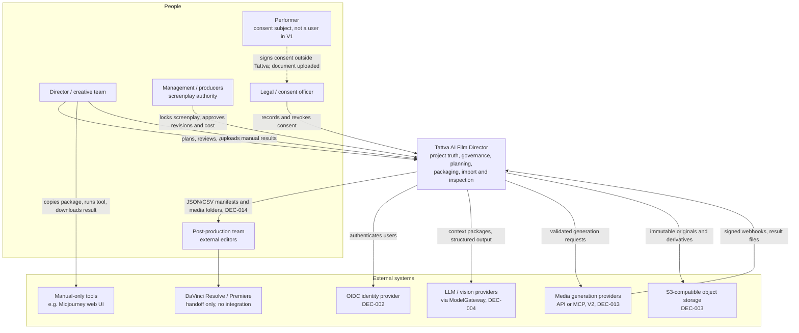
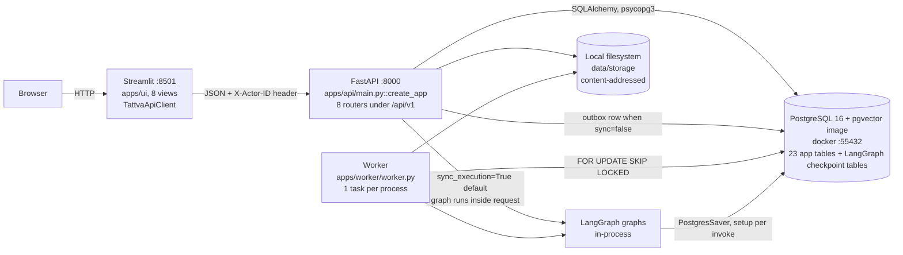
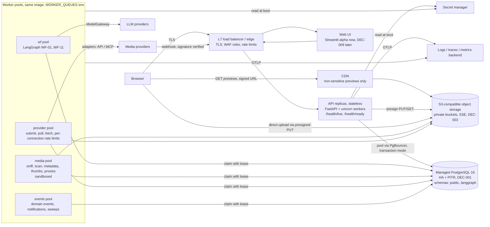
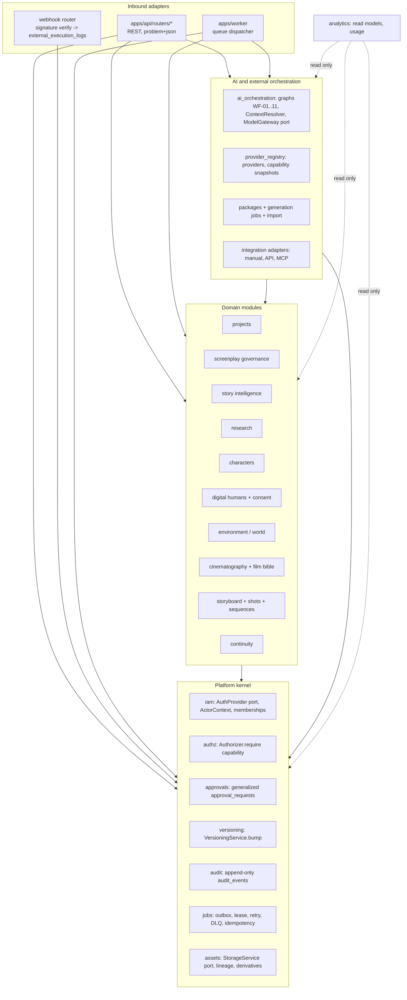
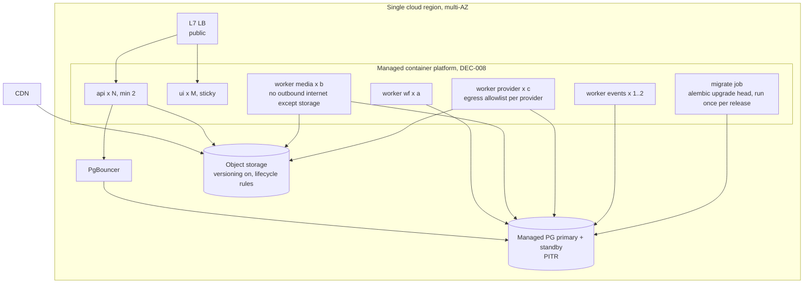
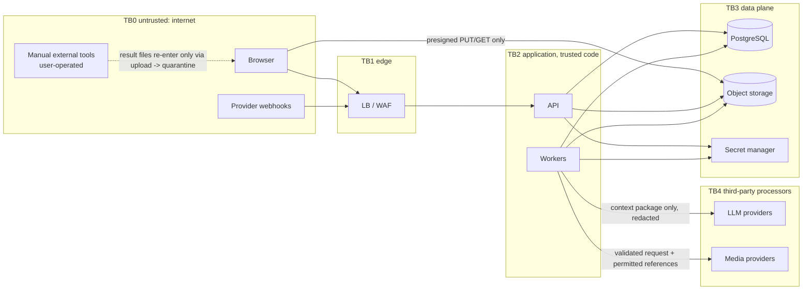

# System Architecture — Tattva AI Film Director

**Doc ID:** TFD-ARC-001 · **Version:** 1.0-draft · **Date:** 2026-11-05 · **Status:** Phase B design — pending approval

**Inputs:** Master Execution Prompt §3–§4, §12, §14, §18, §20–§21; Gap Report v1.0 §7, §10.5, §11; `docs/audit/01`, `03`, `05`, `06`, `08`, `10`; code at `main@b3621cb` plus the uncommitted G-04 WIP (`apps/`, `packages/`, `docker-compose.yml`).

**Companion documents:** `HIGH_LEVEL_DESIGN.md` (module boundaries and data flows), `LOW_LEVEL_DESIGN.md` (state machines, transactions), `DATABASE_DESIGN_AND_ERD.md` (schema and migrations), `API_AND_EVENT_CONTRACTS.md` (REST and events).

---

## 1. Architectural position

Tattva is a **modular monolith**: one Python codebase, one authoritative PostgreSQL database and one object store. It runs as three process types: API, worker and UI. This is what exists today. The target keeps that shape and hardens it.

| Principle | Consequence for the architecture |
|---|---|
| Tattva never generates media itself (Master Prompt §12) | No GPU workloads, no model hosting and no render farm. The worker *orchestrates* external providers, or *packages* work for manual execution. Media processing is limited to inspection, thumbnails, proxies and metadata extraction. |
| Manual execution is permanent (§12.1-B) | Every generation path works with **zero** provider connections. Connected adapters are optional plug-ins behind the same package contract. |
| AI output is a candidate until a human approves it (ADR-001 invariant, §18 "AI cannot bypass…") | Canonical writes happen only in deterministic application services after an `approval_requests` decision. LangGraph nodes never write canon directly; this is already true in `packages/services/*_review.py`. |
| Management owns the locked screenplay (§5) | The approval engine supports approval *levels* (creative, management, cost, consent) and role-bound authority. |
| Consent before likeness or voice (§6.5) | The consent gate is a synchronous, server-side check inside the transaction that authorizes a package, a job or a sensitive asset read. It is never only a UI check. |
| No microservices or Kubernetes without justification (§20.7) | One deployable image with three entrypoints. Each part is scaled independently by process type and worker pool, not by splitting services. |

### 1.1 Why not microservices
Two dimensions actually need to scale independently: (a) HTTP request handling, and (b) long-running or slow work (LLM calls, media inspection, provider polling). Process-level separation (API replicas versus worker pools that read different outbox queues) gives both without network contracts between modules. Every V1 use case is a transaction that spans several modules, for example approving candidates, bumping the project version and writing the audit row. Splitting those across services would need sagas for what is one database transaction today.

**Revisit trigger** (recorded in ADR-007 / DEC-005): a single worker pool cannot keep up even after horizontal scaling, *or* a module needs a different data store or security domain. A likely future example is an isolated media-processing sandbox.

---

## 2. C4 level 1 — system context

**Scope boundary (§14, §15 V3):** Tattva hands off to NLEs through manifests. It does not edit, grade, composite, mix or render final output. OTIO/XML/EDL/AAF are not claimed until a round-trip has been validated (DEC-014).

---

## 3. C4 level 2 — containers

### 3.1 Current (as built, verified 2026-11-05)

| Container | Current facts that matter to the target design |
|---|---|
| UI | Streamlit; calls only the API (`apps/ui/api_client.py`). It never touches the DB, so it is replaceable (DEC-009). |
| API | Stateless except that graphs run in-process when `sync_execution=True` (`apps/api/schemas.py`, 4 request models). CORS allowlist, `GET`/`POST` only. Identity comes from `X-Actor-ID` (`apps/api/dependencies.py::get_actor`). |
| Worker | `process_one_task` claims one task, and any exception becomes permanent `failed`. There is no lease, retry or DLQ, and re-delivery restarts the graph from START (`*Service.execute`). |
| PostgreSQL | Holds canonical data, the outbox **and** LangGraph checkpoints (same DB unless `checkpoint_database_url` is set). Only this runs in `docker-compose.yml`. |
| Storage | `LocalFileSystemStorageService`: `{org}/{project}/{sha256}_{name}`, write-once, with a path-traversal guard. Uploads are buffered fully in memory (`routers/assets.py:27`, `storage/service.py::store_stream`). |

### 3.2 Target

| Container | Target responsibility | Scaling unit | Notes |
|---|---|---|---|
| Edge / L7 LB | TLS termination, HTTP/2, request size caps, coarse per-IP and per-token rate limiting, health-checked routing, webhook path exposure | Managed | An API gateway product is not required in V1. Use the LB's rules, plus per-route limits in the app (§7). |
| Web UI | Experience layer. Holds no business rules and no DB access. | Replicas | Streamlit is server-stateful (websocket session), so the LB needs **sticky sessions** for the UI target group only. The API stays stateless. |
| API | AuthN (JWT), AuthZ (capabilities), validation, idempotency, short transactions, enqueueing work. **Never** runs a graph or provider call inline outside `test` (PERF-01). | Horizontal, CPU-bound | Graceful shutdown: stop accepting, drain within 30 s. Readiness fails when the DB or storage is unreachable. |
| Worker pools | Long or slow work, selected by `outbox_tasks.queue` | Per pool, independent | The same container image. Pool concurrency comes from `WORKER_CONCURRENCY`, which is declared today but unused (`docs/audit/03` §9). |
| PostgreSQL | Canonical truth, outbox, idempotency, audit, checkpoints (separate `langgraph` schema) | Vertical first; read replica only for analytics (§20.3) | PgBouncer in transaction mode **for the API**. Workers that hold `SKIP LOCKED` claims use session-mode connections. Lease-based claiming (LLD §5) keeps locks short. |
| Object storage | Originals (write-once), derivatives, package bundles, imported outputs | Managed | Buckets: `tattva-originals`, `tattva-derivatives`, `tattva-packages`, `tattva-restricted` (performer likeness, voice, consent documents; separate KMS key and access policy). |
| CDN | Thumbnails, proxies and storyboard frames classified `internal` | Managed | **Never** caches `restricted` assets. Signed URLs with ≤ 15 min TTL. Cache key = object key, which is content-addressed and therefore immutable, so no purge is needed on new versions. |
| Redis | **Not introduced in V1.** | — | Justification for leaving it out: no shared session state (JWT); idempotency and rate-limit state live in PG or the LB; caches are not needed at V1 load. Re-evaluate for cross-replica rate-limit counters or SSE fan-out (see `docs/engineering/SCALABILITY_PERFORMANCE_CAPACITY_PLAN.md`). |

---

## 4. C4 level 3 — components inside the API/worker codebase

The allowed-dependency rules and per-module ownership are specified in `HIGH_LEVEL_DESIGN.md` §2. The current mapping is: `packages/services/*` are domain/kernel services; `packages/persistence/repositories.py` is the single persistence layer that the target splits per module; `packages/workflows/*` is `ai_orchestration`; `packages/storage/*` is the `assets` storage port.

---

## 5. Runtime architecture

### 5.1 Request path (target)
1. The edge terminates TLS and applies the per-IP limit and the body cap. Uploads never pass through it: they use a presigned PUT.
2. The API middleware stack, in order:
   - correlation ID (`X-Request-ID` echoed or generated)
   - JWT verification (`AuthProvider`)
   - `ActorContext` resolution: user → membership → org
   - per-actor rate limit
   - `Idempotency-Key` lookup (mutating routes)
3. The router calls a service. The service calls `Authorizer.require(actor, capability, resource)` and then does its transactional work. Long work becomes an outbox task inserted **in the same transaction**, and the API returns `202` with a run or job resource.
4. Errors are mapped once (`apps/api/errors.py`), extended to RFC 9457 (`API_AND_EVENT_CONTRACTS.md` §5).

### 5.2 Background path
1. A worker claims a task with a lease (`lease_expires_at`) via `SKIP LOCKED`, filtered by `queue` and `next_attempt_at <= now()`.
2. A heartbeat extends the lease while the task runs. A sweeper returns expired leases to `pending`. The design is in LLD §5.
3. Workflow tasks **resume** from the LangGraph checkpoint when one exists (`graph.invoke(None, config)`); they never restart from START (fixes `docs/audit/06` §3).
4. Results are written by deterministic services in short transactions. State transitions use guarded `UPDATE … WHERE status = :expected`.

### 5.3 Human-in-the-loop path
The current pattern (decision committed before resume, `ScriptIntelligenceService.decide`) is preserved. Target change: `POST /approvals/{id}/decide` commits the decision **and** enqueues a `workflow.resume` task (`dedupe_key = resume:{approval_id}`) atomically, then returns `202`. The graph resumes on the `wf` pool. The legacy synchronous response stays available during migration (`API_AND_EVENT_CONTRACTS.md` §2.2).

---

## 6. Deployment topology

### 6.1 Current: local development only

| Component | How it runs |
|---|---|
| PostgreSQL | `docker-compose.yml` service `db` (`pgvector/pgvector:pg16`, port 55432, volume `tattva_pgdata`) |
| API | `uvicorn apps.api.main:app --reload` on the host |
| Worker | `python -m apps.worker.worker` on the host (optional; the default is sync execution) |
| UI | `streamlit run apps/ui/app.py` on the host |
| Storage | `./data/storage` on the host |
| CI / images / observability | None (`docs/audit/01` §3) |

### 6.2 Target environments
Use one container image (`tattva-app`) with entrypoints `api`, `worker`, `ui` and `migrate`. Environments are `local` (compose: PG + MinIO + api + worker + ui), `staging` and `production`, each with its own database, buckets, secrets and IdP client.

- **Rolling deploys.**
  - The `migrate` job runs first.
  - Migrations are additive-only within a release (DATABASE doc §6), so old and new code both run against the new schema.
  - API instances drain before termination. Workers stop claiming on SIGTERM, finish or release their lease, then exit (lease expiry is the backstop).
- **Kubernetes:** not required. A managed container platform with autoscaling, health checks and job support is sufficient (DEC-008). Re-evaluate only if pool autoscaling on queue depth or sandboxing requirements exceed what the platform offers.
- **Infrastructure as Code:** required from staging onward. The tool choice belongs in `docs/engineering/DEPLOYMENT_AND_DEVOPS.md`.

---

## 7. Trust boundaries

| Boundary | Threats specific to Tattva | Controls (current → target) |
|---|---|---|
| Browser → API | Impersonation (SEC-01), cross-tenant access (SEC-04), approving without authority (SEC-03) | `X-Actor-ID` → **Bearer JWT**. Org is derived from membership, never from the request. A capability check runs on every route. Approval authority is checked against `approval_requests.required_capability`. |
| Browser → object storage | Unscanned uploads, oversized files, MIME spoofing (SEC-05) | Presigned PUT scoped to one key, size and content-type. Every new asset starts `quarantined` until the `media` pool sniffs magic bytes and scans it. Downloads use signed GETs that the API issues only after an authz check. |
| Manual tool → Tattva | Returned files are untrusted. Users may upload the wrong file or someone else's media. | Imports go through the same quarantine path. The `import_jobs` mapping requires the user to confirm the package and shot. Provenance records `execution_mode=manual` and the operator. |
| API/worker → LLM | Prompt injection via uploaded screenplays and research PDFs (SEC-11). Confidential screenplay egress. | Only `ContextResolver`-built `context_packages` are sent. Uploaded text is delimited as data. Output is schema-validated. Model output can never trigger a write that has not passed approval. A per-provider data-processing approval is recorded in `providers`. |
| Worker → media providers | Credential leakage. Unauthorized spend. Sending a performer's likeness without consent. | Credentials come only from the secret manager (`provider_connections.secret_ref`). The cost approval and consent gate are re-checked **at submit time**. References are sent through short-lived signed URLs or upload, per the verified capability snapshot. |
| Provider → webhook | Forged callbacks, replay | Per-provider signature verification, done only as the provider documents it (no invented schemes). Deliveries are de-duplicated by provider event ID. Raw payloads go to `external_execution_logs`. A webhook only *nudges* a status poll; it is never trusted alone for state. |
| App → PostgreSQL | App role can rewrite audit history (SEC-07) | A separate DB role is used for migrations. The app role gets `INSERT, SELECT` only on `audit_events`. RLS is defense-in-depth (**OPEN — DEC-019**, see DATABASE doc §4.3). |

## 8. Data boundaries and classification

| Class | Examples (tables / buckets) | Storage rule | Egress rule |
|---|---|---|---|
| `restricted` | Performer face, body and voice references; `body_measurements`; `performer_consents` documents; voice profiles | `tattva-restricted` bucket with a separate key. DB rows are tagged `sensitivity='restricted'`. Access requires capability `likeness.view` **and** an active consent for the purpose. | Never sent to the CDN. Sent to a provider only inside a consent-checked package. Never in logs. |
| `confidential` | Unlocked and locked screenplays, suggestions, research notes, packages | Private buckets; tenant-scoped rows | LLM egress only via context packages to providers whose data terms are recorded. A manual-tool warning is shown (Gap §7.2). |
| `internal` | Thumbnails, storyboard frames, proxies of non-restricted assets | Derivatives bucket; CDN allowed via signed URL | — |
| `secret` | Provider API keys, MCP tokens, IdP client secret | Secret manager only; DB stores `secret_ref` | Never in packages, prompts, exports, logs or the browser (Gap §7.3) |
| `operational` | `audit_events`, `job_events`, `external_execution_logs` (redacted) | Append-only | Exported to observability with tenant IDs, without content |

Tenant boundary: every tenant row carries `organization_id`. The current gaps (`scenes`, `entities`, `*_candidates`, `project_versions`) and their backfill are in DATABASE doc §4.2. Object keys keep the existing `{org}/{project}/…` prefix (`storage/service.py`), which allows bucket-policy and lifecycle rules per tenant.

## 9. External systems

| System | Integration style | Status | Decision |
|---|---|---|---|
| OIDC IdP | JWT verification via JWKS; `AuthProvider` port | NOT_IMPL | DEC-002 (approval gate #1) |
| LLM / vision | `ModelGateway` port; a deterministic `mock` adapter first | NOT_IMPL (`config.model_gateway_provider: Literal["mock"]`) | DEC-004 |
| Media providers (FLUX.2, Higgsfield, Runway, Kling, …) | `ProviderAdapter` port with `ManualAdapter` (always), `ApiAdapter` and `McpAdapter` (separate) | NOT_IMPL; Higgsfield is config-only | DEC-006, DEC-013. No endpoint or schema is assumed until verified and snapshotted. |
| Object storage | `StorageService` port (exists) plus a new `S3StorageService` | Local only | DEC-003 |
| NLE handoff | File manifests | NOT_IMPL | DEC-014 |
| Malware scanning | `ScanPort` in the media pool | NOT_IMPL | Product selection is in the DEVOPS doc |

## 10. Failure boundaries

| Failure | Blast radius (target) | Behaviour |
|---|---|---|
| LLM provider down or slow | WF runs on the `wf` pool only | Tasks retry with backoff (`provider_transient`). Runs stay `running`/`queued`. Canon is untouched. The UI shows a degraded banner. |
| Media provider down | Connected generation jobs for that connection only | The circuit opens per `provider_connection`. Jobs stay `authorized` and do not submit. **The manual path stays fully available.** The user can convert the job to manual (LLD §6.6). |
| Submit outcome unknown (timeout after send) | One `generation_attempt` | `unknown_outcome` → reconciliation. **No automatic resubmit for paid providers** (LLD §6.6). |
| Worker crash | Tasks it held | The lease expires and the sweeper re-queues. The graph resumes from its checkpoint, and candidate writes are idempotent. |
| API replica crash | In-flight requests | The LB retries idempotent GETs. Clients retry POSTs with the same `Idempotency-Key`. |
| PostgreSQL unavailable | Whole system (single source of truth, by design) | Managed HA failover. API readiness fails. Workers back off. RPO/RTO targets are in `NON_FUNCTIONAL_REQUIREMENTS.md`. |
| Object storage unavailable | Uploads, imports, previews, package bundles | Metadata reads continue. Uploads return 503 (`storage-unavailable`). Package export is retried. |
| Checkpoint schema loss | Runs paused at an interrupt | Approval rows remain authoritative. An operator can `cancel` the run and re-trigger it; candidates are marked `superseded`. Runbook in `PRODUCTION_OPERATIONS_RUNBOOK.md`. |
| Consent revoked mid-flight | Packages and jobs that reference the performer | A `consent.revoked` event invalidates unsubmitted packages and cancels queued jobs. Already-submitted attempts are flagged for review (HLD §4.5). |

## 11. Internal modules (summary)
These are the 21 responsibility boundaries from Master Prompt §18, grouped as kernel / domain / orchestration / analytics. Full definitions, owned tables and allowed dependencies are in `HIGH_LEVEL_DESIGN.md` §2.

## 12. Architecture decisions referenced

| ID | Topic | Status |
|---|---|---|
| DEC-001 | Managed PostgreSQL | Open — the design assumes any PG16 with pgvector and PITR |
| DEC-002 | Auth provider | **Approval gate #1**; this design assumes OIDC + JWT |
| DEC-003 | Object storage | **Approval gate #5**; S3-compatible behind `StorageService` |
| DEC-005 | Queue | Recommended: keep the Postgres outbox (this doc §5.2) |
| DEC-008 | Hosting | Open — containers on a managed platform, no K8s |
| DEC-009 | Production frontend | **Approval gate #2**; the API-first design keeps it reversible |
| **OPEN — DEC-019** | Postgres RLS as defense-in-depth for tenant isolation | Recommend: adopt in FD-V2, after `organization_id` is backfilled on all tenant tables. Use `SET LOCAL app.org_id` per transaction, with policies on tenant tables. Not before, because PgBouncer transaction mode plus RLS needs every query path to set the GUC inside the transaction. |
