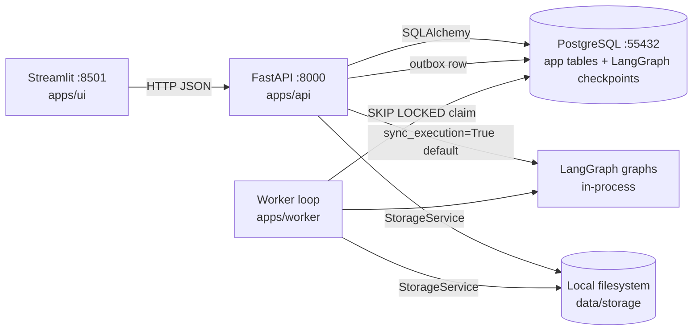

# 01 — Codebase Current State

**Doc ID:** TFD-AUDIT-001 · **Audit date:** 2026-11-05 · **Status:** Phase A audit (evidence-based)
**Inspected:** branch `docs/product-evolution-audit` (forked from `main` @ `b3621cb`) **plus uncommitted G-04 Film Bible work-in-progress** (24 modified files + 6 new paths, left untouched per product decision).

---

## 1. Repository identity

| Item | Value |
|---|---|
| Remote | `origin` → GitHub `Kaustubhd0022/Tattva_AI_Film_Director-V3-` (main only) |
| Local branches | `main`, `docs/product-evolution-audit` (this audit) |
| Commits | 8 total. Product commits: `44346a0` (approval/storage fixes), `dde4625` (services layer + routers), `9c5d8b7` (Streamlit modularisation), `a9f8512` (G-02 Historical Research), `b3621cb` (G-03 Storyboard) |
| Uncommitted | G-04 Film Bible synthesis: `apps/api/routers/film_bible.py`, `packages/services/film_bible*.py`, `packages/workflows/film_bible_synthesis/`, migration `00b7cd57e036`, `tests/api/test_film_bible_api.py`, plus edits to 24 existing files |
| Language / runtime | Python 3.11 (`.venv`), FastAPI, SQLAlchemy 2, Alembic, psycopg3, LangGraph 1.2.x + `langgraph-checkpoint-postgres`, Streamlit |
| Database | Docker `pgvector/pgvector:pg16` on `:55432` (`docker-compose.yml`, container `tattva-postgres`, healthy). Alembic `current` = `head` = `00b7cd57e036` (the WIP migration **has already been applied** to the local dev DB) |

**Gap Report v1.0 reconciliation:** Gap Report v1.0 audited commit `44346a0`. Since then G-02, G-03, a services layer, routers, `IdentityService` and a restricted CORS policy have landed. The Gap Report’s inventory (§4) is therefore **stale** for those areas; its strategic recommendations remain valid. See `10_DOCUMENT_CONFLICT_AND_DECISION_REGISTER.md` §3.

## 2. Directory structure (top level)

```
apps/
  api/        FastAPI app: main.py (create_app), dependencies.py, errors.py, schemas.py, routers/{health,projects,assets,workflows,approvals,research,storyboard,film_bible*}.py
  ui/         Streamlit: app.py, api_client.py (TattvaApiClient), components.py, views/{overview,assets,script_intelligence,historical_research,storyboard,review,film_bible,audit}.py
  worker/     worker.py (outbox polling loop, TASK_HANDLERS per graph_id)
packages/
  core/       config.py (pydantic-settings), logging.py
  domain/     enums.py, errors.py, invariants.py
  persistence/ models.py (405 lines), repositories.py (510 lines), db/session, migrations/ (4 revisions)
  services/   identity, projects, assets, research, script_review, research_review, storyboard, storyboard_review, film_bible*, film_bible_review*, + per-workflow run services
  storage/    service.py (StorageService ABC + LocalFileSystemStorageService), factory.py
  workflows/  checkpointer.py, script_intelligence/, historical_research/, storyboard_intelligence/, film_bible_synthesis/*
tests/        api/, integration/, unit/, workflows/, conftest.py, support.py
docs/         product/ (PRD v0.9, IA v1.0, Wireframe v1.0, Addendum v1.1, ADR-001 copy, README, build prompt, SOURCE_OF_TRUTH_INDEX), implementation/ (BUILD_PLAN, OPEN_DECISIONS), ADRs/ADR-001
data/storage/ local asset store (gitignored; ~130 residual test files)
```
`*` = uncommitted WIP.

## 3. Process topology (as built)



- Only PostgreSQL is containerised. There is **no Dockerfile** and no API/UI/worker service in `docker-compose.yml`.
- There is **no CI configuration** (no `.github/`, no Makefile).
- All "AI" is deterministic Python. No LLM, image, video or voice provider is called anywhere (`packages/core/config.py`: `model_gateway_provider: Literal["mock"]`, `higgsfield_integration_mode: Literal["manual_export"]`; the comment says the keys are "not yet consumed").

## 4. Modules and workflows present

| Capability | Graph (Addendum ID) | Generator | Committed? |
|---|---|---|---|
| Script Intelligence | G-01 `script_intelligence` | `ScreenplayParser.parse`: regex sluglines and uppercase cues | Yes |
| Historical Research | G-02 `historical_research` | `HistoricalInvestigator.investigate`: hardcoded per keyword (kalinga/maurya/ashoka) | Yes |
| Storyboard Intelligence | G-03 `storyboard_intelligence` | `StoryboardAligner.generate_panels`: deterministic, from a text brief | Yes |
| Film Bible Synthesis | G-04 `film_bible_synthesis` | `FilmBibleSynthesizer.synthesize_rules`: 6 hardcoded rules, plus a regex conflict detector | **No (WIP, broken)** |
| G-05…G-11 (character/asset, shot planning, continuity, AI Director review, prompt compilation, external handoff, output inspection) | — | — | Not present |

All four graphs share one pattern: generate → persist candidates and approval request → `interrupt()` → resume with decision → commit canonical or record rejection. Checkpoints use `PostgresSaver` (thread_id = `workflow_run_id`).

## 5. Verification baseline (executed 2026-11-05)

| Check | Command | Result |
|---|---|---|
| Test suite | `.venv/bin/python -m pytest -p no:cacheprovider` | **47 passed, 5 failed, 1 error (6.8 s)**. Every failure and the error are in G-04 WIP. |
| Lint | `.venv/bin/ruff check .` | All checks passed |
| Types | `.venv/bin/mypy --explicit-package-bases packages apps` | **321 errors in 31 files** (194 `arg-type`, 61 `assignment`, 24 `union-attr`, …). Plain `mypy packages apps` aborts on a module-path error, so mypy is not a working gate today. |
| Migrations | `alembic current` / `alembic heads` | Both `00b7cd57e036`; linear chain `e16ffe799e44 → 0d204c88a75f → 066e52ac4889 → 00b7cd57e036` |

Failing tests:
```
ERROR  tests/api/test_film_bible_api.py::test_film_bible_rules_crud        (teardown: ForeignKeyViolation film_bible_rules_project_id_fkey)
FAILED tests/api/test_film_bible_api.py::test_film_bible_synthesis_vertical_slice_e2e
FAILED tests/api/test_film_bible_api.py::test_film_bible_conflict_detection
FAILED tests/api/test_film_bible_api.py::test_film_bible_partial_approval
FAILED tests/api/test_film_bible_api.py::test_film_bible_rejection
FAILED tests/workflows/test_worker.py::test_queued_film_bible_run_is_executed_by_worker
  root cause: AttributeError: 'ResearchRepository' object has no attribute 'list_claims_for_project'
              (packages/workflows/film_bible_synthesis/graph.py:51)
```
**Side effect to note:** because the G-04 teardown fails, running the suite leaves orphan test-tenant rows in the local dev DB. This will keep happening until defect G04-C is fixed (see `09_TEST_AND_QUALITY_AUDIT.md`).

## 6. Headline assessment

The repository is a **sound modular-monolith foundation plus three working deterministic vertical slices (G-01…G-03) and one broken in-progress slice (G-04)**. It implements the candidate → approval → canonical → version → audit lifecycle well. It does **not** yet implement:
- real authentication or authorization
- real AI inference
- media handling beyond text
- providers or packages
- characters, digital humans, consent, cinematography, shots or continuity
- any of the hybrid/live-action direction in the Master Execution Prompt

It is **not production-ready** and must not be presented as such.
