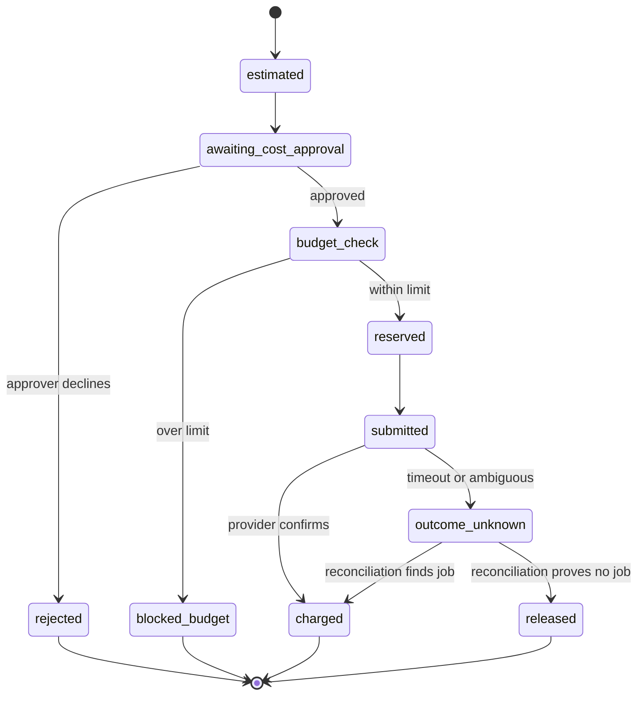

# Cost and Capacity Model

**Doc ID:** TFD-ENG-009 · **Version:** 1.0-draft · **Date:** 2026-11-05 · **Status:** Phase B design — pending approval
**Inputs:** Master Prompt §12.1 (cost approval before submit), §12.3 (cost model in registry), §20.6 (monthly provider cost), §29.13 · `SCALABILITY_PERFORMANCE_CAPACITY_PLAN.md` §6 (workload tiers) · `docs/audit/07` (all providers UNVERIFIED) · FD-FR-055 · ADR-005

> **No prices appear in this document.** Every unit price is a variable whose value must come from (a) the chosen hosting/DB/storage vendor's price sheet at contract time (DEC-001/003/008) or (b) a verified `provider_capability_snapshots` record with source URL and date. Tattva does not invent provider prices or credit structures (brief, Master Prompt §12.2).

---

## 0. Current state

No cost exists beyond developer laptops: no cloud infrastructure, no LLM calls (`model_gateway_provider: Literal["mock"]`), no provider calls. There is no `usage_records` table, no budget concept and no cost approval level (`approval_requests` has no `approval_level`).

## 1. Notation

| Symbol | Meaning | Source |
|---|---|---|
| `h` | Hours per month (730) | constant |
| `p_vcpu_h`, `p_gb_h` | Container price per vCPU-hour and per GB-RAM-hour | Hosting vendor (DEC-008) |
| `p_pg_inst_h` | Managed PG instance price per hour for the chosen tier | DEC-001 |
| `p_pg_gb_m`, `p_bkp_gb_m` | PG storage and backup storage per GB-month | DEC-001 |
| `p_obj_gb_m` | Object storage per GB-month (standard tier) | DEC-003 |
| `p_obj_req_put`, `p_obj_req_get` | Per-1k request prices | DEC-003 |
| `p_egress_gb`, `p_cdn_gb` | Egress / CDN per GB | DEC-003 / DEC-008 |
| `p_lb_h`, `p_lb_unit` | LB hourly and capacity-unit prices | DEC-008 |
| `p_obs_gb`, `p_obs_series` | Observability ingest per GB and per active series | DEC-023 |
| `p_in[m]`, `p_out[m]`, `p_cache[m]` | LLM price per input / output / cached-input token for model `m` | DEC-004 (after the eval spike) |
| `credit[p,k]` | Credits consumed by provider `p` for capability `k` per unit (per image, per second of video, per character of voice …) | Verified snapshot only |
| `p_credit[p]` | Price per credit, or the per-unit price if the provider bills directly | Verified snapshot / contract |

## 2. Infrastructure cost by component

| Component | Monthly cost formula | Expected-tier quantities (capacity plan §6.2) |
|---|---|---|
| API | `n_api × (vcpu × p_vcpu_h + gb × p_gb_h) × h` | `n_api=2, vcpu=1, gb=1` |
| UI (Streamlit alpha) | `n_ui × (vcpu × p_vcpu_h + gb × p_gb_h) × h` | `n_ui=2, vcpu=0.5, gb=1` |
| Graph worker pool | `n_wg × (vcpu × p_vcpu_h + gb × p_gb_h) × h` | `n_wg=2, vcpu=1, gb=2` |
| Media worker pool (FD-V2) | `n_wm × (vcpu × p_vcpu_h + gb × p_gb_h) × h_active` (scale-to-zero when idle) | `n_wm=1–2, vcpu=2, gb=4` |
| Migrate job | negligible (minutes per deploy) | — |
| Postgres | `p_pg_inst_h × h × (1 + ha_standby) + db_gb × p_pg_gb_m + bkp_gb × p_bkp_gb_m` | 2 vCPU / 8 GB, HA on; `db_gb ≈ 12–45` (§6 row 14, with or without pruning); `bkp_gb ≈ db_gb × (retention_days / 7)` approx. |
| Object storage | `stored_gb × p_obj_gb_m + (puts/1000) × p_obj_req_put + (gets/1000) × p_obj_req_get` | `stored_gb ≈ 620` at the 12-month expected tier |
| Egress | `review_gb_out × p_egress_gb` (or `p_cdn_gb` once the CDN trigger fires) | `review_gb_out ≈ concurrent_users × sessions/month × avg_proxy_gb_viewed` |
| Load balancer | `p_lb_h × h + lcu × p_lb_unit × h` | 1 LB |
| Observability | `log_gb × p_obs_gb + series × p_obs_series` | `log_gb ≈ requests/month × 1 KB + tasks/month × 5 KB` |
| Secrets / KMS | vendor per-secret and per-key fees | ~15 secrets, 3 keys |
| Malware scanning (DEC-022) | Self-hosted: counted in the media pool. Managed: `scanned_gb × p_scan_gb` | — |

**Total infra:** `C_infra = Σ components`. Staging ≈ `0.5 × C_infra(prod)` (single replicas, smaller DB, no HA). This is an assumption to verify at DEC-008.

## 3. LLM and provider cost model

### 3.1 LLM (ModelGateway, after DEC-004)

For a workflow run `r` that makes model calls `i` against model `m_i`:

```
C_llm(r) = Σ_i [ (tin_i − tcache_i) × p_in[m_i] + tcache_i × p_cache[m_i] + tout_i × p_out[m_i] ]
```

Monthly per project:

```
C_llm(project, month) = Σ_graph  runs[graph] × E[C_llm(r) | graph]
E[C_llm | graph] measured from usage_records after the alpha; before that, estimated from
  tin  ≈ context_package_tokens[graph] + instruction_tokens[graph]
  tout ≈ max_output_tokens[graph] × fill_ratio            (fill_ratio placeholder = 0.5)
```

| Graph | Input-token driver | Output-token driver |
|---|---|---|
| WF-01 Script Intelligence | Screenplay length (≈ pages × tokens_per_page), chunked | Scenes × fields |
| WF-02 Historical Research | Question + retrieved source excerpts | Claims × citations |
| WF-04 Film Bible | Approved claims + scenes summary | Rules |
| WF-08 AI Director Review | Shot spec + context package | Findings |
| WF-09 Prompt Compilation | Shot spec + references manifest | Prompt variants per provider |

### 3.2 External generation providers (FD-V2)

For a shot `s` with approved attempts and regenerations:

```
C_gen(s) = Σ_attempts a  units(a) × credit[p_a, k_a] × p_credit[p_a]
units(a) = images | seconds_of_video | characters_or_seconds_of_audio | per_job   (per verified capability)
E[attempts per approved shot] = 1 + regen_ratio            (measured; planning placeholder R)
C_gen(project) = Σ_shots  E[units per attempt] × (1 + R) × credit × p_credit
```

- Attempts with `outcome_unknown` are counted at the **estimated** cost until reconciliation confirms whether the provider charged them.
- Manual-mode executions have `C_gen = 0` inside Tattva. The user may optionally record the external spend they incurred (`usage_records.source = manual_reported`), so project totals are complete.

### 3.3 Monthly provider cost (§20.6 item 15)

```
C_provider(month) = Σ_org Σ_project [ C_llm(project, month) + Σ_{shots generated this month} C_gen(s) ]
```

The tiers in the capacity plan give `runs/day` and shot volumes. Prices stay variables, so the model can be evaluated only once DEC-004 and DEC-013 provide verified prices. **No monthly figure is published until then.**

## 4. Per-project budget gates

| Element | Design |
|---|---|
| Budget object | Per project: `budget_limit` and `budget_currency_or_unit` (money or provider credits), `soft_threshold` (default 0.8), `period` (`project` lifetime or `monthly`). Stored in project settings; DB design (peer doc) owns the columns |
| Estimate | `ProviderAdapter.estimate()` (ADR-005) returns `{units, credits, amount, confidence, price_source_snapshot_id}`. With no verified price, `amount=null` and `confidence=unknown`, so **connected submission is blocked**; manual mode stays available |
| Gate 1: cost approval | Every connected submission creates an `approval_requests` row with `approval_level=cost` showing the estimate. A holder of `cost.approve` decides (ADR-003). Batch approvals are allowed per package with an explicit total |
| Gate 2: budget check at submit | In the provider worker, inside the transaction that inserts `generation_attempts`: `committed + reserved + estimate ≤ budget_limit`, with the project budget row locked `FOR UPDATE`. If exceeded, the attempt is `blocked_budget` and the job is not submitted |
| Reservation | On submit, the estimate is reserved. On completion, the reservation is replaced with the actual cost from the provider response, or the estimate if the provider reports none. Unknown outcomes keep the reservation |
| Soft threshold | At ≥ 80 %, notify the project's producer role and show a dashboard warning |
| Hard stop | At ≥ 100 %, every connected submission is blocked. Raising the limit requires `cost.approve` at management level and is audited (`budget_changed`) |
| LLM budgets | Org-level monthly LLM budget with the same reservation logic; graph starts return 429 `budget_exhausted` when exceeded. The deterministic/mock generators are never blocked |
| Defaults | **OPEN — DEC-025 (new):** default thresholds and who holds `cost.approve`. Recommendation: producer role holds it; management approves limit increases |



## 5. `usage_records`

The single ledger for metering, quotas, dashboards and (later) billing. Append-only; one row per billable or metered event. DB design (peer doc) owns final columns; required fields:

| Field | Purpose |
|---|---|
| `id`, `created_at` | identity, time |
| `organization_id`, `project_id` | attribution; tenant scope |
| `actor_id` | who triggered it (or the system for scheduled work) |
| `workflow_run_id`, `ai_run_id`, `generation_job_id`, `generation_attempt_id` | links (nullable by kind) |
| `kind` | `llm_tokens` · `provider_generation` · `storage_gb_day` · `upload_bytes` · `egress_bytes` · `media_processing_seconds` · `manual_reported` |
| `provider_id`, `model_id`, `capability_snapshot_id` | what was used and at which verified version |
| `generator_mode` | `mock` / `deterministic` / `live` (mock rows are kept and always excluded from cost) |
| `units`, `unit` | e.g. 1532 `input_tokens`; 8 `video_seconds` |
| `estimated_amount`, `actual_amount`, `currency_or_credit` | nullable until known |
| `price_source` | snapshot ID or contract reference; null means "price unknown" |
| `reservation_state` | `none` · `reserved` · `charged` · `released` |
| `idempotency_key` | prevents double counting on retries (unique) |

Consumers: budget gate (§4), Observability dashboards §5.4–5.5, the rate limiter window (capacity plan §1), and the capacity re-plan (replacing assumed tiers with measured ones).

## 6. Capacity → cost feedback loop

1. Alpha: record `usage_records` for every run, even with mocks (`generator_mode=mock`). This measures run counts, token proxies (context package sizes) and storage growth, which validates capacity plan §6 rows 9, 13 and 14.
2. After DEC-004: a 2-week eval spike with a capped budget gives `E[C_llm | graph]`.
3. After DEC-013: the first provider pilot gives `regen_ratio` and units per attempt.
4. Re-issue this model with values and publish the monthly cost range per tier. Until then, **no cost figure is quoted in any product or sales material.**
