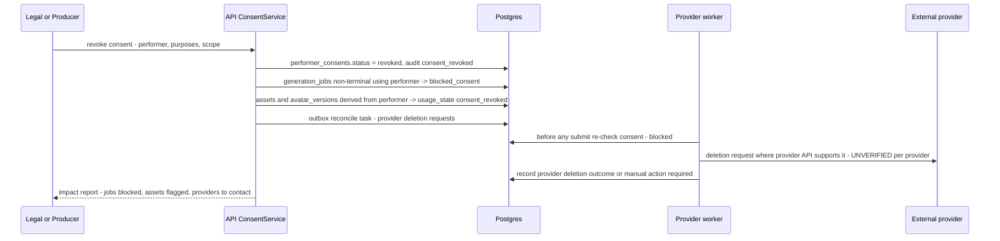

# Data Privacy and Retention

**Doc ID:** TFD-ENG-008 · **Version:** 1.0-draft · **Date:** 2026-11-05 · **Status:** Phase B design — pending approval
**Inputs:** Master Prompt §6 (esp. §6.4 body measurement, §6.5 performer rights), §9 voice, §12.2 (provider data retention), §21 · `docs/audit/05` §2 (no `ondelete` policies), `08` SEC-12 · DEC-007, DEC-012 · ADR-006 · `BACKUP_AND_DISASTER_RECOVERY.md`

> **Legal status.** This document is an engineering design for data handling. It is **not** legal advice and does not decide lawful basis, retention periods or consent wording. Every legal item is marked **OPEN — DEC-007** (retention and privacy) or **OPEN — DEC-012** (consent and likeness policy). DEC-007 is **blocking for digital-human work** (`docs/audit/10` §4): no C4 data may be stored in any shared environment until both decisions are approved.

---

## 0. Current state

- Data stored today: org and user records (name, email); projects; uploaded scripts and documents; parsed scenes, entities, research, storyboard and film bible data; audit events; LangGraph checkpoints.
- No performer, likeness, measurement or voice data exists, and no model for it exists (SEC-12).
- No deletion capability. FKs have no `ondelete` policy, so a project cannot be deleted (`docs/audit/05` §2). There are no DELETE routes (`docs/audit/03` §2).
- Retention: everything is kept forever by default (OPEN_DECISIONS DEC-007 current default: "immutable original files retained indefinitely").

## 1. Data classification

| Class | Name | Examples in Tattva | Handling baseline |
|---|---|---|---|
| **C0** | Public | Marketing pages; public provider documentation captured in capability snapshots | No restriction |
| **C1** | Internal | Provider capability snapshots, feature flags, aggregate metrics | Authenticated staff |
| **C2** | Confidential, operational | Logs and traces (redacted, Observability §6), `workflow_runs` metadata, `usage_records`, cost records, audit events (IDs plus action metadata) | Org-scoped access; no creative content |
| **C3** | Confidential, creative IP and personal data | Screenplays and every version, suggestions, dialogue, research sources, Film Bible, storyboards, shot specs, prompts, production packages, generated outputs, user names and emails, fictional character profiles, footage that does **not** feature an identifiable real performer | Org + project authZ; encrypted at rest; never sent to a provider except as part of an approved package; never used for model training by Tattva |
| **C4** | Special: biometric-like and identity data of real people | **Face references** (front, side and three-quarter images, facial geometry, expression references) of real performers; **body measurements** (`body_measurements`: height, shoulder, chest, waist, hip, limb proportions) and body scans of real people; **voice** samples, `voice_profiles` and voice clones; performance-reference video of an identifiable person; `digital_humans` / `avatar_versions` derived from a real performer (identity-preserving mode); `performer_consents` and signed consent documents | Everything in C3, plus: consent-gated purpose checks (ADR-006); a separate KMS key and storage prefix `c4/`; streamed through the API only (no CDN, no long-lived URLs); every read audited (`likeness_asset_viewed`); excluded from golden sets, logs and staging; provider disclosure required before any transfer |

Classification rules:
- **Fictional versus real.** A face or body profile is C4 when it is derived from or references a **real person**. A purely fictional AI character with no real-person source is C3. The `provenance.source` of a characteristic determines the class. If the source is unknown, treat it as C4.
- **Derivatives inherit** the highest class of their inputs (`asset_lineage`). A fictional AI avatar transformed from a real performer's footage (Master Prompt §6.2 B) keeps C4 lineage for the preserved characteristics (movement, body dimensions, voice).
- AI-**estimated** body measurements are C4 and labelled `estimated`, never `verified` (Master Prompt §6.4).
- A `sensitivity_class` column on `assets` and on C4 tables is the enforcement hook. DB design (peer doc) owns the column definition.

## 2. Retention per class

All periods are **engineering defaults proposed for Legal review**, marked OPEN.

| Class / data | Default retention (proposal) | Trigger for deletion | Status |
|---|---|---|---|
| C4: performer face, body and voice references; digital doubles | Life of the consent scope, **ending at the earlier of** consent expiry, consent revocation, or project archive + 90 days | Revocation, expiry, project purge | **OPEN — DEC-007 / DEC-012** |
| C4: consent records and signed documents | Kept **after** revocation as evidence of what was authorised and when (status `revoked`, payload intact) for a Legal-defined period | Legal hold expiry | **OPEN — DEC-012** |
| C3: screenplays, every version, canonical project data | Project lifetime + 90 days after the org requests deletion. The locked-screenplay history (all versions, Master Prompt §5) is never pruned while the project exists | Org/project purge | **OPEN — DEC-007** |
| C3: generated outputs, rejected attempts | Approved outputs: project lifetime. Rejected and superseded attempts: 180 days, then purge bytes and keep metadata | Age | OPEN — DEC-007 |
| C3: AI prompts and responses (`ai_runs`) | 1 year, or project lifetime if linked to an approved artifact (provenance) | Age | OPEN — DEC-007 |
| C2: audit events | Project lifetime + 1 year; append-only | Project purge + delay | OPEN — DEC-007 |
| C2: usage and cost records | 7 years if used for billing (financial records), otherwise 2 years | Age | OPEN — DEC-007 |
| C2: logs and traces | 30 days hot + 90 days archive | Age | Recommended |
| LangGraph checkpoints | 30 days after a terminal run state | Age | Recommended (Backup doc §5) |
| Backups | 14 days pilot / 35 days GA PITR; weekly logical exports 90 days | Age | OPEN — DEC-007 (must be disclosed for C4) |
| Quarantined uploads | 30 days | Age | Recommended |

## 3. Data subject and customer rights (design hooks)

| Need | Mechanism |
|---|---|
| Access / export | Project archive export (TFD-POST-004, FD-FR-050/060) plus a per-performer export of C4 data and consents |
| Rectification | Versioned edits; measurement correction keeps history with `verification_status` |
| Erasure | §4 purge workflow |
| Restriction | Consent `suspended` state blocks use without deleting |
| Objection to provider transfer | Per-project setting "no connected providers for C4", which forces manual mode |

Which of these apply in which jurisdiction, and on what timelines, is **OPEN — DEC-007**.

## 4. Deletion and consent-revocation propagation

### 4.1 Deletion model
- **Soft delete, then purge.** `deleted_at` / `purge_after` on deletable aggregates (project, asset, performer). Purge runs as `maintenance` pool tasks.
- **Purge order** (children first, because FKs have no `ondelete`): derivatives → lineage edges → candidates → canonical rows → assets → project. Audit events are kept for their retention period with C3/C4 details already excluded by design.
- **Bytes:** the object is deleted, and every non-current version under the object lock is removed by the privileged purge role. Immutable backups expire naturally, so the backup retention is disclosed (Backup doc §8).
- **Shared bytes:** because storage is content-addressed, two rows can share one key. Purge deletes the object only when no other live row references it (reference count by `storage_path`).
- **Checkpoints:** purge `checkpoint*` rows for every run of the project.

### 4.2 Consent revocation propagation (ADR-006)

Rules:
1. Revocation takes effect **immediately for new use**. Package compile and provider submit fail closed if no active consent covers the purpose.
2. Existing derived assets are **flagged, not auto-deleted**. Whether already-approved footage may remain in a delivered work is a contractual question: **OPEN — DEC-012**. The impact report lists every affected shot, sequence and package so a human decides.
3. **Provider-side deletion:** whether a given provider supports deletion requests via API is **UNVERIFIED** for every candidate provider (`docs/audit/07` §2). Where unsupported, the impact report produces a manual task with the provider's documented contact or procedure, recorded in the capability snapshot.
4. Restores replay revocations (Backup doc §6.3).

## 5. Provider data disclosure

Before any C3 or C4 data leaves Tattva for an external provider (TB5/TB6, FD-V2), the following must hold:

| Control | Detail |
|---|---|
| Verified provider terms | `provider_capability_snapshots` stores, with source URL and verification date: data retention, training use of inputs and outputs, commercial-use terms, region, and deletion process (Master Prompt §12.2). Any unverified field blocks connected execution for C4 |
| Per-connection acknowledgement | When an org creates a `provider_connection`, an admin acknowledges the disclosed data-use terms; this is stored and audited (FD-FR-059 → TFD-CNS-008) |
| Per-submission disclosure | The spend/consent approval screen lists the C4 items included in the package, the provider and its retention terms |
| Consent purpose includes the provider | Consent may restrict to named providers or provider categories (ADR-006). Submit checks this |
| Minimisation | Context Resolver includes only references required by the shot. Packages never include performer legal names or consent documents |
| LLM providers (ModelGateway) | C4 is never sent to an LLM. C3 is sent only under a DPA with no-training terms. **OPEN — DEC-004 / DEC-007** |
| Manual mode | Downloaded packages that contain C4 are watermarked with the package ID and recipient, logged (`package_downloaded`), and expire their download URL after 15 min |

## 6. DPIA

A Data Protection Impact Assessment (or the local equivalent) is **required before closed pilot** for any deployment that stores C4 data. Reasons:
- Large-scale processing of biometric-like data (face geometry, voice, body).
- Systematic generation of synthetic likenesses of real people.
- Transfer to third-party AI providers, possibly cross-border.
- A power imbalance between studio and performer when obtaining consent.

| DPIA input | Source in Phase B docs |
|---|---|
| Data inventory and classes | §1 of this doc; DB design (peer doc) |
| Flows and recipients | §5; INTEGRATION_ARCHITECTURE (peer doc) |
| Security measures | `SECURITY_THREAT_MODEL.md` |
| Retention | §2 |
| Rights handling | §3–§4 |
| Residual risks | Provider deletion unverifiable; backups retain C4 until expiry |

Owner: Legal (DEC-012 approver) with Product and Engineering. **OPEN — DEC-007.** Recommendation: run the DPIA in parallel with ADR-006 implementation. FD-V1 can ship with C4 features disabled (feature flag) if the DPIA is not complete, so it does not block FD-V1 intelligence work.

## 7. Engineering obligations (summary)

1. `sensitivity_class` on assets and C4 tables, enforced in services and the storage adapter.
2. C4 storage prefix with a separate KMS key; proxied reads; read audit.
3. Purge workflow with reference counting and checkpoint purge.
4. Revocation propagation and impact report.
5. Provider disclosure fields required before connected C4 execution.
6. Log redaction (Observability §6).
7. No C4 in staging, golden sets or load tests.
8. No facial embeddings or biometric templates are computed or stored in FD-V1/FD-V2 (**DEC-017**, proposed by the AI architecture workstream). Face references are stored only as images under C4 controls. Any future template would need a new DPIA.
