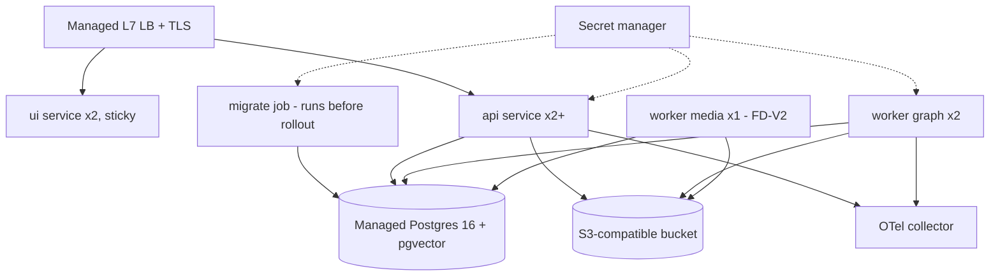

# Deployment and DevOps

**Doc ID:** TFD-ENG-005 · **Version:** 1.0-draft · **Date:** 2026-11-05 · **Status:** Phase B design — pending approval
**Inputs:** `docs/audit/01` §3, `03` §9, `05` §4, `08` (SEC-02, SEC-09) · `pyproject.toml` · `docker-compose.yml` · `packages/core/config.py` · `apps/worker/worker.py` · `packages/workflows/checkpointer.py` · DEC-001, DEC-003, DEC-008 · `TESTING_AND_QA_STRATEGY.md` §14

---

## 0. Current state

| Item | Current |
|---|---|
| Containers | Only Postgres (`docker-compose.yml`: `pgvector/pgvector:pg16`, port 55432, `POSTGRES_PASSWORD: postgres`). **No Dockerfile** for the API, worker or UI |
| CI/CD | **None** (no `.github/`, no Makefile) |
| Environments | Local developer machines only |
| Config | `packages/core/config.py::Settings` (pydantic-settings, `.env`). `environment` defaults to `"development"` (SEC-02) |
| Secrets | `.env` (untracked), `.env.example` with placeholders. Several declared keys are unused (`docs/audit/03` §9) |
| Migrations | Applied by hand (`alembic upgrade head`). Head `00b7cd57e036` is an uncommitted WIP revision that is already applied locally |

## 1. Images: one Dockerfile per process

All images build from the same source tree and lockfile, so domain code is identical across processes. Separate Dockerfiles keep each image minimal and give each its own entrypoint, user and health check.

| File | Process | Entrypoint | Notes |
|---|---|---|---|
| `docker/api.Dockerfile` | FastAPI | `uvicorn apps.api.main:app --host 0.0.0.0 --port 8000 --workers 1 --timeout-graceful-shutdown 30` | One uvicorn worker per container; scale by replicas |
| `docker/worker.Dockerfile` | Outbox worker | `python -m apps.worker.worker --pool ${WORKER_POOL:-graph}` | The `--pool` flag is added with ADR-007; until then the existing loop runs unchanged |
| `docker/ui.Dockerfile` | Streamlit (alpha) | `streamlit run apps/ui/app.py --server.port 8501 --server.headless true` | Replaced or joined by a web-app image if ADR-002 is approved |
| `docker/migrate.Dockerfile` | One-off migration job | `alembic upgrade head && python -m packages.workflows.checkpointer --setup` | Runs `PostgresSaver.setup()` **once** per deploy instead of on every invocation (PERF-02). Needs a small CLI entry in `checkpointer.py` (Phase C) |
| `docker/media-worker.Dockerfile` (FD-V2) | Media pool | same worker module, `--pool media` | Adds a pinned LGPL `ffmpeg`/`ffprobe` build (DEC-018, licence review) and libmagic; ClamAV is a sidecar (DEC-022) |

Common rules:
- Base `python:3.11-slim` pinned by digest; multi-stage build; installed with `--require-hashes` from a lockfile (`uv.lock` or `requirements.lock`, generated from `pyproject.toml`).
- Non-root UID 10001; read-only root filesystem; `/tmp` as tmpfs.
- `HEALTHCHECK`: API `GET /health`; worker checks that the heartbeat file is fresh.
- Labels: `org.opencontainers.image.revision=<git sha>`; the same SHA is exported as the `TATTVA_BUILD_SHA` env var and appears in logs (Observability §1).

`docker-compose.yml` is **extended** (not replaced) with `api`, `worker`, `ui`, `migrate` and `minio` services behind a profile `full`. Plain `docker compose up -d` keeps starting only `db`, so the current developer workflow (`docs/audit/09` §1) still works.

## 2. Environments

| Env | Purpose | Infra | Data | Identity | Providers | Deploy trigger |
|---|---|---|---|---|---|---|
| `development` (local) | Developer loop | docker-compose | Disposable; seed scripts | Dev fallback **only if** `ALLOW_DEV_IDENTITY_FALLBACK=true`, otherwise a local OIDC test issuer | Mock adapters, labelled | manual |
| `test` / `ci` | Automated tests | GitHub Actions + PG service container | Per-run `tattva_test_*` DB (DEC-015) | Test JWKS signing test tokens; `X-Actor-ID` header accepted **only** here | Mock + recorded fixtures | every PR |
| `staging` | Integration, E2E, load, drills, pilot rehearsal | Managed container platform + managed PG + S3-compatible bucket (DEC-001/003/008) | Synthetic data only. **No real performer data (C4)** | Real IdP, staging tenant | Mock adapters by default; sandbox provider accounts behind flags with spend caps | merge to `main` |
| `production` | Pilot and GA | Same topology as staging, separate account/project | Real customer data | Real IdP | Verified adapters per DEC-013, behind flags | tagged release + manual approval |

Staging and production are built from the same IaC modules with different variables. Production data is **never** copied to staging (C3/C4 classes; Privacy doc). Restore drills go to an isolated, short-lived restore environment instead (Backup doc §7).

## 3. Topology (staging / production)

## 4. CI/CD (GitHub Actions)

Workflows under `.github/workflows/`:

| Workflow | Trigger | Jobs (in order) |
|---|---|---|
| `ci.yml` | `pull_request`, `push` to any branch | lint → types (ratchet) → unit → api/integration/db/workflow (PG service) → migration round trip + migration lint → authz/tenant → contract replay → security (pip-audit, gitleaks). Stages 1–8 of the Testing doc §14 |
| `build.yml` | push to `main` | build 4 images → Trivy → SBOM → push to registry tagged `sha-<git sha>` → Playwright E2E on a compose stack using those images |
| `deploy-staging.yml` | `build.yml` success on `main` | migration gate (§5) → `migrate` job → rolling deploy api/worker/ui → smoke (`/ready`, login, create project, WF-01 with the mock generator to `awaiting_approval`) → mark the image `staging-verified` |
| `deploy-prod.yml` | tag `v*` on a `staging-verified` SHA + GitHub Environment manual approval (2 reviewers) | backup checkpoint (on-demand snapshot) → migration gate → `migrate` → rolling deploy → smoke → release notes and SBOM attached |
| `nightly.yml` | schedule | evals, live provider contracts (opt-in), k6 against staging, ZAP baseline |

Rules:
- Third-party actions pinned by SHA; `permissions: contents: read` by default.
- Cloud credentials via GitHub OIDC federation; no static cloud keys in GitHub secrets.
- Branch protection on `main`: required checks = `ci.yml` jobs; linear history; 1 review (2 for `packages/persistence/migrations/**` and `packages/core/config.py` via CODEOWNERS).

## 5. Migration gating

The rule follows `docs/audit/05` §4 and Master Prompt §24 (never delete applied migrations; never drop without a data-preservation migration).

1. **Classification.** Each migration file declares `MIGRATION_PHASE = "expand" | "backfill" | "contract"` in its module. Migration lint (CI) checks:
   - `expand`: only `ADD COLUMN` (nullable or with a default), `CREATE TABLE`, `CREATE INDEX CONCURRENTLY`, and new constraints `NOT VALID`.
   - `backfill`: data only, batched (≤ 10k rows per transaction), idempotent, with a reconciliation query in the docstring.
   - `contract`: drops or renames. Allowed only when the PR references the release where the last reader/writer was removed, carries the `contract-migration` label and has 2 approvals.
2. **Order of operations per deploy:** on-demand DB snapshot (prod) → `migrate` job (`alembic upgrade head` as the `migrator` role) → wait for success → roll out the app. Because migrations are expand-only during a release, old pods keep working against the new schema.
3. **Gate checks before `migrate` runs:**
   - `alembic heads` returns exactly one head.
   - The target revision exists in the image.
   - The round-trip test passed in CI for this SHA.
   - The `alembic_version` in the target DB is an ancestor of head (no divergence).
   - For prod, a snapshot newer than 15 minutes exists.
4. **Readiness check** (`/ready`) compares `alembic_version` with the head baked into the image. A pod whose schema is behind does not receive traffic.
5. **WIP revision `00b7cd57e036`:** it must be committed (DEC-010 fix-forward) before any shared environment exists. Shared environments must never see an uncommitted revision.

## 6. Rolling deploys

- API and UI: `maxUnavailable=0`, `maxSurge=1`. Readiness gate as above. LB connection draining 30 s, matching uvicorn's graceful timeout.
- Workers: SIGTERM → stop claiming → finish the current task within `task_timeout`, or release its lease (ADR-007). Until ADR-007 lands, deploys must **drain** workers: scale to 0, confirm that `SELECT count(*) FROM outbox_tasks WHERE status='claimed'` = 0, then deploy.
- Streamlit: sticky sessions; users see a reconnect on rollout, which is acceptable for the alpha.
- Graph compatibility: a deploy that changes a graph's node set bumps `workflow_runs.graph_version`. Runs paused at `interrupt()` under the old version must resume on code that still understands that version. Keep old node names for one release, or finish or cancel paused runs before contracting.

## 7. Secrets management

| Secret | Store | Consumer | Rotation |
|---|---|---|---|
| `DATABASE_URL` (per role: `app_rw`, `migrator`) | Platform secret manager | API, worker / migrate job | 90 days; dual-user rotation (create new password, roll pods, revoke old) |
| `CHECKPOINT_DATABASE_URL` (when separate) | same | API, worker | 90 days |
| Object storage credentials | Workload identity (IAM role) preferred; otherwise secret manager | API, worker | Role-based: no rotation needed |
| OIDC client secret / JWKS URL | Secret manager / config | API, UI | Per IdP policy |
| LLM keys (`OPENAI_API_KEY` etc., currently unused) | Secret manager, platform-level | ModelGateway only | 90 days or on suspicion |
| Per-org provider credentials (FD-V2) | `provider_connections.credential_ciphertext`, envelope-encrypted with a KMS key; never returned by any API | Provider worker | Customer-controlled; revocation via UI |
| Webhook signing secrets (FD-V2) | Same as provider credentials | API webhook receiver | Per connection |

Rules: secrets are never baked into images or written to logs (Observability §6). `.env` is for development only. `Settings` gains a `SecretStr` type for every key so that `repr()` never prints the value.

## 8. Environment configuration: fail closed (fixes SEC-02, SEC-09)

Changes to `packages/core/config.py` (Phase C; additive for local developers through `.env.example`):

1. `environment: Literal["development","test","staging","production"]` **has no default.** A process started without `ENVIRONMENT` exits with a validation error. `.env.example` sets `ENVIRONMENT=development`, so local setup keeps working after copying it.
2. A new `allow_dev_identity_fallback: bool = False`. `apps/api/dependencies.py` replaces `settings.environment in DEV_FALLBACK_ENVIRONMENTS` with `settings.environment == "development" and settings.allow_dev_identity_fallback`. In `test`, tests authenticate explicitly. `UserRepository.get_or_create_default_actor` loses the `select(OrganizationModel).first()` branch and binds only to `slug='default-studio'`.
3. A `model_validator(mode="after")` enforces, for `staging` and `production`:
   - `database_url` is set explicitly and does not contain `postgres:postgres@` or `localhost`.
   - `allow_dev_identity_fallback` is false.
   - `debug` is false and `db_echo` is false.
   - `storage_provider != "local"` (local FS cannot be shared across replicas).
   - `cors_allow_origins` contains no `localhost` and no `*`.
   - The auth issuer and audience are set (ADR-003).
   - `model_gateway_provider` may be `mock` only if `ALLOW_MOCK_PROVIDERS=true`, and then the UI shows a banner (NFR-UX-02).
4. Startup logs a one-line config fingerprint (`environment`, build SHA, storage provider, auth issuer host, mock flags) with **no** secret values.
5. Unit tests cover each rule (NFR-SEC-02).

## 9. Feature flags

**OPEN — DEC-024 (new):** flag mechanism. Recommendation: start with typed `Settings` flags (env-driven, per deployment). Add per-organization overrides in a JSONB `settings` column on `organizations`, introduced in the DB design, only when the pilot needs per-tenant rollout. No third-party flag service until then.

| Flag | Default | Purpose |
|---|---|---|
| `FF_ASYNC_WORKFLOWS` | off → on in Phase C | Switches the `sync_execution` default to false while the request field stays available (contract preserved) |
| `FF_OUTBOX_LEASES` | off → on | ADR-007 rollout |
| `FF_PRESIGNED_UPLOADS` | off | ADR-008 |
| `FF_SCREENPLAY_LOCK` | off | ADR-004 rollout |
| `FF_CONSENT_ENFORCEMENT` | **on, not switchable off in production** | ADR-006. A flag exists only to stage the UI; the gate cannot be disabled in prod (validator) |
| `FF_PROVIDER_<ID>_CONNECTED` | off | Per-provider connected execution. Manual mode is always on (ADR-005) |
| `ALLOW_MOCK_PROVIDERS` | on in dev/test/staging, off in prod | Labelled mocks |

## 10. Rollback

| Situation | Action |
|---|---|
| App defect, schema unchanged or expand-only | Re-deploy the previous `staging-verified` image SHA (rolling). Expand-only migrations stay in place; old code ignores the new columns |
| Bad expand migration (fails midway) | On Postgres, Alembic runs the upgrade inside a transaction (`context.begin_transaction()` in `packages/persistence/migrations/env.py`; DDL is transactional). The exception is `CREATE INDEX CONCURRENTLY`, which runs in an autocommit block and is retried idempotently with `IF NOT EXISTS`. Fix forward with a new revision. **Never edit an applied revision** |
| Bad backfill | Backfills are idempotent and reversible by design (they write new columns only). Re-run the corrected backfill |
| Contract migration caused data loss | Restore via PITR to the pre-deploy snapshot into a new instance, then reconcile (Backup doc §6). This is why contract migrations require a fresh snapshot and two approvals |
| `alembic downgrade` | Only in dev/staging, or in prod for an expand revision with no data written yet. Run as `migrator` after a snapshot |
| Worker version mismatch on paused graphs | Keep the previous worker image for the `graph` pool until paused runs drain (§6) |

## 11. Open decisions

- **OPEN — DEC-008:** hosting platform. Recommendation: a managed container service with L7 LB, secrets and autoscaling; no Kubernetes (capacity plan §7).
- **OPEN — DEC-001 / DEC-003:** managed PG and object storage vendors; both are required before staging.
- **OPEN — DEC-024 (new):** feature-flag mechanism (§9).
