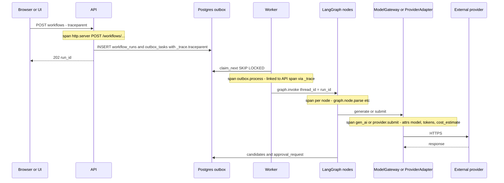

# Observability and Monitoring

**Doc ID:** TFD-ENG-006 · **Version:** 1.0-draft · **Date:** 2026-11-05 · **Status:** Phase B design — pending approval
**Inputs:** Master Prompt §20, §22, V1-30 (core operational observability) · `docs/audit/02` (V1-30 NOT_IMPL), `08` PERF-07 · `packages/core/logging.py` · `apps/worker/worker.py` · `packages/persistence/models.py` (`OutboxTaskModel.payload`) · `NON_FUNCTIONAL_REQUIREMENTS.md` · `COST_AND_CAPACITY_MODEL.md`

---

## 0. Current state

- `packages/core/logging.py`: `logging.basicConfig` with the text format `"%(asctime)s %(levelname)-7s %(name)s: %(message)s"`, logger names `tattva.<name>`.
- `/health` runs `SELECT 1`. There is no readiness endpoint, no metrics, no tracing, no request ID, and no correlation between an API request and the worker task it enqueues.
- The worker logs `Claimed task %s (type=%s, run=%s)` and `Completed task %s`. That is the only existing correlation.

## 1. Structured JSON logs

Every process (API, worker, UI, migrate) writes **one JSON object per line to stdout**. `configure_logging()` keeps its signature and switches to a JSON formatter when `LOG_FORMAT=json` (default in staging/prod; text stays the local default).

| Field | Source | Always present |
|---|---|---|
| `ts` | UTC RFC 3339 with ms | yes |
| `level`, `logger`, `msg` | stdlib | yes |
| `service` | `api` / `worker` / `ui` / `migrate` | yes |
| `env`, `build_sha` | `Settings.environment`, `TATTVA_BUILD_SHA` | yes |
| `request_id` | `X-Request-ID` inbound (validated UUID) or generated; echoed in the response header and in error bodies | API |
| `trace_id`, `span_id` | OTel context | when traced |
| `org_id`, `project_id` | resolved actor and path | when known |
| `actor_id` | verified token subject (internal user UUID, never email) | when authenticated |
| `workflow_run_id`, `graph_id`, `graph_version`, `node` | worker / graph | worker |
| `outbox_task_id`, `attempt`, `pool` | worker | worker |
| `approval_id`, `generation_job_id`, `generation_attempt_id`, `provider_id` | where relevant | — |
| `error_class`, `error_code` | exception mapping (`apps/api/errors.py`) | on error |
| `duration_ms` | request or task | on completion |

Implementation: `contextvars` for correlation fields, populated by an ASGI middleware (API) and by `process_one_task` (worker), and attached by a logging `Filter`. **The `run → request` link:** the API writes `request_id` and the W3C `traceparent` into `outbox_tasks.payload` under the reserved key `_trace`. The `payload` JSON column already exists, so no schema change is needed. The worker restores both.

## 2. OpenTelemetry traces

| Span | Kind | Key attributes |
|---|---|---|
| `http.server <route>` | server | `http.route`, `http.status_code`, `tattva.org_id`, `tattva.project_id` |
| `outbox.enqueue` | producer | `tattva.workflow_run_id`, `tattva.task_kind`, `tattva.pool` |
| `outbox.process` | consumer, **span link** to the enqueue span (not a parent, because queue time can be long) | `tattva.attempt`, `tattva.queue_wait_ms` |
| `graph.invoke` / `graph.resume` | internal | `tattva.graph_id`, `tattva.graph_version`, `tattva.resumed_from_checkpoint` |
| `graph.node.<name>` | internal | `tattva.node`, candidate counts |
| `gen_ai.request` (ModelGateway) | client | OTel GenAI semantic conventions: `gen_ai.system`, `gen_ai.request.model`, `gen_ai.usage.input_tokens`, `gen_ai.usage.output_tokens`; `tattva.prompt_version`, `tattva.generator_mode` (`mock` is explicit) |
| `provider.<op>` (FD-V2) | client | `tattva.provider_id`, `tattva.capability_snapshot_version`, `tattva.execution_mode` (`connected_api` / `connected_mcp` / `manual`), `tattva.cost_estimate_units` |
| `storage.put` / `storage.get` | client | `tattva.storage_provider`, size; never the key for C4 objects |
| DB | client | SQLAlchemy and psycopg instrumentation; parameterised statements only |

- Instrumentation: `opentelemetry-instrumentation-fastapi`, `-sqlalchemy`, `-psycopg`, `-httpx`, `-requests`, plus manual spans for graph nodes, the outbox and adapters.
- Export: OTLP to an OTel Collector, then to a backend chosen under **OPEN — DEC-023 (new)**. Recommendation: the hosting platform's managed tracing/metrics backend, or a Grafana stack (Tempo/Loki/Prometheus) if DEC-008 lands on a platform without one.
- Sampling: 100 % for `outbox.process`, `provider.*`, `gen_ai.*` and errors; 10 % head sampling for `GET` reads; tail-based keep on latency > p95.

## 3. Metrics (named list)

Prometheus-style names. Labels never include user IDs, project titles or other high-cardinality values; `org_id` appears only on cost and usage metrics, which have bounded cardinality at pilot scale.

**HTTP / API**
| Metric | Type | Labels |
|---|---|---|
| `tattva_http_requests_total` | counter | `route`, `method`, `status_class` |
| `tattva_http_request_duration_seconds` | histogram | `route`, `method` |
| `tattva_http_rate_limited_total` | counter | `route`, `limiter` |
| `tattva_auth_failures_total` | counter | `reason` (`missing`, `invalid_sig`, `expired`, `wrong_aud`) |
| `tattva_authz_denied_total` | counter | `capability` |

**Outbox / workers**
| Metric | Type | Labels |
|---|---|---|
| `tattva_outbox_pending_tasks` | gauge | `pool` |
| `tattva_outbox_oldest_pending_age_seconds` | gauge | `pool` |
| `tattva_outbox_claim_latency_seconds` | histogram | `pool` (created → claimed; NFR-JOB-01) |
| `tattva_outbox_task_duration_seconds` | histogram | `pool`, `task_type`, `outcome` |
| `tattva_outbox_retries_total` | counter | `pool`, `error_class` |
| `tattva_outbox_dead_lettered_total` | counter | `pool`, `task_type` |
| `tattva_outbox_lease_expired_reclaims_total` | counter | `pool` |
| `tattva_worker_busy_slots` | gauge | `pool`, `worker_id` |

**Workflows / approvals**
| Metric | Type | Labels |
|---|---|---|
| `tattva_workflow_runs_total` | counter | `graph_id`, `final_status` |
| `tattva_workflow_runs_in_status` | gauge | `graph_id`, `status` |
| `tattva_workflow_e2e_seconds` | histogram | `graph_id` (start → awaiting_approval) |
| `tattva_approval_wait_seconds` | histogram | `scope`, `approval_level` (human time; informational) |
| `tattva_approval_decisions_total` | counter | `scope`, `decision` |
| `tattva_canonical_commits_total` | counter | `scope` |
| `tattva_version_conflicts_total` | counter | `scope` (409s from `assert_expected_version`) |

**Storage / media**
| Metric | Type | Labels |
|---|---|---|
| `tattva_upload_bytes_total` | counter | `asset_type` |
| `tattva_upload_rejected_total` | counter | `reason` (`size`, `signature_mismatch`, `mime`, `malware`) |
| `tattva_asset_processing_seconds` | histogram | `step` (`scan`, `probe`, `thumbnail`, `proxy`) |
| `tattva_storage_reconciliation_drift` | gauge | `kind` (`missing_object`, `orphan_object`, `checksum_mismatch`) |

**AI / providers / cost**
| Metric | Type | Labels |
|---|---|---|
| `tattva_gen_ai_requests_total` | counter | `provider`, `model`, `generator_mode`, `outcome` |
| `tattva_gen_ai_tokens_total` | counter | `provider`, `model`, `direction` |
| `tattva_gen_ai_latency_seconds` | histogram | `provider`, `model` |
| `tattva_provider_jobs_total` | counter | `provider_id`, `execution_mode`, `outcome` (incl. `outcome_unknown`) |
| `tattva_provider_rate_limited_total` | counter | `provider_id` |
| `tattva_usage_cost_estimated_units_total` | counter | `org_id`, `provider_id`, `unit` |
| `tattva_budget_utilisation_ratio` | gauge | `org_id` (max over the org's projects) |
| `tattva_consent_gate_blocks_total` | counter | `purpose` |

**Database**: from the managed PG exporter: connections used/max, replication lag, `pg_stat_statements` top-N mean time, table size for `checkpoints*`, `audit_events`, `assets`.

## 4. SLOs and alerts

| SLO | SLI | Objective | Window | Alert (multi-window burn rate) |
|---|---|---|---|---|
| API availability | `/ready` probe success and non-5xx ratio of `tattva_http_requests_total` | 99.5 % pilot / 99.9 % GA (DEC-026) | 28 d | Page: 14.4× burn over 1 h and 5 min. Ticket: 3× over 6 h |
| API read latency | `tattva_http_request_duration_seconds` GET ≤ 300 ms | 95 % | 28 d | Ticket at 2× burn over 6 h |
| Job pickup | `tattva_outbox_claim_latency_seconds` ≤ 5 s | 95 % | 7 d | Page if `tattva_outbox_oldest_pending_age_seconds{pool="graph"}` > 600 for 10 min |
| Workflow success | runs ending `completed`/`awaiting_approval`/`rejected` vs `failed` (excluding user cancels) | 99 % | 7 d | Ticket if `failed` > 5 % over 1 h |

Non-SLO alerts:
| Alert | Condition | Severity (Incident doc) |
|---|---|---|
| Dead letters | `increase(tattva_outbox_dead_lettered_total[15m]) > 0` | SEV-3 |
| Stuck claims (pre-ADR-007) | `count(outbox_tasks WHERE status='claimed' AND claimed_at < now()-30m) > 0` (SQL exporter) | SEV-3 |
| Storage drift | `tattva_storage_reconciliation_drift{kind="missing_object"} > 0` | SEV-2 |
| Consent gate bypass suspicion | Provider submit with a C4 reference and no matching consent check span in the trace | SEV-1 |
| Budget | `tattva_budget_utilisation_ratio > 0.8` → notify; `> 1.0` → SEV-2 (hard stop already enforced) | SEV-2/notify |
| Auth anomalies | `tattva_auth_failures_total` rate > 10× baseline | SEV-3 |
| DB connections | > 80 % of max for 10 min | SEV-3 |
| Checkpoint growth | `checkpoints*` size > capacity model + 50 % | ticket |
| Mock in prod | any `tattva_gen_ai_requests_total{generator_mode="mock"}` in production with `ALLOW_MOCK_PROVIDERS` false | SEV-2 (config breach) |

## 5. Dashboards

1. **Service health:** request rate, errors, latency by route; pod restarts; `/ready` status; DB connections.
2. **Pipeline:** per pool: pending, oldest age, claim latency, busy slots, retries, DLQ; workflow runs by status and graph.
3. **Governance:** approvals pending by level and age; canonical commits; version conflicts; screenplay lock events; consent gate blocks.
4. **AI cost and quality (V1 + V2):**
   - Tokens and estimated cost per org, project, graph, model per day, from `usage_records` (SQL datasource; metrics are for alerting only).
   - Cost per approved artifact = `Σ cost for runs whose candidates reached canon / approved artifacts`.
   - Mock vs live ratio (must be 0 % mock in prod).
   - Eval scores over time per WF from `evaluation_records`, annotated with prompt and model version changes.
5. **Provider cost (FD-V2):** spend per provider vs budget; attempts per approved shot (regeneration ratio); `outcome_unknown` count; rate-limit hits; manual vs connected execution share.
6. **Storage:** bytes by class and type; growth vs capacity plan; reconciliation drift; quarantine count.

## 6. Redaction policy (PII and likeness data)

Logs and traces are **class C2 at most** (see `DATA_PRIVACY_AND_RETENTION.md` §1). Anything that would raise them to C3/C4 is redacted at source.

| Data | Rule |
|---|---|
| Screenplay text, dialogue, research excerpts, prompts, model responses | **Never logged and never in span attributes.** Log lengths, hashes (`sha256[:12]`) and IDs. Prompt and response bodies are stored only in `ai_runs` / `prompt_versions` with project-level access control |
| Face references, body measurements, voice samples, performer names, consent documents (C4) | Never logged. IDs only. Storage spans omit object keys for C4 assets |
| Emails, full names | Not logged. `actor_id` (UUID) only |
| Tokens, API keys, presigned URLs, cookies | Never logged. Middleware strips `Authorization`, `Cookie`, `X-Amz-*`, `Signature`, `X-Actor-ID` from logged headers. URL query strings are dropped from logged URLs |
| Exceptions | Messages from provider SDKs can echo payloads. Adapter exceptions are wrapped and the original message is truncated to 200 characters and run through the scrubber |
| File names | User file names can contain personal names. Log `asset_id` instead |

Enforcement: a logging `Filter` with a deny-list scrubber (key-name and regex based); the OTel Collector `attributes/redaction` processor as a second layer; a unit test feeds known secrets and C4 fixtures through the logger and asserts they are absent. Log retention: 30 days hot, 90 days archive; audit lives in `audit_events`, not in logs.

## 7. Phasing

| Phase | Deliverable |
|---|---|
| Alpha | JSON logs + `request_id` + `workflow_run_id` correlation via `_trace`; `/ready`; outbox SQL gauges; redaction filter + test |
| Pilot | OTel traces end to end; metrics list above; SLO dashboards and alerts; AI cost dashboard from `usage_records` |
| FD-V2 | Provider spans, provider cost dashboard, consent-gate trace assertion |
