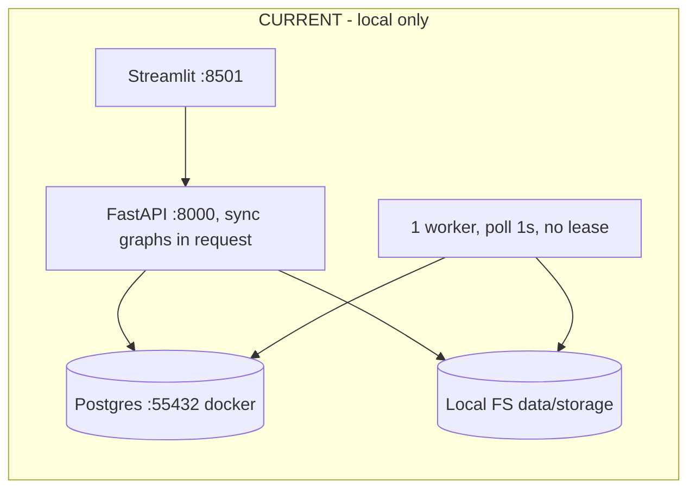
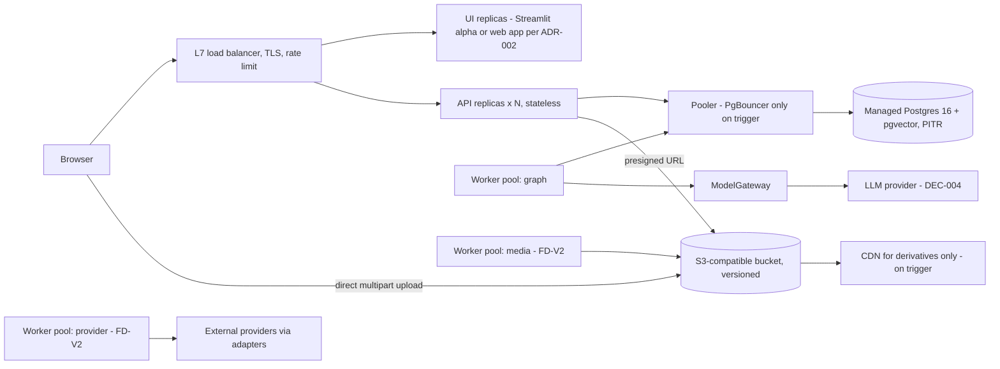
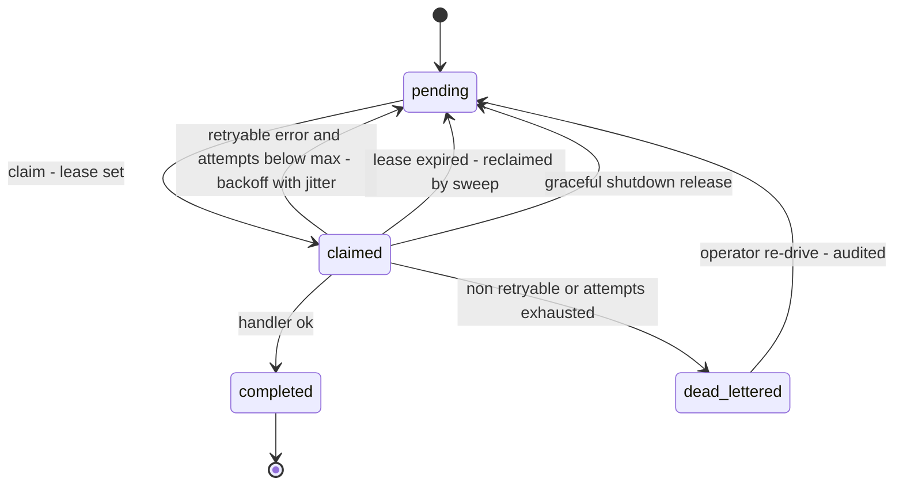

# Scalability, Performance and Capacity Plan

**Doc ID:** TFD-ENG-002 · **Version:** 1.0-draft · **Date:** 2026-11-05 · **Status:** Phase B design — pending approval
**Inputs:** Master Prompt §20.1–§20.7 · `docs/audit/03` §6–§8, `05` §2, `08` §2 (PERF-01…07) · `packages/core/config.py` · `packages/persistence/database.py` · `packages/persistence/repositories.py::OutboxRepository.claim_next` · `apps/worker/worker.py` · `packages/storage/service.py` · ADR-007, ADR-008 · `NON_FUNCTIONAL_REQUIREMENTS.md`

---

## 0. Principles

1. **Measure before adding infrastructure.** Every component in §7 has a trigger. Without the trigger, the component is not introduced.
2. **Canonical data never depends on cache or queue state.** PostgreSQL is the system of record. Caches are disposable, and the outbox is a table inside the same database.
3. **The modular monolith stays one deployable codebase** with three process types today (API, worker, UI) and one added later (media worker pool, same image, different entrypoint).
4. **Additive change only.** Every change below extends current tables and routes (expand → backfill → switch → contract).

### Current vs target topology

---

## 1. Load balancing (§20.1)

| Concern | Design | Current | Notes |
|---|---|---|---|
| L7 load balancer and TLS | A managed L7 LB from the hosting platform (DEC-008) terminates TLS 1.2+, routes `/api/*` to API replicas and `/` to the UI | None | The LB that comes with the container platform. No separate API gateway product is needed until a public partner API exists (then **OPEN — DEC-008**) |
| Stateless API replicas | Minimum 2 replicas at pilot. No in-process durable state | `create_app()` keeps no session state. `get_settings()` is `lru_cache`d config, which is safe. `IdentityService` reads the DB per request | Requirement: no module-level caches of tenant data. Code review rule plus a test that two `TestClient` instances see identical state |
| Health / readiness | `GET /health` = liveness, no I/O. New `GET /ready` = DB `SELECT 1` + storage adapter `head` on a sentinel key + migration head check (`alembic_version` = expected) | `/health` runs `SELECT 1` (`apps/api/routers/health.py`), which mixes liveness and readiness | If liveness touches the DB, a DB blip restarts every pod. Split them |
| Worker health | The worker writes a heartbeat (`lease_expires_at` renewal) and exposes a file or port probe. The platform restarts it if the heartbeat stalls for > 2 × lease renewal interval | None | ADR-007 |
| Graceful shutdown | API: uvicorn `--timeout-graceful-shutdown 30`, and the LB drains connections before SIGTERM. Worker: on SIGTERM, stop claiming, finish the current task up to `task_timeout`, otherwise release the lease (`status=pending`, `next_attempt_at=now()`) | `run_worker_loop` has no signal handling; a kill leaves the task `claimed` forever | Release on shutdown removes most stuck tasks before leases exist |
| Horizontal scaling | API: scale on CPU > 60 % or p95 > NFR-LAT-01. Workers: scale on `tattva_outbox_pending_tasks{pool}` and oldest-pending age | N/A | Workers scale independently of the API (Master Prompt §20.1) |
| Rolling deploys | maxUnavailable 0, maxSurge 1; migrations run first as a separate job (`DEPLOYMENT_AND_DEVOPS.md` §5) | N/A | Expand-only migrations make old and new code compatible during the roll |
| Rate limiting | Two layers. (1) LB per-IP limit as a coarse flood guard. (2) App-level per-actor token bucket on AI-trigger and upload routes (NFR-SEC-08), stored in Postgres (`usage_records` window counts) until Redis is justified | None (SEC-10) | Postgres-backed limiting is acceptable at expected load (≤ tens of writes/s). The trigger for Redis is in §7 |
| Realtime status | **Server-Sent Events** `GET /api/v1/projects/{pid}/events` streaming `workflow_run`, `approval_request` and `generation_job` state changes. Polling `GET /workflow-runs/{id}` stays as the fallback. The SSE source is Postgres `LISTEN/NOTIFY` on channel `tattva_events`, published in the same transaction as the state change | Polling endpoint exists but the UI doesn't use it | SSE works through L7 LBs, needs no sticky sessions (each replica LISTENs) and is one-directional, which is all job status needs. WebSockets are not justified. LB idle timeout ≥ 75 s with a 30 s SSE heartbeat comment |
| Shared session state | None. Auth is a bearer JWT verified per request (ADR-003). The Streamlit session holds only UI state and the token | Streamlit session state only | Streamlit needs sticky sessions at the LB because its websocket is bound to a server process. That is a UI-tier concern only |

## 2. Caching (§20.2)

**Rule:** a cache miss or cache outage degrades latency, never correctness. Nothing caches *mutable canonical* rows by ID without a version in the key.

| Layer | What | Cache key | Scope | TTL | Invalidation | Sensitive-data rule | Failure behaviour | When |
|---|---|---|---|---|---|---|---|---|
| Browser | Static UI bundle (web app per ADR-002) | content hash in filename | public | 1 year, `immutable` | new hash per build | none in bundle | n/a | With web app |
| Browser / CDN | Derivatives: thumbnails, proxies, waveforms | `asset_derivatives.id` + `checksum` in the URL path, served through **short-lived signed URLs** | per-asset authorization at URL issue | URL expiry 15 min; object `Cache-Control: private, max-age=900` | Content-addressed, so it never changes; revocation means no new URLs are issued | **Never** for C4 data (face references, body measurements, voice; see Privacy doc §1). Those are served only through the API with per-request authZ and `Cache-Control: no-store` | Fall back to origin | FD-V2 |
| API response | **Not cached** for tenant data in FD-V1 | — | — | — | — | — | — | Only on a measured hot-read trigger (§7) |
| Retrieval / embeddings | No embedding index in FD-V1. Enable only after it is shown to beat structured selection (**DEC-016**) | — | — | — | — | — | — | — |
| AI context | `context_packages` are **themselves the cache**: an immutable, hashed package keyed by `(project_id, screenplay_version_id, input_versions_hash, resolver_version)` | `context_hash` | project | none (immutable rows) | A new canonical version produces a new hash; old packages are kept for provenance | Package payload follows the class of its most sensitive input. C4 inputs are referenced by ID, never inlined | Recompute | FD-V1 (Context Resolver) |
| Prompt cache | Use provider-side prompt caching only through `ModelGateway`, only for the stable prefix (system prompt + Film Bible excerpt). No Tattva-side response cache for generative calls | gateway-managed | org + project, never cross-tenant | provider-defined | n/a | Disabled for prompts containing C4 references | Call without cache | After DEC-004 |
| Embedding cache | Embeddings stored as rows (pgvector) keyed by `(source_type, source_id, source_checksum, embedding_model)` | that tuple | project | none | Recompute when checksum or model changes | No embeddings of face or voice data (DEC-017) | Recompute | Only after DEC-016 shows retrieval beating structured selection |
| DB query | Postgres shared buffers; no app query cache | — | — | — | — | — | — | — |
| Redis shared cache | **Not introduced.** Trigger in §7 | `t:{org}:{project}:{entity}:{id}:v{version}` (format reserved) | Keys always include org + project | ≤ 5 min | version in key; publish on commit | No C3/C4 values | Bypass to DB | On trigger |

## 3. Database performance (§20.3)

| Concern | Current | Target design |
|---|---|---|
| Connection pooling | SQLAlchemy `pool_size=10`, `max_overflow=20`, `pool_pre_ping=True` per process (`packages/persistence/database.py`). The LangGraph `PostgresSaver.from_conn_string` opens **its own connection per invocation**, and `setup()` runs every time (PERF-02) | Connections per process ≤ `pool_size + max_overflow + checkpointer pool`. Budget: `(api_replicas × 30) + (worker_replicas × (worker_concurrency × 2 + 2)) ≤ 0.8 × max_connections`. Use one long-lived `ConnectionPool` for the checkpointer per process; `setup()` runs once in the migration job |
| PgBouncer | Not present | **Evaluate, don't deploy.** Trigger: the budget above exceeds 80 % of `max_connections` for the managed tier. Then use transaction pooling for API traffic. **Caveat:** `LISTEN/NOTIFY` (SSE) and session-level advisory locks do not work through transaction pooling, so SSE listeners connect directly |
| Indexes | PK/FK indexes plus film-bible indexes only (`docs/audit/05` §2) | Add `(project_id, created_at DESC)` on `audit_events`, `assets`, `workflow_runs`, `approval_requests` and every `*_candidates` table. Add partial index `outbox_tasks (pool, next_attempt_at) WHERE status = 'pending'`. Add `workflow_runs (organization_id, status)`. Each index ships in its own migration with `CREATE INDEX CONCURRENTLY` (Alembic `autocommit_block`) |
| Pagination | None (PERF-05) | Keyset cursor `?limit=50&cursor=<base64(created_at,id)>`, max 200. Existing unpaginated responses keep their shape for one release: the default `limit` is large and returned with a `next_cursor` field (additive) |
| Transaction boundaries | Approval row locked and committed before resume (good). Version bump unlocked in 3 services (PERF-06) | One transaction per command. Project row `FOR UPDATE` only around the version bump. No external network call inside a DB transaction (provider submits happen after commit of the `generation_attempts` row, with an outcome-unknown state) |
| Slow-query monitoring | None | `pg_stat_statements` enabled; `log_min_duration_statement = 500ms` in staging and prod; weekly top-20 review; OTel DB spans carry `db.statement` (parameterised, no values) |
| Statement timeouts | None | `statement_timeout = 15s` for the API role, `120s` for the worker role, `0` for the migration role. `idle_in_transaction_session_timeout = 60s` |
| Read replicas | None | Not before trigger (§7). Candidates: audit-log reads, analytics, export. Canonical review flows always read the primary (read-your-writes after approval) |
| Partitioning | None | Only `audit_events` and `usage_records` are candidates, by month, at > 50 M rows or when retention deletes become expensive. Not before |
| Checkpoint growth | LangGraph `checkpoints`, `checkpoint_blobs`, `checkpoint_writes` grow per run with no pruning | Prune threads of terminal runs after 30 days (runbook procedure). This is the largest DB growth term (§6) |

## 4. Background processing (§20.4)

Full design in **ADR-007**. Summary of the change to `outbox_tasks` and `apps/worker/worker.py`:

| Concern | Current (`apps/worker/worker.py`, `OutboxRepository.claim_next`) | Target |
|---|---|---|
| Durable dispatch | Outbox row in the same transaction as `workflow_runs` (good); `workflow_run_id` is **unique** on `outbox_tasks`, so one task per run | Keep. Add a `task_kind` (`start` / `resume` / `provider_poll` / `media_derive` / `reconcile`). Resume and poll tasks need more than one task per run, so the unique constraint is **relaxed via an expand step**: add `dedupe_key` unique, then backfill `dedupe_key = 'start:' || workflow_run_id`, then drop the old unique constraint in a later contract release |
| Lease | `claimed_at` set; never re-claimed | `lease_expires_at = now() + lease`; heartbeat renews every `lease/3`; `claim_next` also selects `status='claimed' AND lease_expires_at < now()` |
| Retry | Any exception means FAILED forever | `attempts < max_attempts` (default 5): set `status='pending'`, `next_attempt_at = now() + min(cap, base × 2^attempts) × random(0.5, 1.0)` with base 10 s and cap 15 min (full jitter). `last_error_class` records `retryable` / `non_retryable` / `outcome_unknown` |
| Dead letter | None | After `max_attempts`, or on a non-retryable error, set `status='dead_lettered'` and `dead_lettered_at`. The run goes to `failed` with a visible reason. Re-drive is an operator action (runbook) that is audited |
| Idempotency | Re-execution restarts the graph from START | Handler checks for a checkpoint for `thread_id=workflow_run_id`. If one exists it calls `invoke(None, config)` to resume; otherwise it starts. Candidate writes are keyed by `(workflow_run_id, ordinal)` so a replayed node cannot duplicate |
| Cancellation | None | `workflow_runs.status='cancel_requested'` is checked between graph nodes and before every provider submit |
| Timeouts | None | Per-pool `task_timeout` (graph 15 min, media 60 min, provider-poll 2 min per poll) |
| Concurrency | 1 task per process; `WORKER_CONCURRENCY` declared and unused | `worker_concurrency` threads per process (graph pool: 4; media: 2 per vCPU; provider: 8 since it is I/O bound). Settings key `worker_pools` |
| Workload pools | One loop handles all `TASK_HANDLERS` | `pool` column on `outbox_tasks`: `graph`, `media`, `provider`, `maintenance`. Same image; `python -m apps.worker.worker --pool graph` |
| Backpressure | None | API refuses new AI starts with `429` + `Retry-After` when `pending(pool) > queue_high_watermark` (graph: 200) or the project already has `max_active_runs_per_project` (default 3) |
| Provider rate limits | n/a | Per-provider token bucket held in Postgres (`provider_connections` row + `usage_records` window). Limit values come from verified `provider_capability_snapshots`; while unverified the limit is 1 request at a time (conservative) |
| Wake-up | 1 s polling | Keep polling. Add `LISTEN tattva_outbox` only if NFR-JOB-01 is missed |

## 5. Media infrastructure (§20.5)

Full design in **ADR-008**.

| Concern | Design | Current |
|---|---|---|
| Upload path | ≤ 100 MB documents: streaming upload through the API, `SpooledTemporaryFile` (16 MB in memory, then disk) with hash-while-write, then `StorageService.put_stream`. FD-V2 media: `POST /projects/{pid}/uploads` creates an `assets` row in state `pending_upload` and returns presigned multipart URLs; the client uploads directly; `POST /uploads/{id}/complete` verifies size and checksum | Whole file in memory (`routers/assets.py:27`, `store_stream` → `read()`) |
| Download | API issues 15-minute signed GET URLs after an authZ check; C4 objects are streamed through the API instead (no URL leakage) | None |
| Signature validation | Magic-byte sniffing (`python-magic`/libmagic or `filetype`) on the first 8 KB, compared with the declared MIME and the allowlist per `asset_type`. Mismatch → `rejected` | Client MIME trusted |
| Malware scan | Asset state `pending_scan`. Media worker scans with a ClamAV-compatible engine (**OPEN — DEC-022**). Clean → `available`; infected → `quarantined` (moved to a quarantine prefix, never served) | None |
| Document parsing | PDF/DOCX parsed in the media worker with real parsers, size and page limits, a decompression-bomb ratio limit (100:1) and a 60 s timeout. Not parsed in the API process | PDF/DOCX decoded as UTF-8 (`script_review.py`) |
| Metadata | Pinned LGPL build of FFmpeg/ffprobe in the media worker image, subject to licence review (**DEC-018**). `ffprobe -show_format -show_streams -of json` into `asset_metadata` (duration, fps, resolution, codec, timecode) | None |
| Thumbnails / proxies / waveforms | Media pool writes `asset_derivatives` rows (kind: `thumbnail`, `proxy_h264_720p`, `waveform_png`, `contact_sheet`), content-addressed, `is_original=false` | None |
| Transcoding | Only for review proxies. Tattva **never** renders final media (Master Prompt §14; V3 deferred) | n/a |
| CDN | Derivatives only, behind signed URLs, on trigger (§7) | n/a |
| Lifecycle | Originals: object lock (governance mode) while the project is active. Derivatives: regenerable, so they may expire after 90 days of inactivity. Quarantine: 30 days, then delete. Deletion policy follows `DATA_PRIVACY_AND_RETENTION.md` | Write-once local files, no lifecycle |
| Size column | `assets.size_bytes` is `Integer`. Add `size_bytes_big BIGINT`, backfill, switch reads, then contract | 32-bit |

## 6. Capacity planning (§20.6)

### 6.1 Workload tiers and assumptions

The tiers describe the **12-month horizon after closed pilot entry**. They are planning assumptions, not forecasts. They must be replaced with measured values from `usage_records` once the pilot runs.

- **Low:** one internal studio running the alpha, with a single film in pre-production.
- **Expected:** closed pilot with 5 studios, each running a few films, mostly FD-V1 intelligence plus manual handoff.
- **Peak:** 15 studios with FD-V2 connected generation and hybrid live-action footage ingestion.

| # | §20.6 metric | Low | Expected | Peak | Assumption |
|---|---|---|---|---|---|
| 1 | Concurrent users (active sessions) | 5 | 25 | 100 | Expected: 5 orgs × ~5 active crew. Peak: 15 orgs × ~7, with review sessions clustered after dailies |
| 2 | Projects per organization | 2 | 8 | 25 | Expected: a studio runs a feature plus several shorts or episodes. Peak: an episodic producer with one project per episode |
| 3 | Assets per project (originals) | 100 | 1,500 | 5,000 | Script, research PDFs and reference images dominate at low/expected. Peak adds footage takes and generated outputs with revisions (≈ 5 attempts per approved shot) |
| 4 | Average file size | 1 MB | 8 MB | 30 MB | Low is text and PDFs. Expected mixes images (2–10 MB) and some clips. Peak includes generated video (tens of MB) and footage proxies |
| 5 | Maximum file size | 100 MB | 2 GB | 10 GB | Current cap is 100 MB. Expected allows performance-reference footage; peak is the FD-V2 limit (NFR-UP-02) |
| 6 | Video duration (per file) | 10 s | 2 min | 30 min | Generated clips are short. Performance references are a few minutes. A peak take or on-set capture is ≤ 30 min |
| 7 | Video resolution | 720p | 1080p | 4K UHD | Review proxies are always 720p regardless of the source |
| 8 | Upload concurrency (simultaneous uploads, system-wide) | 2 | 10 | 50 | Assumes ~10 % of active users uploading at once at expected; peak covers a post-shoot footage dump |
| 9 | Workflow runs per day | 50 | 500 | 5,000 | Expected: 40 projects × ~12 runs/day (re-runs of intelligence graphs, packages, imports). Peak adds provider poll and media-derive tasks |
| 10 | Concurrent AI tasks (graph + provider pools) | 2 | 10 | 40 | Bounded by `worker_concurrency × replicas` and provider limits, not by demand |
| 11 | Worker throughput (tasks/h, graph pool) | 30 | 300 | 1,500 | Throughput = `replicas × concurrency × 3600 / avg_task_seconds`. With 2 × 4 slots and an assumed 60 s average LLM-backed task, that gives 480/h. Re-derive once DEC-004 latency is measured |
| 12 | Provider request limits | 1 in flight per provider | per verified snapshot | per verified snapshot | **UNVERIFIED for every provider** (`docs/audit/07` §2). Represented as variables `R_p` (req/min) and `C_p` (concurrent jobs) from `provider_capability_snapshots`. No value is assumed |
| 13 | Storage growth (cumulative, 12 months) | ≈ 0.26 GB | ≈ 0.62 TB | ≈ 73 TB | `orgs × projects × assets × avg_size × 1.3` (1.3 = derivatives overhead). Low 1×2×100×1 MB; expected 5×8×1500×8 MB; peak 15×25×5000×30 MB. Excludes object versions, which add only on overwrite (originals are never overwritten) |
| 14 | Database growth (12 months, before checkpoint pruning) | ≈ 4 GB | ≈ 45 GB | ≈ 520 GB | App rows = `projects × (assets×20 + shots×30 + runs_per_project×10) × 2 KB` (shots: 50 / 1,000 / 2,000 per project). This gives ≈ 0.4 GB / 8.4 GB / 156 GB. Checkpoints = `runs/year × 200 KB`: 18,250 / 182,500 / 1,825,000 runs, which is ≈ 3.7 GB / 36 GB / 365 GB. **With 30-day pruning of terminal runs**, checkpoints fall to ≈ 0.3 / 3 / 30 GB and totals to ≈ 1 / 12 / 190 GB. Checkpoints are the dominant growth term. The 200 KB per-run size is an assumption; measure it in the alpha |
| 15 | Monthly provider cost | formula only | formula only | formula only | `COST_AND_CAPACITY_MODEL.md` §3. No prices are invented |

### 6.2 Derived sizing (expected tier)

| Component | Sizing | Derivation |
|---|---|---|
| API | 2 replicas × 1 vCPU / 1 GB | 25 users × ~1 req/s peak burst = 25 req/s; FastAPI sync routes with a 40-thread pool handle that with headroom. 2 replicas are for availability, not load |
| Graph worker pool | 2 replicas × concurrency 4 | Item 10 (10 concurrent AI tasks) is met with 8 slots plus backpressure |
| Media worker pool (FD-V2) | 1–2 replicas × 2 vCPU / 4 GB | Proxy generation is CPU bound; 10 concurrent uploads × at most 1 proxy each |
| Postgres | 2 vCPU / 8 GB, 100 GB storage, `max_connections` ≥ 200 | Item 14 + connection budget: `2×30 + 2×(4×2+2) = 80` |
| Object storage | 1 TB provisioned budget | Item 13 expected |

## 7. Infrastructure choices (§20.7)

| Component | Decision now | Trigger to introduce | Reason it isn't introduced earlier |
|---|---|---|---|
| **Redis** | Not used | (a) rate-limit or SSE fan-out writes measured > 200/s on Postgres; or (b) a measured hot read > 30 % of DB CPU that a version-keyed cache would remove; or (c) a distributed lock need that advisory locks cannot meet | Adds a second stateful system to back up, secure and monitor, with no current justification |
| **CDN** | Not used | FD-V2 media review: derivative egress > 500 GB/month or p95 time-to-first-frame > 2 s for remote users | Nothing to serve today |
| **PgBouncer** | Not used | Connection budget (§3) > 80 % of `max_connections` | Managed pools may be sufficient; transaction pooling breaks `LISTEN` |
| **Managed PostgreSQL** | **Required for staging** (DEC-001) | Staging creation | PITR, failover and encryption are not reproduced by hand |
| **S3-compatible storage** | **Required before pilot** (DEC-003, ADR-008) | Any multi-replica deployment (local FS cannot be shared safely) | — |
| **L7 load balancer** | From the hosting platform at staging | Staging creation | — |
| **Containers** | Dockerfile per process (DEC-008) | Now (first DevOps task) | — |
| **Kubernetes** | Not used | > 6 distinct services or a need for custom autoscalers that the managed container platform lacks | Operational cost; the platform's managed containers cover rolling deploys, probes and autoscaling |
| **Infrastructure as Code** | Terraform (or the platform's native IaC) from staging onward | Staging creation | Hand-built environments drift; DR (Backup doc) needs reproducible infra |
| **Managed queue** (SQS / Pub/Sub / etc.) | Not used (ADR-007) | Outbox claim latency p95 > 1 s at saturation, **or** sustained > 50 tasks/s, **or** cross-region workers are required | The outbox gives transactional enqueue, which a broker would lose without its own outbox relay |
| **Read replica** | Not used | Primary CPU > 60 % sustained with > 40 % from read-only routes | Read-your-writes matters for approval flows |
| **Separate checkpoint DB** | Same instance; separable via `checkpoint_database_url` | Checkpoint tables > 30 % of DB size after pruning, or checkpoint I/O hurting OLTP latency | Already supported by config; no code change needed |
