# Testing and QA Strategy

**Doc ID:** TFD-ENG-004 · **Version:** 1.0-draft · **Date:** 2026-11-05 · **Status:** Phase B design — pending approval
**Inputs:** Master Prompt §22, §23, §29 · `docs/audit/01` §5, `09` · `pyproject.toml` · `tests/conftest.py`, `tests/support.py` · `docker-compose.yml` · DEC-015 · `SECURITY_THREAT_MODEL.md` · `NON_FUNCTIONAL_REQUIREMENTS.md`

---

## 1. Baseline (executed, not inferred)

From `docs/audit/01` §5 and `09` §2, run on 2026-11-05 with `.venv/bin/python -m pytest -p no:cacheprovider` against the local Postgres container:

> **47 passed, 5 failed, 1 error (6.78 s).** All six non-passing results are in the uncommitted G-04 Film Bible WIP:
> - 5 failures: `AttributeError: 'ResearchRepository' object has no attribute 'list_claims_for_project'` (defect G04-B, `packages/workflows/film_bible_synthesis/graph.py:51`)
> - 1 error: teardown `ForeignKeyViolation film_bible_rules_project_id_fkey` (defect G04-C, `tests/support.py::purge_organization`)

| Gate | Result | Enforced? |
|---|---|---|
| `ruff check .` | All checks passed | No (no CI) |
| `mypy --explicit-package-bases packages apps` | **321 errors in 31 files** (194 `arg-type`, 61 `assignment`, 24 `union-attr`, …). Plain `mypy packages apps` aborts on module resolution | No |
| `alembic current` = `heads` | `00b7cd57e036` (WIP revision, applied locally) | No |

This document was written without running any tests (Phase B rule). No result here is claimed beyond the audit's executed run.

## 2. Principles

1. **Vertical-slice first** (Master Prompt §23). A feature is tested along User action → UI → API → AuthN → AuthZ → Validation → Service → DB/storage → Workflow → Approval → Canonical update → Audit → Version → UI result and recovery.
2. **Mocks are labelled.** Every test double lives under `tests/fakes/` or `tests/fixtures/providers/` and its class name starts with `Mock` or `Fake`. Each mock adapter returns `generator_mode="mock"`. Test IDs for anything that uses a mock provider carry the marker `@pytest.mark.mock_provider`, and CI reports list them separately. **A passing mock test is never reported as a provider integration result** (Master Prompt §29).
3. **Never report unexecuted tests as passed.** CI publishes JUnit XML. Release evidence links to the CI run, not to a statement.
4. **Real Postgres, isolated.** No SQLite. (`packages/persistence/database.py` has a SQLite branch; it is not used for tests.)
5. **Regression test per defect.** Every G04-*, SEC-* and PERF-* fix ships with the test that would have caught it.

## 3. Test types (§23)

| Type | Scope | Tooling | Location | Exists today | Gate |
|---|---|---|---|---|---|
| Unit | Pure domain: invariants, enums, parsers, synthesizers, cost formulas, consent policy evaluator | pytest | `tests/unit/` | `test_invariants.py`, `test_ui_smoke.py` | PR |
| API | Routes via `TestClient(app)`, contract and error mapping (`apps/api/errors.py`) | pytest + Starlette TestClient | `tests/api/` | 6 files | PR |
| Integration | Services + repos + storage against real PG | pytest | `tests/integration/` | migrations drift, storage | PR |
| Database | Constraints (unique version, CHECKs), grants (audit append-only), indexes present | pytest + SQL | `tests/db/` (new) | none | PR |
| Migration | Round trip (§6), backfill reconciliation | pytest + Alembic API | `tests/integration/test_migrations.py` (extend) | drift only | PR |
| Workflow | Each WF graph: interrupt, resume, approve, partial approve, reject | pytest | `tests/workflows/` | WF-01 recovery; worker drain | PR |
| Crash recovery | Worker crash/redelivery (§7) | pytest + subprocess | `tests/workflows/test_worker_recovery.py` (new) | none | PR |
| Tenant isolation | Every getter and every foreign-ID body field | pytest | `tests/api/test_tenant_isolation_api.py` (extend) | projects only | PR |
| Authorization | Negative authZ matrix (§5) | pytest parametrised | `tests/authz/` (new) | none | PR |
| Provider adapter / contract | Recorded fixtures (§8) | pytest + respx/VCR-style cassettes | `tests/contract/` | none | PR (replay) / nightly (live, opt-in) |
| Manual import/export | Package manifest, checksum, re-import mapping to shot | pytest | `tests/api/test_handoff_*.py` | none | PR |
| Media handling | Oversize, empty, signature mismatch, EICAR, zip bomb, 32-bit overflow (`size_bytes` > 2^31) | pytest | `tests/media/` | partial (`test_assets_api.py` MIME/size/empty) | PR |
| AI evaluation | Golden sets (§9) | eval harness + pytest wrapper | `evals/` | none | nightly + release |
| UI end-to-end | Playwright (§10) | Playwright (Python) | `tests/e2e/` | none (smoke render only) | merge to main |
| Regression | Full suite | pytest | all | yes | PR |
| Load / stress / soak | k6 (§11) | k6 | `perf/` | none | pre-release |
| Security | Authn bypass, IDOR, header checks, `pip-audit`, image scan, ZAP baseline against staging | mixed | `tests/security/`, CI | none | PR (static) / weekly (DAST) |
| Backup and restore | Drill (§12) | runbook + script | `ops/drills/` | none | quarterly + pre-pilot |

## 4. Vertical-slice test template

Each FD-V1/FD-V2 feature gets one slice test module, `tests/slices/test_<req-id>_<name>.py`, with the following mandatory cases. The pattern is already proven in `tests/api/test_storyboard_api.py` (run → candidates → approval → canonical → version → audit). The template formalises it and adds authZ, idempotency and recovery.

```python
# tests/slices/test_TFD_SB_001_storyboard.py   (template, illustrative)
pytestmark = [pytest.mark.slice("TFD-SB-001")]

def test_happy_path(client, tenant, as_role):            # 1  director starts, approves
def test_unauthenticated_401(client, tenant):             # 2  no token
def test_forbidden_roles_403(client, tenant, as_role):    # 3  parametrised from the authZ matrix
def test_cross_tenant_404(client, tenant, other_tenant):  # 4  other org's IDs in path AND body
def test_validation_422(client, tenant, as_role):         # 5  bad payloads
def test_async_run_202_then_poll(client, tenant):         # 6  async default; status transitions
def test_partial_approval(client, tenant):                # 7  only selected candidates become canon
def test_rejection_no_canon_change(client, tenant):       # 8
def test_version_bump_and_audit(client, tenant):          # 9  exactly +1 version; audit rows, actor = token subject
def test_stale_version_409(client, tenant):               # 10 expected_project_version mismatch
def test_idempotent_retry(client, tenant):                # 11 same Idempotency-Key -> same run
def test_worker_crash_resume(client, tenant, worker):     # 12 kill mid-run -> lease expiry -> resume, no duplicates
def test_generator_mode_labelled(client, tenant):         # 13 run and candidates carry generator_mode
def test_ui_states(e2e_page):                             # 14 Playwright: loading/empty/error/awaiting-approval
```

Rule: a requirement in `REQUIREMENT_TO_CODE_TRACEABILITY.md` moves to `VERIFIED` only when its slice module exists and passes in CI. The `slice` marker connects the two.

## 5. Negative authorization matrix

Generated from the capability matrix in ADR-003. One parametrised test per route family asserts that every role **not** granted the capability gets 403 (or 404 for cross-tenant resources).

| Route family (current routes first) | Capability | owner | management | director | producer | crew_editor | reviewer | viewer | non-member | other-org |
|---|---|---|---|---|---|---|---|---|---|---|
| `POST /projects` | `project.create` | ✓ | ✓ | ✓ | ✓ | 403 | 403 | 403 | n/a | n/a |
| `GET /projects/{id}` and subresources | `project.read` | ✓ | ✓ | ✓ | ✓ | ✓ | ✓ | ✓ | 404 | 404 |
| `POST /projects/{pid}/assets/upload` | `asset.upload` | ✓ | ✓ | ✓ | ✓ | ✓ | 403 | 403 | 404 | 404 |
| `POST /projects/{pid}/workflows/*` | `workflow.run` | ✓ | ✓ | ✓ | ✓ | ✓ | 403 | 403 | 404 | 404 |
| `POST /approvals/{id}/decide`, `approval_level=creative` | `approval.creative` | ✓ | ✓ | ✓ | 403 | 403 | ✓ | 403 | 404 | 404 |
| `POST /approvals/{id}/decide`, `approval_level=management` (screenplay lock) | `screenplay.approve_lock` | ✓ | ✓ | 403 | 403 | 403 | 403 | 403 | 404 | 404 |
| `POST /approvals/{id}/decide`, `approval_level=cost` | `cost.approve` | ✓ | ✓ | 403 | ✓ | 403 | 403 | 403 | 404 | 404 |
| `POST /approvals/{id}/decide`, `approval_level=consent` | `consent.manage` | ✓ | 403 | 403 | ✓ | 403 | 403 | 403 | 404 | 404 |
| `POST /research/questions|sources`, `POST /film-bible/rules` | `canon.propose` | ✓ | ✓ | ✓ | ✓ | ✓ | 403 | 403 | 404 | 404 |
| C4 asset read (face, measurement, voice) | `likeness.view` | ✓ | 403 | ✓ | ✓ | 403 | 403 | 403 | 404 | 404 |
| `GET /projects/{id}/audit-log` | `audit.read` | ✓ | ✓ | ✓ | ✓ | 403 | ✓ | 403 | 404 | 404 |

The role names and grants are **placeholders until ADR-003 is approved**. The test file reads the matrix from the same source of truth as the runtime (`packages/domain/capabilities.py`), so tests and code cannot drift apart. A separate test asserts that every route registered in `create_app()` appears in the matrix: a new route with no matrix entry fails CI.

## 6. Test DB isolation (DEC-015)

**Problem:** tests share the developer database `tattva_film_director`; the G-04 teardown failure leaves orphan rows there (`docs/audit/09` §1).

**Design:**
1. A session-scoped fixture in `tests/conftest.py` creates `tattva_test_<xdist_worker_or_pid>` on the same server (`CREATE DATABASE … TEMPLATE template0`). It runs `alembic upgrade head` against it, sets `DATABASE_URL` and `CHECKPOINT_DATABASE_URL` **before** `packages.persistence.database` is imported, and drops the database at session end (unless `--keep-db` is passed).
   - Constraint: `packages/persistence/database.py` creates the engine at import time from `get_settings()`. The fixture must therefore set the environment in `pytest_configure` and call `get_settings.cache_clear()`. A small refactor to a lazy engine factory is preferred (Phase C).
2. `ENVIRONMENT=test` is set explicitly; the dev fallback is not relied on. Slice tests authenticate with test tokens signed by a test JWKS (ADR-003).
3. `purge_organization` stays as a per-test cleanup, but correctness no longer depends on it. A final assertion fixture fails the run if any table has rows from a purged org (it catches the next G04-C-style omission).
4. CI uses a Postgres service container (`pgvector/pgvector:pg16`, the same image as `docker-compose.yml`).
5. Parallelism: `pytest-xdist` with one database per worker.

## 7. Migration round-trip test

Extends `tests/integration/test_migrations.py`, which today checks only model ↔ schema drift.

1. Fresh DB → `alembic upgrade head` → drift check (existing).
2. For each revision R from head back to base: `downgrade R-1` → `upgrade R`. This asserts that every downgrade function works and that re-upgrade is clean.
3. **Data-carrying round trip:** at `066e52ac4889`, seed a fixture tenant with G-01..G-03 data, upgrade to head, and assert row counts and checksums of seeded tables are unchanged.
4. Each backfill migration has a paired reconciliation assertion (for example, after adding `organization_id` to `scenes`, `count(*) WHERE organization_id IS NULL = 0` and the value equals `projects.organization_id`).
5. A lint step rejects migrations that `DROP` or `RENAME` a column or table unless the PR is labelled `contract-migration` and references the release in which the writer stopped (expand/contract rule, `docs/audit/05` §4).

## 8. Worker crash and redelivery tests

Today only the happy and failure paths of `tests/workflows/test_worker.py` exist. Add, after ADR-007 lands:

| Test | Method | Assertion |
|---|---|---|
| Crash after claim, before graph start | Run `process_one_task` in a subprocess and `SIGKILL` it after the claim commit (test hook env var `TATTVA_TEST_CRASH_AT=after_claim`) | After `lease_expires_at`, another worker claims it; `attempts=2`; run completes; one candidate set |
| Crash mid-graph, after a checkpoint | `TATTVA_TEST_CRASH_AT=after_node:generate_candidates` | Redelivery resumes from the checkpoint (`invoke(None, config)`); candidate count equals the single-run count (fixes `docs/audit/06` §3) |
| Crash at interrupt | Crash after `interrupt()` persisted | Run stays `awaiting_approval`; no task is pending; decide → resume works with a new process |
| Retryable error | Handler raises `RetryableError` twice | `next_attempt_at` grows with jitter within bounds; completes on attempt 3 |
| Poison task | Handler always raises | `dead_lettered` after `max_attempts`; run `failed` with reason; audit event |
| Graceful shutdown | Send SIGTERM during a task | Task completes or is released to `pending`; never left `claimed` |
| Concurrent claim | Two workers, 50 tasks | Each task claimed once (`SKIP LOCKED`, already true; keep it as a regression test) |
| Cancellation | Set `cancel_requested` between nodes | Graph stops at the next node boundary; no canonical write |

## 9. Provider contract tests with recorded fixtures

- **No provider adapters exist** (`docs/audit/07`). These tests are designed now and implemented with the first adapter (DEC-013).
- Each adapter implements the ADR-005 port (`validate`, `compile`, `estimate`, `submit`, `poll`, `fetch_result`, `normalize`).
- **Fixtures** are recorded from the provider's real API in a sandbox account. They are stored at `tests/fixtures/providers/<provider_id>/<snapshot_version>/<case>.json` with metadata `{recorded_at, provider_docs_url, schema_version, recorded_by}`. Secrets and signed URLs are scrubbed at record time.
- **Labelling:** replay tests are marked `@pytest.mark.recorded_fixture`. Tests against `MockProviderAdapter` are marked `@pytest.mark.mock_provider`, and the adapter's name, its `generator_mode="mock"` and its README say so. Reports group the three kinds separately: mock, recorded, live.
- **Live contract run:** opt-in nightly job with a sandbox key and a hard spend cap. It fails if the live response no longer validates against the recorded schema, and it flags the `provider_capability_snapshots` entry `verification_status=drifted`.
- Cases per adapter: happy path; validation reject; auth failure; rate-limited (429 handling with `Retry-After`); timeout → `outcome_unknown` → reconcile before retry; duplicate-submit protection; result download through `SafeFetcher` (SSRF guard).
- The **manual adapter** (ADR-005) has the same contract tests: package compile → export → import → mapping.

## 10. AI golden sets (Master Prompt §22)

| Capability (WF) | Dataset | Metric | Threshold to claim "verified quality" |
|---|---|---|---|
| WF-01 Script Intelligence | ≥ 20 screenplays (Fountain, FDX, PDF), including non-uppercase cues, dual dialogue, and a Hindi/English mixed script; hand-labelled scenes, characters and dialogue lines | Scene boundary F1; character extraction F1; dialogue preservation (exact-match rate of dialogue text); locator accuracy | Set after baseline measurement of the current regex parser (the deterministic baseline is the floor) |
| WF-02 Historical Research | ≥ 30 questions with curated sources and expected claims and conflicts | Source coverage, citation precision, conflict recall, calibration (Brier score on confidence) | Set after first eval |
| WF-03 Storyboard | Panel sets mapped to scenes | Panel↔scene mapping accuracy | Set after first eval |
| WF-04 Film Bible | Rule sets with known conflicts | Conflict precision and recall | Set after first eval |
| WF-07 Continuity | Seeded continuity breaks | Precision / recall per finding type | Set after first eval |
| WF-09 Prompt Compilation | Shot specs → packages | Completeness (required fields present), reference coverage, provider parameter validity against the snapshot schema | 100 % parameter validity (deterministic) |
| Security | Prompt-injection corpus embedded in scripts | Rate of injected instructions reflected in output; must never change canon (structural guarantee) | 0 canon changes; reflection rate reported |

- Eval runs store `evaluation_records` with prompt version, model version, provider version, input asset versions and dataset version (§22 "Track").
- **Thresholds are not invented.** The first eval establishes the baseline. A threshold is set by product approval only after that and recorded in `AI_SYSTEM_ARCHITECTURE.md` (peer doc).
- Datasets that contain real performer data are **not allowed** in golden sets without consent with purpose `evaluation` (ADR-006).

## 11. Playwright E2E for the UI

- **Alpha (Streamlit):** Playwright (Python) against a docker-compose stack (API + worker + UI + PG + MinIO). Selectors use visible text and `data-testid` via Streamlit `key` values. Journeys:
  1. Create project → upload screenplay → run WF-01 → see `awaiting_approval` (without blocking) → approve a subset → scenes visible → version incremented → audit row visible.
  2. Same as 1, rejecting all.
  3. Research → claims → approval.
  4. Login/logout and a token-expiry redirect (after ADR-003).
  5. Error state: API down shows a recoverable error.
- **Production workspace (ADR-002):** the same journeys rewritten against the web app; axe-core accessibility checks for NFR-A11Y-01.
- Run on every merge to `main` and nightly. Traces and videos are kept as artifacts for 14 days.

## 12. Load, stress and soak (k6)

**Tool:** k6 (JavaScript scenarios; thresholds map directly to NFRs). Locust is acceptable if the team prefers Python; there is only one tool.

| Test | Profile | Pass criteria |
|---|---|---|
| Load (expected tier) | 25 VUs, 30 min: 70 % reads, 20 % workflow starts (deterministic mock generators), 10 % approvals | NFR-LAT-01..04 thresholds; error rate < 0.5 %; NFR-JOB-01 pickup ≤ 5 s |
| Stress | Ramp to 100 VUs (peak tier) then 200 | Graceful degradation: 429 backpressure rather than 5xx; no stuck tasks; recovery to baseline within 5 min of load drop |
| Soak | Expected tier for 8 h | No memory growth > 10 % per process; DB connections stable; checkpoint growth matches the model in the capacity plan §6 |
| Upload | 10 concurrent 100 MB uploads; FD-V2: 5 × 5 GB presigned | API RSS stays within NFR-UP-03 |

Environment: staging, sized like production. **Mock generators only, labelled.** Load-testing a real paid provider is prohibited without an explicit cost approval.

## 13. Backup and restore drill

Procedure in `BACKUP_AND_DISASTER_RECOVERY.md` §7. Test evidence: restore timestamp, measured RPO and RTO, reconciliation report (0 missing objects), smoke-test JUnit. Pre-pilot, then quarterly.

## 14. CI pipeline stages

```mermaid
flowchart LR
  A["1 lint: ruff + format check"] --> B["2 types: mypy, ratchet"]
  B --> C["3 unit"]
  C --> D["4 api + integration + db + workflow, PG service"]
  D --> E["5 migration round-trip"]
  E --> F["6 authz matrix + tenant isolation"]
  F --> G["7 contract tests - recorded fixtures"]
  G --> H["8 security: pip-audit, secret scan, SAST"]
  H --> I["9 build images + Trivy + SBOM"]
  I --> J["10 e2e Playwright - compose stack"]
  J --> K["11 deploy staging + smoke"]
  K --> L["12 nightly: evals, live contracts opt-in, k6, ZAP"]
```



| # | Stage | Trigger | Blocking? |
|---|---|---|---|
| 1 | `ruff check .` + `ruff format --check` | PR | Yes |
| 2 | mypy: `mypy --explicit-package-bases packages apps` with a **ratchet**: fail if the error count exceeds the committed baseline file `mypy-baseline.txt` (starts at 321). Strict, zero-error gate first for `packages/domain` and `packages/services` | PR | Yes (ratchet) |
| 3 | Unit tests | PR | Yes |
| 4 | API / integration / DB / workflow tests with Postgres service container and an isolated DB | PR | Yes |
| 5 | Migration round trip (§7) and migration lint | PR | Yes |
| 6 | AuthZ matrix and tenant isolation | PR | Yes |
| 7 | Provider contract tests (replay) | PR | Yes |
| 8 | `pip-audit`, gitleaks secret scan, ruff `S` rules (already selected in `pyproject.toml`) | PR | Yes on Critical/High |
| 9 | Build API/worker/UI images; Trivy scan; CycloneDX SBOM | merge to `main` | Yes |
| 10 | Playwright E2E against the compose stack | merge to `main` | Yes |
| 11 | Deploy to staging + smoke | merge to `main` | Yes for promotion |
| 12 | Nightly: AI evals, opt-in live contract tests, k6 load, OWASP ZAP baseline | schedule | Report; regressions open issues |

## 15. Immediate actions (Phase C, pending approval)

1. Fix G04-A/B/C with regression tests (DEC-010, gate #3), so the baseline reaches 100 % pass.
2. Isolated test DB (§6).
3. CI stages 1–6.
4. mypy runnable plus ratchet.
5. Worker crash tests with ADR-007.
