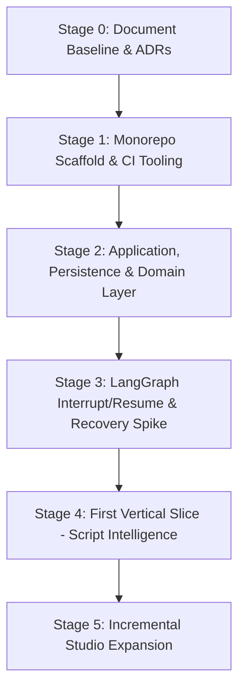

# Tattva AI Film Director — Greenfield Build Plan

**Document ID:** TFD-ENG-001  
**Version:** 1.0  
**Date:** 1 November 2026  
**Status:** Approved Engineering Execution Plan  

---

## 1. Baseline & Context

Tattva AI Film Director is a completely new greenfield product. No prior repository, legacy codebase, production database, or deployment pipeline exists. Unconfigured services (cloud object storage, external SSO, live Higgsfield API, cloud LLM providers) are explicitly marked as **not yet provisioned**; they are represented by provider-neutral interfaces with local deterministic mocks for offline validation.

---

## 2. Milestones & Dependencies

### Milestone Summary

| Milestone | Scope | Key Deliverables | Pre-requisites | Target Status |
|---|---|---|---|---|
| **M0: Baseline** | Source documentation review, ADR-001, Open Decisions, Build Plan. | `docs/product/SOURCE_OF_TRUTH_INDEX.md` `docs/implementation/OPEN_DECISIONS.md` `docs/ADRs/ADR-001-greenfield-stack.md` | PRD v0.9, IA v1.0, Wireframe Spec v1.0, Greenfield Addendum v1.1 | **Complete** |
| **M1: Scaffold** | Clean Python monorepo, typed settings, package dependencies, entrypoint stubs, docker-compose, CI config, README. | `apps/`, `packages/`, `pyproject.toml`, `docker-compose.yml`, `README.md` | Python 3.11+ venv | **In Progress** |
| **M2: Foundations** | Canonical PostgreSQL schema, Alembic migrations, SQLAlchemy repositories, tenant/project isolation, local storage service, durable dispatch. | Migrations for orgs, users, projects, assets, runs, approvals, audit log. | PostgreSQL (pgvector container on :55432) | Ready to build |
| **M3: LangGraph Runtime Spike** | LangGraph graph engine, Postgres checkpointer, pause/interrupt, approval persistence, resume with re-authorization, worker restart recovery test. | Technical spike validating durable state and crash recovery. | M1, M2 | Ready to build |
| **M4: Script Intelligence Slice** | End-to-end user journey: Project creation → Script upload → File preservation → Script parsing graph → Candidate extraction → Candidate review UI → Human approval → Canonical version update → Audit trail. | Script parsing node, entity extraction, Streamlit candidate review UI, approval commit service. | M1, M2, M3 | Ready to build |
| **M5: Studio Expansion** | Historical Research, Storyboard Intelligence, Film Bible, Continuity, Prompt Studio, Higgsfield export adapter. | G-02 to G-11 graphs and UI modules. | M4 complete & approved | Future |

---

## 3. Risks & Mitigations

| Risk | Impact | Mitigation Strategy |
|---|---|---|
| **LangGraph checkpoint state vs Project truth drift** | High | Checkpoint storage is strictly for execution resumption. Domain tables in PostgreSQL remain authoritative. Sensitive operations re-verify project version and permissions on resume. |
| **Premature distributed complexity** | Medium | Adopt modular monolith: Streamlit UI, FastAPI API, and Background Worker share typed domain packages in one repo while running as independent processes. |
| **Provider API lock-in / API volatility** | Medium | Isolate external calls behind internal interfaces (`ModelGateway`, `StorageService`, `HiggsfieldAdapter`). Test against deterministic mocks. |
| **Cross-project data leakage** | Critical | Enforce organization ID and project ID scoping at API route dependencies and repository queries. Add explicit cross-tenant negative test suites. |
| **Streamlit blocking on long-running tasks** | High | Streamlit calls FastAPI asynchronously (`202 Accepted`), displaying polling/status tray. Background worker handles all heavy parsing and graph runs. |

---

## 4. Requirement-to-Test Traceability Matrix

| Requirement Area | Specification Source | Test Category | Target Test File |
|---|---|---|---|
| Tenant / Project Scoping | PRD §3, Addendum §4.1 | Authorization | `tests/authorization/test_tenant_isolation.py` |
| Asset Immutability | PRD §6, Addendum §6.2 | Integration | `tests/integration/test_storage_service.py` |
| Canonical Schema Migrations | Addendum §6.1 | Integration | `tests/integration/test_migrations.py` |
| LangGraph Checkpoint Recovery | Addendum §8, §13 Phase 3 | Workflow / Recovery | `tests/workflows/test_graph_recovery.py` |
| Approval Service Lifecycle | Addendum §9, §10 | Unit & API | `tests/api/test_approvals_api.py` |
| Script Intelligence Slice | PRD §6.1, Wireframe S-02/S-03 | End-to-End | `tests/workflows/test_script_intelligence_slice.py` |
| Deterministic Model Mocking | Addendum §11.3 | Unit | `tests/unit/test_model_gateway_mock.py` |

---

## Change Note — 2026-11-05: audited milestone status

The milestone statuses in §2 are stale. Audited reality, from git log plus a test run on 2026-11-05:

| Milestone | Recorded status | Audited status | Evidence |
|---|---|---|---|
| M0 Baseline | Complete | Complete | `docs/` |
| M1 Scaffold | In Progress | **Done, with gaps**: no CI, no Dockerfile | `apps/`, `packages/`, `pyproject.toml` |
| M2 Foundations | Ready to build | **Done, with gaps**: auth is a header stub, no RBAC, version race | 4 Alembic revisions; scoped repositories |
| M3 LangGraph spike | Ready to build | **Done for G-01** | `tests/workflows/test_graph_recovery.py` (pass) |
| M4 Script Intelligence | Ready to build | **Done**: deterministic parser | `tests/api/test_script_intelligence_slice.py` (pass) |
| M5 Studio Expansion | Future | **In progress** | G-02 `a9f8512` and G-03 `b3621cb` are committed and passing. G-04 Film Bible is **uncommitted and broken** (5 failed, 1 error). G-05 to G-11 are not started. |

**Corrections to the test matrix (§4):**
- `tests/authorization/test_tenant_isolation.py` is now `tests/api/test_tenant_isolation_api.py`.
- `tests/api/test_approvals_api.py`, `tests/workflows/test_script_intelligence_slice.py` and `tests/unit/test_model_gateway_mock.py` do not exist.

This plan is superseded for forward planning by `docs/product/PRODUCT_ROADMAP.md` and `docs/audit/00_FIRST_RESPONSE_ASSESSMENT.md` §H.
