# Tattva AI Film Director — Information Architecture v2.0

**Doc ID:** TFD-PRD-IA-001 · **Version:** 1.0-draft · **Date:** 2026-11-05 · **Status:** Phase B design — pending approval

**Inputs:**
- Master Execution Prompt §13 (lifecycle) and §25 (25 workspace groups and per-screen fields)
- PRD v0.9 §11.2 (26 UX-FD screens)
- IA v1.0 §2–§6 (44 screens: G-01…G-08 and P-01…P-36)
- Wireframe Spec v1.0 §3–§4
- Gap Report §9
- `docs/audit/04` (8 current Streamlit views)
- `PRD_v1.0.md`

**Supersedes:** the screen inventory of IA v1.0 §6 and PRD v0.9 §11.2. These IA v1.0 sections stay valid and are referenced, not duplicated:
- §1 principles
- §2.2 shell layout
- §7 navigation rules
- §13 interaction patterns
- §14 search
- §16 state UX pattern

This resolves conflicts **CON-03** (G-0x collision) and **CON-04** (26 vs 44 vs 25 vs 8) from `docs/audit/10`.

---

## 1. Reconciliation summary

| Source | Unit | Count | Problem | Resolution |
|---|---|---|---|---|
| PRD v0.9 §11.2 | UX-FD-01…26 | 26 screens | Higgsfield-centric; no screenplay governance, digital humans, consent, measurements, capture, voice, mode or team screens | Every UX-FD maps to an `S-` screen (§5.1) |
| IA v1.0 §6 | G-01…08, P-01…36 | 44 screens | `G-0x` collides with graph IDs; same gaps as above; Branch Compare not in Master scope | Every G/P ID becomes an **alias** of an `S-` screen (§5.2); P-34 deferred (DEC-029) |
| Master §25 | Workspace groups | 25 groups | Groups, not screens | Each group becomes a navigation group containing one or more `S-` screens (§5.3) |
| Code (`apps/ui/views/__init__.py::NAVIGATION`) | Streamlit views | 8 views | Labelled with graph IDs ("G-01"); no states; raw JSON | Each view maps to its target screen (§5.4) |

**Canonical result:**
- **60 screens**: 8 global and 52 project-scoped
- **1 deferred screen**: S-APR-04 Branch Compare
- **52 screens in FD-V1** (some expanded in FD-V2)
- **8 screens that are FD-V2 only**

The count is higher than IA v1.0's 44 because Master §4–§12 add 15 capability screens that were absent from every earlier document:
- governance: SCR-01, SCR-03, SCR-04
- impact: CON-03
- mode: MTH-01
- consent and digital humans: DH-01, DH-02
- measurements: PHY-01
- capture: CAP-01, CAP-02
- library: LIB-01
- voice: VOC-01, VOC-02
- team: TEAM-02
- tool registry: REG-02

To avoid duplication, several IA screens were merged:
- G-01 + G-02 → S-GLB-01
- P-24 + P-25 → S-AID-01
- P-27 + P-28 → S-PKG-02
- P-31 + P-32 → S-OUT-01
- the separate Help page is dropped (it is a static link)

**Screen ≠ file:** as in IA v1.0 §6.3, one Streamlit page may host several screens as tabs, provided each screen's states, permissions and approvals stay distinct and deep-linkable.

---

## 2. Global shell (kept from IA v1.0 §2.2, amended)

| Region | Contents | Amendment in v2.0 |
|---|---|---|
| App header | Org/project switcher, global search, task and approval indicators, profile | Project header adds: **canonical screenplay version** (e.g. "Screenplay v3 · locked"), **project mode chip** (`Fully AI` / `Hybrid` / `Mixed`), **episode selector** for episodic formats, and a generator-mode banner when any mock generator is active. The hardcoded "Branch: main" (`apps/ui/app.py`) is removed (DEC-029) |
| Primary navigation | Groups below, filtered by capability | Groups follow Master §25 order |
| Main canvas | Active screen | — |
| Context inspector | Selected object, version, provenance, consent status, context used/excluded | **Consent status** and **effective production mode** added for character, performer and shot selections |
| AI Director rail | Scoped ask/inspect/recommend | Never writes canon; outputs become candidates or suggestions |
| Task/status strip | Background tasks, unknown outcomes, stale items | — |

---

## 3. Canonical navigation tree

Legend:
- `[V1]` = FD-V1
- `[V2]` = FD-V2 only
- `[V1→V2]` = introduced in FD-V1, expanded in FD-V2
- `(alias: …)` = legacy IDs
- `{view: …}` = current Streamlit view it evolves from

```text
TATTVA AI FILM DIRECTOR
│
├── GLOBAL
│   ├── S-GLB-01 Home / Project Portfolio ............... [V1]    (alias: G-01, G-02, UX-FD-01)        {view: app.py sidebar selector}
│   ├── S-GLB-02 New Project (format · mode · delivery) . [V1]    (alias: G-03, UX-FD-01)              {view: app.py "New Film Project" form}
│   ├── S-OPS-01 Task Centre ............................ [V1]    (alias: G-04, UX-FD-25)
│   ├── S-APR-01 Approvals Inbox (all projects / filtered) [V1]   (alias: G-05, UX-FD-24)              {view: review.py}
│   ├── S-REG-01 Production Tool Registry ............... [V1→V2] (alias: G-07 part, UX-FD-21)
│   ├── S-REG-02 Provider Connections ................... [V2]    (alias: G-07 part, UX-FD-21)
│   ├── S-LIB-02 Shared Organisation Library ............ [V2]    (alias: G-06)
│   └── S-TEAM-01 Organisation Members & Roles .......... [V1]    (alias: G-08)
│
└── PROJECT  [one isolated project; header shows screenplay version, mode, episode]
    │
    ├── 1  Project Workspace
    │   └── S-PRJ-01 Project Overview ................... [V1]    (alias: P-01, UX-FD-02)              {view: overview.py}
    ├── 2  Project Intelligence / Story Brain
    │   ├── S-BRN-01 Story Brain ........................ [V1]    (alias: P-02, UX-FD-06)
    │   └── S-BRN-02 Narrative Timeline ................. [V1]    (alias: P-18)
    ├── (intake — supports every group)
    │   ├── S-AST-01 Intake Inbox ....................... [V1]    (alias: P-03, UX-FD-03, G-03 part)   {view: assets.py upload}
    │   ├── S-AST-02 Asset Library (inputs) ............. [V1]    (alias: P-04, UX-FD-04)              {view: assets.py list}
    │   └── S-AST-03 Asset Inspector .................... [V1→V2] (alias: P-05, UX-FD-05, UX-FD-15)
    ├── 3  Screenplay Studio
    │   ├── S-SCR-01 Screenplay Versions & Lock ......... [V1]    (new)
    │   ├── S-SCR-02 Script & Scene Breakdown ........... [V1]    (alias: P-06, UX-FD-10)              {view: script_intelligence.py}
    │   ├── S-SCR-03 Revision Workspace ................. [V1]    (new)
    │   └── S-SCR-04 AI Suggestions Workspace ........... [V1]    (new)
    ├── 4  Historical Research Studio
    │   ├── S-RES-01 Historical Brief ................... [V1]    (alias: P-09)
    │   ├── S-RES-02 Investigation Board ................ [V1]    (alias: P-10, UX-FD-07)              {view: historical_research.py tabs Investigate/Questions/Claims/Conflicts}
    │   ├── S-RES-03 Source & Evidence Inspector ........ [V1]    (alias: P-11)                        {view: historical_research.py tab Sources}
    │   ├── S-RES-04 Historical Timeline ................ [V1]    (alias: P-12, UX-FD-08)
    │   └── S-RES-05 Temporal Visual Profile ............ [V1]    (alias: UX-FD-09)
    ├── (Film Bible — Stage 7 visual direction)
    │   ├── S-BIB-01 Film Bible Overview ................ [V1]    (alias: P-13)                        {view: film_bible.py}
    │   └── S-BIB-02 Visual Language Rules .............. [V1]    (alias: P-17)                        {view: film_bible.py rules/synthesis tabs}
    ├── 5  Character Studio
    │   ├── S-CHR-01 Character Studio ................... [V1→V2] (alias: P-14, UX-FD-12)
    │   └── S-CHR-02 Character State Timeline ........... [V1]    (alias: P-14 state timeline)
    ├── 6  Digital Human Studio
    │   ├── S-DH-01 Performers & Consent ................ [V1]    (new)
    │   └── S-DH-02 Digital Human & Avatar Workspace .... [V2]    (new)
    ├── 7  Physical Identity & Measurements
    │   └── S-PHY-01 Physical Identity & Measurements ... [V1→V2] (new)
    ├── 8  Costume & Props Studio
    │   ├── S-CST-01 Costume Bible ...................... [V1→V2] (alias: P-15, UX-FD-13)
    │   └── S-CST-02 Props & Weapons Register ........... [V1→V2] (alias: P-15, UX-FD-13)
    ├── 9  Environment & Location Studio
    │   └── S-ENV-01 Locations & Environments ........... [V1→V2] (alias: P-16, UX-FD-14)
    ├── 10 Storyboard Studio
    │   ├── S-SB-01 Storyboard Workbench ................ [V1]    (alias: P-07, UX-FD-11)              {view: storyboard.py}
    │   └── S-SB-02 Script ↔ Storyboard Alignment ....... [V1]    (alias: P-08)
    ├── 11 Cinematography Studio
    │   └── S-CIN-01 Cinematography Bible & Libraries ... [V1]    (alias: P-17 camera language)
    ├── 12 Sequence & Shot Planner
    │   ├── S-SEQ-01 Sequence Planner ................... [V1]    (alias: P-19, UX-FD-16)
    │   ├── S-SEQ-02 Scene Planner ...................... [V1]    (alias: P-20)
    │   └── S-SHT-01 Shot Planner & Shot Spec ........... [V1]    (alias: P-21, UX-FD-17)
    ├── 13 Production Method Selector
    │   └── S-MTH-01 Production Mode & Method Map ....... [V1]    (new)
    ├── 14 On-Set Capture Planner
    │   ├── S-CAP-01 Capture Plan & Manifest ............ [V2]    (new)
    │   └── S-CAP-02 Footage Ingestion & Analysis ....... [V2]    (new)
    ├── 15 AI Production Tool Registry  →  global S-REG-01 (project-filtered view: enabled tools and project data policy)
    ├── 16 Prompt & Handoff Studio
    │   ├── S-PKG-01 Master Direction ................... [V1]    (alias: P-26)
    │   ├── S-PKG-02 Shot Package Compiler .............. [V1→V2] (alias: P-27, P-28, UX-FD-20)
    │   └── S-PKG-03 Handoff: Manual Export / Connected Submit [V1→V2] (alias: P-29, UX-FD-20)
    ├── 17 External Execution Monitor
    │   ├── S-EXE-01 Execution Monitor .................. [V1→V2] (alias: P-30, UX-FD-22)
    │   └── S-EXE-02 Output Import & Mapping ............ [V1]    (alias: P-31 import)
    ├── 18 Production Asset Library
    │   └── S-LIB-01 Production Asset Library ........... [V2]    (new; Stage 15)
    ├── 19 Output Inspection Studio
    │   └── S-OUT-01 Output Inspector & Revision ........ [V1→V2] (alias: P-31, P-32, UX-FD-23)
    ├── 20 Continuity & Impact Studio
    │   ├── S-CON-01 Continuity Overview & Rules ........ [V1]    (alias: P-22, UX-FD-18)
    │   ├── S-CON-02 Continuity Finding Detail .......... [V1]    (alias: P-23)
    │   └── S-CON-03 Change Impact Analysis ............. [V1]    (alias: UX-FD-18 impact; IA §3.2 H "Change Impact Analysis")
    ├── (AI Director)
    │   └── S-AID-01 AI Director Review ................. [V1]    (alias: P-24, P-25, UX-FD-19)
    ├── 21 Voice & Dialogue Studio
    │   ├── S-VOC-01 Dialogue & Voice Studio ............ [V2]    (alias: IA §3.2 E "Audio / Voice / Sound References")
    │   └── S-VOC-02 Localisation & Dubbing ............. [V2]    (new)
    ├── 22 Approval & Version History
    │   ├── S-APR-01 Approvals (project filter of global inbox)
    │   ├── S-APR-02 Approval Detail .................... [V1]    (alias: G-05 detail, UX-FD-24)       {view: review.py decision form}
    │   ├── S-APR-03 Versions, Decisions & Audit ........ [V1]    (alias: P-33, UX-FD-24)              {view: audit.py; film_bible.py versions tab}
    │   └── S-APR-04 Branch Compare ..................... [DEFERRED — DEC-029] (alias: P-34)
    ├── 23 Post-Production Handoff
    │   └── S-PST-01 Exports & Post-Production Handoff .. [V1→V2] (alias: P-35)
    ├── 24 Team & Permission Management
    │   └── S-TEAM-02 Project Members & Roles ........... [V1]    (alias: P-36 members, UX-FD-26 part)
    └── 25 Project Settings & Governance
        └── S-PRJ-02 Project Settings & Governance ...... [V1]    (alias: P-36, UX-FD-26)
```

**Why intake, Film Bible and AI Director sit outside the numbered §25 groups:** Master §25 has no intake, Film Bible or AI Director group. All three are explicit FD-V1 items (V1-03, V1-09 and V1-22), so they keep their own navigation entries rather than being buried in another group.

**Production Asset Library and Asset Library are distinct.** S-AST-02 holds *inputs*: anything uploaded, in any processing state. S-LIB-01 holds *approved production outputs*, organised by shot, scene, character and location (Stage 15). Approved outputs also appear in S-AST-02 under a filter, but S-LIB-01 is the production view.

---

## 4. Navigation model

### 4.1 Lifecycle-to-navigation map (Master §13)

```mermaid
flowchart LR
  S1["1 Project creation<br/>S-GLB-02, S-PRJ-02"] --> S2["2 Script and governance<br/>S-SCR-01, 03, 04"]
  S2 --> S3["3 Story intelligence<br/>S-SCR-02, S-BRN-01, 02"]
  S3 --> S4["4 Historical research<br/>S-RES-01..05"]
  S3 --> S5["5 Character development<br/>S-CHR-01, 02, S-PHY-01, S-DH-01, S-CST-01, 02"]
  S4 --> S6["6 Environment and world<br/>S-ENV-01"]
  S5 --> S7["7 Visual direction<br/>S-BIB-01, 02, S-CIN-01"]
  S6 --> S7
  S7 --> S8["8 Scene, sequence, shot planning<br/>S-SEQ-01, 02, S-SHT-01, S-SB-01, 02"]
  S8 --> S9["9 Production method<br/>S-MTH-01"]
  S9 --> S10["10 Capture planning<br/>S-CAP-01, 02"]
  S9 --> S11["11 Package generation<br/>S-PKG-01..03"]
  S10 --> S11
  S11 --> S12["12 External execution<br/>S-PKG-03, S-EXE-01, S-REG-01"]
  S12 --> S13["13 Output inspection<br/>S-EXE-02, S-OUT-01, S-CON-01"]
  S13 --> S14["14 Revision and approval<br/>S-OUT-01, S-APR-02"]
  S14 --> S15["15 Asset library<br/>S-LIB-01"]
  S15 --> S16["16 Post handoff<br/>S-PST-01"]
```



The lifecycle **is not a wizard** (Master §13). Every stage is reachable directly. S-PRJ-01 recommends a next action from the actual project state; it never blocks navigation.

### 4.2 Visibility and mode rules

1. **Capability filtering.** A navigation item is visible only if the user holds at least one capability that reads that screen. Hidden screens return 404 on direct link, not 403, consistent with the API's no-existence-oracle rule (`docs/audit/03` §5).
2. **Equal modes, no hiding by mode.** Hybrid-only screens (S-CAP-01/02) and AI-centric screens (S-PKG-02) are always visible. Their empty states explain when they apply, for example "No shots use live_action_chroma or performance_transformation yet". This keeps the two modes equal and lets a mixed project move between them.
3. **Format-aware structure.** Episodic templates add an episode selector to the header. Screens that are episode-scoped filter by it: SCR, SEQ, SHT, CAP, PKG, EXE, OUT and PST. Character, DH, CST, ENV and CIN are series-scoped.
4. **Release flags.** FD-V2 screens are behind feature flags. In FD-V1 they are absent from navigation, not shown as disabled teasers.
5. **Mock disclosure.** While any generator is `mock` or `deterministic`, every screen that shows AI output carries the generator-mode label (TFD-AID-006).

### 4.3 Cross-screen links (extends IA v1.0 §7.2)

| From | Selection | To | Purpose |
|---|---|---|---|
| S-SCR-01 | Approved revision | S-CON-03 | Review the impact analysis |
| S-SCR-04 | Suggestion accepted for revision | S-SCR-03 | Pull it into a draft revision |
| S-CHR-01 | Linked performer | S-DH-01 | Check consent before adding references |
| S-SHT-01 | Effective mode chip | S-MTH-01 | See where the mode is inherited from; override |
| S-SHT-01 | Hybrid method | S-CAP-01 | Plan capture |
| S-SHT-01 | "Compile" | S-PKG-02 | Build a package from the approved spec |
| S-PKG-03 | Manual export record | S-EXE-02 | Import results later |
| S-EXE-01 | Unknown outcome | S-EXE-01 reconcile drawer | Reconcile before any retry |
| S-OUT-01 | Request revision | S-PKG-02 | Recompile a new package version |
| S-DH-01 | Revoke consent | S-CON-03 (consent impact view) | See dependent assets and packages |
| S-LIB-01 | Approved shot outputs | S-PST-01 | Assemble the post handoff |

---

## 5. Legacy ID mapping (aliases)

### 5.1 PRD v0.9 UX-FD → S-

| UX-FD | Name | S- screen(s) |
|---|---|---|
| 01 | Workspace / Project Home | S-GLB-01, S-GLB-02 |
| 02 | Project Overview | S-PRJ-01 |
| 03 | Universal Intake | S-AST-01 |
| 04 | Asset Library | S-AST-02 |
| 05 | Asset Inspector | S-AST-03 |
| 06 | Project Understanding / Story Brain | S-BRN-01 |
| 07 | Historical Investigation Board | S-RES-02 |
| 08 | Historical Timeline | S-RES-04 |
| 09 | Temporal Visual Profile | S-RES-05 |
| 10 | Script & Scene Studio | S-SCR-02 |
| 11 | Storyboard Studio | S-SB-01 |
| 12 | Character Studio | S-CHR-01 |
| 13 | Costume / Prop Studio | S-CST-01, S-CST-02 |
| 14 | Environment / Location Studio | S-ENV-01 |
| 15 | Reference Video Studio | S-AST-03 (reference-video mode) |
| 16 | Sequence Planner | S-SEQ-01 |
| 17 | Shot Director | S-SHT-01 |
| 18 | Continuity & Impact Studio | S-CON-01, S-CON-03 |
| 19 | AI Director Review | S-AID-01 |
| 20 | Prompt & Handoff Studio | S-PKG-02, S-PKG-03 |
| 21 | Higgsfield Connection & Tool Registry | S-REG-01, S-REG-02 (provider-neutral) |
| 22 | External Run & Asset History | S-EXE-01 |
| 23 | Output Inspector | S-OUT-01 |
| 24 | Versions, Decisions & Approvals | S-APR-01, S-APR-02, S-APR-03 |
| 25 | Task Activity & Recovery | S-OPS-01 |
| 26 | Project Settings & Access | S-PRJ-02, S-TEAM-02 |

### 5.2 IA v1.0 G-/P- → S-

| IA ID | Name | S- screen | Note |
|---|---|---|---|
| G-01 | Home / Project Portfolio | S-GLB-01 | merged with G-02 |
| G-02 | All Projects | S-GLB-01 | search/filter tab |
| G-03 | New Project / Universal Intake | S-GLB-02 (+ S-AST-01 for files) | |
| G-04 | Task Centre | S-OPS-01 | |
| G-05 | Review Inbox | S-APR-01 (+ S-APR-02 detail) | |
| G-06 | Shared Asset Library | S-LIB-02 | FD-V2 |
| G-07 | Integrations | S-REG-01, S-REG-02 | provider-neutral |
| G-08 | Workspace Settings | S-TEAM-01 | |
| P-01 | Project Overview | S-PRJ-01 | |
| P-02 | Project Understanding | S-BRN-01 | |
| P-03 | Intake Inbox | S-AST-01 | |
| P-04 | Asset Library | S-AST-02 | |
| P-05 | Asset Inspector | S-AST-03 | |
| P-06 | Script Viewer & Analyzer | S-SCR-02 | |
| P-07 | Storyboard Workbench | S-SB-01 | |
| P-08 | Script ↔ Storyboard Alignment | S-SB-02 | |
| P-09 | Historical Brief | S-RES-01 | |
| P-10 | Investigation Board | S-RES-02 | |
| P-11 | Source / Evidence Inspector | S-RES-03 | |
| P-12 | Historical Timeline | S-RES-04 | |
| P-13 | Film Bible Overview | S-BIB-01 | |
| P-14 | Character Studio | S-CHR-01, S-CHR-02 | state timeline split out |
| P-15 | Costume & Prop Studio | S-CST-01, S-CST-02 | |
| P-16 | Environment / Location Studio | S-ENV-01 | |
| P-17 | Visual Direction Studio | S-BIB-02, S-CIN-01 | camera language moves to cinematography |
| P-18 | Narrative Timeline | S-BRN-02 | |
| P-19 | Sequence Planner | S-SEQ-01 | |
| P-20 | Scene Planner | S-SEQ-02 | |
| P-21 | Shot Planner | S-SHT-01 | |
| P-22 | Continuity Overview | S-CON-01 | |
| P-23 | Continuity Finding Detail | S-CON-02 | |
| P-24 | AI Director Review | S-AID-01 | |
| P-25 | Recommendation Review | S-AID-01 (detail panel) | merged |
| P-26 | Master Prompt Studio | S-PKG-01 | renamed Master Direction |
| P-27 | Shot Prompt Studio | S-PKG-02 | merged |
| P-28 | Model Compatibility & Compiler | S-PKG-02 (+ capability data from S-REG-01) | merged |
| P-29 | Higgsfield Handoff | S-PKG-03 | provider-neutral; manual and connected |
| P-30 | Handoff History | S-EXE-01 | |
| P-31 | Output Import & Inspector | S-EXE-02 (import), S-OUT-01 (inspect) | split by job |
| P-32 | Output Feedback & Revision | S-OUT-01 | merged |
| P-33 | Activity / Decisions / Versions | S-APR-03 | |
| P-34 | Branch Compare | S-APR-04 | **deferred, DEC-029** |
| P-35 | Export & Package Builder | S-PST-01 | |
| P-36 | Project Settings | S-PRJ-02, S-TEAM-02 | members split out |

All 44 IA IDs and all 26 UX-FD IDs are mapped. No legacy screen is dropped except P-34, which is deferred.

### 5.3 Master §25 workspace groups → S-

| # | §25 group | S- screens |
|---|---|---|
| 1 | Project Workspace | S-PRJ-01 (+ global S-GLB-01/02) |
| 2 | Project Intelligence / Story Brain | S-BRN-01, S-BRN-02 |
| 3 | Screenplay Studio | S-SCR-01…04 |
| 4 | Historical Research Studio | S-RES-01…05 |
| 5 | Character Studio | S-CHR-01, S-CHR-02 |
| 6 | Digital Human Studio | S-DH-01, S-DH-02 |
| 7 | Physical Identity and Measurements | S-PHY-01 |
| 8 | Costume and Props Studio | S-CST-01, S-CST-02 |
| 9 | Environment and Location Studio | S-ENV-01 |
| 10 | Storyboard Studio | S-SB-01, S-SB-02 |
| 11 | Cinematography Studio | S-CIN-01 |
| 12 | Sequence and Shot Planner | S-SEQ-01, S-SEQ-02, S-SHT-01 |
| 13 | Production Method Selector | S-MTH-01 |
| 14 | On-Set Capture Planner | S-CAP-01, S-CAP-02 |
| 15 | AI Production Tool Registry | S-REG-01, S-REG-02 |
| 16 | Prompt and Handoff Studio | S-PKG-01…03 |
| 17 | External Execution Monitor | S-EXE-01, S-EXE-02 |
| 18 | Production Asset Library | S-LIB-01 (+ S-LIB-02 org-level) |
| 19 | Output Inspection Studio | S-OUT-01 |
| 20 | Continuity and Impact Studio | S-CON-01…03 |
| 21 | Voice and Dialogue Studio | S-VOC-01, S-VOC-02 |
| 22 | Approval and Version History | S-APR-01…03 (04 deferred) |
| 23 | Post-Production Handoff | S-PST-01 |
| 24 | Team and Permission Management | S-TEAM-01, S-TEAM-02 |
| 25 | Project Settings and Governance | S-PRJ-02 |
| — | (not in §25) Intake & Assets / Film Bible / AI Director / Task Centre | S-AST-01…03 / S-BIB-01, 02 / S-AID-01 / S-OPS-01 |

### 5.4 Current Streamlit views → S- (CURRENT → TARGET)

| Current view (`apps/ui/views/`) | Nav label today | Target screen(s) | What changes |
|---|---|---|---|
| `app.py` sidebar | Project selector + "New Film Project" form (4 fixed genres) | S-GLB-01, S-GLB-02 | Adds format template, mode, delivery profile and membership-filtered list. Sends the auth token (today `actor_id` is never passed) |
| `overview.py` | 📽️ Project Overview | S-PRJ-01 | Replace counts plus raw project JSON with screenplay version, mode distribution, pending approvals, findings, tasks and next action |
| `assets.py` | 📄 Script Ingestion & Assets | S-AST-01, S-AST-02 | Multi-file streaming intake, per-file states, categories, signed downloads |
| `script_intelligence.py` | ⚡ Script Intelligence (G-01) | S-SCR-02 | Runs WF-01 against a screenplay version, asynchronously. Structured scene and dialogue view instead of raw JSON. Label "WF-01", not "G-01" |
| `historical_research.py` | 🏛️ Historical Research (G-02) | S-RES-02 (Investigate, Questions, Claims, Conflicts tabs), S-RES-03 (Sources tab) | Manual creates go through approval. Mock label on the investigator |
| `storyboard.py` | 🎨 Storyboard Studio (G-03) | S-SB-01 | Adds image/PDF ingestion and many-to-many mapping. Text-brief generation kept and labelled deterministic |
| `review.py` | 🔍 Candidate Review & Approvals | S-APR-01, S-APR-02 | Generalised approval levels. Decisions bound to the authenticated user. Partial approval for all scopes |
| `film_bible.py` (WIP) | 📖 Canonical Film Bible | S-BIB-01, S-BIB-02 (rules, synthesis); scenes and entities tabs → S-SCR-02 / S-CHR-01; versions tab → S-APR-03 | Fixed per C1 (DEC-010) |
| `audit.py` | 🛡️ Audit Trail & History | S-APR-03 | Filters, export, version relationships |

**Preservation:** every current view keeps working until its target screen ships (Master §24). `tests/unit/test_ui_smoke.py` is extended per new screen rather than replaced.

---

## 6. Release view

| Release | Screens |
|---|---|
| **FD-V1 (52)** | S-GLB-01, S-GLB-02, S-OPS-01, S-APR-01, S-REG-01 (manual targets), S-TEAM-01; S-PRJ-01, S-PRJ-02; S-BRN-01, S-BRN-02; S-AST-01…03; S-SCR-01…04; S-RES-01…05; S-BIB-01, S-BIB-02; S-CHR-01, S-CHR-02; S-DH-01; S-PHY-01; S-CST-01, S-CST-02; S-ENV-01; S-SB-01, S-SB-02; S-CIN-01; S-SEQ-01, S-SEQ-02; S-SHT-01; S-MTH-01; S-PKG-01…03; S-EXE-01, S-EXE-02; S-OUT-01; S-CON-01…03; S-AID-01; S-APR-02, S-APR-03; S-PST-01 (archive export); S-TEAM-02 |
| **FD-V1 → expanded in FD-V2** | S-REG-01 (connected snapshots), S-AST-03 (media proxies), S-CHR-01, S-CST-01/02, S-ENV-01 (reference generation), S-PHY-01 (scan import, estimation), S-PKG-02/03 (connected submit, cost), S-EXE-01 (jobs, attempts, unknown outcome), S-OUT-01 (AI-assisted inspection, regeneration), S-PST-01 (post handoff package) |
| **FD-V2 only (8)** | S-REG-02, S-LIB-02, S-DH-02, S-CAP-01, S-CAP-02, S-LIB-01, S-VOC-01, S-VOC-02 |
| **Deferred** | S-APR-04 Branch Compare (DEC-029) |

**FD-V1 frontend:** Streamlit, as an internal alpha (DEC-009, approval gate #2). These screens are flagged in `docs/audit/04` §3 as poor Streamlit fits and are the inputs to ADR-002:
- S-SCR-03 diff/redline
- S-SB-01 board
- S-OUT-01 A/B compare
- S-SHT-01 shot strip
- S-EXE-01 realtime status
