# Tattva AI Film Director — Information Architecture

**Doc ID:** TFD-PRD-IA-001 · **Version:** 1.1 · **Date:** 2026-11-06 · **Status:** S0.2 deliverable. Supersedes 1.0-draft (2026-11-05). This document replaces the legacy file `Tattva_AI_Film_Director_IA_v1.0.md`; earlier drafts titled it "v2.0", and that label is retired.

## v1.1 change summary

The Guided Workspace UX is the newest product-owner input (CON-04, `docs/audit/11`), so v1.1 makes it the **primary navigation**:

1. **New §0 (primary navigation):**
   - The Online Workspace is the first screen after login.
   - Inside a project, a 10-section journey with numbered accordions is the main navigation.
   - Specialist screens move into a **Studio Tools Index**.
   - The journey content lives in [`JOURNEY_MANIFEST.md`](JOURNEY_MANIFEST.md) and [`packages/domain/journey_manifest.yaml`](../../packages/domain/journey_manifest.yaml).
2. **The canonical screen inventory (§3) is kept in full and becomes the Studio Tools catalogue.** Every screen is mapped to its section (§3A). **No capability is removed.**
3. **The 36 wireframe screens are mapped to `S-` screens (§3A.2).** Wireframe screen 36 (Usage & Cost Overview) had no screen, so **S-USE-01** `[V2]` is added. The canonical inventory goes from 60 to **61 screens**.
4. **Release corrections that follow the approved implementation plan:** S-CAP-01 moves from `[V2]` to `[V1→V2]` (plan D7) and S-LIB-01 from `[V2]` to `[V1→V2]` (plan D9). See JOURNEY_MANIFEST §9, JM-2 and JM-3.
5. **Amended rules:**
   - §4.1: the journey rail is gated but Studio Tools stay open.
   - §4.2 rule 2: items that don't apply in the project's mode are shown, not hidden.
   - §4.2 rule 4: release flags apply to journey items as well as screens.
6. **Shell and visual direction follow Guided Workspace Wireframe v1.1** (§0.3 and §0.4). The frontend is React, not Streamlit (ADR-002 as amended at plan approval, 2026-11-06). §6 is updated to match.

**UX sources (controlling for layout, interaction and visual tokens):** `docs/product/ux/guided-workspace-v1.0/`
- `Tattva_AI_Film_Director_UX_Strategy_Guided_Workspace_v1.0.md`
- `Tattva_AI_Film_Director_Guided_Workspace_Wireframe_v1.1.html` (newer, so it wins where the two differ)
- `tattva_guided_workspace_preview.png`

---

## 0. Guided Workspace navigation (primary, v1.1)

### 0.1 Levels

| Level | Surface | Contents | Screens |
|---|---|---|---|
| 0 | **Online Workspace** | The first destination after login. Global header (brand, workspace switcher, search, notifications, help, profile). Welcome with **Create New Project** and **Continue Working**. Project cards (thumbnail, title, format, mode, role, active stage, progress, updated). **My action queue**. **Recent activity**. Workspace administration by permission. | S-GLB-01, S-GLB-02, S-OPS-01, S-APR-01, S-TEAM-01, S-REG-01/02, S-LIB-02 |
| 1 | **Project Workspace** | Project header: title, **format pill**, **mode pill**, screenplay-version chip, **Studio Tools** and **Project Settings** buttons. Left **journey rail** (10 sections with progress and lock state). **Project progress** (%, sections complete). Breadcrumbs. | S-PRJ-01 (overview panel), S-PRJ-02 |
| 2 | **Main section** | Eyebrow "MAIN SECTION nn", title, section progress ("x / y required"), **Expand all / Collapse all**, the accordion list, and the **continue gate** | — |
| 3 | **Accordion group → subpoints** | The header shows number, title, purpose, a status chip and expand state. The body holds subpoints `.1 Review and prepare` and `.2 Validate and approve`, each with its completion rule, primary Studio Tool, and actions **Save as In Progress**, **Mark Complete** and **Not Applicable** (with a reason), plus Request Review and View History | Studio Tools per group (§3A.1) |
| — | **Studio Tools Index** | A drawer listing every specialist screen by section. Its message: "Specialist screens remain available as contextual tools. Opening a tool does not bypass the guided workflow or approval gates." | All `S-` screens, filtered by capability |

**Workspace navigation (UX §9):**

| Entry | Screens |
|---|---|
| Online Workspace | S-GLB-01 |
| All Projects | S-GLB-01, projects tab |
| My Action Queue | S-APR-01 and S-OPS-01 |
| Team & Administration | S-TEAM-01, S-REG-01/02 and workspace settings |

**Breadcrumbs:** Online Workspace / Project / Main Section / Accordion / Subpoint.

**Create Project modal (wireframe v1.1):** title, production format and production mode. Mode is a three-option segmented choice:
- **Fully AI**: "AI-generated visual production."
- **Hybrid**: "Real performers combined with AI."
- **Mixed**: "Choose per sequence or shot."

Detailed setup continues inside section 01. The format list shows all TFD-FMT-001 templates; the wireframe shows a subset of 7.

### 0.2 Journey sections

| # | Section | Release | Groups |
|---|---|---|---|
| 01 | Project Workspace & Setup | V1 | 7 |
| 02 | Screenplay & Governance | V1 | 7 |
| 03 | Research & Story Intelligence | V1 | 6 |
| 04 | Character & Digital Human Studio | V1 foundation; V2 production integrations | 8 |
| 05 | Visual World Development | V1 | 7 |
| 06 | Cinematography & Storyboard Studio | V1 | 7 |
| 07 | Production Planning | V1 | 7 |
| 08 | AI Production & Tool Handoff | V1 manual; V2 connected | 7 |
| 09 | Output Inspection & Continuity Approval | V1 manual review; V2 assisted inspection | 8 |
| 10 | Production Library & Delivery | V1 foundation; V2 expanded | 6 |

The groups, IDs, completion rules, applicability, capabilities, Studio Tools and requirements for all 70 groups are in [`JOURNEY_MANIFEST.md`](JOURNEY_MANIFEST.md) §8.

**Gating:**
- A section opens in the rail once the previous section is ready to continue.
- Completed sections stay revisitable.
- The **Continue to Next Section** button appears only when the section is ready, and it moves on only when the user clicks it.
- Opening a screen never completes a step.
- Progress, applicability, completion and staleness are server records, never browser storage. The wireframe prototype's `localStorage` is prototype-only.

### 0.3 Shell regions (wireframe v1.1)

| Region | Wireframe element | Notes |
|---|---|---|
| Global bar | `header.globalbar` | Brand, current context ("Online Workspace"), notifications, help, avatar |
| Workspace sidebar | `aside.sidebar` (Online Workspace) | Online Workspace, All Projects, My Action Queue, Team & Administration |
| Journey rail | `aside.journey` (Project Workspace) | "← Online Workspace", project name and meta (format · mode), **PROJECT PROGRESS** %, "n of 10 sections complete", the stage list (number, title, done/total, ✓ / ● / ○ / 🔒), and the revisit hint "Changes to approved work may require downstream revalidation." |
| Main canvas | `main.main` | Breadcrumb, release tag ("V1 · …"), project header, section header, accordions, continue gate |
| Continue gate | Gate panel | Title ("Complete the required work to continue" or "Section nn ready to continue"), hint ("Opening a screen does not count as completion."), the "x completed · y remaining" summary, and the **Continue to Next Section →** button |
| Overlays | `.modal`, Studio Tools drawer, toasts | The only places blur and glass effects are allowed (UX §8) |

The context inspector, AI Director rail and task/status strip from §2 keep their roles. In the Project Workspace they open as panels or drawers, not as permanent columns, so the canvas stays focused on the active section (UX §3 level 1; §13 responsive strategy).

Required state screens, at every level (UX §16 item 13): **loading**, **empty**, **error**, **offline** and **permission-denied**. Sample data is always labelled illustrative (UX §2; TFD-AID-006).

### 0.4 Visual direction and tokens (wireframe v1.1, which supersedes the UX §8 starting proposal)

Direction (UX §8):
- A cinematic, professional workspace with restrained dark chrome and a light neutral canvas for reading, forms and tables.
- Swiss-style grid; editorial type only for film and project titles.
- Bento layout only on the Online Workspace and Project Overview.
- Glass effects only on overlays; no neumorphism.
- Short, purposeful motion that respects reduced-motion settings.
- Compact and comfortable density options.

| Token | Value | Use |
|---|---|---|
| `--bg` | `#0c1118` | App chrome |
| `--panel` / `--panel2` | `#121a24` / `#182331` | Dark panels (journey rail, sidebar) |
| `--canvas` | `#f4f5f7` | Content canvas |
| `--white` | `#ffffff` | Cards |
| `--ink` | `#192331` | Body text |
| `--muted` / `--muted2` | `#788493` / `#9aa6b5` | Secondary text |
| `--line` / `--line-dark` | `#dfe4ea` / `#283342` | Borders on light and dark surfaces |
| `--accent` / `--accent-dark` / `--accent-soft` | `#b99a66` / `#8c7045` / `#efe7d9` | The single warm brand accent |
| `--green` / `--green-bg` | `#2e7052` / `#e8f3ed` | Completed, success |
| `--blue` / `--blue-bg` | `#506b8b` / `#eaf0f7` | In progress, info |
| `--amber` / `--amber-bg` | `#906e2f` / `#f6f0e3` | Review required, warning |
| `--red` / `--red-bg` | `#9a4f4f` / `#f7eaea` | Blocked, changes required, error |
| `--shadow` | `0 12px 38px rgba(12,19,28,.08)` | Single-layer elevation |
| `--r` | `14px` | Card and overlay radius. Controls use 6–8 px (UX §8) |
| Font | `Inter, ui-sans-serif, system-ui, -apple-system, "Segoe UI", sans-serif` | UI text. Display type 30–36 px for titles, 14–16 px body |
| Spacing | 4 / 8 / 12 / 16 / 24 / 32 / 40 / 48 px | UX §8 |
| Breakpoints | ≤1120 px collapse side panels · ≤820 px journey drawer, stacked content · ≤560 px mobile (workspace, approvals and review only) | Wireframe v1.1 media queries; UX §13 |

Where the wireframe differs from the UX §8 proposal, the wireframe wins: chrome `#0c1118` instead of `#0F1721`, accent `#b99a66` instead of `#A98B5B`, and the 1120 / 820 / 560 breakpoints instead of 1200 / 820 / 560. Status is never shown by colour alone; every chip carries its label. Contrast is verified to WCAG 2.2 AA before GW2 adopts the tokens (UX §14).

---

**Inputs:**
- Guided Workspace UX Strategy v1.0 and Wireframe v1.1 (v1.1 primary-navigation inputs, above)
- `JOURNEY_MANIFEST.md` (TFD-PRD-JRN-001)
- Master Execution Prompt §13 (lifecycle) and §25 (25 workspace groups and per-screen fields)
- PRD v0.9 §11.2 (26 UX-FD screens)
- IA v1.0 §2–§6 (44 screens: G-01…G-08 and P-01…P-36)
- Wireframe Spec v1.0 §3–§4
- Gap Report §9
- `docs/audit/04` (8 current Streamlit views)
- `PRD_v1.0.md`

**Supersedes:** the screen inventory of IA v1.0 §6 and PRD v0.9 §11.2. These IA v1.0 sections stay valid and are referenced, not duplicated:
- §1 principles
- §2.2 shell layout
- §7 navigation rules
- §13 interaction patterns
- §14 search
- §16 state UX pattern

This resolves conflicts **CON-03** (G-0x collision) and **CON-04** (26 vs 44 vs 25 vs 8) from `docs/audit/10`.

---

## 1. Reconciliation summary

| Source | Unit | Count | Problem | Resolution |
|---|---|---|---|---|
| PRD v0.9 §11.2 | UX-FD-01…26 | 26 screens | Higgsfield-centric; no screenplay governance, digital humans, consent, measurements, capture, voice, mode or team screens | Every UX-FD maps to an `S-` screen (§5.1) |
| IA v1.0 §6 | G-01…08, P-01…36 | 44 screens | `G-0x` collides with graph IDs; same gaps as above; Branch Compare not in Master scope | Every G/P ID becomes an **alias** of an `S-` screen (§5.2); P-34 deferred (DEC-029) |
| Master §25 | Workspace groups | 25 groups | Groups, not screens | Each group becomes a navigation group containing one or more `S-` screens (§5.3) |
| Code (`apps/ui/views/__init__.py::NAVIGATION`) | Streamlit views | 8 views | Labelled with graph IDs ("G-01"); no states; raw JSON | Each view maps to its target screen (§5.4) |
| Guided Workspace Wireframe v1.1 (v1.1 input) | Detailed screens | 36 screens | Uses names, not IDs; screen 36 (Usage & Cost) had no `S-` screen | Each wireframe screen maps to `S-` screens (§3A.2); S-USE-01 added |

**Canonical result (v1.1):**
- **61 screens**: 8 global and 53 project-scoped
- **1 deferred screen**: S-APR-04 Branch Compare
- **54 screens in FD-V1** (some expanded in FD-V2)
- **7 screens that are FD-V2 only**

(v1.0-draft: 60 screens, 52 in FD-V1 and 8 V2-only. v1.1 adds S-USE-01 `[V2]` and moves S-CAP-01 and S-LIB-01 to `[V1→V2]`.)

The count is higher than IA v1.0's 44 because Master §4–§12 add 15 capability screens that were absent from every earlier document:
- governance: SCR-01, SCR-03, SCR-04
- impact: CON-03
- mode: MTH-01
- consent and digital humans: DH-01, DH-02
- measurements: PHY-01
- capture: CAP-01, CAP-02
- library: LIB-01
- voice: VOC-01, VOC-02
- team: TEAM-02
- tool registry: REG-02

To avoid duplication, several IA screens were merged:
- G-01 + G-02 → S-GLB-01
- P-24 + P-25 → S-AID-01
- P-27 + P-28 → S-PKG-02
- P-31 + P-32 → S-OUT-01
- the separate Help page is dropped (it is a static link)

**Screen ≠ file:** as in IA v1.0 §6.3, one Streamlit page may host several screens as tabs, provided each screen's states, permissions and approvals stay distinct and deep-linkable.

---

## 2. Global shell (kept from IA v1.0 §2.2, amended)

> **v1.1:** these regions keep their roles inside the Guided Workspace shell in §0.3. The project header also carries the format pill and the Studio Tools button. "Primary navigation" now means the workspace sidebar at level 0 and the journey rail at level 1. The §25 groups become the grouping inside the Studio Tools Index.

| Region | Contents | Amendment in v2.0 |
|---|---|---|
| App header | Org/project switcher, global search, task and approval indicators, profile | Project header adds: **canonical screenplay version** (e.g. "Screenplay v3 · locked"), **project mode chip** (`Fully AI` / `Hybrid` / `Mixed`), **episode selector** for episodic formats, and a generator-mode banner when any mock generator is active. The hardcoded "Branch: main" (`apps/ui/app.py`) is removed (DEC-029) |
| Primary navigation | Groups below, filtered by capability | Groups follow Master §25 order |
| Main canvas | Active screen | — |
| Context inspector | Selected object, version, provenance, consent status, context used/excluded | **Consent status** and **effective production mode** added for character, performer and shot selections |
| AI Director rail | Scoped ask/inspect/recommend | Never writes canon; outputs become candidates or suggestions |
| Task/status strip | Background tasks, unknown outcomes, stale items | — |

---

## 3. Canonical screen catalogue (Studio Tools)

> **v1.1:** this tree is the complete inventory of canonical screens. It is no longer the primary navigation (§0). Users reach these screens from the journey (each accordion's primary Studio Tool) and from the Studio Tools Index (§3A). The machine-readable copy is `studio_tools` in `packages/domain/journey_manifest.yaml`, and `tests/unit/test_journey_manifest.py` checks the two match.

Legend:
- `[V1]` = FD-V1
- `[V2]` = FD-V2 only
- `[V1→V2]` = introduced in FD-V1, expanded in FD-V2
- `(alias: …)` = legacy IDs
- `{view: …}` = current Streamlit view it evolves from

```text
TATTVA AI FILM DIRECTOR
│
├── GLOBAL
│   ├── S-GLB-01 Home / Project Portfolio ............... [V1]    (alias: G-01, G-02, UX-FD-01)        {view: app.py sidebar selector}
│   ├── S-GLB-02 New Project (format · mode · delivery) . [V1]    (alias: G-03, UX-FD-01)              {view: app.py "New Film Project" form}
│   ├── S-OPS-01 Task Centre ............................ [V1]    (alias: G-04, UX-FD-25)
│   ├── S-APR-01 Approvals Inbox (all projects / filtered) [V1]   (alias: G-05, UX-FD-24)              {view: review.py}
│   ├── S-REG-01 Production Tool Registry ............... [V1→V2] (alias: G-07 part, UX-FD-21)
│   ├── S-REG-02 Provider Connections ................... [V2]    (alias: G-07 part, UX-FD-21)
│   ├── S-LIB-02 Shared Organisation Library ............ [V2]    (alias: G-06)
│   └── S-TEAM-01 Organisation Members & Roles .......... [V1]    (alias: G-08)
│
└── PROJECT  [one isolated project; header shows screenplay version, mode, episode]
    │
    ├── 1  Project Workspace
    │   └── S-PRJ-01 Project Overview ................... [V1]    (alias: P-01, UX-FD-02)              {view: overview.py}
    ├── 2  Project Intelligence / Story Brain
    │   ├── S-BRN-01 Story Brain ........................ [V1]    (alias: P-02, UX-FD-06)
    │   └── S-BRN-02 Narrative Timeline ................. [V1]    (alias: P-18)
    ├── (intake — supports every group)
    │   ├── S-AST-01 Intake Inbox ....................... [V1]    (alias: P-03, UX-FD-03, G-03 part)   {view: assets.py upload}
    │   ├── S-AST-02 Asset Library (inputs) ............. [V1]    (alias: P-04, UX-FD-04)              {view: assets.py list}
    │   └── S-AST-03 Asset Inspector .................... [V1→V2] (alias: P-05, UX-FD-05, UX-FD-15)
    ├── 3  Screenplay Studio
    │   ├── S-SCR-01 Screenplay Versions & Lock ......... [V1]    (new)
    │   ├── S-SCR-02 Script & Scene Breakdown ........... [V1]    (alias: P-06, UX-FD-10)              {view: script_intelligence.py}
    │   ├── S-SCR-03 Revision Workspace ................. [V1]    (new)
    │   └── S-SCR-04 AI Suggestions Workspace ........... [V1]    (new)
    ├── 4  Historical Research Studio
    │   ├── S-RES-01 Historical Brief ................... [V1]    (alias: P-09)
    │   ├── S-RES-02 Investigation Board ................ [V1]    (alias: P-10, UX-FD-07)              {view: historical_research.py tabs Investigate/Questions/Claims/Conflicts}
    │   ├── S-RES-03 Source & Evidence Inspector ........ [V1]    (alias: P-11)                        {view: historical_research.py tab Sources}
    │   ├── S-RES-04 Historical Timeline ................ [V1]    (alias: P-12, UX-FD-08)
    │   └── S-RES-05 Temporal Visual Profile ............ [V1]    (alias: UX-FD-09)
    ├── (Film Bible — Stage 7 visual direction)
    │   ├── S-BIB-01 Film Bible Overview ................ [V1]    (alias: P-13)                        {view: film_bible.py}
    │   └── S-BIB-02 Visual Language Rules .............. [V1]    (alias: P-17)                        {view: film_bible.py rules/synthesis tabs}
    ├── 5  Character Studio
    │   ├── S-CHR-01 Character Studio ................... [V1→V2] (alias: P-14, UX-FD-12)
    │   └── S-CHR-02 Character State Timeline ........... [V1]    (alias: P-14 state timeline)
    ├── 6  Digital Human Studio
    │   ├── S-DH-01 Performers & Consent ................ [V1]    (new)
    │   └── S-DH-02 Digital Human & Avatar Workspace .... [V2]    (new)
    ├── 7  Physical Identity & Measurements
    │   └── S-PHY-01 Physical Identity & Measurements ... [V1→V2] (new)
    ├── 8  Costume & Props Studio
    │   ├── S-CST-01 Costume Bible ...................... [V1→V2] (alias: P-15, UX-FD-13)
    │   └── S-CST-02 Props & Weapons Register ........... [V1→V2] (alias: P-15, UX-FD-13)
    ├── 9  Environment & Location Studio
    │   └── S-ENV-01 Locations & Environments ........... [V1→V2] (alias: P-16, UX-FD-14)
    ├── 10 Storyboard Studio
    │   ├── S-SB-01 Storyboard Workbench ................ [V1]    (alias: P-07, UX-FD-11)              {view: storyboard.py}
    │   └── S-SB-02 Script ↔ Storyboard Alignment ....... [V1]    (alias: P-08)
    ├── 11 Cinematography Studio
    │   └── S-CIN-01 Cinematography Bible & Libraries ... [V1]    (alias: P-17 camera language)
    ├── 12 Sequence & Shot Planner
    │   ├── S-SEQ-01 Sequence Planner ................... [V1]    (alias: P-19, UX-FD-16)
    │   ├── S-SEQ-02 Scene Planner ...................... [V1]    (alias: P-20)
    │   └── S-SHT-01 Shot Planner & Shot Spec ........... [V1]    (alias: P-21, UX-FD-17)
    ├── 13 Production Method Selector
    │   └── S-MTH-01 Production Mode & Method Map ....... [V1]    (new)
    ├── 14 On-Set Capture Planner
    │   ├── S-CAP-01 Capture Plan & Manifest ............ [V1→V2] (new; v1.1: V1 manual form per plan D7)
    │   └── S-CAP-02 Footage Ingestion & Analysis ....... [V2]    (new)
    ├── 15 AI Production Tool Registry  →  global S-REG-01 (project-filtered view: enabled tools and project data policy)
    ├── 16 Prompt & Handoff Studio
    │   ├── S-PKG-01 Master Direction ................... [V1]    (alias: P-26)
    │   ├── S-PKG-02 Shot Package Compiler .............. [V1→V2] (alias: P-27, P-28, UX-FD-20)
    │   └── S-PKG-03 Handoff: Manual Export / Connected Submit [V1→V2] (alias: P-29, UX-FD-20)
    ├── 17 External Execution Monitor
    │   ├── S-EXE-01 Execution Monitor .................. [V1→V2] (alias: P-30, UX-FD-22)
    │   ├── S-EXE-02 Output Import & Mapping ............ [V1]    (alias: P-31 import)
    │   └── S-USE-01 Usage & Cost Overview .............. [V2]    (new in v1.1; wireframe screen 36; TFD-GEN-004, TFD-IAM-006)
    ├── 18 Production Asset Library
    │   └── S-LIB-01 Production Asset Library ........... [V1→V2] (new; Stage 15; v1.1: V1 foundation per plan D9)
    ├── 19 Output Inspection Studio
    │   └── S-OUT-01 Output Inspector & Revision ........ [V1→V2] (alias: P-31, P-32, UX-FD-23)
    ├── 20 Continuity & Impact Studio
    │   ├── S-CON-01 Continuity Overview & Rules ........ [V1]    (alias: P-22, UX-FD-18)
    │   ├── S-CON-02 Continuity Finding Detail .......... [V1]    (alias: P-23)
    │   └── S-CON-03 Change Impact Analysis ............. [V1]    (alias: UX-FD-18 impact; IA §3.2 H "Change Impact Analysis")
    ├── (AI Director)
    │   └── S-AID-01 AI Director Review ................. [V1]    (alias: P-24, P-25, UX-FD-19)
    ├── 21 Voice & Dialogue Studio
    │   ├── S-VOC-01 Dialogue & Voice Studio ............ [V2]    (alias: IA §3.2 E "Audio / Voice / Sound References")
    │   └── S-VOC-02 Localisation & Dubbing ............. [V2]    (new)
    ├── 22 Approval & Version History
    │   ├── S-APR-01 Approvals (project filter of global inbox)
    │   ├── S-APR-02 Approval Detail .................... [V1]    (alias: G-05 detail, UX-FD-24)       {view: review.py decision form}
    │   ├── S-APR-03 Versions, Decisions & Audit ........ [V1]    (alias: P-33, UX-FD-24)              {view: audit.py; film_bible.py versions tab}
    │   └── S-APR-04 Branch Compare ..................... [DEFERRED — DEC-029] (alias: P-34)
    ├── 23 Post-Production Handoff
    │   └── S-PST-01 Exports & Post-Production Handoff .. [V1→V2] (alias: P-35)
    ├── 24 Team & Permission Management
    │   └── S-TEAM-02 Project Members & Roles ........... [V1]    (alias: P-36 members, UX-FD-26 part)
    └── 25 Project Settings & Governance
        └── S-PRJ-02 Project Settings & Governance ...... [V1]    (alias: P-36, UX-FD-26)
```

**Why intake, Film Bible and AI Director sit outside the numbered §25 groups:** Master §25 has no intake, Film Bible or AI Director group. All three are explicit FD-V1 items (V1-03, V1-09 and V1-22), so they keep their own navigation entries rather than being buried in another group.

**Production Asset Library and Asset Library are distinct.** S-AST-02 holds *inputs*: anything uploaded, in any processing state. S-LIB-01 holds *approved production outputs*, organised by shot, scene, character and location (Stage 15). Approved outputs also appear in S-AST-02 under a filter, but S-LIB-01 is the production view.

---

## 3A. Guided Workspace placement (v1.1)

### 3A.1 Studio Tools by journey section

*Home* = where the tool is listed in the Studio Tools Index. *Also used* = tools owned elsewhere that a group in this section links to as its primary tool. Generated from `journey_manifest.yaml`.

| Section | Home tools | Also used by this section's groups |
|---|---|---|
| Online Workspace (level 0) | S-GLB-01 Online Workspace [V1]; S-GLB-02 Create Project [V1]; S-OPS-01 Task Centre [V1]; S-APR-01 Approvals Inbox [V1]; S-TEAM-01 Organisation Members & Roles [V1]; S-LIB-02 Shared Organisation Library [V2] | — |
| 01 Project Workspace & Setup | S-PRJ-02 Project Settings & Governance [V1]; S-TEAM-02 Project Members & Roles [V1] | S-GLB-02, S-PRJ-01, S-MTH-01, S-TEAM-01 |
| 02 Screenplay & Governance | S-AST-01 Intake Inbox [V1]; S-SCR-01 Screenplay Versions & Lock [V1]; S-SCR-02 Script & Scene Breakdown [V1]; S-SCR-03 Revision Workspace [V1]; S-SCR-04 AI Suggestions Workspace [V1] | S-BRN-01, S-APR-02 |
| 03 Research & Story Intelligence | S-BRN-01 Story Brain [V1]; S-BRN-02 Narrative Timeline [V1]; S-RES-01 Historical Brief [V1]; S-RES-02 Investigation Board [V1]; S-RES-03 Source & Evidence Inspector [V1]; S-RES-04 Historical Timeline [V1]; S-RES-05 Temporal Visual Profile [V1] | S-ENV-01, S-APR-02 |
| 04 Character & Digital Human Studio | S-CHR-01 Character Studio [V1→V2]; S-CHR-02 Character State Timeline [V1]; S-PHY-01 Physical Identity & Measurements [V1→V2]; S-DH-01 Performers & Consent [V1]; S-DH-02 Digital Human & Avatar Workspace [V2]; S-VOC-01 Dialogue & Voice Studio [V2] | S-CAP-01, S-APR-02 |
| 05 Visual World Development | S-BIB-01 Film Bible Overview [V1]; S-BIB-02 Visual Language Rules [V1]; S-ENV-01 Locations & Environments [V1→V2]; S-CST-01 Costume Bible [V1→V2]; S-CST-02 Props & Weapons Register [V1→V2] | S-RES-03, S-AST-02, S-AST-03, S-CON-01 |
| 06 Cinematography & Storyboard Studio | S-CIN-01 Cinematography Bible & Libraries [V1]; S-SB-01 Storyboard Workbench [V1]; S-SB-02 Script & Storyboard Alignment [V1] | S-SEQ-01, S-SHT-01 |
| 07 Production Planning | S-SEQ-01 Sequence Planner [V1]; S-SEQ-02 Scene Planner [V1]; S-SHT-01 Shot Planner & Shot Spec [V1]; S-MTH-01 Production Mode & Method Map [V1]; S-CAP-01 Capture Plan & Manifest [V1→V2]; S-CAP-02 Footage Ingestion & Analysis [V2]; S-AID-01 AI Director Review [V1] | S-PKG-02, S-CON-01, S-PRJ-01 |
| 08 AI Production & Tool Handoff | S-REG-01 Production Tool Registry [V1→V2]; S-REG-02 Provider Connections [V2]; S-PKG-01 Master Direction [V1]; S-PKG-02 Shot Package Compiler [V1→V2]; S-PKG-03 Handoff: Manual Export / Connected Submit [V1→V2]; S-EXE-01 Execution Monitor [V1→V2]; S-USE-01 Usage & Cost Overview [V2] | — |
| 09 Output Inspection & Continuity Approval | S-VOC-02 Localisation & Dubbing [V2]; S-EXE-02 Output Import & Mapping [V1]; S-OUT-01 Output Inspector & Revision [V1→V2]; S-CON-01 Continuity Overview & Rules [V1]; S-CON-02 Continuity Finding Detail [V1] | S-EXE-01, S-VOC-01, S-APR-02 |
| 10 Production Library & Delivery | S-LIB-01 Production Asset Library [V1→V2]; S-PST-01 Exports & Post-Production Handoff [V1→V2] | S-AST-02, S-APR-03, S-PRJ-02 |
| Cross-stage (every section, via header and Studio Tools) | S-PRJ-01 Project Overview [V1]; S-AST-02 Asset Library (inputs) [V1]; S-AST-03 Asset Inspector [V1→V2]; S-CON-03 Change Impact Analysis [V1]; S-APR-02 Approval Detail [V1]; S-APR-03 Versions [V1] | — |

Every canonical screen except the deferred S-APR-04 has exactly one home. The test asserts this.

### 3A.2 Wireframe v1.1 screens (36) → canonical screens

| # | Wireframe screen | Canonical screen(s) |
|---:|---|---|
| 01 | Studio Home / Online Workspace | S-GLB-01 |
| 02 | Projects | S-GLB-01 |
| 03 | Create Project | S-GLB-02 |
| 04 | Project Overview | S-PRJ-01 |
| 05 | Team & Permissions | S-TEAM-01, S-TEAM-02 |
| 06 | Project Settings | S-PRJ-02 |
| 07 | Screenplay Studio | S-SCR-01, S-SCR-02 |
| 08 | AI Suggestions Workspace | S-SCR-04 |
| 09 | Screenplay Revision & Approval | S-SCR-03 |
| 10 | Story Brain | S-BRN-01 |
| 11 | Historical Research Board | S-RES-01, S-RES-02 |
| 12 | Historical Timeline & Visual Evolution | S-RES-04, S-RES-05 |
| 13 | Evidence & Source Library | S-RES-03 |
| 14 | Character Studio | S-CHR-01 |
| 15 | Character Identity Profile | S-CHR-01 |
| 16 | Digital Human & Avatar Studio | S-DH-02 |
| 17 | Physical Identity & Measurements | S-PHY-01 |
| 18 | Costume, Props & Weapons Studio | S-CST-01, S-CST-02 |
| 19 | Environment & Location Studio | S-ENV-01 |
| 20 | Storyboard Studio | S-SB-01, S-SB-02 |
| 21 | Cinematography Bible & Camera Library | S-CIN-01 |
| 22 | Sequence Planner | S-SEQ-01, S-SEQ-02 |
| 23 | Shot Director | S-SHT-01 |
| 24 | Production Method Selector | S-MTH-01 |
| 25 | On-Set Capture Planner | S-CAP-01, S-CAP-02 |
| 26 | Production Tool Registry | S-REG-01, S-REG-02 |
| 27 | Prompt & Production Handoff Studio | S-PKG-01, S-PKG-02, S-PKG-03 |
| 28 | External Execution Monitor | S-EXE-01, S-EXE-02 |
| 29 | Production Asset Library | S-LIB-01 |
| 30 | Output Inspector | S-OUT-01 |
| 31 | Continuity & Impact Studio | S-CON-01, S-CON-02, S-CON-03 |
| 32 | Voice & Dialogue Studio | S-VOC-01, S-VOC-02 |
| 33 | Approvals & Version History | S-APR-01, S-APR-02, S-APR-03 |
| 34 | Post-Production Handoff | S-PST-01 |
| 35 | Activity & Audit Trail | S-APR-03 |
| 36 | Usage & Cost Overview | S-USE-01 |

Screens 15 (Character Identity Profile) and 14 (Character Studio) are both served by S-CHR-01. The identity profile is a deep-linkable facet of it (§1, "Screen ≠ file"). Screen 36 is the new S-USE-01.

---

## 4. Navigation model

### 4.1 Lifecycle-to-navigation map (Master §13)

```mermaid
flowchart LR
  S1["1 Project creation<br/>S-GLB-02, S-PRJ-02"] --> S2["2 Script and governance<br/>S-SCR-01, 03, 04"]
  S2 --> S3["3 Story intelligence<br/>S-SCR-02, S-BRN-01, 02"]
  S3 --> S4["4 Historical research<br/>S-RES-01..05"]
  S3 --> S5["5 Character development<br/>S-CHR-01, 02, S-PHY-01, S-DH-01, S-CST-01, 02"]
  S4 --> S6["6 Environment and world<br/>S-ENV-01"]
  S5 --> S7["7 Visual direction<br/>S-BIB-01, 02, S-CIN-01"]
  S6 --> S7
  S7 --> S8["8 Scene, sequence, shot planning<br/>S-SEQ-01, 02, S-SHT-01, S-SB-01, 02"]
  S8 --> S9["9 Production method<br/>S-MTH-01"]
  S9 --> S10["10 Capture planning<br/>S-CAP-01, 02"]
  S9 --> S11["11 Package generation<br/>S-PKG-01..03"]
  S10 --> S11
  S11 --> S12["12 External execution<br/>S-PKG-03, S-EXE-01, S-REG-01"]
  S12 --> S13["13 Output inspection<br/>S-EXE-02, S-OUT-01, S-CON-01"]
  S13 --> S14["14 Revision and approval<br/>S-OUT-01, S-APR-02"]
  S14 --> S15["15 Asset library<br/>S-LIB-01"]
  S15 --> S16["16 Post handoff<br/>S-PST-01"]
```



The lifecycle **is not a wizard** (Master §13). Every stage is reachable directly. S-PRJ-01 recommends a next action from the actual project state; it never blocks navigation.

> **v1.1 amendment (JOURNEY_MANIFEST §7, JM-6):** this 16-stage map stays the *dependency model* that drives impact and staleness. The *guided* surface is the 10-section journey (§0.2). Its rail is gated: a section opens once the previous one is ready to continue, following wireframe v1.1. Completed sections stay revisitable, and **every screen remains directly reachable from the Studio Tools Index**, subject to permissions. So the product is still not a wizard. Direct access never completes a step or bypasses an approval.

### 4.2 Visibility and mode rules

1. **Capability filtering.** A navigation item is visible only if the user holds at least one capability that reads that screen. Hidden screens return 404 on direct link, not 403, consistent with the API's no-existence-oracle rule (`docs/audit/03` §5).
2. **Equal modes, no hiding by mode.** Hybrid-only screens (S-CAP-01/02) and AI-centric screens (S-PKG-02) are always visible. Their empty states explain when they apply, for example "No shots use live_action_chroma or performance_transformation yet". This keeps the two modes equal and lets a mixed project move between them. **v1.1:** journey groups that don't apply in the project's mode (for example `JRN-07.4` in Fully AI) are **shown** with status "Not applicable for the selected production mode" and don't block progress. They are never hidden (wireframe v1.1; JOURNEY_MANIFEST §5).
3. **Format-aware structure.** Episodic templates add an episode selector to the header. Screens that are episode-scoped filter by it: SCR, SEQ, SHT, CAP, PKG, EXE, OUT and PST. Character, DH, CST, ENV and CIN are series-scoped.
4. **Release flags.** FD-V2 screens are behind feature flags. In FD-V1 they are absent from navigation, not shown as disabled teasers. **v1.1:** the same rule applies to journey groups with `release: v2`. They are absent in an FD-V1 deployment and never count toward section completion. The Guided Workspace shell itself also sits behind a flag during rollout (UX §15).
5. **Mock disclosure.** While any generator is `mock` or `deterministic`, every screen that shows AI output carries the generator-mode label (TFD-AID-006).

### 4.3 Cross-screen links (extends IA v1.0 §7.2)

| From | Selection | To | Purpose |
|---|---|---|---|
| S-SCR-01 | Approved revision | S-CON-03 | Review the impact analysis |
| S-SCR-04 | Suggestion accepted for revision | S-SCR-03 | Pull it into a draft revision |
| S-CHR-01 | Linked performer | S-DH-01 | Check consent before adding references |
| S-SHT-01 | Effective mode chip | S-MTH-01 | See where the mode is inherited from; override |
| S-SHT-01 | Hybrid method | S-CAP-01 | Plan capture |
| S-SHT-01 | "Compile" | S-PKG-02 | Build a package from the approved spec |
| S-PKG-03 | Manual export record | S-EXE-02 | Import results later |
| S-EXE-01 | Unknown outcome | S-EXE-01 reconcile drawer | Reconcile before any retry |
| S-OUT-01 | Request revision | S-PKG-02 | Recompile a new package version |
| S-DH-01 | Revoke consent | S-CON-03 (consent impact view) | See dependent assets and packages |
| S-LIB-01 | Approved shot outputs | S-PST-01 | Assemble the post handoff |

---

## 5. Legacy ID mapping (aliases)

### 5.1 PRD v0.9 UX-FD → S-

| UX-FD | Name | S- screen(s) |
|---|---|---|
| 01 | Workspace / Project Home | S-GLB-01, S-GLB-02 |
| 02 | Project Overview | S-PRJ-01 |
| 03 | Universal Intake | S-AST-01 |
| 04 | Asset Library | S-AST-02 |
| 05 | Asset Inspector | S-AST-03 |
| 06 | Project Understanding / Story Brain | S-BRN-01 |
| 07 | Historical Investigation Board | S-RES-02 |
| 08 | Historical Timeline | S-RES-04 |
| 09 | Temporal Visual Profile | S-RES-05 |
| 10 | Script & Scene Studio | S-SCR-02 |
| 11 | Storyboard Studio | S-SB-01 |
| 12 | Character Studio | S-CHR-01 |
| 13 | Costume / Prop Studio | S-CST-01, S-CST-02 |
| 14 | Environment / Location Studio | S-ENV-01 |
| 15 | Reference Video Studio | S-AST-03 (reference-video mode) |
| 16 | Sequence Planner | S-SEQ-01 |
| 17 | Shot Director | S-SHT-01 |
| 18 | Continuity & Impact Studio | S-CON-01, S-CON-03 |
| 19 | AI Director Review | S-AID-01 |
| 20 | Prompt & Handoff Studio | S-PKG-02, S-PKG-03 |
| 21 | Higgsfield Connection & Tool Registry | S-REG-01, S-REG-02 (provider-neutral) |
| 22 | External Run & Asset History | S-EXE-01 |
| 23 | Output Inspector | S-OUT-01 |
| 24 | Versions, Decisions & Approvals | S-APR-01, S-APR-02, S-APR-03 |
| 25 | Task Activity & Recovery | S-OPS-01 |
| 26 | Project Settings & Access | S-PRJ-02, S-TEAM-02 |

### 5.2 IA v1.0 G-/P- → S-

| IA ID | Name | S- screen | Note |
|---|---|---|---|
| G-01 | Home / Project Portfolio | S-GLB-01 | merged with G-02 |
| G-02 | All Projects | S-GLB-01 | search/filter tab |
| G-03 | New Project / Universal Intake | S-GLB-02 (+ S-AST-01 for files) | |
| G-04 | Task Centre | S-OPS-01 | |
| G-05 | Review Inbox | S-APR-01 (+ S-APR-02 detail) | |
| G-06 | Shared Asset Library | S-LIB-02 | FD-V2 |
| G-07 | Integrations | S-REG-01, S-REG-02 | provider-neutral |
| G-08 | Workspace Settings | S-TEAM-01 | |
| P-01 | Project Overview | S-PRJ-01 | |
| P-02 | Project Understanding | S-BRN-01 | |
| P-03 | Intake Inbox | S-AST-01 | |
| P-04 | Asset Library | S-AST-02 | |
| P-05 | Asset Inspector | S-AST-03 | |
| P-06 | Script Viewer & Analyzer | S-SCR-02 | |
| P-07 | Storyboard Workbench | S-SB-01 | |
| P-08 | Script ↔ Storyboard Alignment | S-SB-02 | |
| P-09 | Historical Brief | S-RES-01 | |
| P-10 | Investigation Board | S-RES-02 | |
| P-11 | Source / Evidence Inspector | S-RES-03 | |
| P-12 | Historical Timeline | S-RES-04 | |
| P-13 | Film Bible Overview | S-BIB-01 | |
| P-14 | Character Studio | S-CHR-01, S-CHR-02 | state timeline split out |
| P-15 | Costume & Prop Studio | S-CST-01, S-CST-02 | |
| P-16 | Environment / Location Studio | S-ENV-01 | |
| P-17 | Visual Direction Studio | S-BIB-02, S-CIN-01 | camera language moves to cinematography |
| P-18 | Narrative Timeline | S-BRN-02 | |
| P-19 | Sequence Planner | S-SEQ-01 | |
| P-20 | Scene Planner | S-SEQ-02 | |
| P-21 | Shot Planner | S-SHT-01 | |
| P-22 | Continuity Overview | S-CON-01 | |
| P-23 | Continuity Finding Detail | S-CON-02 | |
| P-24 | AI Director Review | S-AID-01 | |
| P-25 | Recommendation Review | S-AID-01 (detail panel) | merged |
| P-26 | Master Prompt Studio | S-PKG-01 | renamed Master Direction |
| P-27 | Shot Prompt Studio | S-PKG-02 | merged |
| P-28 | Model Compatibility & Compiler | S-PKG-02 (+ capability data from S-REG-01) | merged |
| P-29 | Higgsfield Handoff | S-PKG-03 | provider-neutral; manual and connected |
| P-30 | Handoff History | S-EXE-01 | |
| P-31 | Output Import & Inspector | S-EXE-02 (import), S-OUT-01 (inspect) | split by job |
| P-32 | Output Feedback & Revision | S-OUT-01 | merged |
| P-33 | Activity / Decisions / Versions | S-APR-03 | |
| P-34 | Branch Compare | S-APR-04 | **deferred, DEC-029** |
| P-35 | Export & Package Builder | S-PST-01 | |
| P-36 | Project Settings | S-PRJ-02, S-TEAM-02 | members split out |

All 44 IA IDs and all 26 UX-FD IDs are mapped. No legacy screen is dropped except P-34, which is deferred.

### 5.3 Master §25 workspace groups → S-

| # | §25 group | S- screens |
|---|---|---|
| 1 | Project Workspace | S-PRJ-01 (+ global S-GLB-01/02) |
| 2 | Project Intelligence / Story Brain | S-BRN-01, S-BRN-02 |
| 3 | Screenplay Studio | S-SCR-01…04 |
| 4 | Historical Research Studio | S-RES-01…05 |
| 5 | Character Studio | S-CHR-01, S-CHR-02 |
| 6 | Digital Human Studio | S-DH-01, S-DH-02 |
| 7 | Physical Identity and Measurements | S-PHY-01 |
| 8 | Costume and Props Studio | S-CST-01, S-CST-02 |
| 9 | Environment and Location Studio | S-ENV-01 |
| 10 | Storyboard Studio | S-SB-01, S-SB-02 |
| 11 | Cinematography Studio | S-CIN-01 |
| 12 | Sequence and Shot Planner | S-SEQ-01, S-SEQ-02, S-SHT-01 |
| 13 | Production Method Selector | S-MTH-01 |
| 14 | On-Set Capture Planner | S-CAP-01, S-CAP-02 |
| 15 | AI Production Tool Registry | S-REG-01, S-REG-02 |
| 16 | Prompt and Handoff Studio | S-PKG-01…03 |
| 17 | External Execution Monitor | S-EXE-01, S-EXE-02 |
| 18 | Production Asset Library | S-LIB-01 (+ S-LIB-02 org-level) |
| 19 | Output Inspection Studio | S-OUT-01 |
| 20 | Continuity and Impact Studio | S-CON-01…03 |
| 21 | Voice and Dialogue Studio | S-VOC-01, S-VOC-02 |
| 22 | Approval and Version History | S-APR-01…03 (04 deferred) |
| 23 | Post-Production Handoff | S-PST-01 |
| 24 | Team and Permission Management | S-TEAM-01, S-TEAM-02 |
| 25 | Project Settings and Governance | S-PRJ-02 |
| — | (not in §25) Intake & Assets / Film Bible / AI Director / Task Centre | S-AST-01…03 / S-BIB-01, 02 / S-AID-01 / S-OPS-01 |

### 5.4 Current Streamlit views → S- (CURRENT → TARGET)

| Current view (`apps/ui/views/`) | Nav label today | Target screen(s) | What changes |
|---|---|---|---|
| `app.py` sidebar | Project selector + "New Film Project" form (4 fixed genres) | S-GLB-01, S-GLB-02 | Adds format template, mode, delivery profile and membership-filtered list. Sends the auth token (today `actor_id` is never passed) |
| `overview.py` | 📽️ Project Overview | S-PRJ-01 | Replace counts plus raw project JSON with screenplay version, mode distribution, pending approvals, findings, tasks and next action |
| `assets.py` | 📄 Script Ingestion & Assets | S-AST-01, S-AST-02 | Multi-file streaming intake, per-file states, categories, signed downloads |
| `script_intelligence.py` | ⚡ Script Intelligence (G-01) | S-SCR-02 | Runs WF-01 against a screenplay version, asynchronously. Structured scene and dialogue view instead of raw JSON. Label "WF-01", not "G-01" |
| `historical_research.py` | 🏛️ Historical Research (G-02) | S-RES-02 (Investigate, Questions, Claims, Conflicts tabs), S-RES-03 (Sources tab) | Manual creates go through approval. Mock label on the investigator |
| `storyboard.py` | 🎨 Storyboard Studio (G-03) | S-SB-01 | Adds image/PDF ingestion and many-to-many mapping. Text-brief generation kept and labelled deterministic |
| `review.py` | 🔍 Candidate Review & Approvals | S-APR-01, S-APR-02 | Generalised approval levels. Decisions bound to the authenticated user. Partial approval for all scopes |
| `film_bible.py` (WIP) | 📖 Canonical Film Bible | S-BIB-01, S-BIB-02 (rules, synthesis); scenes and entities tabs → S-SCR-02 / S-CHR-01; versions tab → S-APR-03 | Fixed per C1 (DEC-010) |
| `audit.py` | 🛡️ Audit Trail & History | S-APR-03 | Filters, export, version relationships |

**Preservation:** every current view keeps working until its target screen ships (Master §24). `tests/unit/test_ui_smoke.py` is extended per new screen rather than replaced.

**v1.1 journey placement (plan GW3):** the React re-implementation of each view lands as a Studio Tool in its section:

| Current view | Lands in |
|---|---|
| Assets | `JRN-02.1` |
| Script Intelligence and Review | `JRN-02.2`, `JRN-02.3` |
| Historical Research | `JRN-03.2` to `JRN-03.6` |
| Film Bible | `JRN-05.1` |
| Storyboard | `JRN-06.5` |
| Audit | Cross-stage (S-APR-03) |

Once the Playwright parity suite passes, `apps/ui`, `test_ui_smoke.py` and the Streamlit dependency are removed (plan GW3 exit).

---

## 6. Release view

| Release | Screens |
|---|---|
| **FD-V1 (54)** | S-GLB-01, S-GLB-02, S-OPS-01, S-APR-01, S-REG-01 (manual targets), S-TEAM-01; S-PRJ-01, S-PRJ-02; S-BRN-01, S-BRN-02; S-AST-01…03; S-SCR-01…04; S-RES-01…05; S-BIB-01, S-BIB-02; S-CHR-01, S-CHR-02; S-DH-01; S-PHY-01; S-CST-01, S-CST-02; S-ENV-01; S-SB-01, S-SB-02; S-CIN-01; S-SEQ-01, S-SEQ-02; S-SHT-01; S-MTH-01; S-CAP-01 (manual capture-plan form, v1.1); S-PKG-01…03; S-EXE-01, S-EXE-02; S-OUT-01; S-CON-01…03; S-AID-01; S-APR-02, S-APR-03; S-LIB-01 (approved-output library foundation, v1.1); S-PST-01 (archive export); S-TEAM-02 |
| **FD-V1 → expanded in FD-V2** | S-REG-01 (connected snapshots), S-AST-03 (media proxies), S-CHR-01, S-CST-01/02, S-ENV-01 (reference generation), S-PHY-01 (scan import, estimation), S-CAP-01 (WF-12 capture-plan generation), S-PKG-02/03 (connected submit, cost), S-EXE-01 (jobs, attempts, unknown outcome), S-OUT-01 (AI-assisted inspection, regeneration), S-LIB-01 (full library, TFD-LIB-001/002), S-PST-01 (post handoff package) |
| **FD-V2 only (7)** | S-REG-02, S-LIB-02, S-DH-02, S-CAP-02, S-VOC-01, S-VOC-02, S-USE-01 |
| **Deferred** | S-APR-04 Branch Compare (DEC-029) |

**Frontend (v1.1):** React. The plan approval on 2026-11-06 amended ADR-002 so that React replaces Streamlit now. GW2 builds the Guided Workspace shell in `apps/web` (Vite, React, TypeScript), and GW3 re-implements the Streamlit views as Studio Tools. The superseded v1.0-draft statement is kept below for history.

**FD-V1 frontend (v1.0-draft, superseded):** Streamlit, as an internal alpha (DEC-009, approval gate #2). These screens are flagged in `docs/audit/04` §3 as poor Streamlit fits and are the inputs to ADR-002:
- S-SCR-03 diff/redline
- S-SB-01 board
- S-OUT-01 A/B compare
- S-SHT-01 shot strip
- S-EXE-01 realtime status
