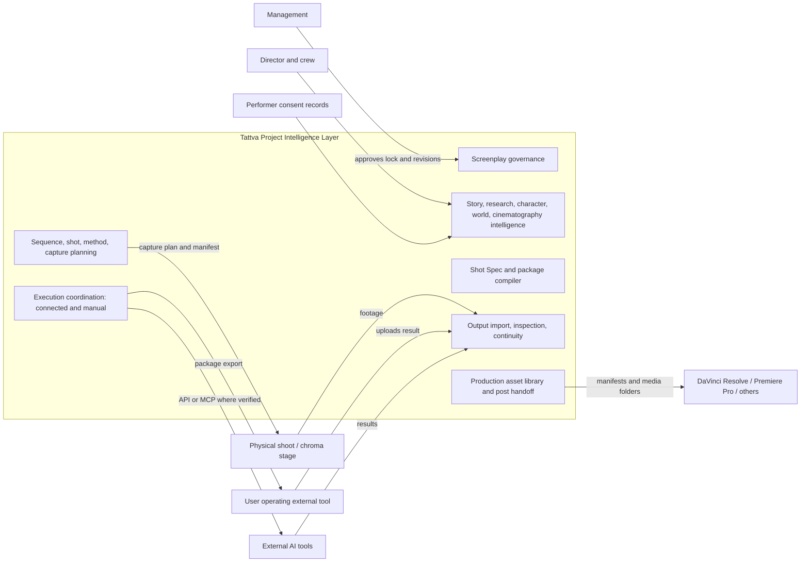
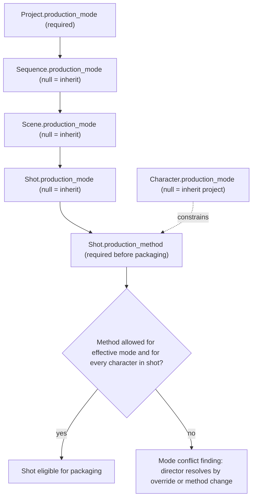
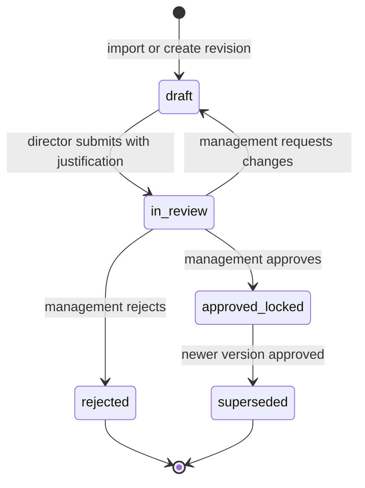
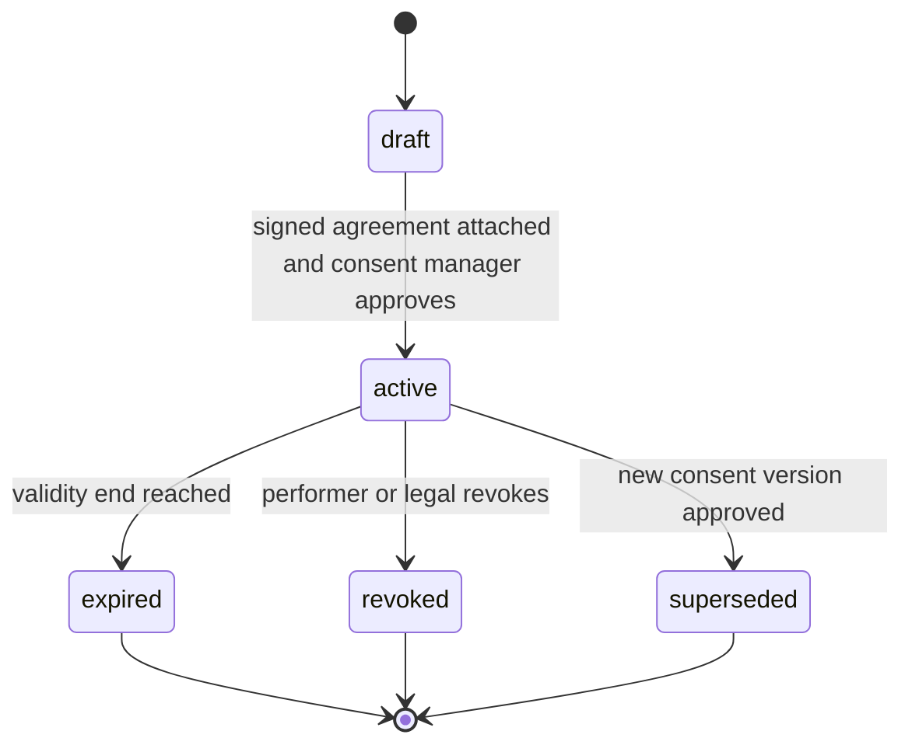
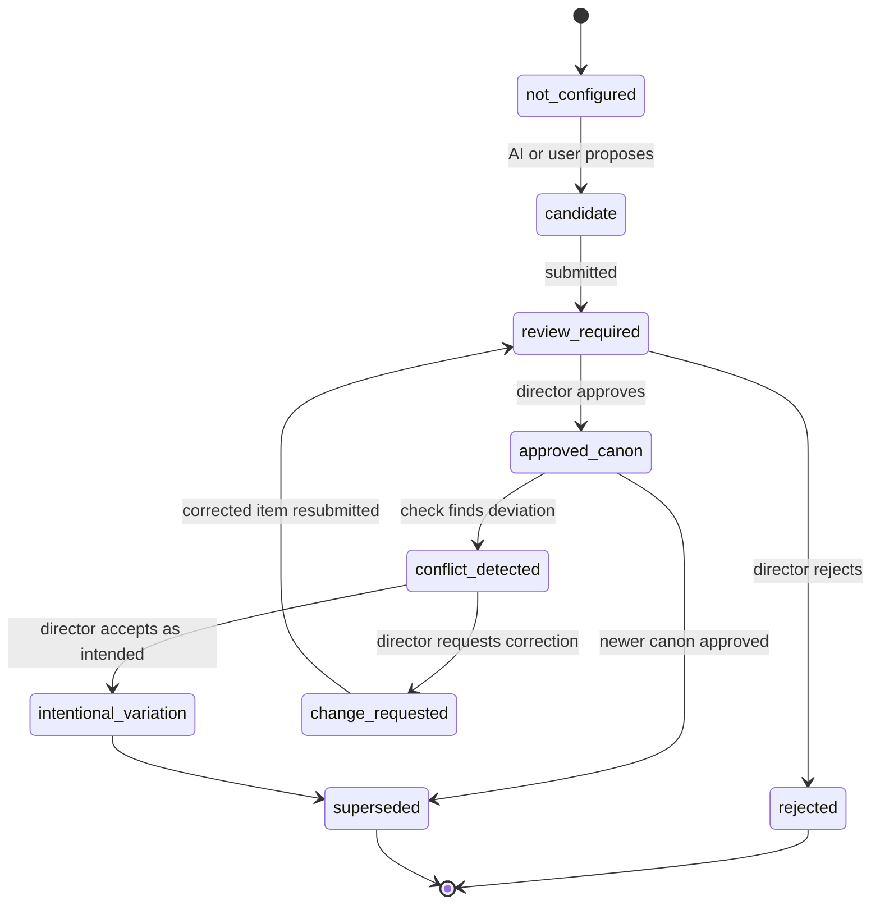

# Tattva AI Film Director — Product Requirements Document v1.0

**Doc ID:** TFD-PRD-001 · **Version:** 1.0-draft · **Date:** 2026-11-05 · **Status:** Phase B design — pending approval

**Inputs:** Master Execution Prompt (§3–§15, §25, §27–§29, §31); Product Evolution & Gap Report v1.0 (§5–§18); PRD v0.9 (`Tattva_AI_Film_Director_PRD_v0.9.md`, kept unedited); IA v1.0; Wireframe Spec v1.0; Phase A audit `docs/audit/01`–`10`; repository `main@b3621cb` plus uncommitted G-04 WIP.

**Supersedes:** PRD v0.9 (TFD-PRD-001 v0.9). The supersession takes effect only after Product and Engineering sign-off (CON-05). Until then, v0.9 remains the reference and this document is the proposed baseline. v0.9 is not edited.

**Companion product docs:** `PRODUCT_ROADMAP.md`, `REVISED_USER_JOURNEYS.md`, `INFORMATION_ARCHITECTURE.md`, `SCREEN_INVENTORY_AND_BEHAVIOUR.md`, `ACCEPTANCE_CRITERIA.md`.

---

## 0. How to read this PRD

| Convention | Meaning |
|---|---|
| **FD-V1 / FD-V2 / FD-V3** | Film Director release labels. They do **not** redefine the wider Tattava Copilot V1/V2/V3 (CON-09). |
| **P0 / P1 / P2** | Priority *within* a release. P0 means the release cannot ship without it. P1 means it is planned for the release and may slip to a point release with Product approval. P2 means desirable and scheduled opportunistically. |
| **TFD-<AREA>-nnn** | Canonical requirement ID (DEC-011). Legacy `FD-FR-0xx` IDs from v0.9 and the Gap Report are listed as aliases. |
| **CURRENT** | As built, per the Phase A audit. Statuses: VERIFIED, IMPL_NV, PARTIAL, SCAFFOLD, MOCKED, PLACEHOLDER, BROKEN, NOT_IMPL, DEFERRED. "VERIFIED" means verified locally against deterministic generators only (`docs/audit/02` legend). |
| **TARGET** | The design this PRD requires. |
| **OPEN — DEC-0xx** | An unresolved decision, with a recommendation. The register is `docs/audit/10` §4. DEC-027 to DEC-029 are proposed in §16 of this PRD. |
| `S-<AREA>-nn` | Screen IDs, defined in `INFORMATION_ARCHITECTURE.md`. |
| `WF-nn` | Workflow/graph IDs (WF-01 = legacy G-01 Script Intelligence … WF-04 = G-04 Film Bible). |

Master Prompt §4–§15 decisions are **requirements, not open questions**:
- two equal modes
- mode selectable at five levels
- the screenplay locked under three workflows
- consent before any use of likeness or voice
- manual execution as a permanent capability
- Tattva never generates media itself
- no NLE in FD-V1 or FD-V2
- FD-V3 deferred

---

## 1. Product definition and vision

**Tattva AI Film Director** is an AI-native filmmaking intelligence, cinematic direction and production-coordination platform. It takes a filmmaker from an idea, or from existing creative material, to two things:
- an approved, production-ready film blueprint (FD-V1)
- approved, generated or transformed cinematic production assets, organised for professional post-production (FD-V2)

**Core principle:** one Project Intelligence Layer, two filmmaking modes, many external production tools, one connected production workspace.

**Measure of success (Master §31):** a production team can reliably take an approved screenplay through intelligent pre-production, then through external AI and live-action production, to approved and organised cinematic assets ready for professional post-production.

### 1.1 What Tattva owns

| Domain | Owned capability | Primary requirement areas |
|---|---|---|
| Project context | Persistent, versioned project truth; one authoritative source | PRJ, CTX, VER |
| Screenplay governance | Locked screenplay, suggestions, revisions, management approval | SCR |
| Story intelligence | Scenes, dialogue, characters, sequences, story timeline | STY, SEQ |
| Historical research & evidence | Questions, sources, typed claims, conflicts, timelines | RES |
| Character identity & continuity | Identity, facial, physical, performance and appearance profiles | CHR, PHY |
| AI avatar specifications | Digital double and fictional avatar specifications, plus reusable digital human records | DH |
| Performer rights | Consent and likeness/voice authorisation | CNS |
| Costume, props, weapons | Bibles, states, assignments | CST, PRP |
| Environments & locations | Profiles, states, references | ENV |
| Cinematography | Physical and virtual camera specs, recommendations, cinematography bible | CIN |
| Shot specification | Provider-neutral Shot Spec, production method | SHT |
| Production instructions | Capture plans and manifests for hybrid production | HYB |
| Tool selection | Registry and recommendation engine | INT, PKG |
| Prompt & reference packaging | Compiler, immutable packages | PKG |
| Execution coordination | Connected jobs and manual handoff | INT, GEN |
| Output import & inspection | Import, mapping, inspection, revision | OUT |
| Continuity | Rules, findings, decisions, impact analysis | CON |
| Approvals, versions, provenance, audit | Generalised approvals, immutable versions, lineage, append-only audit | APR, VER, AUD, LIB |
| Post-production handoff | Manifests and media folders for external editors | POST |

### 1.2 What Tattva does not own

Tattva has no image-, video-, avatar- or voice-generation model of its own. It also has no native rendering engine, NLE, VFX/compositing suite, grading tool, or audio mixing/mastering tool. **All media generation is external.** Tattva coordinates, understands, recommends, validates and manages that work.

**UI rule:** no Tattva control may imply in-product generation. A "Generate" control always names the external tool and the execution mode, for example "Submit to <provider> (connected)" or "Export for <tool> (manual)" (Gap §5 REMOVE list).

### 1.3 System boundary

---

## 2. Two equal filmmaking modes and the mode hierarchy

### 2.1 Modes (Master §4.1)

| Mode | Enum value | Description | Typical shot production methods |
|---|---|---|---|
| A: Fully AI-generated | `fully_ai` | Characters, environments, performance, voice and lip-sync are produced with external AI tools, from approved references | `fully_ai_generated`, `digital_human` |
| B: Hybrid live-action + AI | `hybrid_live_action` | Physical production (actors on chroma, real anchors, real performers) combined with AI environments, appearance transformation and movement transfer | `live_action_chroma`, `performance_transformation`, `digital_human`, `combined` |
| Mixed | `mixed` | The project expects both. No default production method is inherited, so each shot must resolve one explicitly | all five |

Both modes are first-class. Neither is a fallback for the other. Every lifecycle stage (§13 of the Master Prompt) works in both, as shown in `REVISED_USER_JOURNEYS.md` journeys (a), (b) and (c).

### 2.2 Mode hierarchy and inheritance

Mode is set at **project, sequence, scene, character and shot** level (TFD-PRJ-003/004). Sequence, scene and shot form an inheritance chain. Character is a cross-cutting constraint.

**Rules:**
1. **Effective mode.** `effective_mode(shot) = shot.mode ?? scene.mode ?? sequence.mode ?? project.mode`. The UI always shows both the effective value and the level it came from.
2. **Allowed methods** (§2.1 table). A method outside the allowed set is permitted only through an explicit override at shot level, recorded as a `creative_decision` with its rationale.
3. **Character constraint.** A character's mode states how that character is realised (for example, "real performer on chroma" or "fully AI"). If a shot's method cannot realise a character present in it, Tattva raises a `mode_conflict` continuity finding. It never silently changes either value.
4. **Changes cascade only by review.** Changing a mode above shot level recomputes effective modes and runs an impact analysis (TFD-PRJ-006). Shots already approved are marked `review_required` and are never re-planned automatically.
5. **Mixed sequences.** A single sequence may contain real-footage shots and fully AI shots (journey (c)). Continuity rules apply across the boundary (TFD-CON-004).

**CURRENT:** no mode concept exists anywhere in code or docs (`docs/audit/02` §3). `projects.genre` is the only classification column (`packages/persistence/models.py::ProjectModel`).

---

## 3. Screenplay governance (Master §5)

The **management-approved screenplay is the authoritative narrative source**, and management keeps screenplay authority. Three workflows are supported.

| Workflow | What AI may do | What AI may never do | Storage |
|---|---|---|---|
| 1. Original screenplay production | Read and analyse; extract scenes, dialogue and characters; identify production requirements; recommend visual treatment; prepare shot specs; identify continuity issues; prepare packages | Change approved dialogue, scenes, events, structure or narrative decisions | `screenplay_versions` (status `approved_locked`, `is_production_canonical=true`) |
| 2. AI creative suggestions | Propose alternative scenes, dialogue improvements, transitions, storytelling opportunities, dramatic improvements, character development, pacing | Alter the screenplay. Suggestions live only in the **Suggestions Workspace** | `screenplay_suggestions` (proposed / accepted_for_revision / rejected / deferred) |
| 3. Director-led revisions | Help draft, compare and justify | Approve. Only management approves | revision version (`draft → in_review → approved_locked / rejected`) + `screenplay_changes` + `approval_requests(approval_level=management)` + `impact_analyses` |

### 3.1 Screenplay version lifecycle

**Invariants:**
1. At most one version per project, or per episode for episodic formats, has `is_production_canonical = true` (TFD-SCR-002).
2. An `approved_locked` version is immutable. Every write path rejects mutation with 409 `screenplay_locked` (TFD-SCR-003).
3. Every scene, dialogue segment, sequence, shot, package and localised script carries `screenplay_version_id` (TFD-SCR-009).
4. Approving a revision computes an `impact_analysis`, which lists affected scenes, characters, sequences, shots, assets and packages, and marks those items `review_required`. **Nothing propagates automatically** (TFD-SCR-010).
5. All of these are retained: the original, every revision, approved and rejected suggestions, change history, the management decision, approval timestamps, and version relationships (`derived_from_version_id`) (TFD-SCR-008).

**CURRENT:** the script is an `assets` row (`AssetModel`, type `script`). WF-01 parses it straight into `scene_candidates`/`entity_candidates` (`packages/workflows/script_intelligence/parser.py::ScreenplayParser.parse`). There is no lock or version entity (V1-05 NOT_IMPL). **Compatibility:** each existing script asset that WF-01 has processed is backfilled as `screenplay_versions` v1 with status `approved_locked` only if a project owner confirms it. Otherwise it becomes `draft`. Existing `scenes` rows gain a nullable `screenplay_version_id`, populated by that backfill. The pattern is expand → backfill → switch → contract, and no table is dropped.

**Who is "management":** a holder of the `screenplay.approve_lock` capability (TFD-IAM-005). Neither the Director role, Admin role or AI holds it by default. **OPEN — DEC-027** (role and capability matrix). **Recommendation:** a `management_approver` role template distinct from `director`, assignable per project.

---

## 4. Character, digital human and consent (Master §6)

### 4.1 Character Identity Profile

Each character has one persistent profile (`characters` + `character_versions` + `character_identity_profiles`). The profile has five facets:

| Facet | Content (Master §6.1) | Table / structure |
|---|---|---|
| Identity | ID, name, role, biography, story context, relationships, approved identity description, age and timeline, historical context | `character_identity_profiles` |
| Facial identity | Front, side and ¾ reference images; facial geometry references; skin tone, hair, eyes, facial hair, marks, expression references; approved facial identity version | `character_identity_profiles.facial` + asset links (role `face_ref_*`) |
| Physical identity | Height, shoulder, chest, waist, hip, arm and leg proportions, body type, posture, condition, distinguishing characteristics | `physical_identity_profiles` + `body_measurements` |
| Performance identity | Walking, running, gestures, body language, facial expressions, acting references, movement characteristics, performance reference videos | `performance_profiles` |
| Appearance and costume | Costume and armour, accessories, weapons, footwear, jewellery, hair and makeup, dirt/wounds/condition, scene-specific changes | links to `costumes`, `props`, `character_states` |

**Every characteristic carries provenance.** Each one is stored with a `provenance` JSONB envelope `{source, status, confidence, approved_by, version}`. `status` takes one of `candidate | estimated | verified | approved | rejected | superseded` (TFD-CHR-005).

**CURRENT:** characters exist only as `entities` rows with `category="character"`, and scenes hold `scenes.characters_present` JSON (V1-10 PARTIAL). **Compatibility:** `characters.legacy_entity_id` links to `entities.id`. Existing entities are never deleted (TFD-CHR-009).

### 4.2 Avatar modes and performance workflows

| Choice | Options | Rule |
|---|---|---|
| Avatar mode | A. **Identity-preserving digital double**: keeps the real actor's recognisable face, proportions, appearance and performance. B. **Fictional AI avatar**: the director chooses which of body dimensions, movement, gesture, performance, facial expression and voice to preserve; the face and appearance are redesigned within the approved spec. C. Both within one project | Chosen per character (per performer↔character link) |
| Performance workflow | 1. **Performance-preserving video transformation**: real footage is the performance source and an external tool transforms appearance. Tattva inspects the output against the source for movement, timing, gestures, expressions, intensity, screen direction and spatial position. 2. **Reusable digital human / 3D avatar**: model, facial identity, body, skeleton/rig, blendshapes, motion references, appearance and costume variants, reused across scenes and episodes. 3. Both | Tattva recommends; an **irreversible production choice needs explicit authorisation** (TFD-DH-006) |

### 4.3 Body measurements (Master §6.4)

Measurements can come from several sources:
- manual entry
- AI-assisted estimation from **permitted** images or video
- import from scanning tools
- manual correction

Each one then goes through human verification and approval. Every measurement row stores value, unit, capture method, date, source asset, estimation confidence, verification status, approver and version.

**Hard rules:**
- An AI estimate is labelled `estimated`. It can never be shown as `verified` without a human verification step and a calibrated capture method.
- A single arbitrary photograph is never treated as anthropometric ground truth. Its estimates are capped at `estimated/low`.

### 4.4 Performer rights and consent (Master §6.5, §9)

Real performers (`performers`) are distinct from characters. Before any of the following purposes, the performer needs a **valid consent record for that specific purpose** (`performer_consents`):

| Purpose code | Covers |
|---|---|
| `reference_storage` | Storing face/body/voice reference material of the performer in Tattva |
| `digital_double` | Creating an identity-preserving digital double |
| `ai_avatar` | Creating a fictional avatar derived from the performer |
| `appearance_model_derivation` | Training or deriving an appearance model |
| `performance_transformation` | Using performance footage as a transformation source |
| `voice_clone` | Cloning the performer's voice |
| `generated_speech` | Generating new speech in the performer's voice |
| `generated_performance` | Generating new performances from the performer's identity |
| `future_project_reuse` | Reusing likeness in projects other than the consented one |

Consent must be **explicit, purpose-specific, versioned, traceable** (signed agreement asset plus template version), **revocable** according to the agreement and policy, and **linked to performer and project permissions**.

Permission to use recorded audio **never** implies `voice_clone` or `generated_speech`.

Access to sensitive identity references requires `identity.view_sensitive` (TFD-IAM-007).

On revocation, Tattva:
- blocks all new uses for the revoked purposes
- flags every dependent asset, package, job and digital human as `consent_revoked`
- tells the consent manager what the agreement says about existing outputs

Audit history is never deleted. See journey (f).

**OPEN — DEC-012** (consent template and policy owner) and **DEC-007** (retention and privacy) are **blocking** for storing any real-performer likeness or voice data. Until both are approved, the `reference_storage` gate refuses uploads tagged as performer face, body or voice references. Fictional characters with no linked performer are not blocked.

---

## 5. Cinematography and virtual camera (Master §7)

A **Hybrid Cinematography Director**: the director enters exact settings, asks for recommendations, or combines both.

- **Physical camera spec:** the full Master §7.1 parameter list (manufacturer, body, sensor, resolution, fps, shutter, ISO/EI, aperture, WB, lens make/series/focal length/characteristics, distance, height, angle, framing, focus distance, DoF, movement, rig, aspect ratio, codec). It is stored as an **extensible JSONB `camera_spec`** on `shots`, plus reusable `camera_profiles`/`lens_profiles`/`lighting_profiles`. User-defined parameters are allowed, and there is no fixed shortlist.
- **Virtual camera spec:** shot size, establishing, OTS, POV, tracking, dolly, crane, orbit, pan/tilt, handheld, locked, lens look, DoF, composition, lighting, colour/film response, movement speed, duration, motion intensity.
- **Provenance of camera values:** `spec_kind: physical | virtual` and `metadata_origin: actual | creative_target | recommended`. **Actual camera metadata is never mixed up with creative simulation instructions.** `actual` only comes from captured footage metadata or explicit entry by a crew member.
- **Recommendations:** from a described intent, Tattva recommends shot type, position, lens/focal length, movement, framing, lighting, background, subject placement, duration, references and provider-supported settings. Each recommendation **explains why**, and every field can be overridden.
- **Reusable profiles:** a Project Cinematography Bible containing Camera Package, Lens Library, Lighting Library, Shot Composition Rules, Virtual Camera Profile and Visual Language Profile. Continuity across shots holds unless the director approves a change.

**CURRENT:** only `VisualRuleCategory.CAMERA_LANGUAGE` (`packages/domain/enums.py`), plus lens notes hardcoded in `packages/workflows/storyboard_intelligence/aligner.py` (V1-16/17 NOT_IMPL). `storyboard_panels.shot_type` and `ShotType` (7 values) are kept as the seed vocabulary for virtual shot size.

---

## 6. On-set and chroma production (Master §8)

- **Guided capture planning:** each scene or shot gets instructions covering camera and lens setup, sensor and format, fps, lighting, green-screen distance and illumination, subject separation, tracking, movement restrictions, markers, clean plate, reference stills, full-body, facial close-ups, side and ¾ views, movement and walk/turn references, costume and prop references, colour chart, grey card, lighting reference, dialogue and audio, background capture, and required metadata. The plan is **generated from the selected method, environment, camera movement, actor movement and provider requirements. It is never a uniform template.**
- **Independent shoot ingestion:** footage shot independently is uploaded and analysed for missing references, lighting problems, spill, inadequate tracking, motion blur, occlusion, inconsistent frame rates, exposure inconsistencies, camera movement limitations, audio issues, and insufficient face/body references. The output is **practical recommendations, not unnecessary rejection.**
- **Capture manifest:** one per planned shoot. Fields: project, scene, shot, performer, camera, lens, recording settings, lighting setup, capture requirements, required footage, captured footage, validation, missing information, approval status.

**Release:** FD-V2 (Master §15 V2-12). In FD-V1, each shot records `production_method`, so hybrid shots are identified and planned during pre-production. Capture-plan generation and footage analysis ship in FD-V2.

**UNVERIFIED feasibility:** some §8.2 checks (green-screen spill, tracking adequacy, occlusion) need media-analysis models or tools that have not been selected. Frame-rate and exposure consistency can be derived from container metadata. Each check is labelled with its method (`metadata`, `heuristic`, `model:<id>`, `human`) and its coverage.

---

## 7. Voice, dialogue and localisation (Master §9)

| Workflow | Requirements |
|---|---|
| Original voice | Preserve production audio. Link recordings to scene, character and dialogue segment. Track takes and versions, recording metadata, and audio quality and sync status |
| AI voice | Authorised cloning, fictional character voices, voice profile creation and selection, emotion/delivery, dialogue generation (by an external tool), language and accent, version and approval |
| Multilingual | Original dialogue, translated dialogue, approved localised scripts, multilingual voice production, dubbing, lip-sync, timing validation, dialogue comparison |

The director chooses original or AI voice **per character or per scene**.

**Localisation never silently replaces locked screenplay dialogue.** Each localised script is a separate approved asset, linked to `screenplay_version_id` and `dialogue_segment_id`.

**Voice consent:** `voice_clone` and `generated_speech` are explicit consent purposes (§4.4).

**CURRENT:** NOT_IMPL. WF-01 extracts only uppercase cue names (`ScreenplayParser`) and stores no dialogue text. `dialogue_segments` is a new FD-V1 table (STY), because dialogue preservation is an FD-V1 story-intelligence obligation (Master §22).

---

## 8. Production formats and templates (Master §10)

Supported formats:
- feature film
- OTT series
- episodic historical series
- short film
- trailer
- teaser
- documentary
- vertical film
- social media video
- reel
- branded content
- promotional content
- educational content

A **project template** provides structure: the episode and scene organisation, and the default workflow steps that apply. An **output (delivery) profile** provides resolution, aspect ratio, frame rate, duration, audio settings, subtitle requirements, delivery format and platform-specific requirements.

A project has one template and one or more output profiles; for example, a 16:9 master plus a 9:16 social cut-down.

**Formats do not share one workflow** (TFD-FMT-004):
- Episodic formats add a series → episode level with per-episode screenplay versions.
- Documentary allows footage-first projects, where the screenplay lock is optional and a "story outline" artifact governs instead.
- Reels and social formats can skip sequence planning.
- Trailers and teasers reference shots from a parent project.

Exact per-format defaults are configuration data, not code. The initial default values (resolution, fps, durations) need validation by production users before release. **OPEN — DEC-028.**

**CURRENT:** `projects.genre` only. The UI offers four fixed genres (`apps/ui/app.py::GENRES`). Genre stays as a field independent of format.

---

## 9. Continuity (Master §11)

Continuity is director-controlled. The director can:
- lock a characteristic
- permit controlled variation
- approve an intentional change
- request a correction
- define scene-specific states
- define timeline-specific appearance
- compare outputs against approved references

**Dimensions** (at least these nine; each has typed attributes in `continuity_rules.dimension`):

| Dimension | Attributes |
|---|---|
| `character_identity` | face, facial features, age appearance, body proportions, hair, skin, marks, identity refs |
| `character_physical_state` | injuries, fatigue, condition, dirt, blood, wetness, damage, ageing, timeline state |
| `costume` | garments, armour, colours, textures, accessories, condition, scene variations |
| `props_weapons` | type, design, material, scale, ownership, position, condition, state |
| `environment` | geography, architecture, layout, terrain, weather, time of day, changes, period |
| `cinematography` | camera, lens, framing, camera direction, screen direction, movement, lighting, colour profile, composition |
| `performance` | body movement, gesture, facial expression, action, dialogue timing, lip-sync |
| `visual_style` | art direction, palette, texture, lighting style, realism level, film look |
| `audio` | voice identity, dialogue version, language, accent, emotion, timing, audio continuity |

**Status model** (applies to rules, attribute states and findings):

AI detects and recommends; **the director owns final approval**. "No issue detected" always states its coverage (which dimensions, which shots, which method). It never claims that everything was validated.

---

## 10. External tool ecosystem (Master §12)

### 10.1 Execution modes

| Mode | Flow | Availability |
|---|---|---|
| `CONNECTED_API` / `CONNECTED_MCP` | Prepare package → validate inputs → user approval → permission and cost check → submit → track job → receive → import/link → inspect → review → approve → version | FD-V2. Only for providers that passed the onboarding gate (TFD-INT-005). API and MCP use **separate adapters** |
| `MANUAL` | Prepare package → copy prompt/settings → download references → open external app → user executes → user uploads result → validate → link to entity → inspect → review → approve → version | **FD-V1, permanent.** Never presented as a failed connection |

Both modes produce **the same internal lineage records**: package → job → attempt → imported asset → review (TFD-GEN-008).

### 10.2 Candidate ecosystem

| Area | Candidates (all **UNVERIFIED** as of 2026-11-05) |
|---|---|
| Image generation | FLUX.2, Midjourney (manual only; its terms prohibit automated access, Gap Report S1) |
| Video generation | Higgsfield (API and MCP are separate contracts), Seedance, Kling, Runway, Wan |
| Performance transfer | Runway Act-Two |
| Live-action / CG | Autodesk Flow Studio |
| AI anchors / digital twins | HeyGen |
| Motion capture | Rokoko, Move AI |
| Body measurement | Size Stream, plus suitable calibrated scanning systems |
| Voice | ElevenLabs |
| Lip-sync | Sync Labs |
| Professional finishing (handoff target only) | DaVinci Resolve, Premiere Pro |

For each candidate, the provider verification register in `docs/architecture/INTEGRATION_ARCHITECTURE.md` records:
- official URL
- API/MCP availability
- authentication
- schemas
- inputs and outputs
- limits
- rate limits
- costs
- commercial terms
- data retention
- consent implications
- regional availability
- manual alternative
- verification date and source

**This PRD invents no endpoint, payload, MCP schema, price or capability.**

### 10.3 Registry and recommendation

- **Universal Production Tool Registry:** provider capability records with every field in Master §12.3, held as **versioned capability snapshots**. The internal Shot Spec and Character Spec never contain one provider's payload.
- **Recommendation engine:** compares candidates per task or shot on visual quality, identity consistency, environment consistency, motion realism, facial performance, full-body movement, lip-sync, reference adherence, camera control, resolution, duration, speed, cost, reliability and current compatibility. It explains its reasoning. The user can accept it or choose manually.
- **Data sources for recommendations:** FD-V1 recommendations draw only on registry data and project evaluation history, and are labelled with their evidence. Quality claims need evaluation evidence (Master §22).
- **Authorisation:** paid or irreversible execution **always** requires explicit authorisation.

**CURRENT:** no adapters, registry or packages exist. Higgsfield appears only as configuration fields (`packages/core/config.py`: `higgsfield_integration_mode: Literal["manual_export"]`).

---

## 11. Post-production boundary (Master §14)

**Tattva is responsible for:**
- production coordination
- shot and footage tracking
- continuity approval
- asset organisation
- audio/video linkage
- metadata and timecode metadata where available
- versioning
- handoff manifests and editorial notes
- preparation for external editing

**Handoff targets:** DaVinci Resolve, Adobe Premiere Pro and other compatible tools.

**Interchange formats:** XML, EDL, AAF and OpenTimelineIO are evaluated. **Only formats that have been generated and validated in a real editor round trip are claimed as supported.** **DEC-014 (recommended):** JSON and CSV manifests plus organised media folders first; OTIO only after a validated round trip in Resolve or Premiere.

**The post team receives:**
- approved footage
- shot IDs
- scene and sequence relations
- version numbers
- fps, resolution and aspect ratios
- timecodes where available
- audio references and dialogue versions
- continuity notes
- asset manifests
- source provenance

**No NLE, timeline editing, compositing, grading or mixing in FD-V1 or FD-V2.**

---

## 12. Personas and roles

| Persona | Primary job in Tattva | New in v1.0? | Key screens |
|---|---|---|---|
| Studio management / Executive producer | Approve the locked screenplay and revisions; review impact | **New** (Master §5) | S-SCR-01, S-SCR-03, S-APR-02, S-CON-03 |
| Director / Showrunner | Own creative intent; choose modes and methods; approve canon, shots and outputs | v0.9 | S-PRJ-01, S-MTH-01, S-SHT-01, S-AID-01, S-OUT-01 |
| Story developer / Writer | Draft revisions; triage AI suggestions | v0.9 | S-SCR-02/03/04 |
| Historical researcher | Build evidence, claims and timelines | v0.9 | S-RES-* |
| Art director / Production designer | Characters, costume, props, environments, visual language | v0.9 | S-CHR-*, S-CST-*, S-ENV-01, S-BIB-* |
| Cinematographer / DP | Camera and lens libraries, shot camera specs, capture plans | v0.9 (expanded) | S-CIN-01, S-SHT-01, S-CAP-01 |
| On-set / VFX supervisor | Execute capture plans; upload footage; resolve capture gaps | **New** (Master §8) | S-CAP-01/02 |
| Digital human / avatar lead | Build digital doubles, avatars and reusable digital humans | **New** (Master §6) | S-DH-02, S-PHY-01 |
| Rights & consent manager (legal) | Maintain performer consent; handle revocation | **New** (Master §6.5) | S-DH-01 |
| Voice & localisation lead | Voice casting, recordings, localised scripts, dubbing | **New** (Master §9) | S-VOC-01/02 |
| Producer / Project lead | Readiness, cost approval, budgets, team | v0.9 | S-PRJ-01/02, S-EXE-01, S-TEAM-02 |
| AI production operator | Compile packages, run manual handoffs or connected submissions, import outputs | v0.9 | S-PKG-*, S-EXE-*, S-REG-01 |
| Post-production editor (external consumer) | Receive handoff packages | **New** (Master §14) | S-PST-01 (download only) |
| Org administrator | Members, roles, provider connections; **no implicit creative or management authority** | v0.9 | S-TEAM-01, S-REG-02 |

**Role templates** (target, `role_templates` → `capabilities`):
- `org_admin`
- `project_owner`
- `management_approver`
- `director`
- `story_lead`
- `researcher`
- `art_lead`
- `cinematographer`
- `onset_supervisor`
- `dh_lead`
- `consent_manager`
- `voice_lead`
- `producer`
- `production_operator`
- `contributor`
- `viewer`

**Capabilities** are fine-grained, for example:
- `screenplay.approve_lock`
- `screenplay.propose_revision`
- `suggestion.decide`
- `canon.approve.<domain>`
- `consent.manage`
- `identity.view_sensitive`
- `package.export`
- `provider.submit`
- `cost.approve`
- `provider.connect`
- `project.manage_members`
- `output.approve`

**OPEN — DEC-027** covers the final matrix.

**CURRENT:** `users.role` is stored and never read. There are no memberships, and identity is the unauthenticated `X-Actor-ID` header (`apps/api/dependencies.py::get_actor`, SEC-01/02/03).

---

## 13. Release scope — FD-V1, FD-V2, FD-V3 (Master §15)

### 13.1 FD-V1 — Film Intelligence & Pre-production

**Primary output:** an approved filmmaking and production blueprint. FD-V1 works with manual external tools and deterministic mock providers. Mocks are labelled as mocks everywhere.

| # | Master §15 item | Requirement IDs | CURRENT (audit 02) |
|---|---|---|---|
| V1-01 | Project management | TFD-PRJ-001…007, TFD-FMT-001…004 | PARTIAL |
| V1-02 | Team access and role model | TFD-IAM-001…009 | NOT_IMPL |
| V1-03 | Universal asset ingestion | TFD-AST-001…010 | PARTIAL |
| V1-04 | Script intelligence | TFD-STY-001…003, TFD-STY-007, TFD-SCR-001 | VERIFIED (deterministic) |
| V1-05 | Locked screenplay governance | TFD-SCR-002…004, TFD-SCR-006…011 | NOT_IMPL |
| V1-06 | AI suggestions workspace | TFD-SCR-005 | NOT_IMPL |
| V1-07 | Historical research | TFD-RES-001…005, TFD-RES-010 | VERIFIED (mocked) |
| V1-08 | Historical timeline | TFD-RES-006 | NOT_IMPL |
| V1-09 | Film Bible | TFD-CIN-010…013 | BROKEN (G-04 WIP) |
| V1-10 | Character Bible | TFD-CHR-001…009 | PARTIAL |
| V1-11 | Physical Identity Profile | TFD-PHY-001…004, TFD-PHY-006 | NOT_IMPL |
| V1-12 | Costume Bible | TFD-CST-001…003 | NOT_IMPL |
| V1-13 | Props and weapons register | TFD-PRP-001…003 | NOT_IMPL |
| V1-14 | Environment and location Bible | TFD-ENV-001…004 | PARTIAL |
| V1-15 | Storyboard intelligence | TFD-SB-001…004 | VERIFIED (deterministic; PARTIAL against this PRD) |
| V1-16 | Cinematography Bible | TFD-CIN-005, TFD-CIN-006 | NOT_IMPL |
| V1-17 | Camera/lens planning | TFD-CIN-001…004 | NOT_IMPL |
| V1-18 | Sequence planning | TFD-SEQ-001, TFD-SEQ-002 | NOT_IMPL |
| V1-19 | Shot planning | TFD-SHT-001, 002, 004, 005, 006 | PARTIAL |
| V1-20 | Continuity management | TFD-CON-001…006, TFD-CON-008 | NOT_IMPL |
| V1-21 | Context Resolver | TFD-CTX-001…004 | NOT_IMPL |
| V1-22 | AI Director review | TFD-AID-001…007 | NOT_IMPL |
| V1-23 | Provider-neutral Shot Specification | TFD-SHT-003 | NOT_IMPL |
| V1-24 | Prompt compiler | TFD-PKG-001, 003, 005, 006 | NOT_IMPL |
| V1-25 | Production package generation | TFD-PKG-002, 004, 007 | NOT_IMPL |
| V1-26 | Manual export and copy | TFD-INT-001, TFD-INT-003, TFD-INT-004, TFD-INT-006 | NOT_IMPL |
| V1-27 | Manual asset import | TFD-OUT-001, 002, 004, 005, 006 | NOT_IMPL |
| V1-28 | Review and approval | TFD-APR-001…007 | VERIFIED (single tier, no RBAC) |
| V1-29 | Versions and audit | TFD-VER-001…005, TFD-AUD-001…004 | PARTIAL |
| V1-30 | Core operational observability | TFD-OPS-001…010 | NOT_IMPL |

FD-V1 also carries the consent baseline: TFD-CNS-001…005 (performer registry, consent records, gate on reference storage and packaging, revocation, voice-consent separation). Real-performer references must not enter the system before it exists (§4.4).

**FD-V1 exit criteria** (adapted from Gap §6.1; numeric thresholds per **DEC-028**):
1. A team creates a project with format, mode and delivery profile, then uploads a heterogeneous bundle. Every file's outcome is visible, and partial failures are recoverable.
2. A screenplay is imported, locked by a management approver, analysed into scenes and verbatim dialogue, and revised through the director → management workflow with impact analysis.
3. Characters, costume, props, environments, Film Bible and Cinematography Bible are approved with characteristic-level provenance. No real-performer reference exists without consent.
4. Sequences, scenes and shots carry effective mode, production method, camera spec (with origin labels) and screenplay version.
5. Continuity findings carry coverage qualifiers. AI Director findings are dispositioned by humans.
6. A provider-neutral package is compiled, exported manually **with no connector configured**, executed outside Tattva, re-imported, mapped to its shot, reviewed and versioned.
7. Every protected route requires an authenticated actor and enforces org, project, role and resource permissions. CI runs migration, authorisation, recovery, parser-evaluation and E2E suites. No critical or high defect is open.

### 13.2 FD-V2 — AI Production & External Generation

**Primary output:** approved generated and transformed cinematic production assets. Manual execution stays available for every workflow.

| # | Master §15 item | Requirement IDs |
|---|---|---|
| V2-01 | Connected image generation where verified | TFD-INT-002, TFD-GEN-005 |
| V2-02 | Manual image generation workflows | TFD-GEN-008 |
| V2-03 | Character reference generation | TFD-GEN-005 |
| V2-04 | Environment reference production | TFD-GEN-010 |
| V2-05 | Costume and prop reference production | TFD-GEN-011 |
| V2-06 | Keyframe workflows | TFD-GEN-006 |
| V2-07 | Performance-preserving transformation | TFD-DH-004 |
| V2-08 | Digital human workflows | TFD-DH-001, 002, 003, 005, 006, 009 |
| V2-09 | AI anchor workflows | TFD-DH-007 |
| V2-10 | Motion capture integration/handoff | TFD-DH-008 |
| V2-11 | Body measurement integration/handoff | TFD-PHY-005, TFD-PHY-007 |
| V2-12 | Chroma and live-action production workflows | TFD-HYB-001…005 |
| V2-13 | Video generation through verified adapters | TFD-GEN-007, TFD-INT-002 |
| V2-14 | Voice workflows | TFD-VOC-001…004 |
| V2-15 | Multilingual dubbing | TFD-VOC-005, TFD-VOC-007 |
| V2-16 | Lip-sync integration | TFD-VOC-006 |
| V2-17 | Generation job tracking | TFD-GEN-001, TFD-GEN-009 |
| V2-18 | Generation attempt tracking | TFD-GEN-002, TFD-GEN-003 |
| V2-19 | Provider capability registry | TFD-INT-003 (connected scope), TFD-INT-005, 007, 008, 009, 010 |
| V2-20 | Cost and credit tracking | TFD-GEN-004 |
| V2-21 | Output import and inspection | TFD-OUT-002 (AI-assisted), TFD-OUT-003 |
| V2-22 | Continuity comparison | TFD-CON-007 |
| V2-23 | Revision and regeneration requests | TFD-OUT-005 (connected regeneration) |
| V2-24 | Shot-level production library | TFD-LIB-001, 002, 003 |
| V2-25 | Production handoff package | TFD-POST-001…003 |

Also in FD-V2: TFD-CNS-006…008 (consent expiry, enforcement on provider submission, provider data disclosure).

**FD-V2 exit criteria** (Gap §6.2):
- Every connected provider has a signed-off capability snapshot and contract tests.
- Connected and manual runs produce equivalent lineage.
- No provider action runs without authenticated authority and an explicit approval that names model, action and cost.
- Unknown outcomes are reconciled before any retry.
- Outputs never overwrite earlier ones.
- Consent is enforced at submission.
- The post handoff manifest has been validated with a real post team.

### 13.3 FD-V3 — Deferred (not in scope)

Deferred items:
- full NLE editor
- advanced VFX and compositing
- professional colour grading
- advanced audio mixing and mastering
- native final rendering
- automatic final cut
- distribution platform
- automated delivery and mastering infrastructure

**Work on these must not start because an FD-V1 or FD-V2 workflow mentions post-production.** FD-V3 needs its own PRD, architecture and investment decision (Gap §18, stage 8).

---

## 14. Functional requirements

**Column key:**
- **Rel**: release
- **Pri**: priority within release
- **Src**: Master Prompt section and §15 item
- **Alias**: legacy ID
- **Current**: audit status

Acceptance criteria for every P0 are in `ACCEPTANCE_CRITERIA.md`. Screens are in `SCREEN_INVENTORY_AND_BEHAVIOUR.md`.

### 14.1 PRJ — Project management and production mode

| ID | Requirement | Rel | Pri | Src | Alias | Current |
|---|---|---|---|---|---|---|
| TFD-PRJ-001 | Create a project with a stable ID, title, logline, genre, **production format template, production mode, visual quality profile, project scale and delivery profile**. Only the title and mode are required. The other fields may be "decide later", but must be set before shot packaging | V1 | P0 | §13 S1, V1-01 | FD-FR-001/002 | PARTIAL (title/logline/genre only, `routers/projects.py`) |
| TFD-PRJ-002 | List, get, update metadata and archive projects, scoped to the caller's project memberships. Archive is soft and reversible. No hard delete until DEC-007 | V1 | P0 | V1-01 | FD-FR-001 | PARTIAL (no update/archive) |
| TFD-PRJ-003 | Project-level `production_mode ∈ {fully_ai, hybrid_live_action, mixed}`. Changeable later, with the impact rule in PRJ-006 | V1 | P0 | §4.1 | new | NOT_IMPL |
| TFD-PRJ-004 | Nullable mode override at sequence, scene, character and shot. Effective mode is computed by inheritance (§2.2). The UI shows the effective value and its source level | V1 | P0 | §4.1 | new | NOT_IMPL |
| TFD-PRJ-005 | Mode conflict detection: a shot whose production method is outside the allowed set for its effective mode, or that cannot realise a present character's mode, produces a `mode_conflict` finding. It never auto-corrects | V1 | P0 | §4.1 | new | NOT_IMPL |
| TFD-PRJ-006 | Changing mode at project, sequence, scene or character level runs an impact analysis. Affected approved shots become `review_required`. No silent re-planning | V1 | P0 | §4.1, §5 | new | NOT_IMPL |
| TFD-PRJ-007 | Project Overview shows the canonical screenplay version, project version, mode distribution, pending approvals, unresolved high-severity findings, running tasks and next actions. No fabricated completion percentages | V1 | P1 | §25.1 | UX-FD-02 | PARTIAL (`apps/ui/views/overview.py` counts only) |

### 14.2 FMT — Production formats and templates

| ID | Requirement | Rel | Pri | Src | Alias | Current |
|---|---|---|---|---|---|---|
| TFD-FMT-001 | Template catalogue for all 13 formats in §8. Each template defines structure (with or without episodes), required and optional workflow steps, and default output profile | V1 | P0 | §10 | new | NOT_IMPL |
| TFD-FMT-002 | Output profiles (resolution, aspect ratio, fps, duration target, audio, subtitles, delivery format, platform notes). One or more per project. Shots and post handoff reference a profile | V1 | P1 | §10 | new | NOT_IMPL |
| TFD-FMT-003 | Episodic structure for OTT series and episodic historical series: series → episode → scene, with a canonical screenplay version per episode and reusable characters, digital humans and locations across episodes | V1 | P0 | §10, §6.3 | new | NOT_IMPL |
| TFD-FMT-004 | Format-specific workflow variants (documentary footage-first with optional lock; social/reel without sequence planning; trailer/teaser referencing a parent project's approved shots). Variants are configured, never forced into one workflow | V1 | P1 | §10 | new | NOT_IMPL |
| TFD-FMT-005 | Changing a template after creation shows an impact review before applying | V1 | P2 | §10 | new | NOT_IMPL |

### 14.3 IAM — Identity, access, tenancy

| ID | Requirement | Rel | Pri | Src | Alias | Current |
|---|---|---|---|---|---|---|
| TFD-IAM-001 | Authenticated identity (OIDC/JWT behind an `AuthProvider` port). `X-Actor-ID` header identity only in `test`. Missing configuration fails closed. The dev fallback is behind an explicit local flag and bound to `default-studio` only | V1 | P0 | §21, V1-02 | FD-FR-043 | NOT_IMPL (SEC-01/02) — **gate DEC-002** |
| TFD-IAM-002 | Organisation `memberships` with role. `users.role` is migrated into a membership, not dropped | V1 | P0 | V1-02 | FD-FR-001 | NOT_IMPL |
| TFD-IAM-003 | `project_memberships` with project role. Users see and act only on projects they belong to (org admins manage membership but gain no creative capabilities) | V1 | P0 | V1-02 | FD-FR-043 | NOT_IMPL |
| TFD-IAM-004 | Capability matrix (`role_templates` → `capabilities`), deny-by-default, enforced server-side on every route and every workflow resume. AI and workflow nodes act only with the initiating user's capabilities | V1 | P0 | §21, §18 | FD-FR-043 | NOT_IMPL — **OPEN DEC-027** |
| TFD-IAM-005 | `screenplay.approve_lock` (management authority) is a distinct capability. The director, admin and AI do not hold it by default | V1 | P0 | §5 | new | NOT_IMPL |
| TFD-IAM-006 | `cost.approve` capability and per-project budget caps for provider spend | V2 | P0 | §12.4, V2-20 | FD-FR-038 | NOT_IMPL |
| TFD-IAM-007 | Asset-level permission: performer face, body and voice references and consent documents need `identity.view_sensitive`. Listing endpoints redact them otherwise | V1 | P0 | §6.5 | new | NOT_IMPL |
| TFD-IAM-008 | Membership or capability revocation takes effect on the next request. Pending approvals assigned to a revoked user are re-routed | V1 | P1 | §21 | new | NOT_IMPL |
| TFD-IAM-009 | Tenant and project isolation: every repository getter is scoped, and foreign IDs in requests are validated as belonging to the same project. Cross-tenant access returns 404 | V1 | P0 | §21 | FD-FR-043 | PARTIAL (projects/approvals/runs scoped; `ResearchRepository.get_question/get_source`, `FilmBibleRepository.get_rule` unscoped — SEC-04) |

### 14.4 AST — Universal asset ingestion

| ID | Requirement | Rel | Pri | Src | Alias | Current |
|---|---|---|---|---|---|---|
| TFD-AST-001 | Multi-file upload streamed to private object storage. Per-file size limits. The API process never holds a whole file in memory | V1 | P0 | §20.5, V1-03 | FD-FR-003 | PARTIAL (`routers/assets.py:27` buffers whole file; PERF-03) — **gate DEC-003** |
| TFD-AST-002 | File-signature (magic-byte) validation; client MIME is not trusted. Processing states `received → scanning → quarantined / accepted`. Parsers run isolated | V1 | P0 | §20.5, §21 | FD-FR-004 | NOT_IMPL (SEC-05) |
| TFD-AST-003 | Category taxonomy covering screenplay, storyboard, character reference, face reference, body reference, performance reference video, reference image, environment reference, research document, audio, production footage, generated output, motion data, body scan, consent document and notes. Provisional classification plus user correction | V1 | P0 | §13 | FD-FR-003/006 | PARTIAL (`AssetType` 6 values; upload hard-codes `script`) |
| TFD-AST-004 | Immutable original with checksum, uploader, timestamp, source and rights declaration. A re-upload of identical bytes creates a new asset row linked to the same blob, never an overwrite | V1 | P0 | §31.14 | FD-FR-004 | PARTIAL (content-addressed `LocalFileSystemStorageService`) |
| TFD-AST-005 | Per-asset processing state with partial-failure isolation. One bad file never fails the batch | V1 | P0 | Gap §8.3 | FD-FR-005 | NOT_IMPL |
| TFD-AST-006 | Text derivatives for screenplay and document formats (Fountain, FDX, PDF text layer, DOCX, TXT), with lineage to the original. PDF/DOCX are never decoded as UTF-8 bytes | V1 | P0 | V1-03/04 | FD-FR-007/008 | BROKEN for PDF/DOCX (`script_review.py` decodes as UTF-8) |
| TFD-AST-007 | Media derivatives (thumbnails, video proxies, audio waveform, sampled frames, technical metadata) with lineage | V1 / V2 | P1 / P0 | §20.5 | FD-FR-008 | NOT_IMPL |
| TFD-AST-008 | Duplicate and near-duplicate detection that never deletes originals | V1 | P2 | — | FD-FR-009 | NOT_IMPL |
| TFD-AST-009 | Reference-video analysis (timecodes, shot boundaries, camera, motion and lighting observations) with a reference-purpose taxonomy | V1 | P1 | Stage 5–7 | FD-FR-023/024 | NOT_IMPL |
| TFD-AST-010 | Signed, short-lived download URLs only. No public asset URL. Downloads are permission-checked | V1 | P0 | §21 | FD-FR-004 | NOT_IMPL |

### 14.5 SCR — Screenplay governance

| ID | Requirement | Rel | Pri | Src | Alias | Current |
|---|---|---|---|---|---|---|
| TFD-SCR-001 | Screenplay import (Fountain, FDX, PDF, DOCX, TXT) creates a `screenplay_versions` row in `draft`, linked to its source asset | V1 | P0 | §5, V1-04 | FD-FR-020 | PARTIAL (asset only) |
| TFD-SCR-002 | Approved screenplay lock: management approval (`approval_level=management`) moves `in_review → approved_locked` and sets `is_production_canonical`. Only one canonical version per project or episode | V1 | P0 | §5 | new | NOT_IMPL |
| TFD-SCR-003 | Locked versions are immutable. Any attempt to mutate text, scenes or dialogue of an `approved_locked` version returns 409 `screenplay_locked` and is audited | V1 | P0 | §5, §31.2 | new | NOT_IMPL |
| TFD-SCR-004 | AI analysis (WF-01 and successors) reads only from a specific `screenplay_version_id` and never writes screenplay text | V1 | P0 | §5 Mode 1 | new | PARTIAL (WF-01 reads asset bytes) |
| TFD-SCR-005 | AI Suggestions Workspace: suggestions in seven kinds (alternative scene, dialogue improvement, transition, storytelling opportunity, dramatic improvement, character development, pacing), stored in `screenplay_suggestions` against a version and anchor. Dispositions: accept-for-revision, reject, defer. Accepted suggestions can be pulled into a director revision; they never edit a version | V1 | P0 | §5 Mode 2, V1-06 | new | NOT_IMPL |
| TFD-SCR-006 | Director revision: create a draft derived from the canonical version, edit it (import a revised file or make scene-level structured edits), view a change comparison (scene, action and dialogue diff), and give a required justification per change set | V1 | P0 | §5 Mode 3 | new | NOT_IMPL |
| TFD-SCR-007 | Management review of a revision: approve, reject or request changes, with notes. Approval creates the new `approved_locked` canonical version, supersedes the previous one, and records approver and timestamps | V1 | P0 | §5 Mode 3 | new | NOT_IMPL |
| TFD-SCR-008 | Full history retained: original, all revisions, suggestions with dispositions, `screenplay_changes`, management decisions, timestamps, `derived_from_version_id` | V1 | P0 | §5 | new | NOT_IMPL |
| TFD-SCR-009 | Scenes, dialogue segments, sequences, shots, packages and localised scripts store `screenplay_version_id`. The system always knows the production-canonical version | V1 | P0 | §5 | new | NOT_IMPL |
| TFD-SCR-010 | When a revision is approved, compute an `impact_analysis` (affected scenes, characters, sequences, shots, assets, packages, localised dialogue), mark items `review_required`, and show it before and after approval. **No automatic propagation** into approved assets | V1 | P0 | §5 | FD-FR-030 | NOT_IMPL |
| TFD-SCR-011 | Per-episode screenplay governance for episodic formats (see FMT-003) | V1 | P1 | §10 | new | NOT_IMPL |
| TFD-SCR-012 | In-app rich screenplay editor with redline. Depends on the frontend decision (Streamlit is unsuitable, audit 04 §3) | V2 | P2 | §18 | new | NOT_IMPL — **OPEN DEC-009** |

### 14.6 STY — Story intelligence

| ID | Requirement | Rel | Pri | Src | Alias | Current |
|---|---|---|---|---|---|---|
| TFD-STY-001 | Scene extraction from a screenplay version with page/line locators → candidates → approval → canonical `scenes`. The existing WF-01 pipeline is preserved | V1 | P0 | V1-04 | FD-FR-020 | VERIFIED (deterministic; `ScreenplayParser`) |
| TFD-STY-002 | **Dialogue segments** extracted verbatim (speaker, line, parenthetical, scene, order, locator). Dialogue preservation is measured exactly against the source | V1 | P0 | §9, §22 | FD-FR-020 | NOT_IMPL |
| TFD-STY-003 | Character, location and time-of-day extraction resolved into `characters`/`locations` (with legacy `entities` links) | V1 | P0 | V1-04 | FD-FR-025 | PARTIAL (`entities`) |
| TFD-STY-004 | Story Brain epistemic states (known, unknown, ambiguous, assumed, conflicting, blocked, resolved) per project fact | V1 | P1 | Stage 3 | FD-FR-010 | NOT_IMPL |
| TFD-STY-005 | Story/narrative timeline, distinct from and linked to the historical timeline | V1 | P1 | Stage 3 | FD-FR-018 | NOT_IMPL |
| TFD-STY-006 | Character relationships | V1 | P1 | §6.1 | — | NOT_IMPL |
| TFD-STY-007 | Golden screenplay set (including non-uppercase cues, PDF, FDX) with scene/character F1 and exact-match dialogue preservation, run in CI before any quality claim | V1 | P0 | §22 | FD-FR-049 | NOT_IMPL |

### 14.7 RES — Historical research

| ID | Requirement | Rel | Pri | Src | Alias | Current |
|---|---|---|---|---|---|---|
| TFD-RES-001 | Research questions with status (`open/investigating/resolved/deferred`) and the investigation workflow (WF-02) | V1 | P0 | V1-07 | FD-FR-015 | VERIFIED (mocked) |
| TFD-RES-002 | Source registry with tier (`tier_0_project…tier_3_discovery`), locator, retrieval date and independence | V1 | P0 | V1-07 | FD-FR-013 | PARTIAL (locators thin) |
| TFD-RES-003 | Typed claims (`historical_fact, historical_interpretation, contested_claim, creative_dramatization, user_assertion, unverified`), kept separate from approval status | V1 | P0 | Stage 4 | FD-FR-012 | VERIFIED (`ClaimClass`) |
| TFD-RES-004 | Conflicts stay visible; an unsupported claim can never be marked `historical_fact` | V1 | P0 | Stage 4 | FD-FR-014 | PARTIAL |
| TFD-RES-005 | Manual research writes go through candidate → approval, or a role-gated direct-canon path with audit and version bump | V1 | P0 | §31.3 | — | NOT_IMPL (SEC-06, `ResearchService.create_*`) |
| TFD-RES-006 | Historical timeline events with uncertain dates (original expression, normalised range, precision, calendar), linked to claims and scenes | V1 | P0 | V1-08 | FD-FR-018/019 | NOT_IMPL |
| TFD-RES-007 | Historical brief / period resolution (date range, region, polity, event, fidelity stance) | V1 | P1 | Stage 4 | FD-FR-011 | NOT_IMPL |
| TFD-RES-008 | Temporal visual profile (clothing, grooming, weapons, architecture, materials by period), evidence-linked | V1 | P1 | Stage 4 | FD-FR-016 | NOT_IMPL |
| TFD-RES-009 | Anachronism flags with evidence and alternatives | V1 | P1 | Stage 4 | FD-FR-017 | NOT_IMPL |
| TFD-RES-010 | Investigator runs behind the ModelGateway with real retrieval when DEC-004 is approved. Until then it is labelled `mock`; the keyword-switched `HistoricalInvestigator` is never presented as research | V1 | P0 | §22 | — | MOCKED |

### 14.8 CHR — Character Bible

| ID | Requirement | Rel | Pri | Src | Alias | Current |
|---|---|---|---|---|---|---|
| TFD-CHR-001 | Character Identity Profile (identity facet, §4.1) | V1 | P0 | §6.1, V1-10 | FD-FR-025 | PARTIAL (`entities`) |
| TFD-CHR-002 | Facial identity: front, side and ¾ references, features, expression references, approved facial identity version. **Performer-derived references are gated by consent** (CNS-003) | V1 | P0 | §6.1 | AC-008 | NOT_IMPL |
| TFD-CHR-003 | Performance identity profile and reference videos | V1 | P1 | §6.1 | — | NOT_IMPL |
| TFD-CHR-004 | Appearance and costume facet linking costumes, props/weapons, hair/makeup and condition per state | V1 | P0 | §6.1 | FD-FR-025 | NOT_IMPL |
| TFD-CHR-005 | Characteristic-level provenance envelope `{source, status, confidence, approved_by, version}` on every characteristic | V1 | P0 | §6.1 | new | NOT_IMPL |
| TFD-CHR-006 | Character versions: approval creates an immutable version; edits create candidates; there are no overwrites | V1 | P0 | §6.1 | FD-FR-044 | NOT_IMPL |
| TFD-CHR-007 | Character states (scene- and timeline-specific: injury, fatigue, dirt, blood, wetness, damage, ageing) consumed by shots and continuity | V1 | P0 | §6.1, §11 | FD-FR-029 | NOT_IMPL |
| TFD-CHR-008 | Character relationships graph | V1 | P1 | §6.1 | — | NOT_IMPL |
| TFD-CHR-009 | Non-destructive link from `entities(category=character)` to `characters`. Existing entity IDs keep resolving | V1 | P0 | §24 | — | n/a (migration) |

### 14.9 PHY — Physical identity and measurements

| ID | Requirement | Rel | Pri | Src | Alias | Current |
|---|---|---|---|---|---|---|
| TFD-PHY-001 | Physical Identity Profile per character (and per performer where consented) with the §6.1 physical fields | V1 | P0 | §6.1, V1-11 | — | NOT_IMPL |
| TFD-PHY-002 | `body_measurements` rows: value, unit, capture method, date, source asset, confidence, verification status, approver, version | V1 | P0 | §6.4 | — | NOT_IMPL |
| TFD-PHY-003 | Manual entry and manual correction (a correction creates a new version) | V1 | P0 | §6.4 | — | NOT_IMPL |
| TFD-PHY-004 | Labelling rule: any AI- or tool-estimated value is `estimated`. `verified` needs a human verifier **and** a calibrated capture method. A single-photograph estimate is capped at `estimated/low` | V1 | P0 | §6.4 | — | NOT_IMPL |
| TFD-PHY-005 | Import from body-scanning tools: manual file import first, connected only after onboarding (Size Stream is a candidate, UNVERIFIED) | V2 | P1 | V2-11 | — | NOT_IMPL |
| TFD-PHY-006 | Performer measurements need an active `reference_storage` consent before they are stored | V1 | P0 | §6.5 | — | NOT_IMPL |
| TFD-PHY-007 | AI-assisted estimation from permitted images or video with stated capture conditions and confidence | V2 | P1 | §6.4, V2-11 | — | NOT_IMPL |

### 14.10 DH — Digital humans and avatars

| ID | Requirement | Rel | Pri | Src | Alias | Current |
|---|---|---|---|---|---|---|
| TFD-DH-001 | Digital double creation workflow (identity-preserving): select performer and character, consent check (`digital_double`), assemble reference set, declare preserved elements, prepare package, import result, inspect identity, approve `avatar_versions` | V2 | P0 | §6.2A, V2-08 | Master example | NOT_IMPL |
| TFD-DH-002 | Fictional avatar from a performer: the director selects which characteristics to preserve; face and appearance are redesigned inside the approved character spec; consent `ai_avatar` | V2 | P0 | §6.2B | — | NOT_IMPL |
| TFD-DH-003 | Both avatar modes coexist in one project, chosen per performer↔character link | V2 | P1 | §6.2C | — | NOT_IMPL |
| TFD-DH-004 | Performance-preserving transformation: source footage → external tool → output inspected against the source for movement, timing, gestures, expressions, intensity, screen direction and spatial position. Consent `performance_transformation` | V2 | P0 | §6.3 W1, V2-07 | — | NOT_IMPL |
| TFD-DH-005 | Reusable digital human record (model asset, facial identity, body, skeleton/rig, blendshapes where available, motion references, appearance, costume variants) with `avatar_versions`, reusable across scenes and episodes | V2 | P0 | §6.3 W2, V2-08 | — | NOT_IMPL |
| TFD-DH-006 | Workflow selection (transformation / digital human / both), with a Tattva recommendation and rationale. Irreversible choices (for example, commissioning a paid avatar build) need explicit authorisation | V2 | P0 | §6.3 | — | NOT_IMPL |
| TFD-DH-007 | AI anchor workflow: real anchor → AI anchor (HeyGen candidate, UNVERIFIED), consent-gated, manual path first | V2 | P1 | §4.1B, V2-09 | — | NOT_IMPL |
| TFD-DH-008 | Motion capture handoff and import (Rokoko, Move AI candidates, UNVERIFIED) as `movement_references` linked to character and performer | V2 | P1 | V2-10 | — | NOT_IMPL |
| TFD-DH-009 | Reusing a digital human in another project needs `future_project_reuse` consent and project-level permission | V2 | P0 | §6.5 | — | NOT_IMPL |
| TFD-DH-010 | Avatar *specification* (method intent, preserved characteristics, reference requirements) drafted as part of the Character Bible in FD-V1 | V1 | P1 | §3 owns list | — | NOT_IMPL |

### 14.11 CNS — Performer consent

| ID | Requirement | Rel | Pri | Src | Alias | Current |
|---|---|---|---|---|---|---|
| TFD-CNS-001 | Performer registry (`performers`), separate from characters, linked to characters and projects | V1 | P0 | §6 | — | NOT_IMPL |
| TFD-CNS-002 | Consent records: explicit, purpose-specific (§4.4 purposes), versioned, traceable (agreement asset + template version + approver), project-scoped, validity window | V1 | P0 | §6.5 | — | NOT_IMPL — **gate DEC-012, DEC-007** |
| TFD-CNS-003 | Server-side consent gate before every gated purpose (reference storage, packaging/export with performer references, avatar creation, transformation, voice clone, generated speech or performance, cross-project reuse). A block explains which purpose is missing | V1 (storage, packaging) / V2 (generation) | P0 | §6.5, §18 | FD-FR-059 | NOT_IMPL |
| TFD-CNS-004 | Revocation: blocks new uses immediately; flags dependent assets, packages, jobs and digital humans `consent_revoked`; notifies owners; preserves audit; surfaces the agreement's obligations for existing outputs | V1 | P0 | §6.5 | — | NOT_IMPL |
| TFD-CNS-005 | Voice consent is separate. Permission for recorded audio never implies `voice_clone` or `generated_speech` | V1 | P0 | §9 | — | NOT_IMPL |
| TFD-CNS-006 | Expiry handling and advance notice | V2 | P1 | §6.5 | — | NOT_IMPL |
| TFD-CNS-007 | Consent enforced at connected submission, re-checked at submit time (not only at package time) | V2 | P0 | §21 | — | NOT_IMPL |
| TFD-CNS-008 | Provider data disclosure: before performer material is sent to a provider, show that provider's data-use, retention and training terms from the registry and require acknowledgement | V2 | P0 | §12.2 | FD-FR-059 | NOT_IMPL |

### 14.12 CST / PRP / ENV — World Bibles

| ID | Requirement | Rel | Pri | Src | Alias | Current |
|---|---|---|---|---|---|---|
| TFD-CST-001 | Costume Bible: garments, armour, accessories, footwear, jewellery, hair and makeup, materials, colours, textures, evidence links | V1 | P0 | V1-12 | FD-FR-025 | NOT_IMPL |
| TFD-CST-002 | Costume states (condition, damage, scene variants) | V1 | P0 | §11 | FD-FR-029 | NOT_IMPL |
| TFD-CST-003 | Costume assignment per character, scene and state | V1 | P0 | §6.1 | — | NOT_IMPL |
| TFD-PRP-001 | Props and weapons register (`kind` = `prop` or `weapon`; type, design, material, scale, ownership) | V1 | P0 | V1-13 | FD-FR-025 | NOT_IMPL |
| TFD-PRP-002 | Prop states per scene (position, condition, state, holder) | V1 | P0 | §11 | FD-FR-029 | NOT_IMPL |
| TFD-PRP-003 | Evidence links for historical props and weapons | V1 | P1 | Stage 4 | — | NOT_IMPL |
| TFD-ENV-001 | Location and environment profiles (geography, architecture, layout, terrain, materials, period) | V1 | P0 | V1-14 | FD-FR-025 | PARTIAL (`scenes.location_name`, `entities`) |
| TFD-ENV-002 | Environment states (weather, time of day, environmental change, damage) | V1 | P0 | §11 | FD-FR-029 | NOT_IMPL |
| TFD-ENV-003 | Background/reference library per location | V1 | P1 | Stage 6 | — | NOT_IMPL |
| TFD-ENV-004 | Non-destructive link from `scenes.location_name` and `entities(category=location)` to `locations` | V1 | P0 | §24 | — | n/a |

### 14.13 SB — Storyboard

| ID | Requirement | Rel | Pri | Src | Alias | Current |
|---|---|---|---|---|---|---|
| TFD-SB-001 | Storyboard ingestion from images or PDF into ordered panels (page/panel crop assets) | V1 | P0 | V1-15 | FD-FR-021 | NOT_IMPL (CODE-05) |
| TFD-SB-002 | Text-brief panel generation (current WF-03) retained and labelled `deterministic` | V1 | P1 | — | — | VERIFIED (deterministic; `StoryboardAligner`) |
| TFD-SB-003 | Many-to-many panel ↔ scene ↔ shot mapping with human correction | V1 | P0 | V1-15 | FD-FR-022 | PARTIAL (`storyboard_panels.scene_id` single FK) |
| TFD-SB-004 | Panel approval, ordering and notes through candidates (existing pattern) | V1 | P0 | V1-15 | — | VERIFIED |

### 14.14 CIN — Cinematography, Film Bible, visual direction

| ID | Requirement | Rel | Pri | Src | Alias | Current |
|---|---|---|---|---|---|---|
| TFD-CIN-001 | Camera/lens specification on a shot: extensible `camera_spec` JSONB covering all Master §7.1 parameters, plus user-defined parameters | V1 | P0 | §7.1, V1-17 | Master example | NOT_IMPL |
| TFD-CIN-002 | Virtual cinematography fields (§7.2), `spec_kind=virtual` | V1 | P0 | §7.2 | — | NOT_IMPL |
| TFD-CIN-003 | `metadata_origin ∈ {actual, creative_target, recommended}` on every camera value. `actual` only from footage metadata or crew entry, and shown distinctly in the UI and in packages | V1 | P0 | §7.2 | — | NOT_IMPL |
| TFD-CIN-004 | Recommendations from a described intent (shot type, position, lens, movement, framing, lighting, background, placement, duration, references, provider-supported settings) with rationale. Every field can be overridden; overrides are recorded | V1 | P0 | §7.3 | — | NOT_IMPL |
| TFD-CIN-005 | Cinematography Bible: camera package, lens library, lighting library, composition rules, virtual camera profile, visual language profile, versioned and approved | V1 | P0 | §7.4, V1-16 | — | NOT_IMPL |
| TFD-CIN-006 | Cinematography continuity across shots unless the director approves a change (feeds CON) | V1 | P1 | §7.4 | — | NOT_IMPL |
| TFD-CIN-010 | Film Bible visual rules (category, strictness) via synthesis → candidates → **partial approval** that commits only the selected rules, with decision notes kept | V1 | P0 | V1-09 | — | BROKEN (G04-A/B) — **gate DEC-010** |
| TFD-CIN-011 | Film Bible rules link to research claims **by ID** and are tenant-checked | V1 | P0 | V1-09 | — | BROKEN (G04-E, `create_rule(historical_claim_id)`) |
| TFD-CIN-012 | Manual rule creation goes through approval or a role-gated audited path. Re-synthesis supersedes rather than duplicates canonical rules | V1 | P0 | §31.3 | — | BROKEN (G04-D/F) |
| TFD-CIN-013 | Visual Language Profile (palette, texture, lighting style, realism level, film look) | V1 | P1 | Stage 7 | — | NOT_IMPL |

### 14.15 SEQ / SHT — Sequence and shot planning

| ID | Requirement | Rel | Pri | Src | Alias | Current |
|---|---|---|---|---|---|---|
| TFD-SEQ-001 | Sequences: ordered scene groups with dramatic goal, emotion, mode override and screenplay version | V1 | P0 | V1-18 | FD-FR-028 | NOT_IMPL |
| TFD-SEQ-002 | Scene planning: creative intention, entering and exiting character and environment states, mode override | V1 | P0 | Stage 8 | FD-FR-029 | NOT_IMPL |
| TFD-SHT-001 | Shots: per-scene ordered shot list with type, composition, duration, action, character states, environment state, references and screenplay version | V1 | P0 | V1-19 | FD-FR-028 | PARTIAL (`storyboard_panels.shot_type`) |
| TFD-SHT-002 | `production_method ∈ {fully_ai_generated, live_action_chroma, performance_transformation, digital_human, combined}`, required before packaging and validated against the effective mode | V1 | P0 | §13 S9 | new | NOT_IMPL |
| TFD-SHT-003 | **Provider-neutral Shot Specification**: a versioned schema (`shot_spec_schema_version`) with no provider payload fields. Provider parameters live only in a typed optional extension keyed by capability snapshot | V1 | P0 | V1-23 | FD-FR-028/032 | NOT_IMPL |
| TFD-SHT-004 | Incoming and outgoing state per shot (character, costume, prop, geography, screen direction, lighting/time, action) | V1 | P0 | §11 | FD-FR-029 | NOT_IMPL |
| TFD-SHT-005 | Shot approval and versioning; an approved shot spec is immutable | V1 | P0 | V1-19 | FD-FR-044 | NOT_IMPL |
| TFD-SHT-006 | Convert storyboard panels into shot candidates | V1 | P1 | V1-15/19 | — | NOT_IMPL |

### 14.16 CON — Continuity

| ID | Requirement | Rel | Pri | Src | Alias | Current |
|---|---|---|---|---|---|---|
| TFD-CON-001 | Continuity validation: run checks (deterministic rules first, AI-assisted where labelled) over shots, states and references. Findings carry severity, evidence, method and coverage | V1 | P0 | §11, V1-20 | FD-FR-031, Master example | NOT_IMPL |
| TFD-CON-002 | Director controls: lock characteristic, permit variation (with bounds), approve intentional change, request correction, define scene-specific state, define timeline-specific appearance | V1 | P0 | §11 | — | NOT_IMPL |
| TFD-CON-003 | Status model with the nine states (§9) on rules, states and findings | V1 | P0 | §11 | FD-FR-044 | NOT_IMPL |
| TFD-CON-004 | All nine dimensions supported. Checks apply across mixed-mode boundaries (real footage next to AI shots) | V1 | P0 | §11 | — | NOT_IMPL |
| TFD-CON-005 | Coverage transparency: "no issue detected" always states dimensions, scope and method covered | V1 | P0 | v0.9 principle 13 | AC-010 | NOT_IMPL |
| TFD-CON-006 | `continuity_decisions` record the director's disposition and rationale. AI never sets `approved_canon` or `intentional_variation` | V1 | P0 | §11 | — | NOT_IMPL |
| TFD-CON-007 | Output continuity comparison against approved references (identity, costume, environment, lighting, composition) | V2 | P0 | V2-22 | FD-FR-041 | NOT_IMPL |
| TFD-CON-008 | Change impact analysis for any canonical change (character, date, environment, mode, screenplay) via typed dependency edges | V1 | P0 | §5, §11 | FD-FR-030 | NOT_IMPL |

### 14.17 CTX / AID — Context Resolver and AI Director

| ID | Requirement | Rel | Pri | Src | Alias | Current |
|---|---|---|---|---|---|---|
| TFD-CTX-001 | Context Resolver: a deterministic service producing versioned, hashed `context_packages` from canonical data only, listing included and excluded items with reasons | V1 | P0 | V1-21 | FD-FR-034 | NOT_IMPL |
| TFD-CTX-002 | AI nodes consume context packages only. They never query the DB freely or read non-canonical candidates unless the package says so | V1 | P0 | §18 | — | NOT_IMPL (G-04 reads claims by text) |
| TFD-CTX-003 | Staleness: a context package or any artifact compiled from it becomes `stale` when a referenced version is superseded | V1 | P0 | AC-011 | FD-FR-044 | NOT_IMPL |
| TFD-CTX-004 | "Context used / excluded" is inspectable from any AI output | V1 | P1 | IA §7.3 | — | NOT_IMPL |
| TFD-AID-001 | AI Director review: prioritised findings (severity, confidence, evidence, affected items) at project, scene and shot scope; accept, edit, reject or defer with rationale; no automatic canon change | V1 | P0 | V1-22 | FD-FR-031 | NOT_IMPL |
| TFD-AID-002 | `ModelGateway` port with a deterministic mock adapter. All generators (WF-01…04) are routed through it | V1 | P0 | DEC-004 | CODE-03 | NOT_IMPL — provider choice **gate DEC-004** |
| TFD-AID-003 | Structured output validated against schemas. Invalid model output is rejected, recorded and never persisted as a candidate | V1 | P0 | §22 | — | NOT_IMPL |
| TFD-AID-004 | Untrusted-input isolation (prompt-injection controls, tool allowlists) before any live model | V1 | P0 | §21 | — | NOT_IMPL (SEC-11) |
| TFD-AID-005 | Capability golden sets and rubrics (story, research, character, cinematography, package, inspection) tracked per prompt, model and provider version | V1 | P0 | §22 | FD-FR-049 | NOT_IMPL |
| TFD-AID-006 | Generator-mode label (`deterministic`, `mock`, `live:<model>`) on every run, candidate and finding in API and UI | V1 | P0 | OPEN_DECISIONS inv. 3 | — | NOT_IMPL (audit 04 §4.5) |
| TFD-AID-007 | Per-run AI cost and token budget with an observability record | V1 | P1 | §22 | — | NOT_IMPL |

### 14.18 PKG — Prompt compiler and production packages

| ID | Requirement | Rel | Pri | Src | Alias | Current |
|---|---|---|---|---|---|---|
| TFD-PKG-001 | Prompt compiler: Shot Spec + context package + target (a capability snapshot, or a manual target profile) → target-specific prompt and settings. Compiler is deterministic and versioned; `prompt_versions` are recorded | V1 | P0 | V1-24 | FD-FR-032 | NOT_IMPL |
| TFD-PKG-002 | Immutable production package: manifest per Gap §7.5 (IDs, versions, screenplay version, context hash, prompt, reference manifest with checksums, roles and rights/consent status, approvals, compiler version) plus content hash | V1 | P0 | V1-25 | FD-FR-037/052 | NOT_IMPL |
| TFD-PKG-003 | Validation against the target's capability snapshot or manual target notes. Unsupported parameters block export with reasons; nothing is silently dropped | V1 | P0 | §12.3 | FD-FR-033 | NOT_IMPL |
| TFD-PKG-004 | A package goes `stale` when any source version changes. Recompiling creates a new package version; the old one is retained | V1 | P0 | AC-011 | FD-FR-034 | NOT_IMPL |
| TFD-PKG-005 | Project Master Direction as a compiler input | V1 | P1 | IA P-26 | FD-FR-028 | NOT_IMPL |
| TFD-PKG-006 | Tool recommendation per task or shot over the §12.4 criteria with explained reasoning. In FD-V1 it uses registry data only, labelled with its evidence. FD-V2 adds verified snapshots and evaluation history | V1 / V2 | P1 / P0 | §12.4 | — | NOT_IMPL |
| TFD-PKG-007 | Packages embed consent and rights status. A package that references performer material without valid consent cannot be exported or submitted | V1 | P0 | §6.5 | FD-FR-059 | NOT_IMPL |

### 14.19 INT / GEN — External execution

| ID | Requirement | Rel | Pri | Src | Alias | Current |
|---|---|---|---|---|---|---|
| TFD-INT-001 | **Manual provider handoff**: copy prompt and settings; download JSON + Markdown manifest and a reference bundle (ZIP, or short-lived links); record the export event (user, time, package hash, target tool). No secrets in exports | V1 | P0 | §12.1B, V1-26 | FD-FR-039/053, Master example | NOT_IMPL |
| TFD-INT-002 | **Connected provider execution** via a provider adapter (API and MCP are separate): validate → approve → permission, consent and cost check → submit → track → retrieve → import | V2 | P0 | §12.1A, V2-01/13 | FD-FR-035/036, Master example | NOT_IMPL — **gate DEC-013, DEC-006** |
| TFD-INT-003 | Production Tool Registry with versioned capability snapshots (Master §12.3 fields), verification status, source and date. FD-V1 holds manual-target entries; FD-V2 holds connected entries. UNVERIFIED entries cannot be connected | V1 / V2 | P0 | §12.3, V2-19 | FD-FR-033 | NOT_IMPL |
| TFD-INT-004 | Every task has an explicit execution mode (`CONNECTED_API`, `CONNECTED_MCP`, `MANUAL`). MANUAL is always available and never rendered as an error state | V1 | P0 | §12.1 | FD-FR-051 | NOT_IMPL |
| TFD-INT-005 | Provider onboarding gate (terms/rights, auth, capability contract, lifecycle, output handling, commercial, quality) with a recorded sign-off before connected mode can be enabled | V2 | P0 | §12.2 | Gap §7.4 | NOT_IMPL |
| TFD-INT-006 | Terms compliance: no automation that a provider's terms prohibit (Midjourney is manual-only). Registry flag `automation_permitted=false` blocks connected mode | V1 | P0 | §12.2 | Gap §7.2 | n/a |
| TFD-INT-007 | Provider credentials live server-side in a secret store, are never in DB plaintext, exports, prompts, logs or the browser, and are scoped per org connection | V2 | P0 | §21 | — | NOT_IMPL (keys in `config.py` unused) |
| TFD-INT-008 | When a provider is disconnected, disallowed or down, the same package version stays executable manually. A failed connected submission is never silently duplicated by a manual one | V2 | P0 | §12.1 | Gap §8.2 | NOT_IMPL |
| TFD-INT-009 | Webhook signature verification and replay protection | V2 | P0 | §21 | — | NOT_IMPL |
| TFD-INT-010 | Live MCP tool and schema discovery at connect time. A snapshot diff blocks actions until a human re-approves | V2 | P1 | §12.3 | FD-FR-036 | NOT_IMPL |
| TFD-GEN-001 | `generation_jobs` per package execution with states (`draft, awaiting_approval, submitted, running, succeeded, failed, cancelled, unknown_outcome, manual_exported, awaiting_import, imported`) | V2 | P0 | V2-17 | FD-FR-040 | SCAFFOLD (`workflow_runs` internal only) |
| TFD-GEN-002 | `generation_attempts` with idempotency key, provider request ID, timestamps and error class | V2 | P0 | V2-18 | FD-FR-056 | NOT_IMPL |
| TFD-GEN-003 | Unknown-outcome reconciliation before any retry. Tattva never auto-resubmits a possibly accepted paid request | V2 | P0 | Gap §8.3 | FD-FR-056 | NOT_IMPL |
| TFD-GEN-004 | Cost estimate (where the provider exposes it, otherwise "unknown" is shown) and explicit `cost.approve` approval before paid or irreversible actions. Budgets and caps; `generation_cost_records` hold estimated vs actual | V2 | P0 | §12.4, V2-20 | FD-FR-038/055 | NOT_IMPL |
| TFD-GEN-005 | Character reference generation (identity sheets, turnarounds) as candidate assets linked to the character version | V2 | P0 | V2-01/03 | — | NOT_IMPL |
| TFD-GEN-006 | Keyframe workflows (approved keyframe → video package reference) | V2 | P1 | V2-06 | — | NOT_IMPL |
| TFD-GEN-007 | Video generation through verified adapters with duration, aspect, seed and reference validation per snapshot | V2 | P0 | V2-13 | FD-FR-035 | NOT_IMPL |
| TFD-GEN-008 | Manual and connected parity: a manual run produces the same job, attempt, asset and review lineage as a connected run | V2 | P0 | V2-02 | FD-FR-051/053 | NOT_IMPL |
| TFD-GEN-009 | Cancel where the provider supports it; otherwise record "cancellation requested" and keep tracking | V2 | P1 | §20.4 | FD-FR-048 | NOT_IMPL |
| TFD-GEN-010 | Environment reference production linked to location and environment state | V2 | P0 | V2-04 | — | NOT_IMPL |
| TFD-GEN-011 | Costume and prop reference production linked to costume, prop and state | V2 | P0 | V2-05 | — | NOT_IMPL |

### 14.20 HYB — Hybrid, on-set and chroma

| ID | Requirement | Rel | Pri | Src | Alias | Current |
|---|---|---|---|---|---|---|
| TFD-HYB-001 | **Chroma capture plan** per scene or shot, generated from method, environment, camera movement, actor movement and provider requirements (all §8.1 items, varying per scene) | V2 | P0 | §8.1, V2-12 | Master example | NOT_IMPL |
| TFD-HYB-002 | Capture manifest per planned shoot with the §8.3 fields and an approval status | V2 | P0 | §8.3 | — | NOT_IMPL |
| TFD-HYB-003 | Independent shoot ingestion and analysis (the §8.2 issue list) producing recommendations with method and coverage labels | V2 | P0 | §8.2 | — | NOT_IMPL |
| TFD-HYB-004 | Captured footage linked to manifest items; missing-requirement validation | V2 | P0 | §8.3 | — | NOT_IMPL |
| TFD-HYB-005 | Actual camera metadata extracted from footage, stored as `metadata_origin=actual` and compared with the plan | V2 | P1 | §7.2 | — | NOT_IMPL |

### 14.21 OUT / LIB — Output import, inspection, library

| ID | Requirement | Rel | Pri | Src | Alias | Current |
|---|---|---|---|---|---|---|
| TFD-OUT-001 | Manual output import: upload → validate → immutable asset → map to package, shot, character, location and prop (ambiguous mappings require the user to choose) | V1 | P0 | §12.1B, V1-27 | FD-FR-053/057 | NOT_IMPL |
| TFD-OUT-002 | Output inspection against the Shot Spec and approved references over the Stage 13 dimensions. FD-V1 is a human checklist with structured findings; FD-V2 adds AI-assisted findings, each labelled with method and coverage | V1 / V2 | P0 | Stage 13, V2-21 | FD-FR-041 | NOT_IMPL |
| TFD-OUT-003 | For transformation outputs, inspection against the original performance reference (see DH-004) | V2 | P0 | §6.3 | — | NOT_IMPL |
| TFD-OUT-004 | Human disposition (approve, reject, request revision) with reason. Approval creates a versioned approved artifact | V1 | P0 | Stage 14 | FD-FR-058 | NOT_IMPL |
| TFD-OUT-005 | Revision request creates a new package version and job; the original output and package are retained (manual in FD-V1, regeneration via adapters in FD-V2) | V1 / V2 | P0 | Stage 14, V2-23 | FD-FR-042/058 | NOT_IMPL |
| TFD-OUT-006 | Missing metadata on imports is entered by the user and labelled `user_supplied`. Tattva never invents provider job IDs or prompt versions | V1 | P0 | IA §16 | — | NOT_IMPL |
| TFD-LIB-001 | Production asset library of approved images, keyframes, videos, audio, digital humans, motion and environment assets, and shot outputs, organised by shot, scene, character and location | V2 | P0 | Stage 15, V2-24 | — | NOT_IMPL |
| TFD-LIB-002 | Lineage view: asset → package → job/attempt → provider/model/params → review → approval | V2 | P0 | §31.14 | FD-FR-057 | NOT_IMPL |
| TFD-LIB-003 | Org-level shared library for reusable assets and digital humans, honouring consent scope and permissions | V2 | P2 | IA G-06 | — | NOT_IMPL |

### 14.22 VOC — Voice, dialogue, localisation

| ID | Requirement | Rel | Pri | Src | Alias | Current |
|---|---|---|---|---|---|---|
| TFD-VOC-001 | Voice source per character or scene (`original_recorded` or `ai_authorised`); planning value set in FD-V1, enforced in FD-V2 | V1 / V2 | P1 / P0 | §9, V2-14 | — | NOT_IMPL |
| TFD-VOC-002 | Original audio linked to scene, character and dialogue segment; takes and versions; recording metadata; quality and sync status | V2 | P0 | §9 | — | NOT_IMPL |
| TFD-VOC-003 | Voice profiles (consented clone or fictional voice), emotion/delivery, language and accent, versions and approval; dialogue speech produced by an external tool through packages | V2 | P0 | §9 | — | NOT_IMPL |
| TFD-VOC-004 | Voice clone and generated speech blocked without the corresponding consent purposes (CNS-005) | V2 | P0 | §9 | — | NOT_IMPL |
| TFD-VOC-005 | Localised scripts are separate approved assets linked to screenplay version and dialogue segment. Locked dialogue is never modified | V2 | P0 | §9, V2-15 | — | NOT_IMPL |
| TFD-VOC-006 | Dubbing and lip-sync via external tools (manual first; Sync Labs is a candidate, UNVERIFIED) with timing validation | V2 | P1 | V2-16 | — | NOT_IMPL |
| TFD-VOC-007 | Dialogue comparison (original vs translation vs generated) | V2 | P1 | §9 | — | NOT_IMPL |

### 14.23 POST — Post-production handoff

| ID | Requirement | Rel | Pri | Src | Alias | Current |
|---|---|---|---|---|---|---|
| TFD-POST-001 | Post handoff package containing every §11 item (approved footage, IDs, relations, versions, technical properties, timecodes where available, audio and dialogue versions, continuity notes, manifests, provenance) | V2 | P0 | §14, V2-25 | — | NOT_IMPL |
| TFD-POST-002 | Interchange formats: JSON and CSV manifests plus a media folder. Other formats are shown as "not supported" until a validated round trip exists (DEC-014) | V2 | P0 | §14 | — | NOT_IMPL |
| TFD-POST-003 | Editorial notes per shot | V2 | P1 | §14 | — | NOT_IMPL |
| TFD-POST-004 | Project archive export of approved artifacts, lineage, evidence, prompts, manifests, versions and audit | V1 | P1 | — | FD-FR-050/060 | NOT_IMPL |

### 14.24 APR / VER / AUD — Governance

| ID | Requirement | Rel | Pri | Src | Alias | Current |
|---|---|---|---|---|---|---|
| TFD-APR-001 | Generalised `approval_requests`: scope, `target_type`/`target_id`, target version, required capability, `approval_level ∈ {creative, management, cost, consent}`. Existing scope-based rows keep working | V1 | P0 | V1-28 | FD-FR-044 | PARTIAL (single tier) |
| TFD-APR-002 | Explicit scope dispatch. An unknown scope returns 422 and is never routed to the script service | V1 | P0 | §21 | — | DEFECT (SEC-08, `routers/approvals.py` else-branch) |
| TFD-APR-003 | An approval binds to an exact target version. A mismatch returns 409 and forces re-review | V1 | P0 | §31.3 | FD-FR-045 | PARTIAL (`assert_expected_version`) |
| TFD-APR-004 | Partial approval (selected candidates) works in every workflow, including the fixed WF-04 | V1 | P0 | V1-28 | — | VERIFIED WF-01..03; BROKEN WF-04 (G04-A) |
| TFD-APR-005 | Decisions record the authenticated actor, capability, timestamp and notes. AI can never approve | V1 | P0 | §31.9 | FD-FR-046 | PARTIAL (unauthenticated actor) |
| TFD-APR-006 | Cross-project approvals inbox filtered by the user's capabilities | V1 | P1 | IA G-05 | — | NOT_IMPL |
| TFD-APR-007 | Multi-step approval chains (for example, creative sign-off then management sign-off) | V1 | P1 | §5 | — | NOT_IMPL |
| TFD-VER-001 | Project version integrity: row lock on every bump and unique `(project_id, version_number)` | V1 | P0 | V1-29 | FD-FR-045 | DEFECT (PERF-06) |
| TFD-VER-002 | Artifact versioning for screenplay, character, bible, shot spec, package, output and consent. Approved versions are immutable and superseded, never overwritten | V1 | P0 | V1-29 | FD-FR-044 | PARTIAL |
| TFD-VER-003 | Expected-version checks on all protected mutations | V1 | P0 | V1-29 | FD-FR-045 | PARTIAL |
| TFD-VER-004 | Version relationship navigation (`derived_from`, `supersedes`) | V1 | P1 | §5 | — | NOT_IMPL |
| TFD-VER-005 | Re-runs never duplicate canonical rows; they supersede them | V1 | P0 | — | — | DEFECT (G04-F) |
| TFD-AUD-001 | Audit events for every material action (lock, revision, suggestion disposition, consent change, export, submission, cost approval, import, approval) | V1 | P0 | V1-29 | FD-FR-046 | PARTIAL (17 `AuditAction`s) |
| TFD-AUD-002 | Audit is append-only at the DB level | V1 | P0 | §21 | — | NOT_IMPL (SEC-07) |
| TFD-AUD-003 | Audit view with filters and export | V1 | P1 | — | — | PARTIAL (`apps/ui/views/audit.py` list) |
| TFD-AUD-004 | Audit and analytics events never contain secrets, full script text or performer biometric data | V1 | P0 | §21 | — | n/a |

### 14.25 OPS — Operations

| ID | Requirement | Rel | Pri | Src | Alias | Current |
|---|---|---|---|---|---|---|
| TFD-OPS-001 | Async-by-default workflows (202 + run ID + status endpoint); sync only in tests | V1 | P0 | §20.4 | FD-FR-047 | DEFECT (`sync_execution=True` default, PERF-01) |
| TFD-OPS-002 | Worker lease and heartbeat, retry with exponential backoff and jitter, max attempts, dead-letter, cancel | V1 | P0 | §20.4 | FD-FR-048 | NOT_IMPL (PERF-04) |
| TFD-OPS-003 | Redelivery resumes from the checkpoint; candidate writes are idempotent | V1 | P0 | §17 | FD-FR-048 | DEFECT (restart from START) |
| TFD-OPS-004 | `Idempotency-Key` on resource-creating and cost-bearing POSTs | V1 | P0 | §20.4 | FD-FR-048 | NOT_IMPL |
| TFD-OPS-005 | Task Centre with task states (queued, running, awaiting input, awaiting approval, succeeded, partially succeeded, failed, cancelled, stale, blocked, unknown outcome) | V1 | P0 | IA §11.2 | FD-FR-047 | NOT_IMPL |
| TFD-OPS-006 | Observability: request/correlation IDs, structured logs, metrics, traces, readiness probe | V1 | P0 | V1-30 | — | NOT_IMPL (PERF-07) |
| TFD-OPS-007 | CI (lint, tests against Postgres, migration upgrade/downgrade round trip, isolated test DB) | V1 | P0 | §23 | — | NOT_IMPL — DEC-015 |
| TFD-OPS-008 | Backups and a tested restore before any pilot data | V1 | P0 | §21 | — | NOT_IMPL |
| TFD-OPS-009 | In-app notifications | V1 | P1 | — | FD-DEC-019 | NOT_IMPL |
| TFD-OPS-010 | Cursor pagination on every list endpoint | V1 | P0 | §20.3 | — | NOT_IMPL (PERF-05) |

**Coverage check:** all 30 FD-V1 items and all 25 FD-V2 items in Master §15 map to at least one requirement (§13 tables).

**Counts:**

| Release | P0 | P1 | P2 |
|---|---|---|---|
| FD-V1 | 136 | 33 | 2 |
| FD-V2 | 37 | 13 | 2 |

224 requirements in total. Split-release IDs (for example AST-007, CNS-003, INT-003) are counted once, in their earlier release and at their earlier-release priority. 177 IDs are P0 in at least one release, and each of them has acceptance criteria in `ACCEPTANCE_CRITERIA.md`.

---

## 15. Non-goals

1. In-product generation of images, video, avatars or voice; model hosting or fine-tuning.
2. NLE, timeline editing, compositing/VFX, grading, mixing/mastering, final render, automatic final cut, distribution or automated mastering (FD-V3, deferred).
3. Autonomous creative decisions. Tattva recommends; humans approve canon, modes, methods, outputs and spend.
4. Automating any provider in a way its terms prohibit; browser or Discord automation for Midjourney.
5. Treating a single photograph as anthropometric ground truth.
6. Live-action crew scheduling, casting, payroll and budgeting (production-office ERP).
7. A generic chat assistant with its own memory. Chat may exist only as a scoped control surface over the Project Intelligence Layer.
8. Microservices, Kubernetes, separate queue brokers or graph databases without a measured need (Master §20.7).
9. Claiming an interchange format, provider capability or quality improvement without validation evidence.

---

## 16. Success metrics

**Baseline first.** No numeric target is committed before a pilot baseline (Gap §15). The one exception is governance invariants, whose target is always zero violations.

| Group | Metric | Target |
|---|---|---|
| **North star (FD-V1)** | Time from approved screenplay lock to an approved, exported production package per shot (manual or connected) | Baseline in pilot; target set by DEC-028 |
| North star (FD-V2) | Time from approved package to approved output per shot | Baseline in pilot |
| Governance invariants | Silent changes to locked screenplay; AI-originated canon writes; consent-gated actions executed without valid consent; paid submissions without recorded approval; duplicate paid submissions after an unknown outcome | **0** (alert on any) |
| Screenplay governance | Revision cycle time (submit → management decision); % of approved revisions with an impact analysis reviewed before approval | Baseline; 100% for the latter |
| Story intelligence | Scene and character extraction F1; exact dialogue preservation rate (golden set) | Dialogue preservation 100% on golden set; F1 baselined |
| Research | Citation correctness; unsupported-claim rate; conflict recall | Baseline |
| Character / continuity | Continuity finding precision and recall on golden sequences; recurring defect rate per character | Baseline |
| Package quality | Shot Spec completeness; validation pass rate; recompile rate per shot | Baseline |
| Execution | Manual export→import completion rate; connected submit success; unknown-outcome frequency; revision rounds per approved shot | Baseline per provider |
| Cost | Estimated vs actual cost per approved shot; retry waste | Baseline |
| Intake reliability | Per-file processing success by type; partial-failure recovery rate | Baseline |
| Adoption | Weekly active users per role; % of shots planned in Tattva for pilot productions | Baseline |

---

## 17. Open decisions referenced

| ID | Topic | Status / recommendation |
|---|---|---|
| DEC-002 | Auth provider | Approval gate #1. OIDC behind an `AuthProvider` port |
| DEC-003 | Object storage | Approval gate #5. S3-compatible behind `StorageService` |
| DEC-004 | ModelGateway / LLM | Approval gate #4. Gateway and mock first; provider after an eval spike |
| DEC-006 | Higgsfield | Manual first; API and MCP as separate adapters after verification |
| DEC-007 | Retention and privacy | **Blocking** for performer likeness and voice data |
| DEC-009 | Production frontend | Approval gate #2. Streamlit for the FD-V1 alpha; decide before the FD-V2 UX freeze |
| DEC-010 | G-04 WIP | Approval gate #3. Fix forward first |
| DEC-011 | ID scheme | Recommended. Used throughout |
| DEC-012 | Consent template and owner | Approval gate #6 |
| DEC-013 | First connected provider pilot | Approval gate #7 |
| DEC-014 | Post interchange formats | Recommended. JSON/CSV first |
| DEC-015 | Test DB isolation | Recommended |
| **DEC-027 (new)** | Role and capability matrix, including who holds management authority (`screenplay.approve_lock`), cost approval and consent management | **OPEN.** Recommendation: the role templates in §12 with deny-by-default; management_approver separate from director; Product + Leadership + Legal sign-off. Blocks TFD-IAM-004/005, SCR-002/007 |
| **DEC-028 (new)** | Pilot production(s), format template default values, and pilot acceptance thresholds | **OPEN.** Recommendation: one hybrid chroma historical episode plus one fully AI short as paired pilots; template defaults validated by their producers; thresholds set after a 2-week baseline |
| **DEC-029 (new)** | Creative branches (IA P-34 Branch Compare; v0.9 "branch" model) | **OPEN.** Recommendation: no branches in FD-V1 or FD-V2. Alternatives are handled by the Suggestions Workspace and draft revisions. Remove the hardcoded "Branch: main" label (`apps/ui/app.py`). Revisit in FD-V3 discovery |

---

## 18. Change log versus PRD v0.9

| # | Change | v0.9 position | v1.0 position | Driver |
|---|---|---|---|---|
| 1 | Product definition | Pre-production intelligence with Higgsfield as primary execution environment | Intelligence + direction + **production coordination** across two equal modes and many tools | Master §3; **CON-08** |
| 2 | Live action | Live-action production out of scope (v0.9 §5.2, l.295) | Hybrid live-action + AI is an equal mode; capture planning, footage ingestion, transformation (§2, §6) | Master §4; **CON-08** (resolved by precedence) |
| 3 | Production mode | None | Five-level mode hierarchy with inheritance and conflict findings (§2.2) | Master §4.1 |
| 4 | Screenplay governance | Script is an input asset; no lock | Locked screenplay, Suggestions Workspace, director revisions, management approval, impact analysis (§3) | Master §5 |
| 5 | Characters | Character Bible with identity vs appearance (AC-008) | Plus facial, physical, performance facets, characteristic-level provenance, digital doubles, fictional avatars, reusable digital humans (§4) | Master §6 |
| 6 | Consent | Generic mention (v0.9 §15.5) | Purpose-specific, versioned, revocable consent gate; voice consent separate (§4.4) | Master §6.5, §9; SEC-12 |
| 7 | Cinematography | Shot grammar in Shot Director | Physical and virtual camera specs, metadata origin, recommendations with rationale, Cinematography Bible (§5) | Master §7 |
| 8 | Voice and localisation | Optional audio cues in reference analysis | Original and AI voice, localisation, dubbing, lip-sync, voice consent (§7) | Master §9 |
| 9 | Formats | "Do not force template" (FD-FR-002) | 13 format templates plus output profiles; template selection at creation with "decide later" except mode (§8). Reconciles FD-FR-002 with Master Stage 1 | Master §10, §13 |
| 10 | External tools | Higgsfield-first; MCP as P1 controlled integration; manual export as fallback | Provider-neutral registry; API and MCP separate adapters; **manual execution permanent and first-class**; candidate ecosystem all UNVERIFIED (§10) | Master §12; Gap §7 |
| 11 | North star | "Higgsfield-ready production package" | Provider-neutral: approved lock → approved package; FD-V2 adds package → approved output (§16) | Master §3, §31.12 |
| 12 | Release labels | "Film Director V1", P0/P1/P2 used as release tiers (v0.9 §5.3) | FD-V1 / FD-V2 / FD-V3 as releases; P0/P1/P2 as priority **within** a release | **CON-09**; Gap §16 |
| 13 | Requirement IDs | FD-FR-001…050 (+ Gap FD-FR-051…060) | TFD-<AREA>-nnn with FD-FR aliases | **CON-06**; DEC-011 |
| 14 | Decision IDs | FD-DEC-001…023 | Single register `docs/audit/10` (DEC-001…015) + DEC-027…018 here. FD-DEC items are absorbed: FD-DEC-003/004 → DEC-027; FD-DEC-002/023 → DEC-028; FD-DEC-007 → DEC-002; FD-DEC-014/015 → DEC-006; FD-DEC-020 → DEC-007 | **CON-06** |
| 15 | Frontend | v0.9 §13 recommends a React/Next.js style stack; ADR-001 selects Streamlit | Streamlit is the FD-V1 internal alpha and control surface; production frontend per DEC-009 (ADR-002) before the FD-V2 UX freeze | **CON-01**, DEC-009 |
| 16 | Screen inventory | 26 UX-FD screens | One canonical `S-<AREA>-nn` inventory reconciling PRD 26, IA 44, Master §25 (25 groups) and the 8 current views (`INFORMATION_ARCHITECTURE.md`) | **CON-03**, **CON-04** |
| 17 | Status of baseline | v0.9 "draft"; Build Plan/Index "Approved" | v1.0 becomes the baseline only after sign-off; v0.9 is retained | **CON-05** |
| 18 | Authority docs | Two ADR-001 copies | `docs/ADRs/ADR-001` is canonical | **CON-02** |
| 19 | Missing doc | Copilot Architecture Blueprint v2.0 cited | Marked "external, not in repo" | **CON-07** |
| 20 | Storyboard | Image/PDF panel ingestion (FD-FR-021) | Kept as P0 (TFD-SB-001); current text-brief generation retained as P1 and labelled deterministic | **CODE-05** |
| 21 | Async | Long tasks async (FD-FR-047) | Same, plus the current defect recorded (`sync_execution=True` default) | **CODE-04** |
| 22 | Canon protection | AI output only a candidate | Manual canon-writing POSTs (research, film bible) must route through approval (TFD-RES-005, CIN-012) | **CODE-07**, SEC-06 |
| 23 | Reference-video analysis | P0 | FD-V1 P1. Not in Master §15 V1 list; kept as an enhancement of universal ingestion | Master §15 precedence |
| 24 | Branches | Branch model and Branch Compare (IA P-34) | Deferred (DEC-029) | Scope control |
| 25 | Model gateway | Assumed (DEC-004, Build Plan) | Recorded as NOT_IMPL; TFD-AID-002 P0 | **CODE-03** |

**PRD v0.9 content intentionally retained** (by reference; not duplicated here):
- problem statements (§2)
- product principles 1–15 (§4); principle 12 is generalised from Higgsfield to "external tools are execution, not source of truth"
- capability-specific AI metrics (§18.3)
- global acceptance rules (§19.1)
- golden datasets (§19.4)
- glossary (§25)
