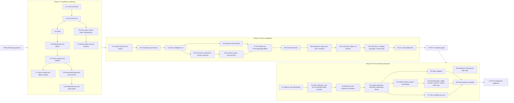

# Tattva AI Film Director — Product Roadmap (Phases C–F)

**Doc ID:** TFD-PRD-RM-001 · **Version:** 1.0-draft · **Date:** 2026-11-05 · **Status:** Phase B design — pending approval

**Inputs:**
- Master Execution Prompt §15, §24, §27, §29
- Gap Report v1.0 §13 (work packages) and §18 (delivery sequence)
- `docs/audit/01`–`10` (current state, defects, decision register)
- `PRD_v1.0.md` (requirement IDs)

---

## 1. Planning rules

1. **Dependency order beats feature appetite.** Following Gap §13, FD-V2 generation does not start until the FD-V1 package, provenance, approval, asset and task foundations are stable.
2. **Additive changes only.** Every schema change goes expand → backfill → dual-read/verify → switch → contract (`docs/audit/05` §4). No applied migration is edited or deleted. The local DB is already at WIP head `00b7cd57e036`, so G-04 is fixed forward.
3. **Protect working slices.** WF-01…WF-03 end-to-end tests (`tests/api/test_script_intelligence_slice.py`, `test_historical_research_api.py`, `test_storyboard_api.py`, `tests/workflows/test_graph_recovery.py`) must pass at every step (Master §24).
4. **Approval gates are hard stops.** An item marked **⛔ DEC-0xx** does not start implementation until that decision is approved. Design, spikes against mocks, and provider due-diligence may run in parallel (Gap §13.1).
5. **Done means §29 DoD.** A work package closes only against the Definition of Done checklist in `ACCEPTANCE_CRITERIA.md` §2. A rendered screen or a passing mock is not done.
6. **Sizing** uses S/M/L/XL. These are relative effort only, not calendar commitments. No dates are committed before DEC-028 (pilot) and team capacity are known.

### 1.1 Approval gates (from `docs/audit/10` §4, plus PRD §17)

| Gate | Decision | Blocks |
|---|---|---|
| #1 | DEC-002 Auth provider | C3 (real auth). Every FD-V1 release |
| #2 | DEC-009 Production frontend (ADR-002) | E0 (frontend build-out). FD-V2 UX freeze. TFD-SCR-012 |
| #3 | DEC-010 G-04 fix-forward | C1 |
| #4 | DEC-004 Model gateway / LLM provider | D-live (switching any generator from `mock` to `live:<model>`). TFD-RES-010 live mode |
| #5 | DEC-003 Object storage | C7 (streaming/object storage). Any media beyond text |
| #6 | DEC-012 Consent template and owner | D5 consent go-live. All performer likeness/voice storage. E6, E8 |
| #7 | DEC-013 First connected provider | E2 |
| — (blocking) | DEC-007 Retention and privacy | D5 performer data. Hard delete. E6, E8 |
| — (new) | DEC-027 Role and capability matrix | C4 (RBAC policy content; the mechanism can be built first). D2 management approval |
| — (new) | DEC-028 Pilot and thresholds | D11 pilot. FD-V1 exit thresholds |
| — (new) | DEC-029 Branches | Nothing (recommendation is to defer) |
| — | DEC-006 Higgsfield adapters | E5 video adapters |
| — | DEC-014 Post interchange | E9 beyond JSON/CSV |
| — | DEC-015 Test DB isolation | C2 |
| — | DEC-005 Queue | C6 (recommendation: keep the outbox) |
| — | DEC-001 / DEC-008 Managed PG / hosting | C11 staging, F |

---

## 2. Sequence overview

**Mapping to Gap Report §18 stages:**

| Gap stage | This roadmap |
|---|---|
| 0 Re-baseline | Phase B (this doc set) |
| 1 Protect the core | Phase C |
| 2 Complete the project truth layer | D1–D8 |
| 3 Direct the film | D9–D10 and D11 (Shot Spec and compiler) |
| 4 Complete manual loop | D11 |
| 5 Stabilise pilot | D12 + F1 |
| 6 Connect execution | E1–E2 |
| 7 Close the generation loop | E3–E9 |
| 8 Reassess finishing | FD-V3 discovery only (§7) |

---

## 3. Phase C — Foundation hardening

**Goal:** make the existing slices safe, authenticated, asynchronous, observable and version-correct, without changing their product behaviour. Master §27 Phase C names authentication, authorisation, tenant isolation, project permissions, asset storage, secure media, DB consistency, async jobs, idempotency, retries, error handling, observability, configuration, CI/CD and environment separation.

| WP | Scope | Requirements | Depends on | Gate | Size | Key current-code touchpoints |
|---|---|---|---|---|---|---|
| **C1** | Fix G-04 forward (defects G04-A…G): • declare `approved_rule_ids` and `decision_notes` in state • use `ResearchRepository.list_claims` • extend `tests/support.py::purge_organization` • route `POST /film-bible/rules` through approval • link claims by ID • supersede rather than duplicate • add the pending-status guard Then commit the WIP with regression tests | TFD-CIN-010/011/012, TFD-APR-004, TFD-VER-005 | — | ⛔ **DEC-010** (#3) | M | `packages/workflows/film_bible_synthesis/{state,graph}.py`, `packages/services/film_bible*.py`, `apps/api/routers/film_bible.py`, `tests/api/test_film_bible_api.py` |
| **C2** | Dedicated per-session test DB. CI running ruff, pytest against a Postgres service, and an `alembic upgrade head → downgrade -1 → upgrade` round trip. mypy made runnable, then burned down by package | TFD-OPS-007 | C1 (green suite) | DEC-015 (recommended) | M | `tests/conftest.py`, `pyproject.toml`, new CI config |
| **C3** | Real authentication: an `AuthProvider` port with OIDC/JWT verification in `get_actor`. Fail closed when `ENVIRONMENT` is unset. Dev fallback behind an explicit flag and bound to `default-studio` only. The UI sends a bearer token | TFD-IAM-001 | C2 | ⛔ **DEC-002** (#1) | L | `apps/api/dependencies.py`, `packages/services/identity.py::IdentityService.resolve`, `packages/core/config.py:24`, `repositories.py:69-71`, `apps/ui/api_client.py` |
| **C4** | `memberships` and `project_memberships`. Backfill from `users.role` and project creators. `role_templates`/`capabilities` with a policy check on every route and every approval resume | TFD-IAM-002/003/004/005/007/008 | C3 | Mechanism: none. Matrix content: ⛔ **DEC-027** | L | all routers; `packages/services/*` |
| **C5** | Tenant integrity: • scope `ResearchRepository.get_question/get_source` and `FilmBibleRepository.get_rule` • validate foreign IDs • add `organization_id` to `scenes`, `entities`, candidates and `project_versions` (expand + backfill) • row lock on every version bump plus unique `(project_id, version_number)` after a dedupe check • explicit approval dispatch with 422 on unknown scope • cursor pagination | TFD-IAM-009, TFD-VER-001/003, TFD-APR-002, TFD-OPS-010 | C4 | — | M | `packages/persistence/repositories.py`, `research_review.py:170`, `storyboard_review.py:151`, `film_bible_review.py:158`, `apps/api/routers/approvals.py` |
| **C6** | Async-by-default (202 + run ID; UI polls `GET /workflow-runs/{id}`). Outbox gains `lease_expires_at`, `next_attempt_at`, `max_attempts`, `dedupe_key`, `last_error_class` and `dead_lettered_at`. Lease sweeper, backoff with jitter, DLQ, cancel. Resume from checkpoint on redelivery. `Idempotency-Key` middleware. Checkpointer `setup()` runs once at startup | TFD-OPS-001/002/003/004/005 | C2 | DEC-005 (recommended: keep outbox) | L | `apps/api/schemas.py` (`sync_execution`), `apps/worker/worker.py`, `OutboxRepository.claim_next`, `packages/workflows/checkpointer.py` |
| **C7** | Secure media: • streaming upload to an S3-compatible adapter behind `StorageService` • presigned uploads and downloads • magic-byte validation and scan/quarantine states • real PDF/DOCX/FDX text extraction as derivatives (stop UTF-8 decoding) • category taxonomy and per-asset processing state | TFD-AST-001…006, TFD-AST-010 | C5 | ⛔ **DEC-003** (#5) for the S3 adapter; local adapter work can start | L | `apps/api/routers/assets.py:27`, `packages/storage/service.py:142`, `packages/services/script_review.py` |
| **C8** | Generalised approvals (`target_type/id`, target version, `approval_level`, required capability) while keeping existing scope rows. Append-only audit (DB grants or trigger). Audit taxonomy extended | TFD-APR-001/003/005, TFD-VER-002, TFD-AUD-001/002/004 | C4 | — | M | `ApprovalRequestModel`, `AuditRepository.record`, `AuditAction` |
| **C9** | Observability baseline (correlation IDs, structured logs, metrics, traces, readiness). Dockerfile per process. Environment separation. Backup plus tested restore | TFD-OPS-006/008 | C6 | DEC-008 / DEC-001 for staging only | M | `packages/core/logging.py`, `apps/api/routers/health.py` |
| **C10** | `ModelGateway` port with a deterministic mock adapter. WF-01…04 generators move behind it. Generator-mode label on runs and candidates. Structured-output validation. Shared approval-gate helper for the four graphs | TFD-AID-002/003/006 | C1, C8 | Gateway: none. Live provider: ⛔ **DEC-004** (#4) | M | `packages/workflows/*/{parser,investigator,aligner,synthesizer}.py` |

**Phase C exit:**
- All existing slice tests pass under real auth.
- A negative authorisation matrix test exists per router family.
- Worker crash and redelivery tests pass.
- CI is green.
- The UI runs against a non-development API.
- No SEC-01…SEC-08 finding remains open.

---

## 4. Phase D — FD-V1 product completion

Each work package is a full vertical slice: UI → API → authN/Z → validation → service → DB/storage → workflow → approval → canonical → audit → version → UI recovery (Master §23).

| WP | Scope | Requirements | Screens | Depends on | Gate | Size |
|---|---|---|---|---|---|---|
| **D1** | Project formats, templates and output profiles. Production mode at project level, with the override columns added now (nullable) on scenes, plus sequences, characters and shots when those tables arrive. Episodic structure. Project update and archive. Project Settings | TFD-PRJ-001…004, TFD-PRJ-007, TFD-FMT-001…004 | S-GLB-02, S-PRJ-01, S-PRJ-02, S-TEAM-02 | C4 | DEC-028 (template default values, not the mechanism) | M |
| **D2** | **Screenplay governance:** • `screenplay_versions`, `screenplay_changes`, `screenplay_suggestions`, `creative_decisions`, `impact_analyses` • lock, suggestions workspace, director revision with diff and justification, management approval • backfill of existing script assets (confirmed by the owner) WF-01 retargeted to read `screenplay_version_id` | TFD-SCR-001…011, TFD-APR-007 | S-SCR-01…04, S-APR-01/02 | D1, C8 | ⛔ **DEC-027** (management authority) | XL |
| **D3** | Story intelligence v2: • verbatim `dialogue_segments` • Fountain/FDX/PDF parsers and non-uppercase cues • golden screenplay set in CI • entity resolution into `characters`/`locations` with legacy links • Story Brain states | TFD-STY-001…007, TFD-SCR-009 | S-SCR-02, S-BRN-01/02 | D2, C7 | Live AI extraction: ⛔ DEC-004 | L |
| **D4** | Research hardening: • manual writes through approval • locators • historical brief • `timeline_events` with uncertain dates • temporal visual profiles • anachronism flags | TFD-RES-001…009 (010 live: ⛔ DEC-004) | S-RES-01…05 | C5, D3 | — | L |
| **D5** | Characters and people: • `characters`, `character_versions`, identity/facial/performance profiles, provenance envelope, `character_states` • `performers`, `performer_consents` (purposes, revocation) • `physical_identity_profiles`, `body_measurements` with labelling rules • sensitive-reference permission • avatar specification drafts | TFD-CHR-001…009, TFD-CNS-001…005, TFD-PHY-001…004, TFD-PHY-006, TFD-IAM-007, TFD-DH-010 | S-CHR-01/02, S-DH-01, S-PHY-01 | D3 | Fictional characters: none. **Any real-performer data: ⛔ DEC-012 (#6) + DEC-007** | XL |
| **D6** | World Bibles: `costumes`/`costume_states`, `props`/`prop_states` (kind prop or weapon), `locations`/`environment_profiles`/`environment_states`, legacy location links | TFD-CST-001…003, TFD-PRP-001…003, TFD-ENV-001…004 | S-CST-01/02, S-ENV-01 | D5 | — | L |
| **D7** | Film Bible generalised (from fixed C1) plus Visual Language Profile. Cinematography Bible (camera, lens and lighting profiles; composition rules; virtual camera profile) | TFD-CIN-005/006/010…013 | S-BIB-01/02, S-CIN-01 | C1, D4, D6 | — | M |
| **D8** | Context Resolver (`context_packages`, hashing, included/excluded, staleness). WF-01…04 consume packages | TFD-CTX-001…004 | context inspector panel on all studios | D7 | — | L |
| **D9** | Storyboard image/PDF ingestion and many-to-many mapping. `sequences`, scene planning, `shots` with `production_method`, `camera_spec` (physical/virtual, origin), cinematography recommendations, mode inheritance and conflict findings, panel → shot conversion | TFD-SB-001/003/004, TFD-SEQ-001/002, TFD-SHT-001/002/004/005/006, TFD-CIN-001…004, TFD-PRJ-005/006 | S-SB-01/02, S-SEQ-01/02, S-SHT-01, S-MTH-01 | D8 | Live recommendations: ⛔ DEC-004 | XL |
| **D10** | Continuity (rules, nine dimensions, nine-state model, findings with coverage, decisions). Generic impact analysis. AI Director review | TFD-CON-001…006, TFD-CON-008, TFD-AID-001/004/005/007 | S-CON-01…03, S-AID-01 | D9 | — | XL |
| **D11** | Provider-neutral Shot Spec schema. Prompt compiler. Immutable `production_packages`. Manual-target registry entries. Manual export (copy, JSON/Markdown, ZIP). Manual import, mapping, human inspection checklist, disposition, revision. Project archive export | TFD-SHT-003, TFD-PKG-001…007 (006 at P1), TFD-INT-001/003/004/006, TFD-OUT-001/002/004/005/006, TFD-POST-004 | S-PKG-01…03, S-REG-01, S-EXE-01/02, S-OUT-01, S-PST-01 (archive) | D10 | Consent gate active: ⛔ DEC-012 if performer refs exist | XL |
| **D12** | FD-V1 pilot stabilisation: • real-bundle pilot • golden-set evaluation reports • UI states and accessibility pass • Task Centre • notifications • approvals inbox • performance baselines • runbooks • training | TFD-OPS-005/009, TFD-APR-006, TFD-AUD-003 | S-OPS-01, S-APR-01/03, S-GLB-01 | D11 | ⛔ **DEC-028** | L |

**Parallelism allowed inside Phase D:**
- D4 can run alongside D5 and D6 once D3 lands.
- Golden datasets (TFD-AID-005, TFD-STY-007) are assembled from D2 onwards.
- Provider due-diligence for Phase E (register entries, terms review) runs throughout D with no production credentials (Gap §13.1).

**D-live (cross-cutting, ⛔ DEC-004):** once the provider is chosen, each generator (WF-01 extraction, WF-02 research, WF-04 synthesis, D9 recommendations, D10 AI Director) switches from `mock` to `live:<model>` one at a time. Each switch has to pass its golden-set threshold. The mode label shows in the UI from C10 onwards.

---

## 5. F1 — FD-V1 readiness gate (Phase F applied to V1)

Master Phase F activities are run at FD-V1 scope before any FD-V2 connected work goes to users:
- security assessment (threat model from `docs/engineering/SECURITY_THREAT_MODEL.md`, authorisation matrix, upload abuse, prompt injection)
- regression suite
- load test of intake and workflow queue at the DEC-028 pilot scale
- backup and restore verification
- deployment rehearsal on staging (DEC-001, DEC-008)
- monitoring and alerts
- incident runbooks
- release checklist

**Exit:** the FD-V1 exit criteria in PRD §13.1 are met with evidence attached.

---

## 6. Phase E — FD-V2 external production

| WP | Scope | Requirements | Screens | Depends on | Gate | Size |
|---|---|---|---|---|---|---|
| **E0** | Production frontend build-out for media-heavy screens (storyboard board, A/B compare, timeline-like shot strips, realtime job status). The API stays the contract | TFD-SCR-012 and the UX of all FD-V2 screens | all FD-V2 screens | F1 | ⛔ **DEC-009** (#2), ADR-002 | XL |
| **E1** | Connected registry: `providers`, `provider_capability_snapshots`, `provider_connections` (org-scoped, secret store). Onboarding gate record. Terms flags (`automation_permitted`). Webhook verification framework | TFD-INT-003 (connected), TFD-INT-005/006/007/009/010 | S-REG-01/02 | F1 | DEC-006 for Higgsfield entries | L |
| **E2** | `generation_jobs`, `generation_attempts`, `generation_cost_records`. Cost approval and budgets. Unknown-outcome reconciliation. Manual/connected parity. **First connected image provider pilot** | TFD-GEN-001…004, TFD-GEN-008/009, TFD-INT-002/008, TFD-IAM-006, TFD-CNS-007/008 | S-EXE-01, S-PKG-03 | E1 | ⛔ **DEC-013** (#7) | XL |
| **E3** | Character, environment and costume/prop reference generation. Keyframes. Tool recommendation with snapshots and evaluation history | TFD-GEN-005/006/010/011, TFD-PKG-006 (P0 in V2) | S-CHR-01, S-ENV-01, S-CST-01/02, S-PKG-02 | E2 | Performer-derived references: ⛔ DEC-012 | L |
| **E4** | AI-assisted output inspection. Continuity comparison. Production asset library and lineage. Media derivatives at P0 (proxies, frames, waveform) | TFD-OUT-002 (V2), TFD-CON-007, TFD-LIB-001/002, TFD-AST-007 | S-OUT-01, S-LIB-01 | E2, C7 | Live inspection models: ⛔ DEC-004 | L |
| **E5** | Video generation adapters. Higgsfield API and MCP as **separate** adapters after contract verification; others only after onboarding | TFD-GEN-007, TFD-INT-002/010 | S-PKG-03, S-EXE-01 | E4 | ⛔ DEC-006, DEC-013 per provider | L per adapter |
| **E6** | Hybrid production: capture plans, manifests, independent footage ingestion and analysis, actual camera metadata | TFD-HYB-001…005 | S-CAP-01/02 | E4 | Performer footage: ⛔ DEC-012 + DEC-007 | XL |
| **E7** | Voice: original recordings and takes, voice profiles, consent enforcement, localised scripts, dubbing and lip-sync (manual first), dialogue comparison | TFD-VOC-001…007 | S-VOC-01/02 | E4, D3 | Voice clone / generated speech: ⛔ DEC-012 | XL |
| **E8** | Digital humans: digital double, fictional avatar, combination, performance-preserving transformation (with inspection against source), reusable digital humans, AI anchors, mocap handoff, body-scan import and AI estimation, cross-project reuse | TFD-DH-001…009, TFD-OUT-003, TFD-PHY-005/007, TFD-LIB-003 | S-DH-02, S-PHY-01, S-LIB-02 | E6 | ⛔ **DEC-012 (#6) + DEC-007** | XL |
| **E9** | Post-production handoff package (JSON/CSV manifests + media folders). Editorial notes. Validation with a real post team in Resolve and/or Premiere before claiming any other format | TFD-POST-001…003 | S-PST-01 | E5, E7, E8 | DEC-014 | M |

**Parallelism allowed:**
- E6 and E7 can run in parallel after E4.
- E5 adapters are added one at a time, each behind its own provider gate.
- Manual execution stays operational throughout (TFD-INT-008). A regression test runs every FD-V2 workflow with all connectors disabled.

---

## 7. F2 — Production readiness (Phase F)

Master §27 Phase F at FD-V2 scope:
- security assessment, including provider credential lifecycle, webhook spoofing, consent bypass and cost-gate bypass
- full regression
- load, stress and soak tests (job queue, media upload, provider rate limits)
- performance tuning
- backup and restore plus DR test
- deployment rehearsal
- monitoring and alerts (cost anomalies, unknown-outcome rate, DLQ depth)
- incident runbooks, including provider-incident runbooks
- release checklist (`docs/release/RELEASE_READINESS_CHECKLIST.md`)

**Exit:** the FD-V2 exit criteria in PRD §13.2 are met.

---

## 8. FD-V3 — Deferred

Not scheduled:
- NLE, advanced VFX/compositing, grading, mixing/mastering
- native final render, automatic final cut
- distribution, automated delivery and mastering

Gap stage 8 allows **discovery only**, which needs a separate product case and an investment decision. Branch/alternative-canon support (DEC-029) is evaluated in the same discovery.

---

## 9. Requirement coverage by work package

| Area | Work packages |
|---|---|
| PRJ | D1 (001–004, 007), D9 (005, 006) |
| FMT | D1 |
| IAM | C3, C4, C5, D5 (007), E2 (006) |
| AST | C7 (001–006, 010), E4 (007), D12 or later (008, 009 as P1/P2) |
| SCR | D2, E0 (012) |
| STY | D3 |
| RES | D4, D-live (010) |
| CHR | D5 |
| PHY | D5 (001–004, 006), E8 (005, 007) |
| DH | D5 (010), E8 |
| CNS | D5 (001–005), E2 (007, 008), E8 (006) |
| CST, PRP, ENV | D6 |
| SB | D9 (001, 003, 004); SB-002 already exists |
| CIN | C1 (010–012), D7 (005, 006, 013), D9 (001–004) |
| SEQ, SHT | D9; D11 (SHT-003) |
| CON | D10, E4 (007) |
| CTX | D8 |
| AID | C10 (002, 003, 006), D10 (001, 004, 005, 007) |
| PKG | D11, E3 (006 V2) |
| INT | D11 (001, 003, 004, 006), E1, E2, E5 |
| GEN | E2, E3, E5 |
| HYB | E6 |
| OUT | D11, E4, E8 (003) |
| LIB | E4, E8 (003) |
| VOC | E7 (VOC-001 planning field in D5) |
| POST | D11 (004), E9 |
| APR | C5 (002), C8, D2 (007), D12 (006), C1 (004) |
| VER | C5, C8, C1 (005) |
| AUD | C8, D12 (003) |
| OPS | C2, C5, C6, C9, D12 |

**Open risks to the sequence:**
1. DEC-027 delays block D2, the largest FD-V1 differentiator. **Mitigation:** build the mechanism in C4 against a provisional matrix flagged `provisional`.
2. DEC-012/DEC-007 delays block D5 for real performers. **Mitigation:** fictional characters proceed; performer uploads are refused with a clear message.
3. DEC-009 unresolved by the end of D blocks E0. **Mitigation:** FD-V2 API work proceeds; Streamlit hosts interim review screens marked "alpha".
