# Tattva AI Film Director — Revised User Journeys

**Doc ID:** TFD-PRD-UJ-001 · **Version:** 1.0-draft · **Date:** 2026-11-05 · **Status:** Phase B design — pending approval

**Inputs:**
- Master Execution Prompt §4–§14, specifically the §13 sixteen-stage lifecycle
- Gap Report §8 (journeys, plus the interruption and recovery rules in §8.3)
- IA v1.0 §9 (journeys UJ-01…UJ-11)
- `PRD_v1.0.md`
- `INFORMATION_ARCHITECTURE.md`
- `SCREEN_INVENTORY_AND_BEHAVIOUR.md`

**Supersedes:** PRD v0.9 §10 (Journeys A–J) and IA v1.0 §9 (UJ-01…11) as the journey baseline. The older journeys remain valid as entry-path examples. Their concepts are mapped in §8.

**CURRENT vs TARGET:** today only fragments of stages 1–4 and 7 exist, all through deterministic or mocked generators:
- project create and text upload (`routers/projects.py`, `routers/assets.py`)
- WF-01 scene and entity extraction
- WF-02 mocked research
- WF-03 text-brief storyboard
- WF-04 (BROKEN)
- single-tier approval (`routers/approvals.py`)

Every journey below describes **TARGET** behaviour. A **CURRENT** note marks each step that has an as-built counterpart.

---

## 1. The 16-stage lifecycle

The lifecycle is **flexible, not a wizard**. Users can enter at any stage with existing scripts, references, research or footage. Each stage writes to the shared Project Intelligence Layer, so nothing is re-explained downstream.

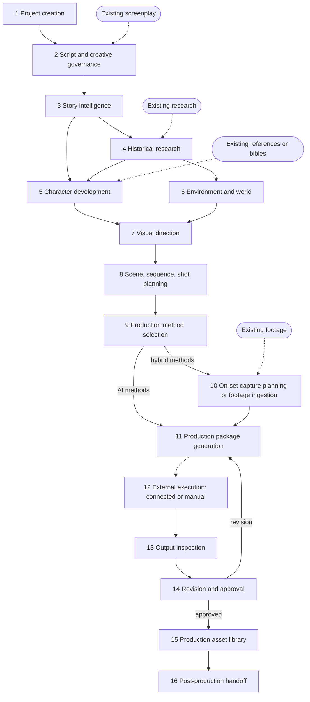

| Stage | Master §13 content | Screens | Key requirements | Release |
|---|---|---|---|---|
| 1 | Format, genre, mode, quality profile, scale, team, delivery | S-GLB-02, S-PRJ-02, S-TEAM-02 | TFD-PRJ-001/003, TFD-FMT-001 | FD-V1 |
| 2 | Import or create; identify approved version; lock; suggestions apart | S-SCR-01/03/04 | TFD-SCR-001…008 | FD-V1 |
| 3 | Narrative, scenes, characters, dialogue, sequences, historical needs, story timeline, relationships | S-SCR-02, S-BRN-01/02 | TFD-STY-001…006 | FD-V1 |
| 4 | Events, evidence, sources, timeline, architecture, geography, costume, weapons, culture; fact ≠ interpretation ≠ dramatisation | S-RES-01…05 | TFD-RES-* | FD-V1 |
| 5 | Identity, profile, face, physical, measurements, costume, props, movement, performance, voice, timeline state | S-CHR-01/02, S-PHY-01, S-DH-01, S-CST-01/02 | TFD-CHR-*, PHY-*, CNS-*, CST-*, PRP-* | FD-V1 |
| 6 | Locations, architecture, interiors/exteriors, geography, terrain, weather, lighting, materials, background, accuracy, continuity | S-ENV-01 | TFD-ENV-* | FD-V1 |
| 7 | Film Bible, Visual Language, Cinematography Bible, camera/lens library, lighting, colour, references | S-BIB-01/02, S-CIN-01 | TFD-CIN-005/010…013 | FD-V1 |
| 8 | Intention, sequence, shot list, composition, lens, movement, duration, states, references, method | S-SEQ-01/02, S-SHT-01, S-SB-01/02 | TFD-SEQ-*, SHT-*, CIN-001…004 | FD-V1 |
| 9 | Fully AI / live-action chroma / transformation / digital human / combined, per shot | S-MTH-01, S-SHT-01 | TFD-SHT-002, PRJ-004/005 | FD-V1 |
| 10 | Capture requirements, or independent footage ingestion | S-CAP-01/02 | TFD-HYB-* | FD-V2 |
| 11 | Provider-neutral Shot Spec and model-specific package | S-PKG-01…03 | TFD-SHT-003, PKG-* | FD-V1 |
| 12 | Connected or manual | S-PKG-03, S-EXE-01 | TFD-INT-*, GEN-* | FD-V1 manual; FD-V2 connected |
| 13 | Identity, face, body, movement, costume, environment, lighting, composition, camera, lip-sync, artifacts, continuity, quality | S-EXE-02, S-OUT-01, S-CON-01 | TFD-OUT-001/002, CON-007 | FD-V1 human; FD-V2 AI-assisted |
| 14 | Findings; accept, reject or request change; track revisions | S-OUT-01, S-APR-02 | TFD-OUT-004/005 | FD-V1 |
| 15 | Images, keyframes, videos, audio, digital humans, motion, environments, shot outputs | S-LIB-01 | TFD-LIB-* | FD-V2 |
| 16 | Organised footage and metadata for external editing | S-PST-01 | TFD-POST-* | FD-V2 (archive export in FD-V1) |

---

## 2. Global interruption and recovery rules

These rules apply to every journey. They extend Gap §8.3 and IA v1.0 §16.

| ID | Interruption | Required behaviour | Requirement |
|---|---|---|---|
| R-01 | One file in a batch fails | Keep its failure record. Every other file continues. The project never shows a misleading "all failed" state | TFD-AST-005 |
| R-02 | AI workflow fails mid-run, or a worker crashes | Prior versions and inputs are preserved. The lease expires and the task is re-claimed. It resumes from the LangGraph checkpoint, not from START. No duplicate candidates are created | TFD-OPS-002/003 |
| R-03 | A canonical version changes while a task runs | The result is marked `stale`. Committing it requires compare and rebase (409 on approve with an old `target_version`) | TFD-APR-003, CTX-003 |
| R-04 | An upstream approved item changes (character, state, location, rule, screenplay, mode) | Downstream packages become `stale`. Approved shots become `review_required` through an impact analysis. Nothing is re-planned automatically | TFD-CON-008, PKG-004 |
| R-05 | A connected submit times out after the provider may have accepted it | The job moves to `unknown_outcome`. It is reconciled by provider request ID or account history before any retry. No automatic duplicate submission | TFD-GEN-003 |
| R-06 | A provider is disconnected, disallowed or down | The same package version stays executable in MANUAL mode. A failed connected submit is never silently duplicated by a manual run | TFD-INT-008 |
| R-07 | Consent is missing, expired or revoked | The gated action is blocked and the block names the missing purpose. Dependent items are flagged. Audit history is kept | TFD-CNS-003/004 |
| R-08 | The session expires mid-edit | Re-authenticate and restore from durable state. Unsaved local edits are offered back. Nothing commits after expiry | STD-RECOVER |
| R-09 | The user lacks a capability | An action-specific block with a request-access path. No data leaks; 404 is returned for objects the user cannot see | TFD-IAM-004 |
| R-10 | A user requests a revision | The old output and package are kept. A new package version and job are created. The disposition and reason are recorded | TFD-OUT-005 |
| R-11 | An AI output fails schema validation | It is rejected and recorded on the run. No candidate is persisted. The user can retry | TFD-AID-003 |
| R-12 | The generator is a mock | The mock label shows on the run, its candidates and the screen. Nothing implies real intelligence | TFD-AID-006 |

---

## 3. Journey (a) — Fully AI feature film

**Persona:** Director (with Story lead, Art lead, Production operator)

**Project:**
- format: Feature film
- mode: `fully_ai`
- delivery profiles: 2.39:1 master, plus a 9:16 trailer cut-down

**Entry:** an existing screenplay draft.

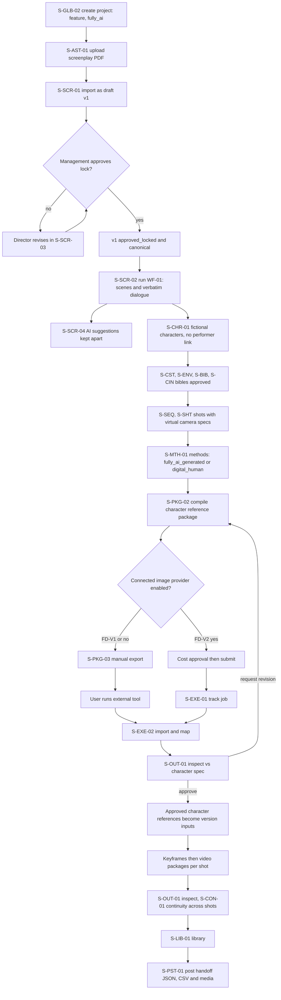

**Stage walkthrough:**

| Stage | What happens | Persistent result | CURRENT |
|---|---|---|---|
| 1 | Producer picks "Feature film", mode `fully_ai`, quality profile "cinematic", two output profiles | `projects` with template and mode; `output_profiles` | Partial: title/logline/genre only |
| 2 | PDF imported. Management locks v1. Director requests AI pacing suggestions; they stay in the Suggestions Workspace | `screenplay_versions` v1 `approved_locked`; `screenplay_suggestions` | None |
| 3 | WF-01 extracts 118 scenes, dialogue and 14 characters from v1 | `scenes`, `dialogue_segments`, `characters` | WF-01 extracts scenes and uppercase cues from asset bytes; deterministic |
| 4 | Skipped. The film is contemporary fiction. Research screens stay reachable but unused | — | — |
| 5 | Characters are fictional, so no consent applies. Facial identity is defined by text spec until approved references exist | `character_identity_profiles` with provenance | None |
| 6–7 | Locations, environments, Film Bible rules, Cinematography Bible with a virtual camera profile | Bibles approved | Film Bible WF-04 BROKEN |
| 8–9 | Shots get `spec_kind=virtual`, with every camera value `creative_target` or `recommended`. Methods are `fully_ai_generated`; the crowd uses `digital_human` | `shots` | None |
| 11 | Character reference package compiled for a manual image target (or a verified provider in FD-V2) | `production_packages` (hash, references, context hash) | None |
| 12 | FD-V1: manual export and external run. FD-V2: connected submit after cost approval | export record or `generation_jobs` | None |
| 13–14 | Inspector checks identity against the spec. The Director requests one revision, then approves | `output_reviews`, new package v2, approved output | None |
| 15–16 | Approved keyframes and videos organised per shot. Post handoff manifest produced | library; handoff package | None |

**Interruptions specific to (a):**

| Situation | Behaviour |
|---|---|
| A character's costume is changed after 40 video packages were compiled | R-04: the 40 packages go `stale`. S-CON-03 lists them. Each recompiles on demand. Earlier outputs remain in the library with their original lineage |
| The Director wants to adopt an AI-suggested new scene | The suggestion is accepted for revision, then goes through journey (d). The suggestion never alters v1 |
| The video provider changes its schema (FD-V2) | The connection moves to `schema_changed`. Submits are blocked until the snapshot is re-approved. Manual export remains available (R-06) |

---

## 4. Journey (b) — Hybrid chroma historical series

**Persona:** Showrunner/Director, Researcher, Consent manager, On-set/VFX supervisor, DH lead

**Project:**
- format: Episodic historical series (8 episodes)
- mode: `hybrid_live_action`
- real actors are shot on green screen, then transformed into historically accurate characters inside AI-generated Mauryan-era environments

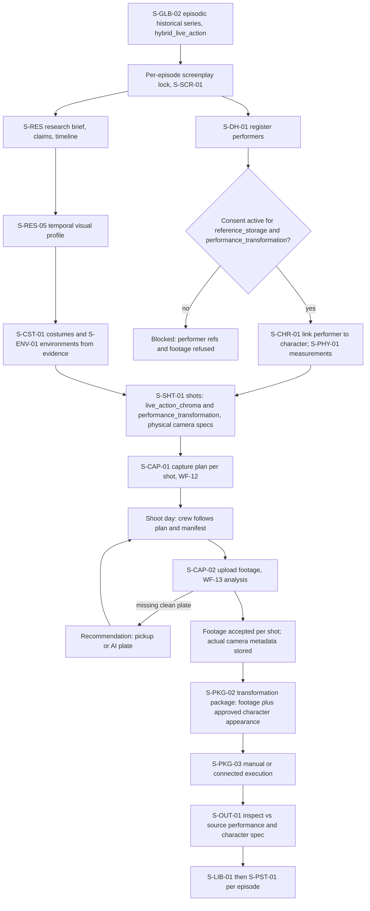

**Sequence: capture to transformation output**

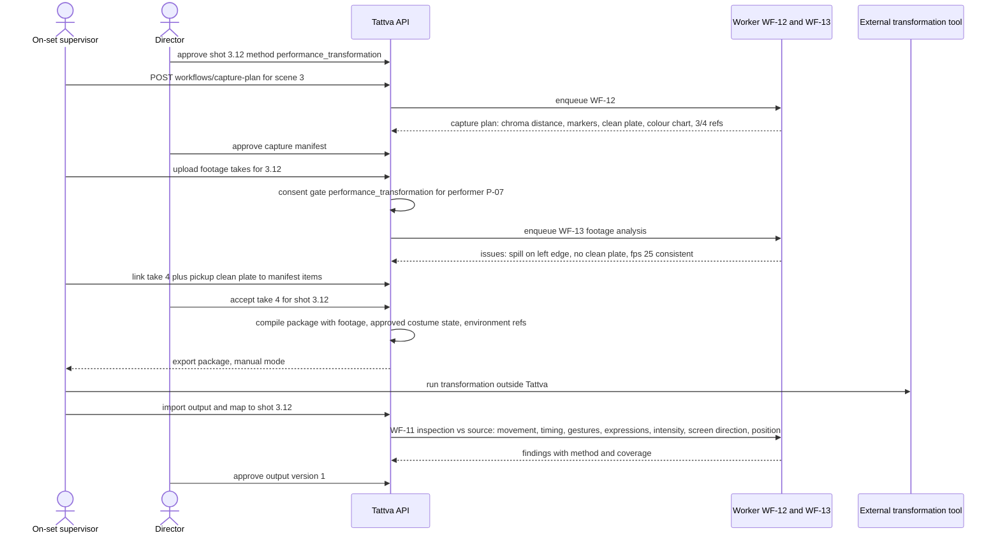

**Stage notes:**
- **Stage 1:** the episode structure is created. Characters, digital humans and locations are series-scoped; screenplay, shots and capture are episode-scoped (IA §4.2).
- **Stage 4:** claims are typed. Costume details from `historical_interpretation` claims are labelled as such in S-CST-01. Any `creative_dramatization` choice is recorded as a `creative_decision`.
- **Stage 5:** measurements entered by the costume department are `verified` only with a calibrated method. Values estimated from photos stay `estimated`.
- **Stage 7:** physical camera package (manufacturer, sensor, lens series) is defined in S-CIN-01. Shot specs use `metadata_origin=creative_target` until footage arrives, then `actual` from the footage metadata (TFD-HYB-005).
- **Release:** stages 10, 12-connected and 13 (AI-assisted) are FD-V2. In FD-V1 the series is fully planned (stages 1–9, 11), and hybrid shots carry their method ready for capture.

**Interruptions specific to (b):**

| Situation | Behaviour |
|---|---|
| DEC-012/DEC-007 not yet approved | Performer registry and consent screens show "storage disabled pending policy". Planning continues with fictional character specs only. Footage upload of performers is refused with an explanation (R-07) |
| Footage analysis cannot assess tracking adequacy (no model available) | The check is shown as "not assessed (no method)", never "pass" (S-CAP-02) |
| Episode 3 screenplay revised after shooting | Journey (d). The impact analysis lists captured footage and manifests for changed scenes as `review_required`. Footage is never deleted |
| Performer revokes consent mid-season | Journey (f) |

---

## 5. Journey (c) — Mixed mode within one sequence

**Persona:** Director, Cinematographer

**Project:** feature film, mode `mixed`.

**Sequence SQ-07, "The river crossing":**

| Shot | Content | Production method | Notes |
|---|---|---|---|
| 07.01 | Wide establishing shot of the river at dusk | `fully_ai_generated` | Virtual camera |
| 07.02 | Lead actor dialogue | `live_action_chroma` | Physical camera |
| 07.03 | Crowd of soldiers | `digital_human` | Reusable digital humans |
| 07.04 | Lead actor's stunt | `performance_transformation` | Stunt double footage transformed to the lead's approved appearance |
| 07.05 | Close-up | `combined` | Live face plate plus AI armour and environment |

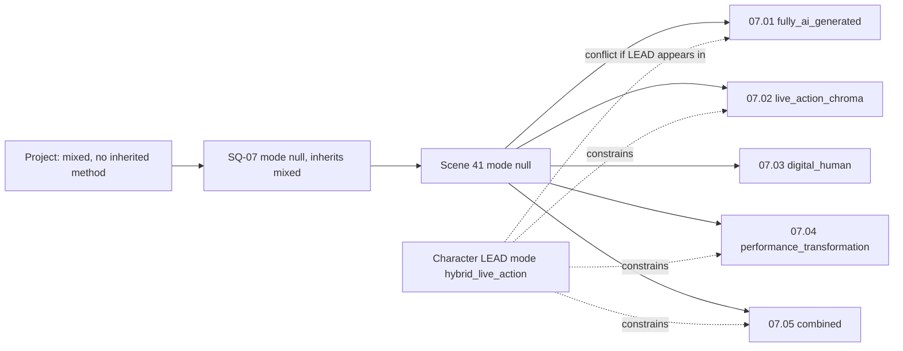

**Steps:**
1. **S-MTH-01:** the Director sees that SQ-07 inherits `mixed`, which means no default method. Each shot must set one, and packaging is blocked until it does (TFD-SHT-002).
2. **S-SHT-01:** the Director sets each method. Shot 07.01 is a wide shot showing the lead's silhouette, but LEAD's character mode is `hybrid_live_action`, so Tattva raises a `mode_conflict` (TFD-PRJ-005). The Director resolves it with a shot-level `creative_decision` ("silhouette only; AI double acceptable at this distance"), and the rationale is recorded.
3. **S-CIN-01 / S-SHT-01:** shots 07.02, 07.04 and 07.05 use the physical camera package. Shots 07.01 and 07.03 use the virtual camera profile, which is **matched to the physical lens look** (focal length equivalence, DoF, colour response) so the cut is seamless. Each value carries `spec_kind` and `metadata_origin`.
4. **S-CON-01:** continuity rules for dimensions `cinematography` (screen direction, lighting direction, colour profile), `environment` (time of day dusk, weather), `costume` and `character_identity` apply **across all five shots regardless of method** (TFD-CON-004).
5. **Execution:**
   - 07.02, 07.04 and 07.05 follow journey (b) capture and transformation.
   - 07.01 and 07.03 follow journey (a) packages.
   - All outputs land on the same sequence.
6. **S-OUT-01 + S-CON-01:** a cross-shot continuity check flags that the light direction in 07.01 (AI) conflicts with the actual lighting in the 07.02 footage. The Director chooses "request correction" on 07.01, which creates a new package version. The real footage is never altered.

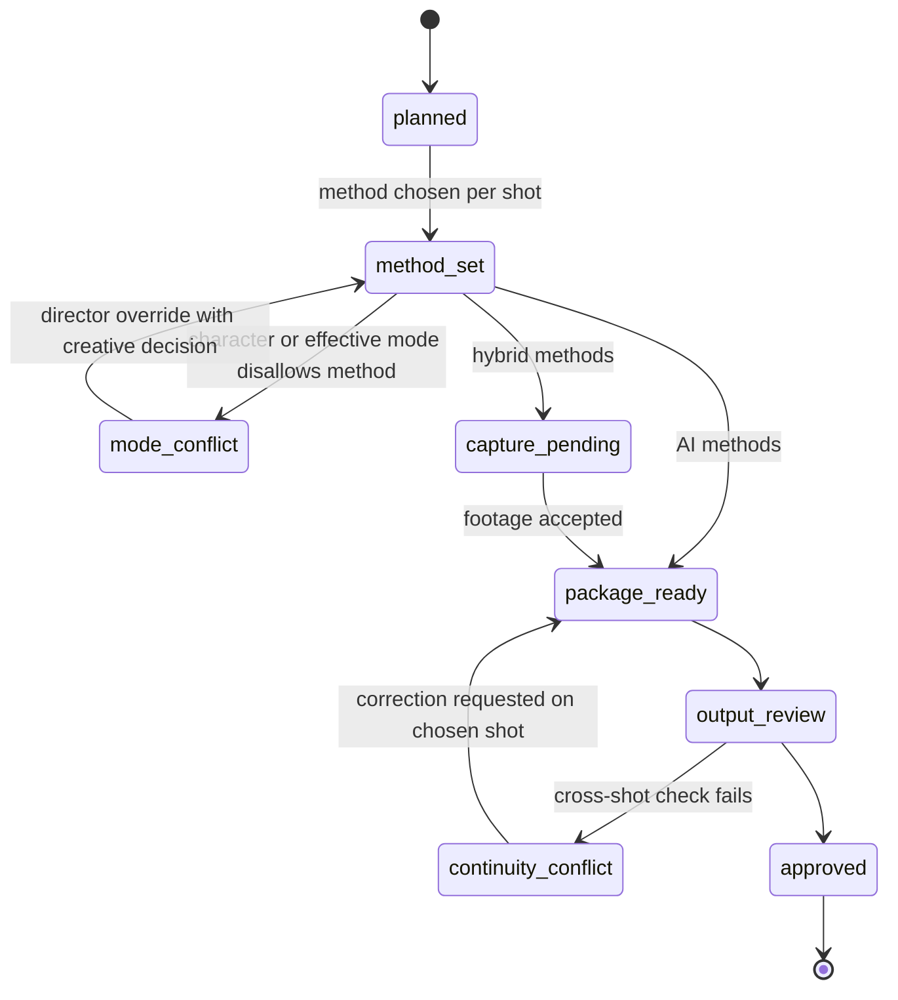

**Interruptions specific to (c):**

| Situation | Behaviour |
|---|---|
| The project mode is changed from `mixed` to `fully_ai` | S-PRJ-02 shows an impact preview. Shots 07.02/04/05 now fall outside the allowed set for the new effective mode and are flagged `mode_conflict` and `review_required`. They are not changed (TFD-PRJ-006) |
| The live-action shoot for 07.02 is cancelled | The Director switches 07.02 to `digital_human`. The old capture plan is retained as superseded, and a new package is compiled. The continuity rules are unchanged |

---

## 6. Journey (d) — Director-led screenplay revision with management approval and impact analysis

**Persona:** Director (author), Management approver (decision), Producer (impact owner)

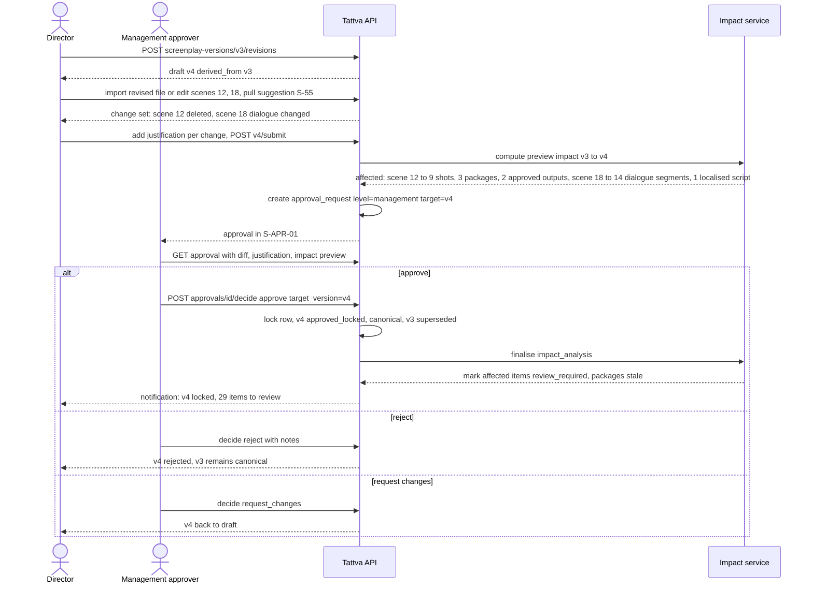

**Rules applied:**
1. The Director can **never** approve their own revision unless they also hold `screenplay.approve_lock`. Even then, a policy flag under DEC-027 can require a second approver.
2. A suggestion pulled from S-SCR-04 is copied into the draft change set. The suggestion record is updated to `accepted_for_revision` and linked to v4.
3. **No automatic propagation:**
   - Shots of the deleted scene 12 are not deleted. They become `review_required`, and the Producer decides to retire or re-anchor each one.
   - Approved outputs stay approved but carry a "source scene superseded" flag.
   - Localised scripts for scene 18 become `review_required` (TFD-VOC-005).
4. Every new shot or sequence created afterwards references v4. Older ones still show v3 until they are reviewed and re-anchored (TFD-SCR-009).

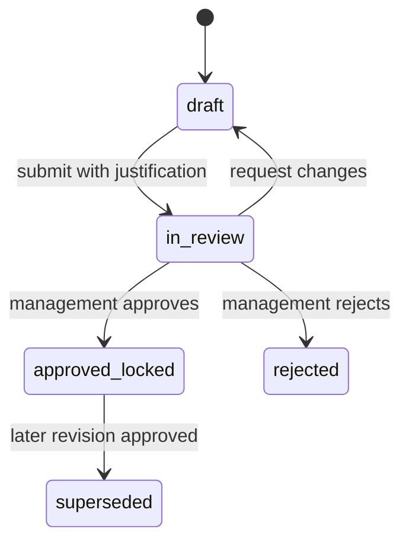

**Interruptions specific to (d):**

| Situation | Behaviour |
|---|---|
| v3 is superseded by another approved revision (v5) while v4 is in review | Approving v4 returns 409 (base no longer canonical). Management sees a "rebase required" state. The Director rebases v4 onto v5 and resubmits (R-03) |
| The impact computation fails | The approval stays possible, but the UI shows "impact not computed". Management is warned and can wait or approve. If approved, the impact is computed as a retried task, and items are marked when it completes |
| The management approver's access is revoked while pending | The approval is re-routed to remaining holders (TFD-IAM-008). If none exist, S-TEAM-02 blocks the removal (S-TEAM-02 AC-1) |
| A user tries to edit dialogue on v4 after the lock | 409 `screenplay_locked`, audited (TFD-SCR-003) |

---

## 7. Journey (e) — Manual provider handoff when the API is unavailable

**Persona:** Production operator, Producer

**Context:** FD-V2. A connected video provider is configured, but submissions fail, or a submission's outcome is unknown.

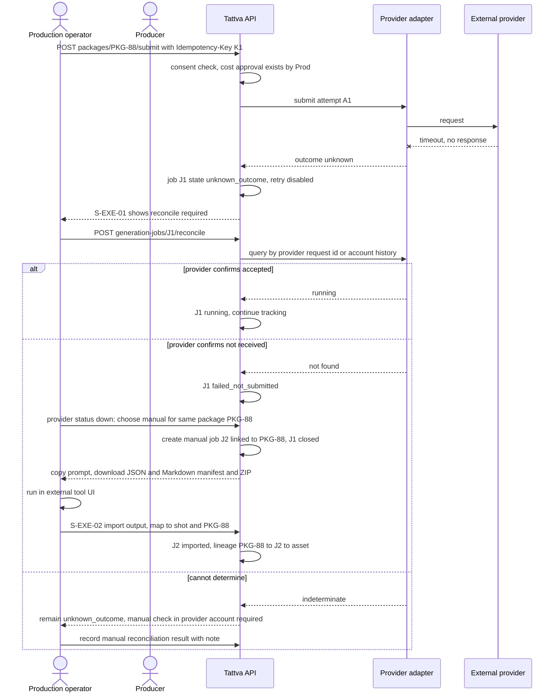

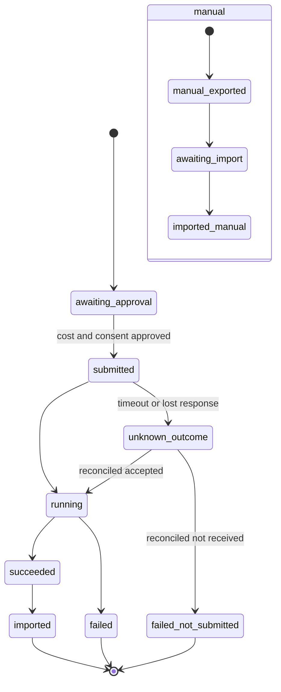

**Rules applied:**
1. **No silent fallback.** Tattva never submits the same package manually or connected a second time while the first job is `unknown_outcome` (R-05, R-06).
2. The manual job is a **new job on the same package version**. Lineage is identical in shape to a connected job (TFD-GEN-008).
3. If the provider later delivers J1's output (for example, via a webhook after reconciliation recorded "not received"), it is imported as a separate output linked to J1, and the operator is warned about possible double spend. Neither output overwrites the other.
4. In **FD-V1**, the manual path is the only path. The same screens and package are used, without any connector.
5. Midjourney-type targets (`automation_permitted=false`) only ever show the manual branch (TFD-INT-006).

**Interruptions specific to (e):**

| Situation | Behaviour |
|---|---|
| The package goes `stale` between the failure and the manual export | Export is blocked with "package stale: recompile". The new package version needs a fresh creative approval, and a cost approval if it goes connected again |
| The operator imports an output without knowing which take it is | The import stays `awaiting_mapping`. Metadata is `user_supplied`. No job ID is invented (TFD-OUT-006) |
| The budget cap is reached | Submit is blocked with the cap shown. Manual export is still allowed because Tattva incurs no spend; spend outside Tattva is the user's responsibility, and a notice says so |

---

## 8. Journey (f) — Consent revocation for a performer

**Persona:** Consent manager (Legal), Producer, Director, DH lead

**Context:** performer P-07 had active consents for `reference_storage`, `performance_transformation`, `digital_double` and `voice_clone` on the series in journey (b). P-07 revokes `digital_double` and `voice_clone`.

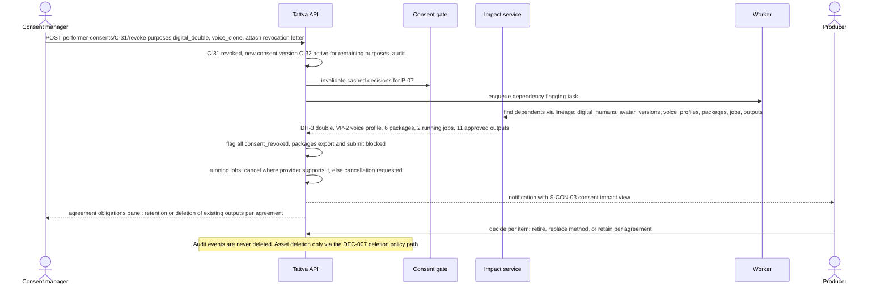

**Rules applied:**
1. **Immediate block.** From the moment of revocation, every gated action for the revoked purposes fails server-side, including requests already in flight that reach the gate later (TFD-CNS-003, TFD-CNS-007).
2. **Remaining purposes stay active.** `reference_storage` and `performance_transformation` remain valid, so the hybrid shots in journey (b) can continue.
3. **Existing outputs:**
   - They are not auto-deleted. Their handling follows the agreement's terms, which are surfaced from the consent record.
   - Deletion, where required, follows the DEC-007 retention and deletion policy and is audited.
   - Library items show `consent_revoked`, and S-PST-01 blocks them from new handoff packages unless the agreement permits use.
4. **Downstream re-planning:** shots that used DH-3 become `review_required`. The Director can switch them to `performance_transformation` (if still consented) or to a fictional `digital_human` not derived from P-07.
5. **Cross-project reuse:** any project reusing DH-3 through S-LIB-02 is flagged as well (TFD-DH-009).

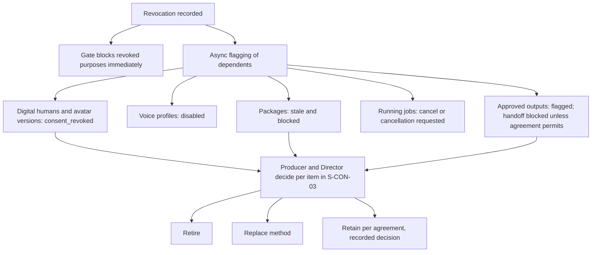

**Interruptions specific to (f):**

| Situation | Behaviour |
|---|---|
| The flagging task fails partway | The block is already in force, because the gate checks consent live and does not depend on the flags. The flagging task retries (R-02). S-CON-03 shows "dependency scan incomplete" until it finishes |
| A connected job completes after revocation | The output is imported but immediately flagged `consent_revoked`. It cannot be approved for use until Legal records a decision |
| Revocation is entered in error | It cannot be undone by editing. Legal records a new consent version (activated through consent approval), and both events remain in audit |

---

## 9. Mapping of earlier journeys

| Earlier journey | Now covered by |
|---|---|
| PRD v0.9 A (arbitrary input) / IA UJ-01, UJ-02, UJ-03 | Stage 1–3 entry paths; journey (a) |
| PRD v0.9 B (existing bundle) | Stage 1 + R-01 |
| PRD v0.9 C (Kalinga history) / IA UJ-04 | Journey (b), stage 4 |
| PRD v0.9 D (storyboard) / IA UJ-05 | Stage 8 (S-SB-01/02) |
| PRD v0.9 E (character/costume) / IA UJ-06 | Journeys (a) and (b), stage 5 |
| PRD v0.9 F (reference video) | S-AST-03 (P1) |
| PRD v0.9 G (Higgsfield handoff) / IA UJ-08 | Journeys (a) and (e), provider-neutral |
| PRD v0.9 H (import and inspect) / IA UJ-09 | Stages 13–14; journey (e) |
| PRD v0.9 I (change impact) / IA UJ-10 | Journey (d), plus R-04 |
| PRD v0.9 J (interruptions) | §2 R-01…R-12 |
| IA UJ-07 (continuity-aware shots) | Journey (c) |
| IA UJ-11 (alternative direction without changing canon) | Suggestions Workspace + draft revisions. Branches deferred (DEC-029) |
