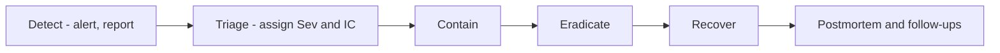

# Incident Response Runbook

**Doc ID:** TFD-REL-004 · **Version:** 1.0-draft · **Date:** 2026-11-05 · **Status:** Phase B design — pending approval
**Inputs:** `docs/engineering/SECURITY_THREAT_MODEL.md`, `OBSERVABILITY_AND_MONITORING.md` §4, `DATA_PRIVACY_AND_RETENTION.md`, `BACKUP_AND_DISASTER_RECOVERY.md`, `COST_AND_CAPACITY_MODEL.md` §4 · ADR-005, ADR-006 · `PRODUCTION_OPERATIONS_RUNBOOK.md`

> Notification deadlines to regulators and data subjects are legal obligations that depend on jurisdiction and contract. They are **OPEN — DEC-007 / DEC-012**. This runbook names the trigger and the owner, not the legal deadline.

---

## 1. Severity levels

| Sev | Definition (Tattva-specific) | Examples | Response | Update cadence |
|---|---|---|---|---|
| **SEV-1** | Harm to people or a breach of trust boundaries, or total outage | Cross-tenant data exposure; C4 (face, voice, body) data exposed or used without consent; credential leak with evidence of use; canonical locked screenplay altered without approval; complete outage during pilot hours | Immediate, all hands; Incident Commander (IC) within 15 min | 30 min |
| **SEV-2** | Major degradation, or a contained security or financial event | API availability below SLO for > 30 min; workers not draining > 30 min; storage `missing_object` drift; provider overspend past budget; leaked credential with no evidence of use | IC within 30 min (support hours, per DEC-026) | 1 h |
| **SEV-3** | Partial degradation with a workaround | One workflow type failing; DLQ growth; one provider down (manual mode works) | Next business hour | Daily |
| **SEV-4** | Cosmetic or low risk | UI glitch; dashboard gap | Backlog | — |

Rule: **any suspected consent or likeness incident starts as SEV-1** until triage downgrades it.

## 2. Roles

| Role | Responsibility |
|---|---|
| Incident Commander (IC) | Owns the incident; decides severity, containment and comms; keeps the timeline |
| Ops lead | Hands-on mitigation: flags, scaling, restores, DB |
| Security lead | Forensics, credential rotation, evidence preservation (SEV-1 security) |
| Product owner | Customer impact assessment; customer comms content |
| Legal owner (DEC-012) | Consent and likeness incidents; regulatory and contractual notifications |
| Scribe | Timestamped log in the incident channel |

During the pilot, one person may hold several roles, but IC and Ops lead should be different people for SEV-1.

## 3. Communication

1. Open the incident channel `#inc-<yyyymmdd>-<slug>`. Post severity, IC, a one-line summary and the next update time.
2. **Internal:** updates at the Sev cadence: what we know, what we're doing, next update.
3. **Customers (pilot studios):** Product drafts and IC approves. SEV-1/SEV-2 affecting a studio: notify the studio's named contact within the support window, with facts only (no speculation and no blame).
4. **Performers:** for a consent or likeness incident, Legal decides whether and how performers or their representatives are notified (OPEN — DEC-012).
5. **Status note** on resolution. A postmortem is required for SEV-1/SEV-2 within 5 business days. It is blameless, includes a timeline and root cause, and lists actions with owners. Every security action is linked in the threat-model findings table.

## 4. General procedure

Preserve evidence before you change anything in a SEV-1 security incident: snapshot the DB, export relevant `audit_events`, retain logs and traces beyond normal retention, and keep a copy of the affected objects (versions).

## 5. Scenario playbooks

### 5.1 Consent / likeness data incident (SEV-1)

Triggers:
- C4 asset served to a user without `likeness.view` or `voice.view`.
- A provider submission containing performer-derived material without an active consent for that purpose (consent gate bypass alert, Observability §4).
- Consent revoked but a job still submitted.
- A C4 asset found in logs, staging, a golden set or an unexpected bucket.
- A report from a performer or agent.

| Step | Action |
|---|---|
| Contain | Turn off `FF_PROVIDER_*_CONNECTED` for affected providers; set the performer's consents to `suspended` (blocks all gated purposes); revoke presigned URLs by rotating the C4 bucket access role or key; disable the affected user accounts if misuse is suspected |
| Scope | Query `audit_events` for `likeness_asset_viewed`, `package_exported`, `provider_submit` involving the performer's assets; collect `generation_attempts` with provider job IDs; list downloads of packages containing C4 (watermark IDs) |
| Provider side | Ask each provider involved to delete the inputs and outputs, through their documented process (UNVERIFIED per provider; record the outcome) |
| Derived assets | Flag `consent_revoked` / `incident_hold`; do not delete before Legal decides (evidence) |
| Notify | Legal decides on performer, customer and regulator notification (OPEN — DEC-007/012) |
| Fix | Root-cause the gate failure; add a regression test to the consent-policy suite; re-run V2-G06 |

### 5.2 Credential leak

Covers DB credentials, provider API keys (platform or per-org), the OIDC client secret, KMS access, and the CI or cloud deploy identity.

| Step | Action |
|---|---|
| Contain | **Rotate immediately** (DevOps §7): issue new, roll pods, revoke old. Per-org provider credentials: revoke at the provider console and mark the `provider_connections` row `revoked`; notify the org admin. CI/cloud: disable the federated role trust, review recent deployments |
| Assess use | Provider: review the provider's usage console and Tattva `usage_records` / `generation_attempts` for unexpected jobs. DB: `pg_stat_activity` and managed DB audit logs for unknown client addresses. Storage: bucket access logs |
| Source | gitleaks history scan; log search for the key prefix (redaction should have prevented it; if found, it is also a redaction bug) |
| Severity | Evidence of use → SEV-1; none → SEV-2 |
| Follow-up | If the key was in Git, rewriting history is not enough: rotation is the fix. Add a detection rule |

### 5.3 Provider overspend

Triggers: `tattva_budget_utilisation_ratio > 1.0`; a provider invoice or console shows spend above `usage_records`; many `outcome_unknown` attempts; a retry loop.

| Step | Action |
|---|---|
| Contain | Turn off `FF_PROVIDER_<ID>_CONNECTED` (manual mode remains); confirm the budget hard stop is blocking (`blocked_budget` attempts); pause the `provider` worker pool if a loop is suspected |
| Reconcile | For every `outcome_unknown` / `submitted` attempt, poll the provider and compare its jobs list with `generation_attempts` by idempotency key / client reference. Mark duplicates |
| Quantify | `SELECT project_id, sum(actual_amount), sum(estimated_amount) FROM usage_records WHERE provider_id=:p AND created_at > :t GROUP BY 1` against the provider's statement |
| Recover | Raise or reset budgets only with `cost.approve` at management level (audited). Dispute duplicate charges with the provider using attempt records |
| Fix | If duplicates came from a retry without reconciliation, this is a defect against ADR-005 rule 2. Add a crash test |

### 5.4 Cross-tenant data exposure (SEV-1)
Contain by disabling the affected route (feature flag or a deploy of the previous image). Use `audit_events` and logs (`org_id` vs resource org) to enumerate the exposure. Fix and add the IDOR case to the authZ matrix. Notification is decided by Legal and Product.

### 5.5 Canonical integrity (locked screenplay or approved artifact altered)
Compare the `screenplay_versions` content hash with the audit trail. Restore the prior content from PITR into a side instance, then repair forward with an audited correction version. Never edit in place. Investigate how the immutability trigger was bypassed.

### 5.6 Outage / data loss
Follow `BACKUP_AND_DISASTER_RECOVERY.md` §6 and the Operations runbook §1–§4. Declare SEV-1 for full outage during support hours.
