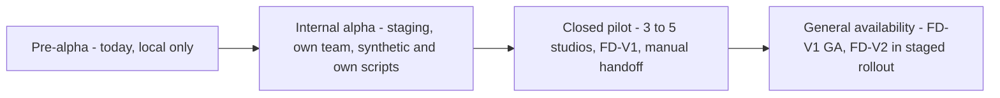

# Production Launch Plan

**Doc ID:** TFD-REL-002 · **Version:** 1.0-draft · **Date:** 2026-11-05 · **Status:** Phase B design — pending approval
**Inputs:** `docs/audit/01` §6 (headline assessment), `02` · `RELEASE_READINESS_CHECKLIST.md` · `docs/engineering/NON_FUNCTIONAL_REQUIREMENTS.md`, `DEPLOYMENT_AND_DEVOPS.md`, `DATA_PRIVACY_AND_RETENTION.md` · `docs/product/PRODUCT_ROADMAP.md` (peer doc) · approval gates #1–#7 (`docs/audit/10` §4)

---

## 0. Current state: PRE-ALPHA

Tattva AI Film Director is **pre-alpha** as of 2026-11-05 and **must not be presented as production-ready** (`docs/audit/01` §6):
- **No authentication.** Identity is an unauthenticated header (SEC-01) and the dev fallback is on by default (SEC-02).
- **No deployment exists:** no Dockerfile, no CI, no staging, no backups.
- **No real AI.** All generators are deterministic or mocked. No provider integration exists.
- 3 deterministic vertical slices work locally (WF-01..WF-03); the 4th (WF-04 Film Bible) is broken WIP.
- **Tests:** 47 pass / 5 fail / 1 error; mypy reports 321 errors and is not gated.
- Nothing has been load-tested or measured.

It must not be exposed on any network or loaded with real customer or performer data until the internal-alpha entry criteria are met.

## 1. Stages

### Stage 1: Internal alpha

| | Criteria |
|---|---|
| **Entry** | Foundation gates F-01…F-14 passed (Checklist §1). Gate #1 (DEC-002 auth) and #3 (DEC-010 G-04) approved. Staging environment built from IaC (DEC-001/003/008 chosen for staging). Backups enabled |
| **Scope** | Tattva team only. FD-V1 intelligence slices on the Streamlit surface. Mock or deterministic generators, clearly labelled. Real model calls only after DEC-004 (gate #4), with a capped budget |
| **Data allowed** | Synthetic data; scripts owned by Tattva. **No real performer data (C4)** |
| **Exit** | 2 weeks of use with 0 SEV-1/SEV-2 open. First restore drill passed (V1-G15). Baseline golden-set evals recorded. k6 load at expected tier meets NFR-LAT and NFR-JOB. Screenplay lock and manual handoff loop functional (V1-G06, V1-G11). 0 Critical/High security findings |

### Stage 2: Closed pilot (FD-V1)

| | Criteria |
|---|---|
| **Entry** | All FD-V1 gates in the Checklist §2 passed and signed. Production environment separate from staging. Support model agreed (**OPEN — DEC-026**: business hours, 99.5 %). DPIA started. Either DEC-007/DEC-012 approved, or C4 features remain flagged off. Pilot agreement covers data use, retention and the absence of guarantees on AI output quality |
| **Scope** | 3–5 invited studios, FD-V1 including the manual provider handoff (no connected generation). Each studio is onboarded by the team, with one named contact |
| **Measures** | Measured NFRs (replace the assumptions in the capacity plan); `usage_records`-based cost per project; eval scores on pilot data (with consent purpose `evaluation` only); weekly feedback review |
| **Exit** | 8 weeks with: availability ≥ 99.5 % in support hours; no data-isolation incident; no consent incident; ≥ 1 complete film pre-production blueprint per studio produced (locked screenplay → shots → packages → manual import → review); go/no-go review by Prod + Eng + Sec + Legal |

### Stage 3: General availability

| | Criteria |
|---|---|
| **Entry** | Pilot exit passed. NFR targets for GA met (99.9 % with on-call, RPO ≤ 5 min, RTO ≤ 1 h). SSO decision made (ADR-003 open item). Self-serve org onboarding with membership management. Incident runbook exercised in a game day. Pricing approved (outside this doc; cost model provides the inputs) |
| **FD-V2 rollout** | Connected generation only through per-provider flags (`FF_PROVIDER_<ID>_CONNECTED`) after FD-V2 gates (Checklist §3). Start with the DEC-013 pilot provider for consenting pilot studios. Manual mode remains available everywhere |
| **Exit / steady state** | Quarterly restore drills; monthly security review; eval regression dashboards; capacity re-plan each quarter from measured `usage_records` |

## 2. Rollback and abort criteria

| Stage | Abort trigger | Action |
|---|---|---|
| Alpha | Any auth bypass, or cross-tenant read | Freeze staging; fix; re-run the F-gates |
| Pilot | SEV-1 data or consent incident (Incident runbook) | Suspend affected org(s); notify per the incident runbook; Legal decides on continuation |
| Pilot | Availability < 99 % for two consecutive weeks | Stop onboarding new studios; reliability sprint |
| GA / FD-V2 | Provider overspend or duplicate paid submissions | Disable `FF_PROVIDER_*` for the provider (manual mode stays); reconcile; postmortem |

## 3. Communication

- Pilot studios receive release notes per deploy (from the tagged release), a status page or channel for incidents, and a named contact.
- Every UI surface states when output comes from a mock or deterministic generator (NFR-UX-02) until real models are live and evaluated.
- No marketing or sales claim of AI quality, cost or performance without the evidence required by the Checklist.
